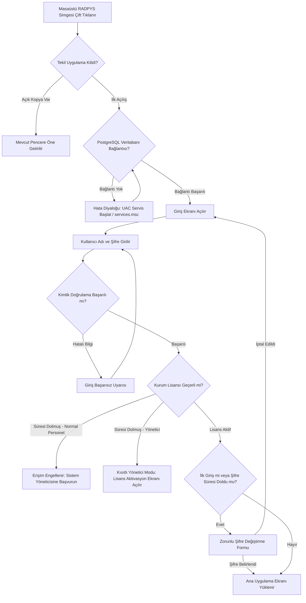

---json
{
  "pageTitle": "01. Kurulum, Başlatma ve İlk Giriş — RADPYS v4 Kullanım Kılavuzu",
  "h1": "Kurulum, Başlatma ve İlk Giriş",
  "lead": "RADPYS masaüstü uygulamasını güvenli tekil kilit altında başlatma, veritabanı motoru kontrolleri, ilk girişte zorunlu geçici şifre değişimi, Evrensel Arama Komut Paleti (Ctrl+K), Bildirim Merkezi ve lisans aktivasyon sürecini yönetmenizi sağlar.",
  "overviewId": "overview",
  "badges": [
    {
      "text": "KVKK & Bilgi Güvenliği Uyumlu",
      "tone": "emerald"
    }
  ],
  "readingTime": "3 Dakika",
  "legalNote": "<strong>Yasal Güvence:</strong> Sağlık Bakanlığı Sağlıkta Kalite Standartları (SKS 6.1) ve KVKK 6698 Sayılı Kanun Madde 12 uyarınca yetkisiz erişimler kilitlenir."
}
---

## Kısa Reçete (20 Saniye Kuralı) {#quick-recipe}

:::recipe Kısa Reçete: İlk Giriş ve Şifre Güvenliği Tamamlama | 20 SANİYELİK AKIŞ
<strong>Yapılacak İşlem:</strong> Birim sorumlusundan aldığınız kullanıcı adı ve geçici şifre ile giriş yapın. Açılan zorunlu şifre penceresinde en az <strong>8 karakterli</strong> (büyük harf, küçük harf, rakam ve özel karakter içeren) yeni şifrenizi belirleyip <strong>[Kaydet]</strong> butonuna basın.

<strong>Sistem Güvencesi:</strong> Geçici şifre kalıcı olarak geçersiz kılınır; yetkili personel harici hiç kimse eski şifreyle hesabınıza erişemez ve tüm modüller yetkiniz dahilinde kullanıma açılır.

- [metric] Parola Politikası | Min. 8 Karakter | cyan
- [metric] Deneme Süresi | 30 Gün (Trial) | slate
- [metric] Erken Uyarı Eşiği | 15 Gün & 3 Gün | amber
- [metric] Platform | Masaüstü & Web | emerald
:::

## Kritik Sahada Yanlış Bilinen Kurallar (Mit Avcısı) {#myth-buster}

:::myth Kritik Sahada Yanlış Bilinen Kural (Mit Avcısı)
### Yanlış Algı:
<em>"Masaüstü simgesine tıkladım ama program açılmadı, sistem dondu veya hata verdi."</em>

### Gerçek Sistem Mantığı:
RADPYS veritabanı bütünlüğünü korumak için <strong>Tekil Örnek (Single Instance)</strong> kilidiyle çalışır. Program zaten simge durumunda veya arka planda açıksa ikinci bir kopya açılmaz; mevcut açık pencere doğrudan ekranın en önüne getirilir.
:::

## 5N1K Kural ve Ayar Çözümleme Tablosu {#matrix-5n1k}

 

 
Giriş ve başlangıç kontrollerinin amacı, çalışma mantığı ve kullanıcı etkileri

 

 

| NE? (Ekran Kontrolü) | NEDEN? (Amaç) | NASIL? (Çalışma Mantığı) | NE ZAMAN? (Tetiklenme) | KİM? (Kullanıcı Kitlesi) |
| --- | --- | --- | --- | --- |
| Kullanıcı Girişi  Kullanıcı Adı & Şifre | Sisteme yetkili kimlik doğrulamasıyla güvenli erişmek. | Bilgiler girilip <strong>[Giriş Yap]</strong> tıklanır. Enter tuşu otomatik olarak bu butonu tetikler. | Programa her girişte. | Tüm Personel |
| Beni Hatırla  Onay Kutusu | Kullanıcı adını tekrar tekrar yazma zahmetini ortadan kaldırmak. | Kullanıcı adını yerel bilgisayara kaydeder. Parola <u>asla</u> kaydedilmez; açılışta imleç doğrudan şifre kutusuna odaklanır. | Kişisel çalışma bilgisayarında. | Tüm Personel |
| Şifreyi Göster  Göz / Onay Kutusu | Şifre yazarken harf ve rakam hatalarını anında görmek. | Noktalı maskeli şifre görünümünü açık metne dönüştürür. | Şifre yazımında hata şüphesinde. | Tüm Personel |
| Zorunlu Şifre Değişimi  Açılır Güvenlik Formu | Geçici veya varsayılan şifreyle sistemde kalınmasını engellemek. | Yeni şifre iki kez girilir; kullanıcının sistemde kayıtlı kurumsal e-posta ve rol bilgileri korunarak şifresi güncellenir. İptal edilirse oturum açılmaz. | İlk girişte veya şifre süresi dolduğunda. | Yeni Tanımlanan Personel |
| Şifremi Unuttum?  Sıfırlama Bağlantısı | Kullanıcının e-posta doğrulamasıyla şifresini güvenle sıfırlaması. | Kullanıcı adı ve kayıtlı e-posta eşleştiğinde 6 haneli doğrulama kodu arka planda gönderilir (en fazla 5 deneme hakkı vardır). | Şifre unutulduğunda. | E-postası Kayıtlı Personel |
| Evrensel Arama (Ctrl+K)  Hızlı Komut Paleti | Menülerde aramadan istenen sayfaya veya personele 2 saniyede ulaşmak. | Klavyeden <strong>Ctrl+K</strong> tuşlarına basılır. En az 2 harf yazıldığında yetki ve lisans paketine uygun sayfalar, hızlı işlemler ve personel kartları listelenir (lisans kilit modunda devre dışıdır). | Hızlı işlem veya kayıt ararken. | Tüm Kullanıcılar |
| Bildirim Merkezi & Rozet  Sağ Üst Zil Simgesi | Nöbet devri, olay bildirimi ve dozimetre alarmlarını anında görmek. | Okunmamış bildirim varsa zil açık maviye boyanır ve sayı gösterir. Nöbet devir bildirimi doğrudan Kabul/Red onayını açar. | Yeni görev veya alarm geldiğinde. | Hedef Personel / Amir |
| Cihaz Kimliği & Lisans  Hakkında Penceresi | Kurum lisansını doğrulamak ve teknik destek paketi üretmek. | Cihaz Kimliği (Machine ID) kopyalanarak lisans alınır. Anahtar girilip aktifleştirilir. Log paketi tek tıkla masaüstüne ZIP'lenir. | Lisans kurulumunda veya destek talebinde. | Sistem Yöneticisi (Admin) |

## Başlatma ve Güvenli Giriş Süreç Akışı {#workflow}

 

## Kritik Ekran Görünümleri ve Kullanım Noktaları {#screenshots}

 [Kopyala] butonuyla kopyalanıp lisans anahtarı üretimi için sağlanır.")

## Adım Adım Operasyonel Eylem Akışı {#step-by-step}

 

 <strong class="text-slate-900 dark:text-white text-base block mb-2">Adım 1: Uygulamayı Başlatma & Giriş</strong>
 Masaüstünüzdeki <strong>RADPYS</strong> simgesine çift tıklayın. Kullanıcı adınızı ve şifrenizi girin. Kendi bilgisayarınızda çalışıyorsanız <strong>[Beni Hatırla]</strong> kutusunu işaretleyin ve <strong>[Giriş Yap]</strong> butonuna tıklayın.
 

 

 <strong class="text-slate-900 dark:text-white text-base block mb-2">Adım 2: İlk Şifrenizi Tanımlama</strong>
 Eğer ilk girişiniz ise ekrana gelen şifre değiştirme penceresinde en az 8 karakterli yeni şifrenizi belirleyin. Her iki kutuya aynı şifreyi yazdıktan sonra <strong>[Kaydet]</strong> butonuna basın. Oturumunuz ana ekranla açılacaktır.
 

 

 <strong class="text-slate-900 dark:text-white text-base block mb-2">Adım 3: Sayfalara ve Personele Hızlı Ulaşım (Ctrl+K)</strong>
 Herhangi bir ekrandayken klavyenizden <strong>Ctrl+K</strong> tuşlarına basın. Açılan kutuya personelin adını veya gitmek istediğiniz menüyü (Örn: *Nöbet*, *İzin*, *Dozimetre*) yazıp Enter'a basarak doğrudan o ekrana geçin.
 

 

 <strong class="text-slate-900 dark:text-white text-base block mb-2">Adım 4: Kurum Lisansını Aktifleştirme (Yalnızca Admin)</strong>
 Sağ üstteki menüden <strong>[Hakkında]</strong> penceresini açın. <strong>[Cihaz Kimliği]</strong> kodunuzu kopyalayıp lisans sağlayıcısına iletin. Size verilen anahtarı kutuya yapıştırıp <strong>[Lisansı Aktifleştir]</strong> butonuna basın.
 

 

 <strong class="text-slate-900 dark:text-white text-base block mb-2">Adım 5: Teknik Destek Paketi Oluşturma</strong>
 Sistemde beklenmeyen bir durumla karşılaşırsanız <strong>[Hakkında]</strong> penceresindeki <strong>[Destek Paketi (Log) Oluştur]</strong> butonuna tıklayın. Masaüstünüze kaydedilen <code>radpys_destek_log.zip</code> dosyasını teknik ekibe e-posta eki olarak gönderin.
 

 

## Sıkça Sorulan Sorular ve Takılma Yönetimi {#faq}

:::faq
### Şifremi unuttum, sisteme nasıl giriş yapabilirim?
Giriş ekranında yer alan <strong>[Şifremi Unuttum?]</strong> butonuna tıklayın. Kullanıcı adınızı ve sistemde kayıtlı e-posta adresinizi girerek yeni şifrenizi belirleyin. Sistemde tanımlı bir e-posta adresiniz yoksa birim sorumlunuza veya sistem yöneticinize başvurunuz; yönetici Kullanıcı Yönetimi ekranından tek tıkla geçici şifre atayabilir.

### Lisans süresi dolduğunda verilerimiz silinir mi?
<strong>Kesinlikle hayır.</strong> Lisans süresinin dolması yalnızca ekran erişimlerini kilitler; veritabanındaki nöbetler, personeller, dozimetre ve RKE kayıtları hiçbir şekilde silinmez veya bozulmaz. Sistem Yöneticisi yeni lisans anahtarını girdiği anda tüm sistem kaldığı yerden eksiksiz çalışmaya devam eder.

### Beni Hatırla seçeneğini işaretlediğimde şifrem bilgisayarda açık kalır mı?
Hayır. Güvenlik ve KVKK gereği <strong>[Beni Hatırla]</strong> seçeneği yalnızca kullanıcı adınızı depolar; parolanızı <u>kesinlikle</u> diske veya yerel ayarlara yazmaz. Her oturumda şifrenin elle yazılması zorunludur.

### PostgreSQL veritabanı bağlantı hatası alıyorum, ne yapmalıyım?
Uygulama açılışında gelen hata kutusundaki <strong>[Servisi Yönetici Olarak Başlat (UAC)]</strong> butonuna tıklayın ve Windows izin penceresine "Evet" deyin. Servis otomatik olarak başlatılacaktır. Sorun devam ederse Windows Hizmetler (<code>services.msc</code>) ekranından PostgreSQL servisinin durumunu kontrol ediniz.
:::
