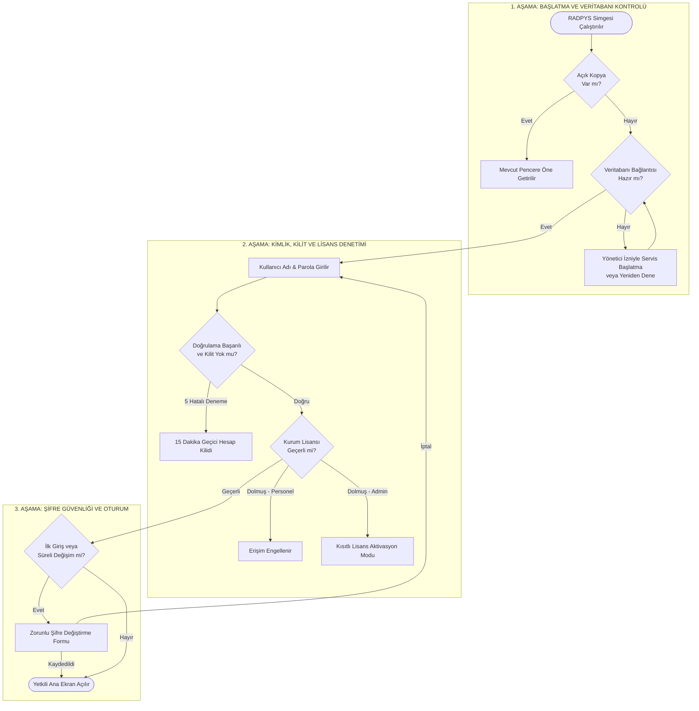

---json
{
  "pageTitle": "01. Kurulum, Başlatma ve İlk Giriş — RADPYS v4 Kullanım Kılavuzu",
  "h1": "Kurulum, Başlatma ve İlk Giriş",
  "lead": "RADPYS masaüstü ve Web Portalı oturumlarını güvenli tekil kilit altında başlatma, veritabanı servisi kontrolleri, ilk girişte zorunlu şifre yenileme, Evrensel Arama Komut Paleti (Ctrl+K), Bildirim Merkezi ve lisans aktivasyonunu yönetmenizi sağlar.",
  "overviewId": "overview",
  "badges": [
    {
      "text": "KVKK 6698 & SKS 6.1 Uyumlu",
      "tone": "emerald"
    }
  ],
  "readingTime": "3 Dakika",
  "legalNote": "<strong>Yasal Güvence:</strong> Sağlık Bakanlığı Sağlıkta Kalite Standartları (SKS 6.1) ve 6698 sayılı KVKK Madde 12 uyarınca yetkisiz erişimler ve zayıf parolalar otomatik olarak engellenir."
}
---

## Kısa Reçete: İlk Giriş ve Zorunlu Şifre Güncelleme {#quick-recipe}

:::recipe Kısa Reçete: İlk Giriş ve Zorunlu Şifre Güncelleme | 20 SANİYELİK AKIŞ

### 1. İstenen Sonuç | slate

Birim sorumlunuzdan veya yöneticiden aldığınız geçici şifreyi kalıcı ve güvenli kişisel parolanızla değiştirerek yetkili olduğunuz modülleri açmak.

### 2. Yapılacak İşlem | cyan

Kullanıcı adınız ve geçici parolanızla <strong>[Giriş Yap]</strong> butonuna basın. Açılan zorunlu şifre penceresinde en az <strong>8 karakter</strong> (büyük harf, küçük harf ve rakam) içeren yeni şifrenizi iki kez yazıp <strong>[Kaydet]</strong> butonuna tıklayın.

### 3. Sistem Etkisi | emerald

Geçici şifre kalıcı olarak iptal edilir; yeni şifre yalnızca size özel şifrelenerek kaydedilir ve yetkiniz dahilindeki tüm ekranlar kullanıma açılır.

- [metric] Parola Politikası | Min. 8 Karakter | cyan
- [metric] Deneme Süresi | 30 Gün | slate
- [metric] Erken Uyarı Eşiği | 15 Gün & 3 Gün | amber
- [metric] Platform | Masaüstü & Web Portal | emerald
:::

## 5N1K Kural ve Arayüz Çözümleme Tablosu {#5w1h}

*Giriş ekranı güvenlik kalkanları, şifre sıfırlama sınırları ve bildirim kontrolleri.*

| NE? (Bileşen / Kontrol) | NEDEN? (Amacı) | NASIL? (Çalışma Mantığı) | NE ZAMAN? (Tetiklenme) | KİM? (Yetkili Rol) |
| --- | --- | --- | --- | --- |
| <strong>[Beni hatırla]</strong> Onay Kutusu | Kullanıcı adını her oturumda tekrar yazma zahmetini kaldırmak. | Yalnızca kullanıcı adını yerel bilgisayarda saklar; parolayı asla diske kaydetmez. | Kişisel çalışma bilgisayarından giriş yapıldığında. | Tüm Personel |
| <strong>[Şifreyi göster]</strong> Onay Kutusu | Yazım sırasında büyük/küçük harf ve rakam hatasını anlık görmek. | İşaretlendiğinde noktalı maskeli parola kutusunu açık metne çevirir. | Giriş veya yeni şifre belirleme sırasında. | Tüm Personel |
| <strong>Hatalı Giriş Kilidi</strong> Otomatik Güvenlik Kalkanı | Deneme-yanılma yoluyla yetkisiz hesap ele geçirmelerini önlemek. | Varsayılan olarak art arda 5 hatalı parola girişinde hesabı 15 dakika süreyle kilitler (yönetici kilidi anında açabilir). | Parola üst üste hatalı girildiğinde. | Tüm Kullanıcılar |
| <strong>[Şifremi Unuttum?]</strong> 3 Aşamalı Sıfırlama Sihirbazı | E-posta doğrulamasıyla unutulan parolayı self-servis yenilemek. | Kayıtlı e-postaya 15 dakika geçerli 6 haneli kod gönderir (5 hatalı kod denemesinde kod iptal edilir; Web Portalda yalnızca yerel ağda çalışır). | Parola unutulduğunda. | E-postası Kayıtlı Personel |
| <strong>Bildirim Merkezi & Rozet</strong> Sağ Üst Zil Simgesi | Nöbet devri, onay kuyruğu ve dozimetre uyarılarını anlık yakalamak. | Okunmamış uyarı varken zil simgesi arka planda güncellenerek rozet gösterir; nöbet devri bildiriminden doğrudan onay penceresi açılır. | Yeni görev veya uyarı geldiğinde. | Hedef Personel / Yönetici |
| <strong>[Onay Bekleyenler] Rozeti & Kapanış Güvenliği</strong> Birim Kapsamlı Sayaç ve Oturum Sonlandırma | Yalnızca yetkili olunan gerçek onay yükünü göstermek ve açık oturum bırakmamak. | Rozet sayacı yalnızca kullanıcının yetkili olduğu birim, vardiya devir aşaması ve tutanakları arka planda sayar; ana pencere kapatıldığında aktif oturum otomatik sonlandırılır. | Oturum açıkken ve pencere kapatıldığında. | Birim Sorumlusu / Yönetici / Tüm Kullanıcılar |
| <strong>Parola Sıfırlama Gizlilik Koruması</strong> Şifremi Unuttum Ekranı | Kötü niyetli kişilerin kurum personel hesaplarını tespit etmesini önlemek. | Girilen kullanıcı adının sistemde var olup olmadığına bakılmaksızın tekil bilgilendirme gösterir; yalnızca geçerli hesaba e-posta kodu iletilir. | Şifremi unuttum sihirbazı kullanıldığında. | E-postası Kayıtlı Personel |
| <strong>Anında Oturum İptali &amp; Hesap Kilit Senkronu</strong> Güvenlik Otomasyonu | Parolası yenilenen veya kilitlenen personelin açık oturumlarını derhal sonlandırmak. | Parola değişimi, lisans süresi dolumu veya hesap kilitlenmesi anında kullanıcının tüm açık bilgisayarlardaki aktif oturumları anında düşürülür. | Parola değiştiğinde veya hesap kilitlendiğinde. | Sistem Güvenlik Kilidi |
| <strong>Dinamik Parola Politikası Rehberi</strong> [Şifre Değiştir] Penceresi | Kullanıcıların aktif kurum şifre kurallarını tahmin etmek yerine tek bakışta görmesini sağlamak. | Sistem ayarlarındaki en az karakter uzunluğu ile büyük harf, küçük harf, rakam ve özel karakter zorunluluklarını dinamik olarak biçimlendirip form üzerinde gösterir. | İlk giriş veya parola yenileme ekranı açıldığında. | Tüm Kullanıcılar |

## Kritik Sahada Yanlış Bilinen Kurallar (Mit Avcısı) {#myth-buster}

:::myth Masaüstü Simgesine Tıkladım Ama İkinci Pencere Açılmadı

### Yanlış Algı

<em>"Masaüstü simgesine tıkladım ama program açılmadı, sistem dondu veya hata verdi."</em>

### Gerçek Sistem Mantığı

<strong>Tekil Uygulama Kilidi aktiftir.</strong> RADPYS veritabanı bütünlüğünü korumak için aynı bilgisayarda yalnızca tek bir örnek altında çalışır. Program zaten açık veya simge durumundaysa ikinci bir kopya başlatılmaz; mevcut açık pencere doğrudan ekranın en önüne getirilir.
:::

## Süreç Akış Şeması {#workflow}

1. **Başlatma ve Veritabanı Kontrolü:** Program tekil kilit altında açılır; veritabanı motoru durmuşsa kullanıcıya tek tıkla yönetici yetkisiyle servisi başlatma seçeneği sunulur.
2. **Kimlik, Kilit ve Lisans Denetimi:** 5 hatalı girişte hesap 15 dakika kilitlenir; lisansı dolan kurumda normal kullanıcı girişi engellenirken Sistem Yöneticisi için yalnızca lisans yükleme ekranı açılır.
3. **Şifre Güvenliği ve Oturum Açılışı:** İlk girişte zorunlu şifre değişimi tamamlanmadan ana ekrana geçilmez; onaylandığında yetki ve kapsam matrisine uygun modüller yüklenir.

## Arayüz Ekran Görünümleri {#screenshots}

## Adım Adım İşlem Rehberi {#step-by-step}

### 1. Masaüstü Uygulamasında Hızlı Arama (Ctrl+K), Lisans Aktivasyonu ve Destek Paketi

1. Oturum açtıktan sonra herhangi bir ekrandayken klavyeden **Ctrl+K** tuşlarına basın; en az 2 harf yazarak yetkili olduğunuz modüllere veya personel kayıtlarına doğrudan geçiş yapın.
2. Kurum lisansını etkinleştirmek için yöneticinizle **[Hakkında]** penceresindeki **[Lisans ve Aktivasyon]** sekmesini açın ve **[Cihaz Kimliği (Machine ID)]** yanındaki **[Kopyala]** butonuna basın.
3. Size iletilen lisans dosyasını **[Lisans Dosyası Seç (.lic)]** butonuyla yükleyin veya anahtar kodunu yapıştırıp **[Lisansı Aktifleştir]** butonuna tıklayın (aktif lisansta yenileme için **[Lisansı Güncelle / Yeni Dosya Seç (.lic)]** butonunu kullanın).
4. Teknik destek gerektiğinde **[Hakkında]** penceresindeki **[Destek Paketi (ZIP)]** butonuna basarak Masaüstünüze oluşturulan destek arşivini teknik ekibe iletin.

### 2. Web Portalı Girişi ve Dış Ağ İki Aşamalı Doğrulaması

1. Kurum içi veya dış ağ tarayıcınızdan **Web Portalı** giriş ekranını açıp kullanıcı adınız ve parolanızla giriş yapın.
2. İlk kez giriş yapıyorsanız açılan zorunlu şifre belirleme formunda yeni parolanızı tanımlayın.
3. Hastane dış ağından bağlanıyorsanız ekrandaki güvenlik doğrulamasını tamamlayın; kurumsal 2FA açıksa e-posta adresinize gelen 6 haneli tek kullanımlık doğrulama kodunu girerek oturumu açın.

## Sıkça Sorulan Sorular (SSS) {#faq}

:::faq

### Veritabanı bağlantı hatası aldığımda ne yapmalıyım?

Açılışta ekrana gelen uyarı penceresinde yönetici izniyle servisi başlatma seçeneğine tıklayıp Windows izin onayını verin. Servis otomatik başlatılamazsa Windows Hizmetler ekranından PostgreSQL hizmetinin çalışır durumda olduğunu kontrol edin.

### Lisans süresi dolduğunda kayıtlı verilerimiz silinir mi?

<strong>Kesinlikle hayır.</strong> Lisans süresinin dolması yalnızca modül ekranlarını kilitler; nöbet çizelgeleri, personel özlük kartları, dozimetre ve cihaz kayıtları veritabanında eksiksiz korunur. Yönetici yeni lisansı yüklediği anda tüm sistem kaldığı yerden açılır.

### Sistemde kayıtlı e-postam yoksa veya dış ağdaysam şifremi nasıl sıfırlarım?

Güvenlik gereği Web Portalındaki <strong>[Şifremi Unuttum?]</strong> sihirbazı yalnızca hastane yerel ağında aktiftir ve sistemde e-posta adresi tanımlı kullanıcılar için çalışır. E-postanız kayıtlı değilse veya dış ağdaysanız Sistem Yöneticinize başvurarak yeni geçici şifre talep ediniz.
:::
