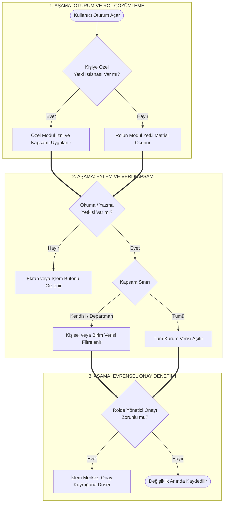

---json
{
  "pageTitle": "02. Kullanıcı, Rol ve Birim Sorumluluk Yönetimi (RBAC) — RADPYS v4 Kullanım Kılavuzu",
  "h1": "Kullanıcı ve Rol Yönetimi",
  "lead": "Rol Tabanlı Erişim Kontrolü (RBAC), modül düzeyinde 4 kademeli veri kapsamı (Miras, Kendisi, Departman, Tümü), kişiye özel yetki istisnaları, rol bazlı yönetici onay zorunluluğu ve birim sorumlusu ile saha görev tahsisini yönetmenizi sağlar.",
  "overviewId": "overview",
  "badges": [
    {
      "text": "SKS 6.1 & Bilgi Güvenliği Uyumlu",
      "tone": "emerald"
    }
  ],
  "readingTime": "4 Dakika",
  "legalNote": "<strong>Yasal Güvence:</strong> Kullanıcılar ve roller hiçbir zaman fiziksel olarak silinmez; pasife alınan hesapların geçmişte onayladığı tüm işlemler denetim izinde kalıcı olarak korunur."
}
---

## Kısa Reçete: Yeni Kullanıcı Açma ve Birim Sorumlusu Atama {#quick-recipe}

:::recipe Kısa Reçete: Yeni Kullanıcı Açma ve Birim Sorumlusu Atama | 20 SANİYELİK AKIŞ

### 1. İstenen Sonuç | slate

Yeni başlayan personele sağlık özlük kartıyla bağlantılı kullanıcı hesabı tanımlamak ve departman sorumlusunu veya saha görevlerini belirlemek.

### 2. Yapılacak İşlem | cyan

<strong>[Kullanıcı İşlemleri]</strong> sekmesinde <strong>[Yeni Kullanıcı]</strong> butonuna basıp rol ve <strong>[Personel Bağlantısı]</strong> seçimini kaydedin. Ardından <strong>[Birim Sorumlulukları]</strong> sekmesinden departmanı seçip <strong>[Sorumluyu Değiştir]</strong> veya <strong>[Görev Ata]</strong> butonunu kullanın.

### 3. Sistem Etkisi | emerald

Kullanıcı yalnızca yetkili olduğu modüllere ve veri kapsamına erişir; departmana tek asli birim sorumlusu atanır ve RKE, Cihaz, Dozimetre, Ortam Dozu ile Eğitim saha görevleri personellere dağıtılır.

- [metric] Erişim Modeli | RBAC & 4 Kapsam | cyan
- [metric] Yetkili Rol | Sistem Yöneticisi | slate
- [metric] Şifre Kuralı | Min. 8 Karakter | amber
- [metric] Platform | Masaüstü Kokpit | emerald
:::

## 5N1K Kural ve Arayüz Çözümleme Tablosu {#5w1h}

*Kullanıcı yönetimi, rol yetki matrisi ve güvenlik kilitlerinin operasyonel kuralları.*

| NE? (Bileşen / Kontrol) | NEDEN? (Amacı) | NASIL? (Çalışma Mantığı) | NE ZAMAN? (Tetiklenme) | KİM? (Yetkili Rol) |
| --- | --- | --- | --- | --- |
| <strong>[Personel Bağlantısı]</strong> Kullanıcı Formu Açılır Kutusu | Giriş hesabını sağlık personelinin özlük siciliyle eşleştirmek. | Bağlantı kurulmazsa hesap yalnızca operatör olur; nöbet, izin ve dozimetre listelerinde görünmez. | Kullanıcı oluşturulurken veya güncellenirken. | Sistem Yöneticisi |
| <strong>[Aktif/Pasif] ve Hesap Kilitleri</strong> Güvenlik Kalkanı | Kurumu yöneticisiz bırakmamak ve geçmiş izleri korumak. | Kendi hesabını/Admin'i pasife alma, yerleşik sistem rollerini silme ve bağlı kullanıcısı olan rolü silme otomatik engellenir. | Pasife alma veya rol silme girişiminde. | Sistem Yöneticisi / Sistem Kilidi |
| <strong>[Değişiklikler Yönetici Onayı Gerektirir]</strong> Rol Formu Onay Kutusu | Kontrollü rollerin kritik veri değişikliklerini çapraz onaydan geçirmek. | İşaretli roldeki kullanıcının kayıt ekleme, güncelleme veya silme işlemleri doğrudan yazılmayıp Merkezi Onay paneline sevk edilir. | Rol tanımlanırken ve veri kaydedilirken. | Sistem Yöneticisi / Onay Amiri |
| <strong>Okuma Bağımlılık Zinciri</strong> Modül Yetki Matrisi | Görüntüleme hakkı olmayan modülde yazma veya silme açılmasını önlemek. | Yazma, Güncelleme veya Silme kutusu işaretlendiğinde Okuma otomatik açılır; Okuma kapatıldığında tümü kapanır. | Rol veya özel yetki kutuları işaretlenirken. | Sistem Yöneticisi |
| <strong>4 Kademeli Veri Kapsamı</strong> Miras / Kendisi / Departman / Tümü | Modül bazında kullanıcının göreceği kayıt sınırını belirlemek. | Miras seçilirse rolün genel kapsamı uygulanır; istenen modüller için yalnızca kendi sicili, birimi veya tüm kurum seçilir. | Modül yetkisi yapılandırılırken. | Sistem Yöneticisi |
| <strong>[Kişiye Özel Yetkiler]</strong> İstisna Paneli | Kullanıcının ana rolünü değiştirmeden tekil modüllerde özel izin veya kapsam vermek. | Özel İzin kutusuyla seçili modülün izin ve kapsamı değiştirilir; <strong>[Role Dön (İstisnaları Kaldır)]</strong> ile rol varsayılanına dönülür. | Personele rolü dışında ek veya kısıtlı yetki gerektiğinde. | Sistem Yöneticisi |
| <strong>Rol ve Durum Rozetleri</strong> Tablo Göstergeleri | Yetki seviyesini ve hesap aktifliğini listede tek bakışta ayırt etmek. | Kullanıcı ve rol listelerinde yetki düzeyleri (Admin, Yönetici, Birim Sorumlusu, Kullanıcı) ve aktiflik durumu renkli rozetlerle gösterilir. | Kullanıcı veya rol listesi incelenirken. | Sistem Yöneticisi |

## Kritik Sahada Yanlış Bilinen Kurallar (Mit Avcısı) {#myth-buster}

:::myth Ayrılan Personelin Hesabını Kapatırsam Onayladığı Kayıtlar Silinir mi?

### Yanlış Algı

<em>"İşten ayrılan personelin kullanıcı hesabını kapattığımda geçmişte onayladığı nöbetler ve girdiği dozimetre ölçümleri sistemden silinir veya bozulur."</em>

### Gerçek Sistem Mantığı

<strong>Hiçbir geçmiş kayıt silinmez.</strong> <strong>[Aktif/Pasif]</strong> işlemi kullanıcının sisteme giriş yetkisini durdurur ancak personel kartını veya onay geçmişini silmez. Geçmişte onaylanan nöbetler, dozimetre verileri ve denetim izleri veritabanında eksiksiz korunur.
:::

## Süreç Akış Şeması {#workflow}

1. **Oturum ve Rol Çözümleme:** Kullanıcı giriş yaptığında önce kişiye özel modül istisnaları, yoksa bağlı olduğu rolün yetki matrisi yüklenir.
2. **Eylem ve Veri Kapsamı:** Okuma izni olmayan modüller gizlenir; yetkili modüllerde kayıtlar seçilen kapsam sınırına (Kendisi, Departman veya Tümü) göre süzülür.
3. **Evrensel Onay Denetimi:** Rolünde yönetici onayı zorunlu tutulan kullanıcıların kritik veri değişiklikleri doğrudan uygulanmayıp Merkezi Onay paneline yönlendirilir.

## Arayüz Ekran Görünümleri {#screenshots}

## Adım Adım İşlem Rehberi {#step-by-step}

### 1. Kullanıcı Hesabı Kilit Açma ve Kişiye Özel Yetki İstisnası Tanımlama

1. **[Kullanıcı ve Rol Yönetimi] > [Kullanıcı İşlemleri]** sekmesinden arama kutusu veya durum/rol filtreleriyle ilgili kullanıcıyı bulun.
2. Hatalı şifre denemesiyle bloke olmuş bir kullanıcıyı seçip araç çubuğundaki **[Kilidi Kaldır]** butonuna basarak hesabı anında açın.
3. Rolünü değiştirmeden belirli modüllerde farklı izin veya kapsam vermek için satırı seçip **[Kişiye Özel Yetkiler]** panelini açın; ilgili modülde özel izin kutusunu işaretleyip izinleri ayarladıktan sonra **[Özel Yetkileri Kaydet]** butonuna tıklayın.

### 2. Rol Oluşturma, Klonlama, Şablon Uygulama ve Karşılaştırma

1. **[Roller ve Yetkiler]** sekmesine geçin; sıfırdan rol tanımlamak için **[Yeni Rol Ekle]** butonunu kullanın veya mevcut bir rolün yetkilerini devralmak için **[İşlemler] > [Rolü Kopyala]** seçeneğini tıklayın.
2. Matrisi tek tek işaretlemek yerine üstteki **[Şablon Uygula]** açılır kutusundan hazır bir profil (*Sadece Okuma*, *Operasyon* veya *Tam Yetki*) uygulayıp gerekli modüllerde kapsamı özelleştirin ve **[Kaydet]** butonuna basın.
3. İki rol arasındaki izin ve kapsam farklarını denetlemek için **[Karşılaştır]** butonuna tıklayıp farklı satırları vurgulu görünümde inceleyin.

### 3. Birim Sorumlusu ve Saha Görev Tahsisi Yapma

1. **[Birim Sorumlulukları]** sekmesinde sol listeden ilgili departmanı seçin (dilerseniz **[Sadece Yöneticiler]** filtresini kullanın).
2. Departmanın asli amirini belirlemek için sağ listeden personeli seçip **[Sorumluyu Değiştir]** butonuna tıklayın.
3. RKE Muayene, Cihaz Bakım/Arıza, Ortam Dozu, Dozimetre veya Eğitim saha görevlerini iş yükünü paylaşacak personellere atamak için **[Görev Ata]** butonunu kullanın; görevi geri almak için **[Görevi Kaldır]** butonuna basın.

## Sıkça Sorulan Sorular (SSS) {#faq}

:::faq

### Kullanımda olmayan bir rolü silmeye çalıştığımda sistem neden izin vermiyor?

Silmek istediğiniz role halen bağlı aktif veya pasif kullanıcı hesapları varsa sistem veri tutarlılığını korumak için silme işlemini engeller. Önce <strong>[Kullanıcı İşlemleri]</strong> sekmesinden o kullanıcıları başka bir role aktarın; ardından rolü silebilirsiniz. Yerleşik sistem rolleri (Admin, Yönetici, Kullanıcı, İzleyici) ise hiçbir zaman silinemez.

### "Miras" kapsamı seçildiğinde personelin veri görme sınırı nasıl belirlenir?

Modül yetki tablosundaki <strong>Miras</strong> seçeneği, ilgili modülün bağlı olduğu rolün genel veri kapsamını (Kendisi, Departman veya Tümü) otomatik olarak uygulamasını sağlar. Yalnızca belirli bir modülde farklı sınır gerekiyorsa o satırın radyo butonunu doğrudan <strong>[Kendisi]</strong>, <strong>[Departman]</strong> veya <strong>[Tümü]</strong> yapabilirsiniz.

### Birim Sorumlusu atamasını neden Departman Tanımları penceresinde göremiyorum?

Departman hiyerarşisi ile yetki yönetimini birbirinden ayırmak amacıyla birim sorumlusu ve saha görevlisi (RKE, Cihaz, Ortam Dozu, Dozimetre, Eğitim) atamaları <strong>[Kullanıcı ve Rol Yönetimi] > [Birim Sorumlulukları]</strong> sekmesinde merkezileştirilmiştir.
:::
