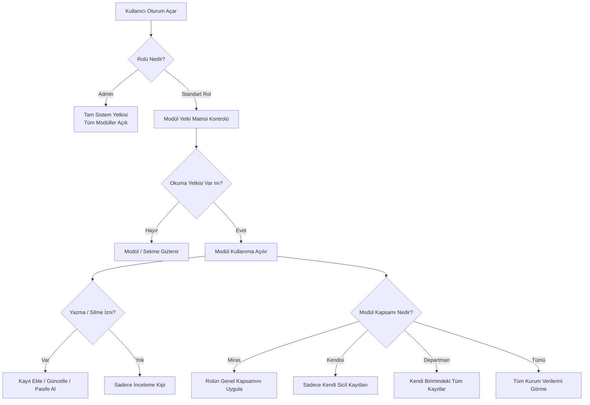

---json
{
  "pageTitle": "02. Kullanıcı, Rol ve İzin Yönetimi (RBAC) — RADPYS v4 Kullanım Kılavuzu",
  "h1": "Kullanıcı ve Rol Yönetimi",
  "lead": "Rol Tabanlı Erişim Kontrolü (RBAC), modül düzeyinde 4 kademeli yetki ve veri kapsamı matrisi (Miras, Kendisi, Departman, Tümü), hatalı şifreyle kilitlenen personelin hesap kilidini kaldırma ve güvenli rol klonlama işlemlerini yönetmenizi sağlar.",
  "overviewId": "overview",
  "badges": [
    {
      "text": "SKS 6.1 & Bilgi Güvenliği Uyumlu",
      "tone": "emerald"
    }
  ],
  "readingTime": "4 Dakika"
}
---

## Kısa Reçete (20 Saniye Kuralı) {#quick-recipe}

:::recipe Kısa Reçete: Yeni Kullanıcı Açma ve Departman Yetkisi Atama | 20 SANİYELİK AKIŞ
<strong>Yapılacak İşlem:</strong> <strong>[Kullanıcı İşlemleri]</strong> sekmesinden <strong>[Yeni Kullanıcı]</strong> butonuna tıklayın; kullanıcı adı, e-posta, kurumdaki görevine uygun rolü ve sağlık personeli ise <strong>[Personel Bağlantısı]</strong>'nı seçerek en az 8 karakterli geçici şifresini kaydedin. Birim amirlerini ve saha görevlerini (RKE muayene, cihaz bakım, ortam dozu, dozimetre, eğitim) atamak için <strong>[Birim Sorumlulukları]</strong> sekmesinden ilgili departmanı seçip <strong>[Sorumluyu Değiştir]</strong> veya <strong>[Görev Ata]</strong> butonunu kullanın.

<strong>Sistem Güvencesi:</strong> Personelin nöbet, izin ve dozimetre takipleri doğrudan özlük kartıyla entegre olur; her departmanın yalnızca bir asli <strong>Departman Sorumlusu</strong> bulunur ve saha iş yükünü paylaşmak üzere seçilen personellere görev tahsisi (delegasyon) yapılabilir.

- [metric] Erişim Modeli | RBAC & Kapsam | cyan
- [metric] Yetkili Rol | Sistem Yöneticisi | slate
- [metric] Şifre Kuralı | Min. 8 Karakter | amber
- [metric] Platform | Masaüstü | emerald
:::

## Kritik Sahada Yanlış Bilinen Kurallar (Mit Avcısı) {#myth-buster}

:::myth Kritik Sahada Yanlış Bilinen Kural (Mit Avcısı)
### Yanlış Algı:
<em>"İşten ayrılan personelin hesabını sildim, geçmişe ait onayladığı nöbetler ve girdiği dozimetre ölçümleri sistemden silindi veya bozuldu."</em>

### Gerçek Sistem Mantığı:
RADPYS'de fiziksel veri silme işlemi <strong>yoktur</strong>. Arayüzdeki eylemler kullanıcı hesabını kalıcı olarak silmez, doğrudan <strong>Pasif</strong> durumuna alır. Personelin onayladığı nöbetler, kaydettiği radyasyon ölçümleri ve tüm denetim izi geçmişi veri tabanında eksiksiz ve yasal olarak korunur.
:::

## 5N1K Kural ve Ayar Çözümleme Tablosu {#matrix-5n1k}

 

 

 Kullanıcı yönetimi, sistem rolleri ve yetki matrisindeki tüm kontrollerin operasyonel kuralları.
 

 

 

 

| NE? (Ekran Kontrolü) | NEDEN? (Amacı) | NASIL? (Çalışma Mantığı) | NE ZAMAN? | KİM? |
| --- | --- | --- | --- | --- |
| Yeni Kullanıcı Tanımlama  [Yeni Kullanıcı Butonu] | Personele sisteme giriş hakkı vermek. | Kullanıcı adı, ad soyad, rol ve en az 8 karakterli ilk şifre girilerek kaydedilir. | Yeni personel göreve başladığında. | Sistem Yöneticisi |
| Personel Bağlantısı  [Personel Bağlantısı Açılır Kutusu] | Kullanıcıyı sağlık özlük kartına bağlamak. | Listeden personel seçilir. Bağlantı kurulmazsa hesap yalnızca operatör olur; nöbet ve dozimetreye giremez. | Sağlık personeline hesap tanımlanırken. | Sistem Yöneticisi |
| Hesap Kilidini Kaldırma  [Kilidi Kaldır Butonu] | Hatalı şifreyle kilitlenen hesabı açmak. | Kilitli kullanıcı seçilip butona basılır; hatalı deneme sayacı ve zaman kilidi anında sıfırlanır. | Personel şifresini art arda yanlış girip bloke olduğunda. | Sistem Yöneticisi |
| Hesabı Pasife Alma  [Aktif/Pasif Butonu] | Yetkiyi dondururken geçmiş kayıtları korumak. | Kullanıcı seçilip pasife alınır. Personelin İK çalışma durumu etkilenmez; yalnızca sistem oturum yetkisi kapatılır ve işlem izi korunur. | Personel ayrıldığında veya yetkisi durdurulduğunda. | Sistem Yöneticisi |
| Kendi Hesabını ve Admin'i Koruma  [Sistem Güvenlik Kilidi] | Sistemin yöneticisiz kalmasını engellemek. | Açık oturum sahibi kendi hesabını pasife alamaz. Yerleşik sistem rolleri (Admin, Yönetici, Kullanıcı, İzleyici) silinemez veya yeniden adlandırılamaz; Admin rolünün yetkileri kısıtlanamaz. | Yanlışlıkla işlem yapılmaya çalışıldığında. | Otomatik Kilit |
| Rol Klonlama (Kopyalama)  [İşlemler > Seçileni Kopyala] | Mevcut bir rolün tüm yetkilerini çoğaltmak. | Kaynak rolün tüm modül okuma/yazma/silme ve kapsam ayarları yeni role birebir aktarılır. | Benzer yetkilere sahip yeni bir unvan profili oluşturulurken. | Sistem Yöneticisi |
| Okuma Yetkisi Bağımlılık Motoru  [Yetki Matrisi Onay Kutuları] | Mantıksız yetki dağılımlarını önlemek. | Yazma, Güncelleme veya Silme açılınca Okuma zorunlu açılır; Okuma kapatılınca tümü anında kapanır. | Yetki kutuları işaretlenirken. | Sistem Yöneticisi |
| Modül Düzeyinde Kapsam (Scope)  [Miras / Kendisi / Departman / Tümü] | Veri görme sınırını modül bazında özelleştirmek. | Miras seçilirse rolün genel ayarı geçerli olur; istendiğinde belirli modüller 'Kendi Departmanı' veya 'Tümü'ne genişletilir. | Modül bazlı özel veri kısıtlaması gerektiğinde. | Sistem Yöneticisi |
| Hazır Yetki Şablonları  [Şablon Uygula Açılır Kutusu] | Matrisi saniyeler içinde doldurmak. | "Sadece Okuma", "Operasyon" veya "Tam Yetki" şablonu tüm modül satırlarına topluca uygulanır. | Yeni bir role hızlı yetki atarken. | Sistem Yöneticisi |
| Roller Arası Canlı Kıyaslama  [Karşılaştır Butonu] | İki rol arasındaki yetki farklarını denetlemek. | Seçilen hedef rol ile mevcut durum kıyaslanır; yetki farkı olan satırlar renkli olarak vurgulanır. | Yetki çakışmalarını tespit ederken. | Sistem Yöneticisi |
| Görsel Durum ve Rol Rozetleri  [Tablo Rozet Göstergeleri] | Kullanıcıların rol seviyelerini ve hesap durumlarını tek bakışta ayırt etmek. | Kullanıcı tablosunda rol sütunu yetki türüne göre simgeli ve renkli rozetle (Kırmızı Admin, Sarı Yönetici, Mavi Birim Sorumlusu, Nötr Kullanıcı); hesap aktifliği ise yeşil [Aktif] veya gri [Pasif] rozetle gösterilir. | Kullanıcı ve rol listesi incelenirken. | Sistem Yöneticisi |
| Kişiye Özel Yetki İstisnaları  [Özel İzin Kutusu &amp; Özel Yetkileri Kaydet] | Kullanıcının rolünü değiştirmeden belirli modüllerde kişiye özel yetki/kapsam istisnası tanımlamak. | Sol listeden kullanıcı seçildiğinde sağdaki [Kişiye Özel Yetkiler] matrisinde [Özel İzin] işaretlenerek Oku/Yaz/Güncelle/Sil ve Erişim Kapsamı (Kendi / Birim / Tüm) özelleştirilir; [Role Dön (İstisnaları Kaldır)] ile varsayılan rol yetkilerine dönülür. | Bir personele bağlı olduğu rol dışında ek modül yetkisi gerektiğinde. | Sistem Yöneticisi |
| Birim Sorumlusu ve Saha Görev Tahsisi  [Birim Sorumlulukları > Sorumluyu Değiştir / Görev Ata] | Her departmanın asli birim amirini belirlemek ve saha görevlerini çalışanlara devretmek. | [Birim Sorumlulukları] sekmesinde sol kart listesinden departman seçilir; [Sorumluyu Değiştir] ile tek asli birim sorumlusu atanır, [Görev Ata] ile RKE Muayene, Cihaz Bakım/Arıza, Ortam Dozu, Dozimetre ve Eğitim saha görevleri personellere tahsis edilir. | Birim amiri atamalarında ve saha iş yükü görev dağılımında. | Sistem Yöneticisi |

 

## Rol Tabanlı Yetki ve Kapsam Mantığı (Mermaid) {#workflow}

 Aşağıdaki şema, bir personelin sisteme girişinden itibaren rol yetkilerinin ve 4 kademeli veri kapsamının arka planda nasıl çözümlendiğini göstermektedir.
 

 

 

## Ekran Konumları ve Görsel Rehber {#screenshots}

## Adım Adım Operasyonel Eylem Akışı {#step-by-step}

 

 <strong class="text-slate-900 dark:text-white text-base block mb-2">Adım 1: Yeni Kullanıcı Tanımlama ve İlk Şifre Atama</strong>
 Sol ana menüden <strong>[Kullanıcı ve Rol Yönetimi]</strong> penceresini açın. <strong>[Kullanıcılar]</strong> sekmesinde <strong>[Yeni Kullanıcı]</strong> butonuna tıklayın. Kullanıcı adını, ad soyadı ve e-posta adresini girin. Sağlık personeli ise <strong>[Personel Bağlantısı]</strong> kutusundan personeli eşleyin. En az 8 karakterli ilk şifresini yazıp <strong>[Kaydet]</strong> butonuna basın.
 

 

 <strong class="text-slate-900 dark:text-white text-base block mb-2">Adım 2: Hatalı Şifreyle Kilitlenen Hesabı Açma</strong>
 Kullanıcı listesindeki arama kutusuna personelin adını yazarak satırını bulun. Yanlış giriş sayısını aşmış personelin satırına tıkladığınızda yukarıdaki <strong>[Kilidi Kaldır]</strong> butonu aktifleşir. Butona tıklayıp onay verdiğinizde kilit saniyeler içinde kaldırılır.
 

 

 <strong class="text-slate-900 dark:text-white text-base block mb-2">Adım 3: Rol Yönetimi ve Rol Klonlama</strong>
 <strong>[Roller ve Yetkiler]</strong> sekmesine geçin. Sol panelde sistem rolleri listelenir. Sıfırdan bir rol açmak için <strong>[Yeni Rol Ekle]</strong> butonuna basabilirsiniz. Eğer mevcut bir unvanın (Örn: *Kıdemli Tekniker*) yetkilerini türetmek istiyorsanız ilgili role tıklayıp <strong>[İşlemler] > [Seçileni Kopyala]</strong> seçeneğiyle tüm yetkileri tek tıkla yeni role çoğaltın.
 

 

 <strong class="text-slate-900 dark:text-white text-base block mb-2">Adım 4: Entegre Modül Yetki Matrisini Düzenleme ve Şablon Uygulama</strong>
 Aynı sekmenin sağ/alt alanında seçili role ait Modül Yetki Matrisi doğrudan açılır. 20 modülü tek tek ayarlamak yerine üstteki <strong>[Şablon]</strong> açılır kutusundan <em>Operasyon</em> veya <em>Sadece Okuma</em> seçip <strong>[Şablon Uygula]</strong> butonuna tıklayabilirsiniz. Özel modüllerde Okuma/Yazma/Güncelleme/Silme kutularını ve Kapsam radyo butonlarını (Miras, Kendisi, Departman, Tümü) seçip sağ alttaki <strong>[Kaydet]</strong> butonuna basın. Kapsam Açıklaması sütunu tam genişlikte net bilgi sunarken, değişiklik yapılan satırlar modül başlığındaki rozetle canlı gösterilir.
 

 

 <strong class="text-slate-900 dark:text-white text-base block mb-2">Adım 5: İki Rolün Yetkilerini Canlı Karşılaştırma</strong>
 İki görev profili arasındaki yetki farklarını denetlemek için <strong>[Karşılaştır]</strong> kutusundan ikinci bir rol seçip <strong>[Karşılaştır]</strong> butonuna tıklayın. Açılan pencerede yetkileri veya kapsamları farklı olan tüm modül satırları vurgulu renkle listelenir.
 

 

## Sıkça Sorulan Sorular ve Takılma Yönetimi {#faq}

:::faq
### Personel kartına bağlamadığım bir kullanıcı nöbet yazabilir veya nöbet listesinde görünebilir mi?
<strong>Hayır.</strong> Bir kullanıcı hesabının nöbet çizelgesinde aday olarak yer alabilmesi, izin talep edebilmesi veya kişisel dozimetre ölçümlerinin işlenebilmesi için mutlaka <strong>[Personel Bağlantısı]</strong> yapılmış olması gerekir. Personele bağlanmayan hesaplar yalnızca bağımsız bir operatör/yönetici hesabı olarak çalışır.

### Personel kurumdan ayrıldığında kullanıcı kaydını tamamen silebilir miyim?
RADPYS'de fiziksel veri silme işlemi bulunmaz. Kullanıcıyı listeden seçip <strong>[Pasif Yap]</strong> butonuna bastığınızda hesabın sisteme girişi derhal kesilir. Ancak kullanıcının geçmişte onayladığı nöbetler ve kaydettiği işlemler denetim izinde bozulmadan korunur.

### Bir role Yazma yetkisi vermek istediğimde neden Okuma yetkisi otomatik olarak işaretleniyor?
RADPYS Yetki Bağımlılık Motoru gereğince bir modülü görüntüleme (Okuma) yetkisi olmayan bir personelin o modülde yeni kayıt oluşturması veya düzenleme yapması mantıksal olarak imkansızdır. Bu nedenle Yazma, Güncelleme veya Silme kutularından biri açıldığında Okuma yetkisi otomatik olarak kilitli şekilde açılır.

### "Miras" kapsamı seçildiğinde personelin yetki alanı neye göre belirlenir?
Modül yetki tablosundaki <strong>Miras</strong> seçeneği, ilgili modülün rolün genel ayarlarında tanımlanmış olan veri sınırını (Kendisi, Kendi Departmanı veya Tümü) doğrudan uygulamasını sağlar. Eğer belirli bir modül için farklı bir kural uygulamak isterseniz satırdaki radyo butonunu doğrudan <strong>[Kendisi]</strong>, <strong>[Departman]</strong> veya <strong>[Tümü]</strong> olarak değiştirebilirsiniz.
:::
