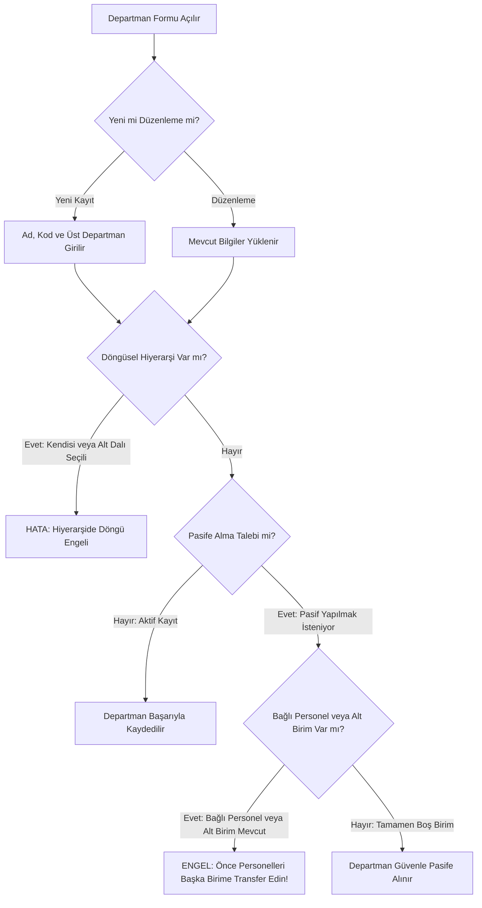

---json
{
  "pageTitle": "03. Sistem Ayarları, Dinamik Tanımlamalar ve Lookup Yönetimi — RADPYS v4 Kullanım Kılavuzu",
  "h1": "Sistem Ayarları, Şablon Merkezi & Tanımlamalar",
  "lead": "Kurum çift başlık ve çift logo antet yapılandırması, Word ve Excel rapor şablonlarının yönetimi, hastane departman hiyerarşisi, kadro unvanları ve resmi tatil takviminin merkezi operasyonel yönetim rehberi.",
  "overviewId": "overview",
  "badges": [],
  "readingTime": "4 Dakika"
}
---

## Hızlı Reçete: Kurumsal Antet ve Çift Logo Tanımlama {#quick-recipe}

:::recipe Hızlı Reçete: Kurumsal Antet ve Çift Logo Tanımlama | 20 SANİYELİK AKIŞ
### 1. İstenen Sonuç | slate
Tüm Word ve Excel raporlarında resmi kurum başlıkları ve logolarının otomatik basılması.

### 2. Yapılacak İşlem | cyan
<strong>[Rapor Şablonları]</strong> ekranında <strong>[Kurum Başlık 1]</strong> ve <strong>[Kurum Başlık 2]</strong> metinlerini girip, <strong>[Gözat...]</strong> butonlarıyla sol/sağ logoları seçin.

### 3. Sistem Etkisi | emerald
Logolar güvenli kaynak kasasına kopyalanır; canlı önizleme güncellenir ve şablonlardaki yer tutuculara otomatik işlenir.

- [metric] Kod Standardı | 2-20 Karakter (_) | slate
- [metric] Yetkili Rol | Yalnızca Admin | slate
- [metric] Tatil Eşiği | 0.5 Gün Adımlı | slate
- [metric] Platform | Yalnızca Masaüstü | slate
:::

## Kritik Sahada Yanlış Bilinen Kurallar (Mit Avcısı) {#myth-buster}

 <svg class="w-5 h-5 shrink-0" fill="none" stroke="currentColor" viewBox="0 0 24 24"><path stroke-linecap="round" stroke-linejoin="round" stroke-width="2" d="M12 9v2m0 4h.01m-6.938 4h13.856c1.54 0 2.502-1.667 1.732-3L13.732 4c-.77-1.333-2.694-1.333-3.464 0L3.34 16c-.77 1.333.192 3 1.732 3z"/></svg>
 MİT AVCISI: Departman Silme ve Veri Bütünlüğü Efsanesi
 

 

 

 <strong class="block text-red-700 dark:text-red-400 font-bold mb-1"> YANLIŞ ALGI:</strong>
 "Kapanan veya adı değişen bir departmanı tablodan silebiliriz; silersek geçmiş nöbet ve izin kayıtları da sistemden yok olur."
 

 

 <strong class="block text-emerald-700 dark:text-emerald-400 font-bold mb-1"> SAHA GERÇEĞİ:</strong>
 "RADPYS'de departmanlar asla fiziksel olarak silinemez; yalnızca <strong>[Pasif]</strong> yapılabilir. Üstelik o birimde kayıtlı aktif personel veya alt departman varsa sistem pasife almayı da kilitler (önce personellerin transferi zorunludur). Bu sayede kurumun son 30 yıllık geçmiş nöbet ve dozimetre kayıtları asla kaybolmaz."
 

 

## 5N1K Kural ve Ayar Çözümleme Tablosu {#matrix-5n1k}

 Tüm kontroller test edilmiştir
 

| NE? (Ayar & Ekran Kontrolü) | NEDEN? (Kullanım Amacı) | NASIL? (Çalışma Mantığı) | NE ZAMAN? (Tetiklenme Anı) | KİM? (Yetkili Kitle) |
| --- | --- | --- | --- | --- |
| <strong>Kurum Çift Başlık Ayarı</strong>  <small class="text-slate-500 dark:text-slate-400">[Kurum Başlık 1 & 2] Metin Alanları</small> | Resmi rapor ve evrakların üst antetine bakanlık ve hastane hiyerarşisini basmak. | Başlık 1 ve 2 metinleri girilir. Başlıkların solundaki onay kutuları işaretlenerek aktif edilir. | Kurum anteti ilk kurulurken veya değiştiğinde. | Sistem Yöneticisi |
| <strong>Kurum Çift Logo Seçimi</strong>  <small class="text-slate-500 dark:text-slate-400">[Gözat...] Butonu & Dosya Seçici</small> | Rapor antetinin sol ve sağ köşelerine resmi kurum logolarını yerleştirmek. | Bilgisayardan seçilen resim programın güvenli kaynak kasasına kopyalanır ve bağıl dosya adı olarak saklanır. | Logo dosyası seçildiğinde. | Sistem Yöneticisi |
| <strong>Canlı Antet Önizlemesi</strong>  <small class="text-slate-500 dark:text-slate-400">[Önizleme Çerçevesi]</small> | Raporu üretmeden önce antetin ekranda nasıl görüneceğini anında denetlemek. | Başlık yazıldıkça veya onay kutusu işaretlendikçe 100x100 logolar ve ortalanmış 14pt başlıklar anında yeniden çizilir. | Formda herhangi bir harfe veya kutuya dokunulduğunda. | Sistem Yöneticisi |
| <strong>Şablonu Uygulamada Açma</strong>  <small class="text-slate-500 dark:text-slate-400">[Aç] Butonu</small> | Word veya Excel şablonu üzerinde doğrudan masaüstü ofis araçlarıyla çalışabilmek. | Seçili şablon dosyası işletim sisteminin varsayılan MS Word veya MS Excel uygulamasında açılır. | Şablon aç butonuna basıldığında. | Sistem Yöneticisi |
| <strong>Şablonu Fabrika Ayarına Sıfırlama</strong>  <small class="text-slate-500 dark:text-slate-400">[Yeniden Oluştur] Butonu</small> | Hatalı düzenlenen veya bozulan rapor şablonlarını orijinal haline döndürmek. | Sistem, fabrika tanımını okuyarak ilgili Word/Excel şablon dosyasını sıfırdan kurumsal standartta yeniden üretir. | Yeniden oluştur butonuna tıklandığında. | Sistem Yöneticisi |
| <strong>Departman Hiyerarşi Kilidi</strong>  <small class="text-slate-500 dark:text-slate-400">[Üst Departman] Açılır Kutusu</small> | Sonsuz döngü ve organizasyon ağacı çökmesini engellemek. | Bir departman kendisini veya kendi alt ağacındaki birimleri üst departman olarak seçemez. | Departman kaydedilirken / güncellenirken. | Sistem Yöneticisi |
| <strong>Departman Pasife Alma Kalkanı</strong>  <small class="text-slate-500 dark:text-slate-400">[Aktif] Onay Kutusu</small> | Personeli veya alt birimi bulunan aktif departmanın pasife alınarak yetim kalmasını önlemek. | Departmana bağlı en az 1 personel veya 1 aktif alt birim varsa pasife alma kesinlikle engellenir; önce transfer istenir. | Pasife alma girişiminde. | Sistem Yöneticisi |
| <strong>Kat Planı / Kroki Eşleme</strong>  <small class="text-slate-500 dark:text-slate-400">[Yeni Yükle...] & [Oda Kodu]</small> | Departmanı mimari kat planına ve oda mahalle koduna bağlamak. | PDF veya görsel kroki seçilir, krokiler havuzuna kaydedilir ve departmana atanır. | Departman tanımlanırken. | Sistem Yöneticisi |
| <strong>Unvan Nöbet ve Radyasyon Mirası</strong>  <small class="text-slate-500 dark:text-slate-400">[Radyasyon Görevlisi] & [Nöbet]</small> | Yeni personel özlük kartı açılırken meslek standartlarının otomatik gelmesini sağlamak. | Unvan kartında işaretlenen radyasyon görevlisi ve nöbet tutabilme bayrakları, bu unvanı alan personele otomatik devredilir. | Unvan tanımlanırken. | Sistem Yöneticisi |
| <strong>Tatil Takvimi 0.5 Gün Kuralı</strong>  <small class="text-slate-500 dark:text-slate-400">[Gün Sayısı] Sayı Alanı</small> | Arefe günleri ve yarım günlük idari izinlerin puantaja tam yansımasını sağlamak. | Tatil gün sayısı 0.5 adımlarla girilir (0.5, 1.0, 1.5). Nöbet dağıtım motoru arefe günlerini yarım gün tatil kabul eder. | Tatil takvimi kaydedilirken. | Sistem Yöneticisi |
| <strong>Tanımlama Tablosu Rozetleri</strong>  <small class="text-slate-500 dark:text-slate-400">[Görsel Rozet Göstergeleri]</small> | Birimlerin radyasyon riskini, nöbet durumunu ve aktiflik statüsünü tek bakışta denetlemek. | Departman, unvan, izin, tatil, eğitim ve cihaz tablolarında [Aktif]/[Pasif] durumları, radyasyon simgesiyle [Radyasyonlu Alan] ve [Nöbet] durumları kurumsal renkli rozetlerle görselleştirilir. | Tanımlama tabloları incelenirken. | Sistem Yöneticisi |
| <strong>Serbest Sütun Boyutlandırma</strong>  <small class="text-slate-500 dark:text-slate-400">[Tablo Başlığı Boyutlandırma & Yatay Kaydırma]</small> | Uzun departman ve unvan adlarının ekranda kesilmeden tam olarak okunmasını sağlamak. | Tablo sütun başlıkları fareyle sağa sola sürüklenerek serbestçe genişletilebilir; uzun metinlerde yatay kaydırma çubuğu belirir ve hiçbir veri üç nokta (...) ile gizlenmez. | Tablo verileri okunurken veya incelenirken. | Sistem Yöneticisi |
| <strong>Tanımlama Silme Kalkanı (Hibrit Silme)</strong>  <small class="text-slate-500 dark:text-slate-400">[Sil] Butonu (Cihaz Türü, Amacı, Kaynak Türü ve Sistem Lookupları)</small> | Kullanımda olan bir tanım silindiğinde geçmiş cihaz, muayene veya envanter kayıtlarının ilişkisinin bozulmasını (yetim kalmasını) önlemek. | Seçili tanıma bağlı en az 1 cihaz veya envanter kaydı varsa sistem kaydı kalıcı silmez; geçmiş verileri koruyarak güvenle <strong>[Pasif]</strong> statüye çeker ve yeni kayıt açılır kutularından gizler. Hiçbir bağlı kaydı olmayan tanımlar ise doğrudan sistemden temizlenir. | Tanımlama tablosunda bir satır seçilip [Sil] butonuna basıldığında. | Sistem Yöneticisi |
| <strong>Kurumsal Antet & Sıfır Sentetik Kurum Standardı</strong>  <small class="text-slate-500 dark:text-slate-400">[Kurum Adı] & Rapor Antetleri</small> | Tüm rapor, etiket ve resmi dökümlerde kurum kimliğini doğru yansıtmak; tanımlı olmayan yerlerde sahte/tahmini kamu kurumu adı yazılmasını engellemek. | Sistem ayarlarında Kurum Adı tanımlandığında tüm resmi tutanak ve rapor şablonlarında bu başlık kullanılır. Değer girilmemişse sistem kesinlikle farazi/sentetik kurum adı uydurmaz; kurumsal sistem varsayılanı olan <strong>RADPYS</strong> antetini kullanır. | Rapor, tutanak veya QR etiket üretilirken. | Sistem Yöneticisi |
| <strong>Akıllı Otomatik Algılamalı E-Posta (SMTP) Ayarları</strong>  <small class="text-slate-500 dark:text-slate-400">[E-Posta ve Bildirim Ayarları] & [Test E-Postası Gönder]</small> | Kurumun bildirim ve doğrulama e-postalarını teknik sunucu/port ayarlarıyla uğraşmadan kolayca yapılandırmak. | E-posta adresi yazıldığı anda sistem Gmail, Outlook/Office 365, Yandex, Yahoo, iCloud veya Kurumsal/Sağlık Bakanlığı (<code>saglik.gov.tr</code>, <code>edu.tr</code>) sunucu ve port ayarlarını otomatik tanır. Parola Windows güvenli anahtar kasasında saklanır, ekran tekrar açıldığında parola kutuya geri doldurulmaz (<em>"Kayıtlı parola mevcut"</em> uyarısıyla gizlenir) ve <strong>[Test E-Postası Gönder]</strong> butonuyla canlı bağlantı doğrulanır. | E-posta bildirimleri ve 2FA doğrulama kurulurken. | Sistem Yöneticisi |
| <strong>Web Portal İki Aşamalı Doğrulama (2FA OTP) Anahtarı</strong>  <small class="text-slate-500 dark:text-slate-400">[Web Portal Girişinde E-Posta Doğrulama Kodu İste]</small> | Web Portalına dış ağdan yapılan girişlerde parola güvenliğini 6 haneli tek kullanımlık e-posta kodu ile güçlendirmek. | Onay kutusu işaretlenip kaydedildiğinde, açık olan Web Portal sunucusunu yeniden başlatmaya gerek kalmadan ayar anında devreye girer. Dış ağdan giriş yapan personele 6 haneli doğrulama kodu gönderilir; e-posta gönderilemezse dış ağ oturumu güvenlik gereği açılmaz (Güvenli Kapanma). | Kurumsal siber güvenlik politikası etkinleştirildiğinde. | Sistem Yöneticisi |

## Departman Yönetimi & Güvenlik Kalkanı Süreci {#workflow}

 Döngü & Transfer Kontrolü
 

 

 

## Ekran Rehberi ve Kritik Arayüzler {#screenshots}

## Adım Adım Operasyonel Eylem Akışı {#step-by-step}

 

 <h3 class="font-bold text-slate-900 dark:text-white flex items-center gap-2">
 1
 Kurum Başlıklarını ve Resmi Çift Logoyu Yapılandırma
 </h3>
 <ol class="list-decimal list-inside text-xs sm:text-sm text-slate-600 dark:text-slate-300 space-y-1.5 pl-2">
 <li>Sol gezinim menüsünden <strong>[Sistem Ayarları] > [Rapor Şablonları & Kurum Anteti]</strong> sekmesini açın.</li>
 <li><strong>[Kurum Başlık 1]</strong> alanına üst idari kurum adını (Örn: <em>T.C. SAĞLIK BAKANLIĞI</em>), <strong>[Kurum Başlık 2]</strong> alanına hastane/fakülte adınızı yazın.</li>
 <li>Başlıkların raporda görünmesi için sollarındaki <strong>[Kurum Başlık 1]</strong> ve <strong>[Kurum Başlık 2]</strong> kutularını işaretleyin.</li>
 <li><strong>[Kurum Logo 1]</strong> ve <strong>[Kurum Logo 2]</strong> yanındaki <strong>[Gözat...]</strong> butonlarına tıklayarak bilgisayarınızdaki logo dosyalarını seçin.</li>
 <li>Sağ paneldeki <strong>Canlı Önizleme</strong> alanında logoların ve başlıkların tam konumunu denetleyin.</li>
 <li>Alt kısımdaki <strong>[Kaydet]</strong> butonuna basın. Başarı bildiriminden sonra üretilen tüm resmi raporlar bu anteti kullanır.</li>
 </ol>
 

 

 <h3 class="font-bold text-slate-900 dark:text-white flex items-center gap-2">
 2
 Yeni Departman Tanımlama ve Mimari Kat Planı Eşleme
 </h3>
 <ol class="list-decimal list-inside text-xs sm:text-sm text-slate-600 dark:text-slate-300 space-y-1.5 pl-2">
 <li>Sistem Yönetimi ağacından <strong>[Sistem Tanımları] > [Departman Tanımları]</strong> sayfasına geçin.</li>
 <li>Araç çubuğundaki <strong>[Yeni]</strong> butonuna tıklayın.</li>
 <li><strong>[Departman Adı]</strong> alanını doldurun ve <strong>[Kod]</strong> kutusuna standart formatta (2-20 karakter, büyük harf) bir kod belirleyin (Örn: <em>RAD_MR</em>).</li>
 <li>Eğer bir alt ünite ise <strong>[Üst Departman]</strong> açılır kutusundan bağlı olduğu ana anabilim dalını seçin.</li>
 <li><strong>[Birim Sorumlusu]</strong> kutusundan ilgili yetkili hekimi veya amiri atayın.</li>
 <li>Birim radyasyon içeriyorsa <strong>[Radyasyonlu alan]</strong> kutusunu, vardiyalı çalışıyorsa <strong>[Nöbet usulü mesai]</strong> kutusunu işaretleyin.</li>
 <li><strong>[Kat Planı / Kroki]</strong> açılır kutusundan ilgili katı seçin veya <strong>[Yeni Yükle...]</strong> butonuyla doğrudan PDF/PNG kat planı yükleyin.</li>
 <li><strong>[Ekle]</strong> butonuna basarak işlemi tamamlayın.</li>
 </ol>
 

 

 <h3 class="font-bold text-slate-900 dark:text-white flex items-center gap-2">
 3
 Resmi/Dini Tatil Takvimini Otomatik Oluşturma ve Düzenleme
 </h3>
 <ol class="list-decimal list-inside text-xs sm:text-sm text-slate-600 dark:text-slate-300 space-y-1.5 pl-2">
 <li>Ağaç menüsünden <strong>[Tanımlamalar] > [Tatil Takvimi]</strong> sayfasına tıklayın.</li>
 <li><strong>Sabit Resmi Tatilleri Topluca Eklemek İçin:</strong> Araç çubuğundaki <strong>[Resmi Tatilleri Ekle]</strong> butonuna tıklayın, ilgili yılı girin; 1 Ocak, 23 Nisan, 1 Mayıs, 19 Mayıs, 15 Temmuz, 30 Ağustos ve 28-29 Ekim (8 resmi tatil) tek tıkla takvime işlenir.</li>
 <li><strong>Dini Bayramları Tek Tıkla Eklemek İçin:</strong> <strong>[Yeni]</strong> butonuna basın, Tatil Adı alanından <em>Ramazan Bayramı</em> veya <em>Kurban Bayramı</em> seçin. Sistem otomatik olarak <em>Dini Tatil</em> türünü ve <em>Tüm bayram günlerini otomatik oluştur</em> seçeneğini aktif eder.</li>
 <li>Tarih alanına bayramın <strong>Arife Günü</strong> tarihini girin ve <strong>[Kaydet]</strong> butonuna basın. Sistem Arife (0.5 gün) ile birlikte bayramın tüm günlerini (Ramazan için 4 gün, Kurban için 5 gün) tek seferde takvime kaydeder.</li>
 <li><strong>İdari İzin veya Özel Tatil İçin:</strong> <strong>[Yeni]</strong> butonuna basarak tekil tarih, tatil adı, tür ve gün sayısı (0.5 veya 1.0) belirleyip kaydedebilirsiniz.</li>
 </ol>
 

 

 <h3 class="font-bold text-slate-900 dark:text-white flex items-center gap-2">
 4
 Kurumsal E-Posta (SMTP) ve Web Portal 2FA Doğrulama Ayarlarını Yapılandırma
 </h3>
 <ol class="list-decimal list-inside text-xs sm:text-sm text-slate-600 dark:text-slate-300 space-y-1.5 pl-2">
 <li>Sol gezinim ağacından <strong>[Sistem Ayarları] > [E-Posta ve Bildirim Ayarları]</strong> sekmesini açın.</li>
 <li><strong>[Gönderici E-Posta Adresi]</strong> kutusuna kurumunuzun veya biriminizin e-posta adresini yazın; sistem sağlayıcıyı (Gmail, Outlook/Office 365, Yandex, Kurumsal/Sağlık Bakanlığı) otomatik olarak algılar ve sunucu/port ayarlarını kendisi doldurur.</li>
 <li>Gmail veya Outlook kullanıyorsanız <strong>[Uygulama Şifresi Nasıl Alınır?]</strong> butonuna tıklayarak 3 adımlı görsel rehber eşliğinde oluşturduğunuz 16 haneli uygulama şifresini, kurumsal posta kullanıyorsanız e-posta parolanızı girin.</li>
 <li>Web Portal girişlerinde personele 6 haneli tek kullanımlık doğrulama kodu gönderilmesini istiyorsanız <strong>[Web Portal girişinde E-Posta ile 6 Haneli Doğrulama Kodu (2FA OTP) iste]</strong> kutusunu işaretleyin.</li>
 <li><strong>[Test E-Postası Gönder]</strong> butonuna basarak bağlantıyı canlı olarak doğrulayın ve ardından <strong>[Ayarları Kaydet]</strong> butonuna tıklayın.</li>
 </ol>
 

 

## Sıkça Sorulan Sorular (SSS) {#faq}

:::faq
### Fiili hizmet (FHZ) hesaplama yöntemini yıl ortasında değiştirebilir miyiz?
Fiili hizmet hesaplama yöntemi (<em>Hibrit</em>, <em>Manuel</em> veya <em>Nöbet</em>) değiştirildiğinde geçmiş dönemlerde kapatılmış ve SGK'ya bildirilmiş olan yıpranma payı puantajlarının tutarlılığı etkilenebilir. Sistem bu sebeple değişiklik anında ekrana <strong>Kritik Ayar Değişikliği</strong> ikazı getirir. Bu ayarın takvim yılı veya mali dönem başında planlı olarak değiştirilmesi önemle tavsiye edilir.

### Kapatılmak istenen bir departmanı pasife alırken sistem neden hata veriyor?
RADPYS veri bütünlüğü kuralı gereğince; içerisinde en az 1 aktif personel kaydı veya kendisine bağlı aktif alt departman bulunan birimler pasife alınamaz. Bu durumda sistem <code>"Bu departman pasife alinamaz: X personel kaydi... Once bagimliliklari kaldirin."</code> uyarısı verir. İşlemi yapabilmek için öncelikle o departmandaki personelleri <strong>[Personel Listesi]</strong> ekranından başka bir aktif birime transfer etmeniz gerekir.

### Cihaz Türü, Cihaz Amacı veya Kaynak Türü gibi bir tanımı sildiğimde geçmiş cihazlar ve envanterler bozulur mu?
<strong>Kesinlikle hayır, geçmiş kayıtlar korunur.</strong> RADPYS <em>"Veri Bütünlüğü Odaklı Hibrit Silme"</em> altyapısına sahiptir. Sildiğiniz bir tanıma (örneğin bir cihaz türüne, amacına veya kaynak grubuna) bağlı mevcut ya da arşivlenmiş cihaz/envanter kayıtları varsa; sistem bu tanımı veritabanından kalıcı olarak silmez, güvenle <strong>Pasife</strong> alır. Böylece geçmiş kalite kontrol, bakım, dozimetre ve envanter raporlarınız asla bozulmaz; yalnızca yeni cihaz ekleme formlarında o tanım listeden kaldırılır. Sadece hiçbir kayıtta kullanılmamış tertemiz tanımlar sistemden kalıcı olarak temizlenir.

### Dini bayramları her yıl tek tek gün gün girmek zorunda mıyız, arefe günü neden 0.5 gündür?
<strong>Hayır, gün gün girmenize gerek yoktur.</strong> Yeni tatil eklerken <em>Ramazan Bayramı</em> veya <em>Kurban Bayramı</em> seçtiğinizde form otomatik olarak toplu oluşturma moduna geçer; yalnızca Arife gününün tarihini seçip kaydettiğinizde Arife günü dahil tüm bayram günleri (Ramazan için 4 gün, Kurban için 5 gün) tek seferde takvime eklenir.   Mevzuata göre dini bayram arefeleri saat 13:00 itibarıyla resmi tatil sayılmaktadır. Nöbet dağıtım motoru ve fazla mesai hesaplayıcısı, personelin sabah çalıştığı mesaiyi normal, öğleden sonrasını ise resmi tatil nöbet katsayısıyla hesaplar. Arife günü için gün sayısı otomatik olarak <code>0.5</code> gün girilerek bu yarım günlük ayrım kusursuz şekilde puantaja yansıtılır.

### "Yeniden Oluştur" butonuna bastığımda Word veya Excel'deki özel tasarımlarım kaybolur mu?
Evet. <strong>[Yeniden Oluştur]</strong> butonu, ilgili Word veya Excel şablonunu doğrudan kurulum anındaki fabrika standartlarına döndürür. Şablon üzerinde daha önce yapmış olduğunuz tablo ve sütun düzenlemelerini kaybetmemek için butona basmadan önce <strong>[Klasörü Aç]</strong> butonuyla <code>data/templates/</code> klasörünün bir yedeğini almanızı önemle öneririz.

### Tanımlama tablolarındaki uzun birim veya unvan adları ekranda dar göründüğünde ne yapmalıyım?
Tablonun sütun başlıkları arasındaki ayırıcı çizgiyi fareyle tutup sağa sola dilediğiniz genişliğe çekebilirsiniz. Tablo otomatik olarak yatay kaydırma çubuğu sunar ve hiçbir veri üç nokta (...) şeklinde kesilmeden tam olarak okunabilir.
:::
