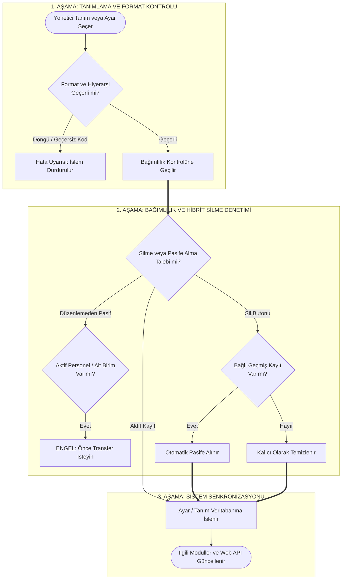

---json
{
  "pageTitle": "03. Sistem Ayarları, E-Posta/2FA ve Tanımlamalar — RADPYS v4 Kullanım Kılavuzu",
  "h1": "Sistem Ayarları, E-Posta & Tanımlamalar",
  "lead": "Kurum antet başlıkları ve çift logo parametreleri, otomatik algılamalı e-posta (SMTP) ve dış ağ 2FA doğrulaması, hastane departman hiyerarşisi, mimari kroki eşlemesi, unvan mirası, tatil takvimi otomasyonu ve veri bütünlüğü odaklı hibrit silme kurallarını yönetmenizi sağlar.",
  "overviewId": "overview",
  "badges": [
    {
      "text": "Veri Bütünlüğü & Hibrit Silme",
      "tone": "emerald"
    }
  ],
  "readingTime": "4 Dakika",
  "legalNote": "<strong>Yasal Güvence:</strong> Tanım kayıtları silinirken geçmiş envanter, cihaz, muayene veya personel ilişkisi varsa sistem kaydı kalıcı silmez; güvenle pasife çekerek 30 yıllık denetim izini korur."
}
---

## Kısa Reçete: Kurum Antet ve Çıktı Parametrelerini Ayarlama {#quick-recipe}

:::recipe Kısa Reçete: Kurum Antet ve Çıktı Parametrelerini Ayarlama | 20 SANİYELİK AKIŞ

### 1. İstenen Sonuç | slate

Tüm resmi raporlarda, tutanaklarda ve PDF çıktılarında kurumun resmi üst başlıklarının ve çift logosunun doğru basılması.

### 2. Yapılacak İşlem | cyan

<strong>[Sistem Yönetimi] > [Genel Ayarlar] > [Rapor ve Çıktı Ayarları]</strong> ekranından başlık ve logo satırını seçin; sağ panelde metni veya <strong>[Gözat...]</strong> butonuyla logoyu seçip <strong>[Aktif]</strong> kutusunu işaretleyin ve <strong>[Değişiklikleri Kaydet]</strong> butonuna basın.

### 3. Sistem Etkisi | emerald

Seçilen logolar güvenli kaynak alanına kopyalanır ve tüm rapor motorları kurum antetini bu ayarlardan okur; kurum adı boşsa sistem sahte kurum adı üretmez, varsayılan RADPYS başlığını kullanır.

- [metric] Birim Kod Formatı | 2-20 Büyük Harf/Rakam | slate
- [metric] Yetkili Rol | Sistem Yöneticisi | cyan
- [metric] Tatil Hassasiyeti | 0.5 Gün Adımlı | amber
- [metric] Platform | Masaüstü Kokpit | emerald
:::

## 5N1K Kural ve Arayüz Çözümleme Tablosu {#5w1h}

*Sistem parametreleri, e-posta güvenliği, hiyerarşik tanımlamalar ve veri bütünlüğü koruma kuralları.*

| NE? (Bileşen / Kontrol) | NEDEN? (Amacı) | NASIL? (Çalışma Mantığı) | NE ZAMAN? (Tetiklenme) | KİM? (Yetkili Rol) |
| --- | --- | --- | --- | --- |
| <strong>Çekirdek Program Parametreleri</strong> Genel, Güvenlik, Dozimetre, İzin, FHZ | Uygulamanın iş ve mevzuat kurallarını kod değiştirmeden merkezi ve güvenli olarak uyarlamak. | Yalnızca mevcut sistem anahtarları güncellenir; yıllık doz sınırı, parola politikası, Şua ve Fiili Hizmet saat/gün parametreleri kritik kabul edilerek Sistem Yöneticisi onayı zorunlu tutulur ve kurum logoları yalnızca kayıt onaylandığında kalıcı saklanır. | Kurum veya mevzuat politikası güncellendiğinde. | Sistem Yöneticisi |
| <strong>Varsayılan Dozimetre Firması Seçimi</strong> <strong>[Dozimetre Ayarları]</strong> (Açılır Liste) | Her dozimetre rapor yüklemesinde firma radyo düğmesini tekrar seçme zahmetini önlemek. | Sağ paneldeki açılır kutudan <strong>Otomatik Algıla</strong>, <strong>RADAT</strong>, <strong>TENMAK / NDK</strong> veya <strong>Genel Excel / CSV</strong> seçeneklerinden biri kaydedilir; Dozimetre Raporu İçe Aktar ekranı açılışta doğrudan seçili firmayı işaretler. | Kurum laboratuvar sağlayıcısı belirlendiğinde. | Sistem Yöneticisi |
| <strong>Otomatik Algılamalı E-Posta (SMTP)</strong> [E-Posta ve Bildirim Ayarları] | Sunucu ve port bilgisi aramadan bildirim e-postasını kurmak ve parolayı gizlemek. | Adres yazıldığında sağlayıcı ve port otomatik algılanır; kaydedilen parola ekran tekrar açıldığında güvenlik gereği kutuya geri doldurulmaz. | E-posta altyapısı yapılandırılırken. | Sistem Yöneticisi |
| <strong>Dış Ağ 2FA ve Otomatik Bildirimler</strong> Güvenlik ve Bildirim Tercihleri | Dış ağ Web Portal girişlerini 6 haneli kodla korumak ve kritik alarmları iletmek. | Onay kutuları kaydedildiğinde açık Web Portal sunucusunu yeniden başlatmadan devreye girer (dış ağ 2FA kodu gönderilemezse oturum açılmaz). | Siber güvenlik veya uyarı politikası açıldığında. | Sistem Yöneticisi |
| <strong>Departman Hiyerarşi Döngü Kilidi</strong> [Üst Departman] Açılır Kutusu | Organizasyon ağacında sonsuz döngü oluşmasını engellemek. | Bir departman kendisini veya kendi altındaki bir birimi üst departman olarak seçerse kayıt işlemi reddedilir. | Departman kaydedilirken veya güncellenirken. | Sistem Yöneticisi |
| <strong>Veri Bütünlüğü Odaklı Hibrit Silme</strong> [Sil] Butonu (Tüm Tanımlar) | Kullanımdaki bir tanım silinince geçmiş cihaz, personel veya muayene kayıtlarını bozmamak. | Departman, Unvan, İzin, Cihaz veya RKE tanımına bağlı kayıt varsa silinmez, <strong>Pasif</strong> duruma çekilir; hiç kullanılmamışsa kalıcı silinir. | Tanımlama listesinde <strong>[Sil]</strong> onaylandığında. | Sistem Yöneticisi |
| <strong>Unvan Radyasyon ve Nöbet Mirası</strong> [Radyasyon Görevlisi mi?] & [Nöbet] | Yeni personel eklenirken mesleki varsayılanları tek tek işaretleme zahmetini önlemek. | Unvan kartındaki radyasyon görevlisi ve nöbet tutabilme bayrakları o unvanla açılan yeni personele otomatik devredilir. | Unvan tanımlanırken veya personel açılırken. | Sistem Yöneticisi |
| <strong>Tatil Otomasyonu ve 0.5 Gün Kuralı</strong> [Resmi Tatilleri Ekle] & [Gün Sayısı] | Sabit resmi tatilleri ve Arife yarım günlerini eksiksiz puantaja yansıtmak. | Resmi tatil aracı 8 sabit günü tek seferde ekler; Arife günleri 0.5 gün adımıyla işlenerek dini bayramlar (Ramazan 4, Kurban 5 kayıt) toplu oluşturulur. | Yıllık tatil takvimi hazırlanırken. | Sistem Yöneticisi |
| <strong>Departman Birleştirme ve Akıllı Aktarım</strong> [Departmanları Birleştir] Butonu | Birim taşınma veya kapatma süreçlerinde personelin ve klinik envanterinin kopmasını önlemek. | Eski departmandaki personellerin yanı sıra kat planı kroki noktaları, tıbbi cihazlar, arıza kayıtları ve gelecekteki çakışan nöbet slotları yeni departmana devredilir. | Hastane birimleri birleştirildiğinde. | Sistem Yöneticisi |
| <strong>Unvan Birleştirme Denetim İzi</strong> [Unvanları Birleştir] Butonu | Mesleki kadro revizyonlarında çalışanların yeni unvana güvenle geçirilmesini sağlamak. | Birleştirilen unvandaki tüm personel kayıtları yeni unvana aktarılır, işlem resmi denetim günlüğüne kaydedilir ve eski unvan pasife alınır. | Kadro veya unvan güncellemesi yapıldığında. | Sistem Yöneticisi |

## Kritik Sahada Yanlış Bilinen Kurallar (Mit Avcısı) {#myth-buster}

:::myth Kullanımda Olan Bir Tanımı Silersem Geçmiş Kayıtlar Bozulur mu?

### Yanlış Algı

<em>"Eski bir departmanı, unvanı, cihaz türünü veya RKE tanımını [Sil] butonuyla kaldırırsam geçmişte ona bağlı cihaz, nöbet ve muayene kayıtları da silinir."</em>

### Gerçek Sistem Mantığı

<strong>Geçmiş kayıtlarınız güvendedir.</strong> RADPYS'de tüm tanım ekranlarında <strong>Veri Bütünlüğü Odaklı Hibrit Silme</strong> çalışır. Silmek istediğiniz tanıma bağlı personel, alt birim, cihaz, RKE veya muayene kaydı varsa sistem tanımı kalıcı silmez, güvenle <strong>Pasif</strong> duruma alır; yalnızca hiç kullanılmamış tanımlar sistemden kalıcı temizlenir.
:::

## Süreç Akış Şeması {#workflow}

1. **Tanımlama ve Format Kontrolü:** Departman ve unvan kodları standart formata göre, üst departman seçimleri ise hiyerarşi döngüsüne karşı doğrulanır.
2. **Bağımlılık ve Hibrit Silme Denetimi:** Düzenleme formundan aktif personelli birim kapatılmak istenirse transfer uyarısı verilir; **[Sil]** butonunda ise bağlı kaydı bulunan tanımlar pasife alınır, boş olanlar silinir.
3. **Sistem Senkronizasyonu:** Kaydedilen kurum ayarları, SMTP/2FA tercihleri ve tanımlar tüm masaüstü formlarına ve Web Portalına anlık yansır.

## Arayüz Ekran Görünümleri {#screenshots}

## Adım Adım İşlem Rehberi {#step-by-step}

### 1. Kurum Anteti, Çift Logo ve Program Ayarlarını Güncelleme

1. Sol gezinim ağacından **[Genel Ayarlar]** altındaki ilgili kategoriyi (örneğin **[Rapor ve Çıktı Ayarları]** veya **[Güvenlik Ayarları]**) açın.
2. Tablodan düzenlemek istediğiniz ayara tıklayın; sağdaki **[Ayar Detayı]** panelinde yeni değeri yazın veya logo seçimleri için **[Gözat...]** butonunu kullanın.
3. Başlık ve logoların raporlarda görünmesi için **[Aktif]** kutusunun işaretli olduğunu doğrulayıp **[Değişiklikleri Kaydet]** butonuna tıklayın.

### 2. Departman, Mimari Kroki ve Kardeş Sistem Tanımlarını Yönetme

1. **[Sistem Tanımları] > [Departman Tanımları]** ekranında **[Yeni]** butonuna basın; ad, 2–20 karakterli büyük harf kod, varsa **[Üst Departman]** ve gerekiyorsa **[Radyasyonlu alan]** / **[Nöbet usulü mesai]** seçeneklerini işaretleyin.
2. Birime mimari kat planı bağlamak için **[Kat Planı / Kroki]** yanındaki **[Yeni Yükle...]** butonunu ve oda/mahalle kodunu girip **[Kaydet]** butonuna tıklayın.
3. Unvan, Cihaz Türü, Cihaz Kullanım Amacı, Cihaz Kaynak Türü, RKE Ekipman Türü, RKE Klinik Bulguları, İzin Türleri, Eğitim veya Muayene Türleri ekranlarında da aynı **[Yeni]**, **[Düzenle]**, **[Sil]** (hibrit silme) ve **[Excel Aktar]** yapısını kullanın.

### 3. Resmi ve Dini Tatil Takvimini Otomatik Oluşturma

1. **[Sistem Tanımları] > [Resmi/Dini Tatiller]** ekranını açın; araç çubuğundaki **[Resmi Tatilleri Ekle]** butonuna tıklayıp yılı girerek 8 sabit resmi tatili (1 Ocak, 23 Nisan, 1 Mayıs, 19 Mayıs, 15 Temmuz, 30 Ağustos ve 28–29 Ekim dahil) tek seferde ekleyin.
2. 2026–2030 yılları arasındaki resmi tatiller ile Diyanet dini bayramları ve Arife yarım günleri (aynı tarihe denk gelen milli ve dini tatillerin tekilleştirilmesi dahil) sistemde hazır tanımlı gelir; sonraki yıllar için **[Yeni]** butonuna basıp bayram türünü seçin, **[Tüm bayram günlerini otomatik oluştur (Arife + Bayram)]** kutusu aktifken yalnızca **Arife** gününün tarihini girip **[Kaydet]** butonuna tıklayın.

### 4. E-Posta (SMTP), Otomatik Bildirimler ve Web Portal 2FA Kurulumu

1. **[Genel Ayarlar] > [E-Posta ve Bildirim Ayarları]** sayfasında gönderici e-posta adresinizi yazın; sistem sağlayıcı ve port bilgisini otomatik tanır.
2. Gmail/Outlook gibi sağlayıcılarda **[Google Uygulama Şifresi Al]** yardımıyla aldığınız uygulama şifresini (veya kurumsal SMTP parolanızı) girin; ihtiyaç duyduğunuz 2FA OTP ve otomatik e-posta bildirim onay kutularını işaretleyin.
3. **[Bağlantıyı Test Et (Test E-Postası Gönder)]** butonuyla e-posta gönderimini doğruladıktan sonra **[Ayarları Kaydet ve Etkinleştir]** butonuna basın.

## Sıkça Sorulan Sorular (SSS) {#faq}

:::faq

### Fiili hizmet (FHZ) hesaplama yöntemini yıl ortasında değiştirebilir miyiz?

Hesaplama yöntemi değiştirildiğinde geçmiş dönem puantajlarının tutarlılığı etkilenebileceği için sistem <strong>Kritik Ayar Değişikliği</strong> onayı ister. Mevcut verilerin bütünlüğü açısından bu değişikliğin yıl veya dönem başında yapılması önerilir.

### Departman düzenleme penceresinde [Aktif] kutusunu kaldırdığımda sistem neden uyarı veriyor?

Departman düzenleme ekranından doğrudan pasife alma işleminde o birime kayıtlı personel veya aktif alt departman varsa sistem yetim kayıt oluşmaması için işlemi durdurur. Önce personelleri <strong>[Personel Listesi]</strong> üzerinden başka bir aktif birime aktarmanız gerekir.

### Genel Program Ayarları tablosuna neden yeni satır veya özel anahtar ekleyemiyoruz?

Program ayarları uygulamanın çekirdek kurallarını yöneten sabit parametrelerdir. Sistem, arka planda karşılığı olmayan rastgele anahtarların eklenmesini güvenlik ve kararlılık amacıyla engeller; yalnızca mevcut parametrelerin değerleri güncellenebilir.
:::
