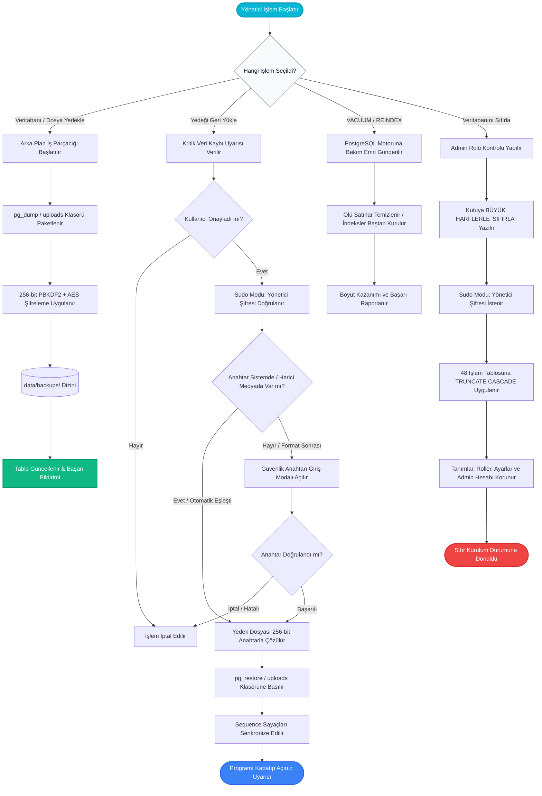

---json
{
  "pageTitle": "04. Veritabanı Bakım, KVKK Evrak Kasası ve Güvenlik — RADPYS v4 Kullanım Kılavuzu",
  "h1": "Veritabanı Bakım, Kriptografik Yedekleme & Sistem Güvenliği",
  "lead": "PostgreSQL motor optimizasyonu (VACUUM ve REINDEX), 256-bit PBKDF2/AES şifreli yedekleme ve felaket kurtarma (Disaster Recovery), 3 kademeli korumayla fabrika ayarlarına sıfırlama, SHA-256 kriptografik denetim izi ve global çökme yakalama rehberi.",
  "overviewId": "overview",
  "badges": [],
  "readingTime": "4 Dakika"
}
---

## Hızlı Reçete: Şifreli Yedekleme ve Motor Optimizasyonu {#quick-recipe}

:::recipe Hızlı Reçete: Şifreli Yedekleme ve Motor Optimizasyonu | 20 SANİYELİK AKIŞ
### 1. İstenen Sonuç | slate
Verilerin tam dökümünü güvenli şifrelemeyle arşivlemek ve veritabanı ölü satırlarını temizlemek.

### 2. Yapılacak İşlem | cyan
<strong>[Veritabanı Bakım]</strong> ekranında <strong>[Veritabanı Yedekle]</strong> ve <strong>[Dosyaları Yedekle]</strong> butonlarına basın; olası format/sunucu değişimi için <strong>[Güvenlik Anahtarı]</strong> kartını harici ortama aktarın; ardından <strong>[Boyut Optimize Et (VACUUM)]</strong> aracını çalıştırın.

### 3. Sistem Etkisi | emerald
Veritabanı 256-bit AES ile şifrelenip zaman damgasıyla saklanır; PostgreSQL motoru ölü satırları temizleyip disk alanını geri kazandırır.

- [metric] Kriptografi | 256-bit AES/PBKDF2 | slate
- [metric] Yetkili Rol | Yalnızca Admin | slate
- [metric] Emniyet Kilidi | Sudo Şifre Onayı | slate
- [metric] Platform | Yalnızca Masaüstü | slate
:::

## 5N1K Kural ve Fonksiyon Tablosu {#table-5w1h}

 

 Veritabanı yedekleme, geri yükleme, motor optimizasyonu ve denetim araçlarının çalışma mantığı.
 

 

| NE? (Ekran Kontrolü) | NEDEN? (Kullanım Amacı) | NASIL? (Çalışma Mantığı) | NE ZAMAN? (Hangi Durumda) | KİM? (Yetkili Kitle) |
| --- | --- | --- | --- | --- |
| <strong>Veritabanı Yedekle</strong>  Sol Üst Buton | Tüm klinik, nöbet, izin ve dozimetre kayıtlarının anlık tam yedeğini almak. | PostgreSQL dökümü alınır; 256-bit PBKDF2/AES ile şifrelenip zaman damgasıyla <code>.dump</code> dosyası üretilir. | Düzenli periyotlarla veya büyük veri girişi/güncelleme öncesinde. | Sistem Yöneticisi |
| <strong>Dosyaları Yedekle</strong>  Sol Üst Buton | Yüklenen personel evrakları, sertifikalar ve cihaz dokümanlarını arşivlemek. | Yüklü dosyalar klasörü zip paketi haline getirilir ve 256-bit anahtarla şifrelenerek <code>.zip</code> olarak saklanır. | Belge kasası arşivlenmek istendiğinde. | Sistem Yöneticisi |
| <strong>Güvenlik Anahtarı (Kurtarma Kartı & Cihaz Donanım Anahtarı)</strong>  Sol Üst Buton | Format veya yeni sunucu kurulumu sonrasında şifreli yedeklerin açılabilmesi için afet kurtarma anahtarını güvenli harici ortama aktarmak ve donanımsal kurtarma anahtarını denetlemek. | Sudo şifresi doğrulanır. 32 karakterlik AES-256 güvenlik anahtarı ve sunucunun Cihaz Kimliği (Machine ID) görüntülenir. Anahtar panoya kopyalanabilir, <strong>[Kurtarma Dosyası Kaydet (.txt)]</strong> butonuyla harici ortama yazılabilir veya tek tıkla donanım kimliğiyle eşitlenebilir. | İlk sistem kurulumunda, felaket kurtarma tatbikatında ve harici diske yedek kopyalanırken. | Süper Yönetici (Sudo) |
| <strong>Yedeği Geri Yükle (Yükle)</strong>  Tablo Aksiyon Butonu | Veri kaybı, sistem çökmesi veya arıza anında sistemi geçmiş bir tarihe döndürmek. | Kritik uyarı onaylanır ve Sudo şifresi girilir. Sistem anahtarı yerel kasadan, harici diskten (<code>radpys_yedek_kurtarma_anahtari.txt</code>) veya geçmiş anahtar arşivinden otomatik tarar; bulunamazsa Güvenlik Anahtarı modalı açılır. Anahtar elle girilebilir, dosyadan seçilebilir veya <strong>[Cihaz Kimliğiyle Çözmeyi Dene]</strong> ile donanım afet anahtarı tek tıkla test edilir. Dosya çözülüp veritabanına basılır; sayaçlar eşitlenir. | Felaket kurtarma, format sonrası geri yükleme veya hatalı toplu işlem sonrası. | Süper Yönetici (Sudo) |
| <strong>Yedeği Dışa Aktar</strong>  Tablo Aksiyon Butonu | Yedek dosyasını harici diske veya USB belleğe aktarmak. | Kullanıcının seçtiği konuma dosya yöneticisiyle güvenli kopya çıkarır. | Harici lokasyonda çevrimdışı arşivleme yapılırken. | Sistem Yöneticisi |
| <strong>Yedeği Kalıcı Olarak Silme</strong>  Tablo Aksiyon Butonu | Eski ve gereksiz yedekleri diskten temizleyerek alan açmak. | Silme onayı + Sudo doğrulaması sonrasında dosya diskten geri dönüşsüz silinir. | Disk alanı yönetimi gerektiğinde. | Süper Yönetici (Sudo) |
| <strong>Boyut Optimize Et (VACUUM)</strong>  Bakım Araçları Butonu | Silinmiş kayıtların bıraktığı ölü satırları temizleyip dosya boyutunu küçültmek. | PostgreSQL <code>VACUUM ANALYZE</code> komutunu koşturur; önceki ve sonraki boyut farkını ekranda özetler. | Ayda bir veya yoğun veri silme/güncelleme işlemlerinin ardından. | Sistem Yöneticisi |
| <strong>İndeksleri Yenile (REINDEX)</strong>  Bakım Araçları Butonu | Bozulan veya şişen arama indekslerini baştan inşa ederek hızı artırmak. | <code>REINDEX SCHEMA public</code> komutuyla tüm indeksler kilitlenmeden yeniden oluşturulur. | Arama ve sorgularda yavaşlama hissedildiğinde. | Sistem Yöneticisi |
| <strong>Sistem Tanısı & Otomatik Onarım</strong>  Bakım Araçları Butonu | Şema tutarsızlıklarını, yetim kayıtları ve form hatalarını tespit edip düzeltmek. | Sihirbaz 5 anomaliyi tarar; <strong>[Otomatik Düzelt]</strong> ile yetim nöbet kayıtları ve ad boşlukları tek tıkla onarılır. | Dönem sonlarında veya veri tutarsızlığı şüphesinde. | Süper Yönetici (Sudo) |
| <strong>Veritabanını Sıfırla</strong>  Tehlikeli Bölge | İşlem kayıtlarını temizleyip sistemi fabrika ayarlarına döndürmek. | Kutuya büyük harflerle <strong>"SIFIRLA"</strong> yazılır + Sudo şifresi girilir. 48 hareket tablosu silinir; tanımlar, ayarlar ve admin korunur. | Kurum devrinde, test sonu veya sıfır yıl başlangıcında. | Yalnızca Root/Admin (Sudo) |
| <strong>Tarihsel Sistem Günlükleri</strong>  Log Merkezi (1. Sekme) | Uygulama, senkronizasyon ve hata loglarını canlı okuyup incelemek. | Dosya seçilir; arama, seviye (INFO/WARNING/ERROR) ve tarih filtresi uygulanarak renklendirilmiş kayıtlar izlenir. | Teknik arıza incelemelerinde veya denetim kontrollerinde. | Sistem Yöneticisi |
| <strong>Kullanıcı Etkileşim Günlüğü</strong>  Log Merkezi (2. Sekme) | Kullanıcıların ekranda tıkladığı butonları, girdiği metinleri ve sonuçları görmek. | Oturum ve işlem türü bazlı filtrelenir; çift tıkla ham veri modalı açılır. Son oturum hariç temizlenebilir. | Kullanıcı takılmalarında ve kök neden analizinde. | Sistem Yöneticisi |
| <strong>KVKK Kriptografik Denetim İzi</strong>  Log Merkezi (3. Sekme) | Yasal denetim kayıtlarının dışarıdan değiştirilmediğini ispatlamak ve işlem izlerini filtrelemek. | Her kaydın SHA-256 hash zinciri doğrulanır; tahrifat varsa kırmızı ikaz, sağlamsa yeşil <strong>[SHA-256 BÜTÜNLÜK DOĞRULANDI]</strong> rozeti verir. Sıra, UTC zaman damgası, kategori, eylem, sonuç ve aktör sütunları merkezi kurumsal tablo düzeniyle listelenir; satıra çift tıklandığında önceki/mevcut hash imzaları görüntülenir. | Resmi KVKK, NDK ve Sağlık Bakanlığı denetimlerinde. | Sistem Yöneticisi / Denetçi |
| <strong>Beklenmeyen Hata (Crash Dialog)</strong>  Global Hata Yakalama | Sistem çökmesini önleyip teknik detayları anında destek ekibine iletmek. | Yakalanmamış hata anında açılır. Tek tıkla traceback kopyalatır veya geliştiriciye e-posta açar. | Uygulama beklenmeyen bir hatayla karşılaştığında. | Tüm Kullanıcılar |

## Kritik Sahada Yanlış Bilinen Kurallar (Mit Avcısı) {#myth-buster}

 

 

 

 <h3 class="text-base font-bold text-slate-900 dark:text-white">
 Saha Mit Avcısı: "Veritabanını Sıfırlarsam Her Şey Silinir mi?"
 </h3>
 En Sık Yapılan Yönetici Yanılgısı
 

 

 

 

 
 

 <strong>Yanlış İnanış:</strong> <em>"Veritabanını Sıfırla butonuna basarsam hastane departmanlarım, unvanlarım, tatil takvimim ve admin şifrem de silinir; programı ilk günkü gibi baştan kurup ayarları yeniden girmem gerekir."</em>
 

 

 

 
 

 <strong>Doğru Gerçek:</strong> <strong>HAYIR.</strong> RADPYS mimarisi referans tanımları ile operasyonel hareketleri birbirinden kesin olarak ayırmıştır. Sıfırlama işlemi yalnızca <strong>hareket tablolarını</strong> (personeller, nöbet çizelgeleri, izinler, dozimetre ölçümleri, arızalar) temizler. <strong>Departmanlar, Unvanlar, Resmi Tatiller, Program Ayarları, Sistem Rolleri, Yetki Şablonları ve `Admin` hesabı mutlak koruma altındadır</strong>; sistem sıfır işlem verisiyle ancak eksiksiz kurumsal yapısıyla anında kullanıma hazır kalır.
 

 

 

## Güvenli Bakım ve Felaket Kurtarma Akış Şeması {#workflow}

 

 Yedekleme, geri yükleme ve fabrika ayarlarına sıfırlama işlemlerinin güvenlik aşamaları.
 

 

 

 

## Arayüz Ekran Görünümleri {#screenshots}

 

 Masaüstü Veritabanı Bakım ve Birleşik Log Merkezi pencerelerinin kontrol panelleri.
 

 

## Adım Adım Operasyon Rehberi {#step-by-step}

 

 Yedekleme, geri yükleme, motor bakımı ve sıfırlama işlemlerinin eksiksiz adımları.
 

 

 

 

 

 1
 <h3 class="font-bold text-slate-900 dark:text-white text-base">Şifreli Veritabanı ve Evrak Yedeği Alma</h3>
 

 

 Sol menüden <strong>[Veritabanı Bakım]</strong> ekranına girin. Pencerenin sol üstündeki <strong>[Veritabanı Yedekle]</strong> butonuna basın. Arka planda PostgreSQL dökümü alınıp 256-bit AES ile şifrelenecek ve <code>data/backups/</code> klasörüne <code>.dump</code> dosyası olarak kaydedilecektir. Yüklü personel evraklarını ve taranmış belgeleri de arşivlemek için yanındaki <strong>[Dosyaları Yedekle]</strong> butonuna tıklayın. Olası format veya sunucu değişikliğinde yedeği açabilmek için <strong>[Güvenlik Anahtarı]</strong> butonuna basıp Sudo doğrulamasıyla kurtarma anahtarınızı harici diskinize mutlaka kaydedin.
 

 

 

 

 2
 <h3 class="font-bold text-slate-900 dark:text-white text-base">Eski Bir Yedeği Geri Yükleme (Felaket Kurtarma)</h3>
 

 

 Tablodan dönmek istediğiniz tarihli yedeği bulun ve en sağdaki <strong>[Yükle]</strong> butonuna basın. Ekrana gelen kritik uyarı penceresinde <strong>[Evet]</strong>'e tıklayın ve Sistem Yöneticisi şifrenizi (<strong>Sudo Doğrulaması</strong>) girin. Sistem yedek anahtarını yerel kasadan, harici diskten veya geçmiş anahtar arşivinden otomatik arar. Bilgisayarınıza format atılmış veya sistem yeni kurulmuşsa ekrana gelen <strong>Yedek Şifreleme Anahtarı Gerekli</strong> modalına 32 karakterlik anahtarınızı girin, <strong>[Dosyadan Seç]</strong> ile harici diskinizdeki kurtarma kartını (<code>radpys_yedek_kurtarma_anahtari.txt</code>) seçin ya da <strong>[Cihaz Kimliğiyle Çözmeyi Dene]</strong> butonuna tıklayarak donanım afet kurtarma anahtarını anında test edin. Geri yükleme tamamlandıktan sonra <strong>uygulamayı kapatıp yeniden başlatın</strong>.
 

 

 

 

 3
 <h3 class="font-bold text-slate-900 dark:text-white text-base">PostgreSQL VACUUM ve REINDEX Motor Bakımı</h3>
 

 

 Sağ taraftaki <strong>[Sistem Bakım Araçları]</strong> kartına gidin. Silinen satırların bıraktığı boş alanları motora geri kazandırmak için <strong>[Boyut Optimize Et (VACUUM)]</strong> butonuna basın. İşlem bitince önceki ve yeni boyut farkını gösteren bilgi kutusunu onaylayın. Arama indekslerini hızlandırmak için <strong>[İndeksleri Yenile (REINDEX)]</strong> butonuna tıklayarak indekslerin baştan kurulmasını sağlayın.
 

 

 

 

 4
 <h3 class="font-bold text-slate-900 dark:text-white text-base">Sistem Tanısı ve Otomatik Onarım Sihirbazı</h3>
 

 

 Bakım panelindeki <strong>[Sistem Tanısı ve Bütünlük Kontrolü]</strong> butonuna tıklayın. Açılan sihirbaz şemadaki yetim nöbet kayıtlarını, hatalı izin tarihlerini ve trim edilmemiş isim boşluklarını tarar. Sarı anomali ikazı varsa üstteki <strong>[Otomatik Düzelt & Onar]</strong> butonuna basıp Sudo şifrenizi girin. Sistem hataları saniyeler içinde şema düzeyinde onaracaktır.
 

 

 

 

 5
 <h3 class="font-bold text-slate-900 dark:text-white text-base">Tehlikeli Bölge — 3 Kademeli Fabrika Ayarlarına Sıfırlama</h3>
 

 

 Sağ alttaki kırmızı <strong>[Tehlikeli Bölge]</strong> alanında bulunan <strong>[Veritabanını Sıfırla (Verileri Temizle)]</strong> butonuna basın. Açılan kutuya tam olarak büyük harflerle <strong>SIFIRLA</strong> yazıp butona tıklayın. Ardından yönetici şifrenizi girin. Sistem tüm personelleri, nöbetleri ve izinleri sıfırlayacak; ancak tanımlarınız, departmanlarınız ve admin hesabınız kesinlikle korunacaktır.
 

 

 

 

 6
 <h3 class="font-bold text-slate-900 dark:text-white text-base">Beklenmeyen Hata (Crash Dialog) Anında Teknik Destek Bildirimi</h3>
 

 

 Uygulama beklenmedik bir hatayla karşılaştığında kapanmaz; ekrana koyu temalı <strong>Beklenmeyen Hata</strong> penceresi gelir. <strong>[Hata Detayını Kopyala]</strong> butonuyla traceback dökümünü panoya alabilir veya <strong>[E-Posta Gönder]</strong> butonuna tıklayarak doğrudan <code>radpys.iletisim@gmail.com</code> adresine hazır formatta teknik hata raporu iletebilirsiniz.
 

 

 

## Sıkça Sorulan Sorular (SSS) {#faq}

:::faq
### Alınan bir yedeği başka bir sunucuya veya yeni bilgisayara taşıyıp yükleyebilir miyim?
Evet. Yedek dosyası 256-bit AES ile şifrelendiğinden geri yükleme sırasında güvenlik anahtarı doğrulanır. Yedekle birlikte harici diske aldığınız kurtarma kartını (<code>radpys_yedek_kurtarma_anahtari.txt</code>) seçebilir, anahtarınızı elle girebilir veya sistemin donanım bazlı afet kurtarma güvencesi sayesinde Cihaz Kimliği (Machine ID) üzerinden kurtarma gerçekleştirebilirsiniz. Anahtar doğrulandıktan sonra veritabanı anında geri yüklenir.

### VACUUM ve REINDEX işlemlerini ne sıklıkla çalıştırmalıyım?
Hastanelerdeki yoğun veri trafiğine bağlı olarak, <strong>[Boyut Optimize Et (VACUUM)]</strong> işleminin ayda bir kez veya toplu personel içe aktarımı/silme sonrasında çalıştırılması önerilir. <strong>[İndeksleri Yenile (REINDEX)]</strong> ise arama ve rapor filtrelerinde gözle görülür bir yavaşlama hissedildiğinde veya her 3-6 ayda bir rutin bakım olarak yapılmalıdır. Her iki işlem de arka planda güvenle yürütülür.

### Yedek geri yüklendikten sonra neden programı kapatıp açmam gerekiyor?
PostgreSQL geri yükleme işlemi veritabanı tablolarını ve otomatik artan ID sayaçlarını (sequence) eski duruma döndürür. Ancak masaüstü uygulamasının belleğinde (RAM) halihazırda açık olan sekmeler ve oturum önbellekleri eski verileri tutmaya devam edebilir. Arayüzün yeni veritabanı durumuyla %100 senkronize çalışabilmesi için programın yeniden başlatılması zorunludur.

### Yanlışlıkla 'Veritabanını Sıfırla' butonuna basarsam geri dönüşü var mıdır?
Yanlışlıkla basılması 3 kademeli emniyet kilidiyle engellenmiştir (Yalnızca Admin yetkisi, büyük harfle "SIFIRLA" yazma şartı ve yönetici şifre doğrulaması). Ancak bu 3 adımı da tamamlayıp veritabanını sıfırladıysanız, tek geri dönüş yolu sıfırlamadan hemen önce aldığınız bir yedeği <strong>[Yükle]</strong> butonuyla geri yüklemektir. Bu nedenle her sıfırlama öncesinde otomatik veya manuel yedek alınması şarttır.

### Beklenmeyen hata (Crash) penceresi çıktığında üzerinde çalıştığım veriler kaybolur mu?
RADPYS'nin global istisna yakalayıcısı (CrashDialog), işletim sisteminin programı zorla kapatmasını (Crash/Terminate) engeller. Hata penceresi çıktığında veritabanı bağlantısı açık kalır ve o ana kadar veritabanına kaydedilmiş tüm verileriniz güvendedir. Yalnızca form üzerinde yazıp henüz [Kaydet] butonuna basmadığınız alanlar etkilenebilir. Hata dökümünü e-posta ile iletip pencereyi kapattıktan sonra güvenle çalışmaya devam edebilirsiniz.
:::
