---json
{
  "pageTitle": "04. Veritabanı Bakım, Yedekleme ve Sistem Güvenliği — RADPYS v4 Kullanım Kılavuzu",
  "h1": "Veritabanı Bakım, Yedekleme & Güvenlik",
  "lead": "256-bit şifreli veritabanı ve belge yedekleme, donanım ve kurtarma kartı destekli felaket kurtarma, motor optimizasyonu (VACUUM ve REINDEX), sistem tanısı ve otomatik onarım, 3 kademeli sıfırlama, SHA-256 kriptografik denetim izi ve beklenmeyen hata yakalama işlemlerini yönetmenizi sağlar.",
  "overviewId": "overview",
  "badges": [
    {
      "text": "256-bit AES & SHA-256 Zinciri",
      "tone": "emerald"
    }
  ],
  "readingTime": "4 Dakika",
  "legalNote": "<strong>Yasal Güvence:</strong> Veritabanı sıfırlama ve felaket kurtarma işlemleri yalnızca Sistem Yöneticisi (Admin) yetkisi ve Sudo şifre doğrulaması ile yürütülür; kurumsal tanımlar ve roller sıfırlamada korunur."
}
---

## Kısa Reçete: Şifreli Yedekleme ve Kurtarma Anahtarı Güvencesi {#quick-recipe}

:::recipe Kısa Reçete: Şifreli Yedekleme ve Kurtarma Anahtarı Güvencesi | 20 SANİYELİK AKIŞ

### 1. İstenen Sonuç | slate

Kurumdaki tüm klinik, nöbet, dozimetre ve şifreli evrak verilerinin format veya arıza riskine karşı harici ortamda kurtarılabilir şekilde yedeklenmesi.

### 2. Yapılacak İşlem | cyan

<strong>[Veritabanı Bakım]</strong> ekranında <strong>[Veritabanı Yedekle]</strong> ve <strong>[Dosyaları Yedekle]</strong> butonlarına basın; ardından <strong>[Güvenlik ve Kurtarma Anahtarı]</strong> butonundan kurtarma dosyanızı kaydedip yedeklerle birlikte harici diske kopyalayın.

### 3. Sistem Etkisi | emerald

Veriler ve yüklenen belgeler 256-bit şifrelemeyle zaman damgalı arşivlenir; donanım değişse dahi kurtarma anahtarı veya Cihaz Kimliği desteğiyle sistem eksiksiz geri yüklenebilir.

- [metric] Şifreleme | 256-bit AES / PBKDF2 | cyan
- [metric] Denetim Bütünlüğü | SHA-256 Zinciri | emerald
- [metric] Emniyet Kilidi | Sudo Yönetici Onayı | amber
- [metric] Platform | Masaüstü Kokpit | slate
:::

## 5N1K Kural ve Arayüz Çözümleme Tablosu {#5w1h}

*Kurtarma anahtarı, motor bakımı, sıfırlama kalkanı, log sekmeleri ve global hata koruma kuralları.*

| NE? (Bileşen / Kontrol) | NEDEN? (Amacı) | NASIL? (Çalışma Mantığı) | NE ZAMAN? (Tetiklenme) | KİM? (Yetkili Rol) |
| --- | --- | --- | --- | --- |
| <strong>[Güvenlik ve Kurtarma Anahtarı]</strong> Merkezi Kasa & Donanım Anahtarı | Format veya yeni sunucu kurulumu sonrası şifreli yedeklerin ve hassas sistem anahtarlarının açılabilmesini garanti altına almak. | Sudo onayıyla 32 karakterlik anahtarı ve Cihaz Kimliğini gösterir; sistem gizli anahtarları (dosya kasası, e-posta parolası, yerel sertifika) donanıma bağlı tek atomik kasada korunur ve geri yüklemede <strong>[Cihaz Kimliğiyle Çözmeyi Dene]</strong> sunulur. | İlk kurulumda veya felaket kurtarma sırasında. | Sistem Yöneticisi (Sudo) |
| <strong>[Boyut Optimize Et (VACUUM)] & [İndeksleri Yenile (REINDEX)]</strong> Sistem Bakım Araçları | Silinen verilerin bıraktığı boş alanı geri kazanmak ve sorgu/arama performansını artırmak. | Ölü kayıtları temizleyip önceki-sonraki boyut kazancını raporlar ve tüm veritabanı arama indekslerini yeniden kurar. | Aylık bakımda veya aramalarda yavaşlama hissedildiğinde. | Sistem Yöneticisi |
| <strong>[Sistem Tanısı ve Bütünlük Kontrolü]</strong> Bütünlük & Otomatik Onarım Sihirbazı | Denetim izi, yetim kayıtlar ve tarih/metin tutarsızlıklarını tespit edip onarmak. | 5 kritik anomaliyi tarar; sorun tespit edilirse <strong>[Otomatik Düzelt ve Onar]</strong> butonu Sudo onayıyla kayıtları tek tıkla düzeltir. | Dönem sonlarında veya veri tutarsızlığı şüphesinde. | Sistem Yöneticisi (Sudo) |
| <strong>[Veritabanını Sıfırla (Verileri Temizle)]</strong> Tehlikeli Bölge (3 Kademeli Kilit) | Kurum tanımlarını ve rolleri silmeden yalnızca test veya işlem verilerini temizlemek. | Admin rolü, kutuya büyük harfle <strong>SIFIRLA</strong> yazımı ve Sudo şifresiyle 48 işlem tablosunu sıfırlar; tanımlar, tatiller ve Admin korunur. | Kurum devrinde veya test sonrası sıfır başlangıçta. | Sistem Yöneticisi (Admin / Sudo) |
| <strong>3 Sekmeli Log Merkezi &amp; Arşiv Koruma</strong> [Tarihsel Sistem] / [Etkileşim] / [KVKK Denetim İzi] | Teknik hataları, kullanıcı adımlarını ve resmi KVKK/NDK işlem izlerini yetkisiz erişime karşı koruyarak denetlemek. | Veritabanı bakım ve KVKK Denetim İzi sekmeleri yalnızca Sistem Yöneticisine açılır; kriptografik hash zinciri doğrulanır ve aktif kayıtlara bağlı hiçbir evrak otomatik saklama temizliğine dahil edilmez. | Arıza incelemelerinde veya resmi denetimlerde. | Sistem Yöneticisi |
| <strong>Beklenmeyen Hata Penceresi & Çökme Günlüğü</strong> Global Çökme Koruması | Beklenmedik bir çalışma hatasında programın aniden kapanmasını önleyip destek kaydı almak. | Olası sistem çökmeleri oturum tanılama günlüğüne zaman damgasıyla işlenir; arayüz istisnalarında hata ayrıntısını panoya kopyalamaya veya hazır destek e-postası oluşturmaya izin verir. | Beklenmeyen bir yazılım istisnası oluştuğunda. | Tüm Kullanıcılar |

## Kritik Sahada Yanlış Bilinen Kurallar (Mit Avcısı) {#myth-buster}

:::myth Veritabanını Sıfırlarsam Departmanlarım ve Ayarlarım da Silinir mi?

### Yanlış Algı

<em>"Veritabanını Sıfırla butonuna basarsam hastane departmanlarım, unvanlarım, tatil takvimim, rollerim ve admin şifrem de silinir; sistemi baştan kurmam gerekir."</em>

### Gerçek Sistem Mantığı

<strong>Kurumsal altyapınız korunur.</strong> Sıfırlama işlemi yalnızca personel, nöbet, izin, dozimetre ve arıza gibi operasyonel hareket kayıtlarını temizler. Departmanlar, unvanlar, resmi tatiller, program ayarları, roller, yetkiler ve Admin hesabı korunarak sistem anında kullanıma hazır kalır.
:::

## Süreç Akış Şeması {#workflow}

```mermaid
flowchart TB
 subgraph S1 ["1. AŞAMA: ŞİFRELİ YEDEKLEME VE ANAHTAR"]
  direction LR
  A(["Yönetici İşlem Seçer"]) --> B["Veritabanı / Dosyalar Arka Planda Paketlenir"]
  B --> C["256-bit AES Şifreleme & Yedek Tablosu Güncellenir"]
  C --> D["Kurtarma Kartı Harici Ortama Alınır"]
 end

 subgraph S2 ["2. AŞAMA: FELAKET KURTARMA (GERİ YÜKLEME)"]
  direction LR
  E["[Yükle] + Çift Onay + Sudo Doğrulaması"] --> F{"Otomatik Anahtar<br/>Eşleşti mi?"}
  F -->|Hayır| G["Kurtarma Dosyası / Elle Giriş<br/>veya Cihaz Kimliği Testi"]
  F -->|Evet| H["Veri Çözülür ve Geri Yüklenir"]
  G -->|Doğrulandı| H
  H --> I(["Sayaçlar Eşitlenir: Yeniden Başlatma"])
 end

 subgraph S3 ["3. AŞAMA: BAKIM, TANI VE 3 KADEMELİ SIFIRLAMA"]
  direction LR
  J["VACUUM / REINDEX / Sistem Tanısı"] --> K["Bütünlük & Performans Sağlanır"]
  L["Sıfırlama: Admin + 'SIFIRLA' + Sudo"] --> M["Hareketler Temizlenir, Tanımlar Korunur"]
 end
```

1. **Şifreli Yedekleme ve Anahtar:** Veritabanı ve yüklenen evrak kasası 256-bit şifrelemeyle paketlenir; kurtarma kartının harici ortamda saklanması önerilir.
2. **Felaket Kurtarma (Geri Yükleme):** Yedek geri yüklenirken çift onay ve Sudo doğrulaması istenir; anahtar yerel kasadan bulunamazsa kurtarma dosyası veya donanım anahtarı seçeneği açılır.
3. **Bakım, Tanı ve 3 Kademeli Sıfırlama:** Motor bakımı ve tanı sihirbazıyla veri sağlığı korunur; sıfırlama ise yalnızca 3 güvenlik kilidi geçildiğinde hareket verilerini temizler.

## Arayüz Ekran Görünümleri {#screenshots}

## Adım Adım İşlem Rehberi {#step-by-step}

### 1. Şifreli Yedek Alma, Dışa Aktarma ve Yedekten Geri Yükleme

1. **[Veritabanı Bakım]** sayfasında **[Veritabanı Yedekle]** ve **[Dosyaları Yedekle]** butonlarına tıklayarak anlık şifreli yedekleri oluşturun; tabloda oluşan satırdan **[Dışa Aktar]** ile harici diske kopyalayın.
2. İlk kurulumda **[Güvenlik ve Kurtarma Anahtarı]** butonuna basıp Sudo doğrulamasının ardından **[Kurtarma Dosyası Kaydet (.txt)]** ile anahtar kartını yedeklerinizin yanına kaydedin.
3. Eski bir yedeğe dönmek için ilgili satırdaki **[Yükle]** butonuna basın, kritik uyarıyı ve Sudo şifresini onaylayın; sistem yeni kurulmuşsa anahtarı girerek, kurtarma dosyasını seçerek veya **[Cihaz Kimliğiyle Çözmeyi Dene]** butonuna basarak geri yüklemeyi tamamlayın ve uygulamayı yeniden başlatın.

### 2. Motor Bakımı, Sistem Tanısı ve Veritabanı Sıfırlama

1. Disk alanı kazanmak için **[Boyut Optimize Et (VACUUM)]**, arama hızını artırmak için **[İndeksleri Yenile (REINDEX)]** butonunu çalıştırın.
2. Veri tutarsızlıklarını taramak için **[Sistem Tanısı ve Bütünlük Kontrolü]** penceresini açın; anomali listelenirse **[Otomatik Düzelt ve Onar]** butonuna basıp Sudo onayıyla düzeltin.
3. Yalnızca yetkili devir veya sıfırlama gerektiğinde kırmızı alandaki **[Veritabanını Sıfırla (Verileri Temizle)]** butonuna tıklayıp doğrulama kutusuna büyük harflerle **SIFIRLA** yazın ve Sudo şifrenizle onaylayın.

### 3. Log Kayıtları ve SHA-256 Denetim İzini İnceleme

1. **[Log Kayıtları ve Denetim İzleri]** penceresinden ihtiyacınıza göre **[Tarihsel Sistem Günlükleri]**, **[Kullanıcı Etkileşim Günlüğü]** veya **[KVKK / NDK Denetim İzi]** sekmesini açın.
2. Arama, kategori, seviye veya sonuç filtrelerini uygulayın; denetim izinde zincir bütünlüğünü doğrulayın ve herhangi bir satıra çift tıklayarak ham kayıt ile dijital özet detaylarını inceleyin.
3. Beklenmeyen bir hata penceresi açıldığında **[Hata Detayını Kopyala]** veya **[E-Posta Gönder]** butonlarıyla teknik ekibe ayrıntıları iletip **[Kapat]** ile çalışmaya devam edin.

## Sıkça Sorulan Sorular (SSS) {#faq}

:::faq

### Yedek geri yüklendikten sonra neden programı kapatıp yeniden açmam gerekiyor?

Veritabanı geri yükleme işlemi tabloları ve kayıt sayaçlarını geçmişteki yedeğe döndürür; ancak açık masaüstü sekmeleri bellekte önceki verileri tutabilir. Tüm ekranların yeni veritabanıyla tam senkronize çalışması için uygulamanın yeniden başlatılması önerilir.

### Boyut Optimize Et (VACUUM) ve İndeksleri Yenile (REINDEX) ne sıklıkla kullanılmalıdır?

Yoğun veri girişi veya toplu silme/aktarım işlemlerinin ardından ayda bir kez <strong>[Boyut Optimize Et (VACUUM)]</strong> çalıştırılması önerilir. Liste ve aramalarda yavaşlama hissedildiğinde veya 3–6 aylık rutin bakımda <strong>[İndeksleri Yenile (REINDEX)]</strong> çalıştırılabilir.

### Beklenmeyen Hata penceresi çıktığında veritabanına kaydedilmiş verilerim silinir mi?

Hayır. Global hata yakalayıcı uygulamanın aniden kapanmasını engeller ve o ana kadar kaydedilmiş tüm verileriniz korunur. Yalnızca o form üzerinde yazıp henüz kaydetmediğiniz taslak alanları tekrar girmeniz gerekebilir.
:::
