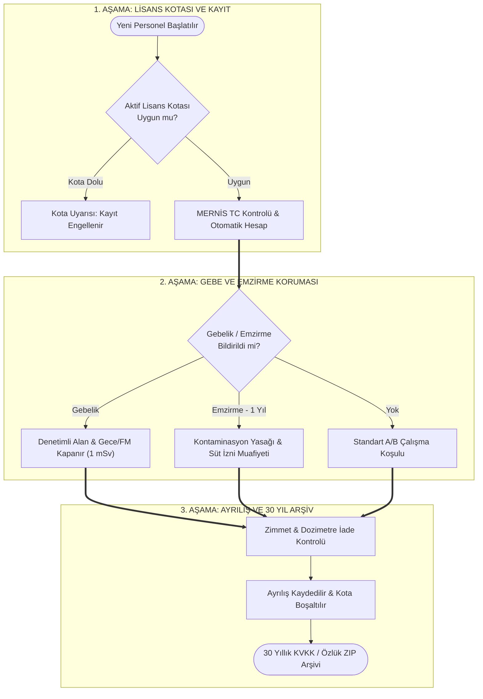

---json
{
  "pageTitle": "05. Personel Yönetimi ve Lisans Kotası — RADPYS v4 Kullanım Kılavuzu",
  "h1": "Personel Yönetimi, Lisans Kotası & Özlük Kartı",
  "lead": "Radyasyonla çalışan ve idari personelin özlük kartını yönetme, aktif lisans kotası kontrolü, otomatik kullanıcı hesabı üretimi, 7 kategorili detay takibi, gebe/emzirme koruma kalkanı ve 30 yıllık yasal KVKK/NDK arşiv paketini oluşturma rehberi.",
  "overviewId": "overview",
  "badges": [
    {
      "text": "6331 İSG, KVKK 6698 & NDK 30 Yıl Arşiv",
      "tone": "emerald"
    },
    {
      "text": "Lisans Kotası Kalkanı",
      "tone": "cyan"
    }
  ],
  "readingTime": "5 Dakika",
  "legalNote": "<strong>Yasal Güvence:</strong> 6331 sayılı İSG Kanunu m. 15, 32162 sayılı Yönetmelik ve NDK düzenlemeleri gereğince ayrılan radyasyon çalışanları sistemden silinmez; sağlık ve doz geçmişleri en az 30 yıl saklanır."
}
---

## Kısa Reçete: Yeni Personel Kaydı ve Yasal Yaşam Döngüsü Yönetimi {#quick-recipe}

:::recipe Kısa Reçete: Yeni Personel Kaydı ve Yasal Yaşam Döngüsü Yönetimi | 20 SANİYELİK AKIŞ

### 1. İstenen Sonuç | slate
Kurum lisans kotasını aşmadan yeni radyasyon çalışanını kaydetmek, otomatik giriş hesabını açmak ve ayrılışta 30 yıllık yasal KVKK arşiv paketini güvenceye almak.

### 2. Yapılacak İşlem | cyan
<strong>[Personel Ekle]</strong> sihirbazıyla kimlik, iletişim, özlük, eğitim ve belgeleri girip <strong>[Kaydet]</strong> butonuna basın. Personel ayrılışında <strong>[Ayrıntı / Düzenle] &gt; [Geçmiş &amp; İşten Ayrılış] &gt; [İşten Ayrılış &amp; KVKK Arşivi]</strong> sekmesinden zimmet denetimini tamamlayıp <strong>[KVKK ve Özlük Arşiv Paketini İndir (ZIP)]</strong> butonunu kullanın.

### 3. Sistem Etkisi | emerald
Aktif personel kotası doğrulanır ve giriş hesabı otomatik oluşturulur; ayrılan personelin doz, sağlık ve özlük geçmişi 30 yıl saklanmak üzere korunurken lisans kontenjanı anında serbest bırakılır.

- [metric] Yasal Saklama | 30 Yıl (NDK / İSG) | slate
- [metric] Lisans Kalkanı | Aktif Personel Kotası | cyan
- [metric] Özel Koruma | Gebe (1 mSv) & Emzirme | amber
- [metric] Platform | Masaüstü & Web Profil | emerald
:::

## 5N1K Kural ve Arayüz Çözümleme Tablosu {#5w1h}

*Personel lisans kotası, sayfalama koruması, gebelik/emzirme kalkanı ve ilişik kesme kuralları.*

| NE? (Bileşen / Kontrol) | NEDEN? (Amacı) | NASIL? (Çalışma Mantığı) | NE ZAMAN? (Tetiklenme) | KİM? (Yetkili Rol) |
| --- | --- | --- | --- | --- |
| <strong>Lisans Kotası ve Otomatik Hesap</strong> Kayıt Doğrulama Motoru | Sözleşme limitini korurken personele ayrı form açmadan güvenli oturum hesabı tanımlamak. | Aktif personel kaydında kurum kotası denetlenir; hesap açılması istendiğinde standart kullanıcı rolü ve rastgele tek kullanımlık geçici şifre (ilk girişte yenileme zorunlu) oluşturulur. | Yeni aktif personel kaydedilirken. | İK / RKS / Sistem Yöneticisi |
| <strong>Durum Filtresi ve Sayfalama Koruması</strong> Liste Kontrol Çubuğu | Aktif personeli ayrılanlardan ayırmak ve binlerce kayıtta ekran donmasını engellemek. | Varsayılan olarak yalnızca aktif çalışanlar listelenir; 1.000 üzeri kayıtta Tümü seçildiğinde performans onayı istenir. | Personel listesi süzülürken. | Tüm Kullanıcılar |
| <strong>Gebe ve Emzirme Koruma Kalkanı</strong> [Bildirimi Kaydet] &amp; Doğum/Süt İzni Geçişi | Anne, fetüs ve bebeği iyonlaştırıcı radyasyon ile bulaşma riskinden korumak. | Doktor raporu eklenerek gebelik kaydedildiğinde denetimli alan, gece nöbeti ve fazla mesai kapatılıp 1 mSv sınırı izlenir; doğum gerçekleştiğinde personel kartından tek adımla 1 yıllık emzirme ve süt izni koruma fazına geçilir. | Gebelik bildirildiğinde veya doğum sonrası geçişte. | RKS / Hekim / Yönetici |
| <strong>Zimmet Denetimli Ayrılış ve 30 Yıl Arşiv</strong> [Ayrılış Bilgilerini Kaydet] &amp; ZIP İhracı | Kurum RKE/dozimetre demirbaşını korumak ve yasal verileri devredilebilir pakette saklamak. | Zimmetli RKE, aktif dozimetre ve RKS görevi denetlenir; ayrılış onaylandığında kota boşaltılır ve yetki doğrulamasıyla tüm dozimetre, izin, sağlık ve eğitim geçmişini hiçbir satır kırpmadan özgün belge uzantılarıyla içeren 30 yıllık KVKK/özlük paketi (ZIP) üretilir. | İşten ayrılma, tayin veya emeklilikte. | İK / RKS / Sistem Yöneticisi |

## Kritik Sahada Yanlış Bilinen Kurallar (Mit Avcısı) {#myth-buster}

:::myth İşten Ayrılan Personeli Silersek Doz ve Sağlık Kayıtları Yok Olur mu?

### Yanlış Algı

<em>"İşten çıkan personeli lisans kotasından yer açılsın diye sistemden silmeliyiz; silersek geçmiş doz ve sağlık kayıtları da kaybolur."</em>

### Gerçek Sistem Mantığı

<strong>Personel kaydı asla kalıcı silinmez.</strong> 6331 sayılı İSG Kanunu m. 15, 32162 sayılı Yönetmelik ve NDK kuralları uyarınca sağlık ve doz kayıtları işten ayrılış sonrası en az <strong>30 yıl</strong> saklanmalıdır. Ayrılış statüsüne alınan personel lisans kotasından otomatik düşülür ve tüm geçmişi şifreli özlük arşiv paketiyle korunur.
:::

## Süreç Akış Şeması {#workflow}

1. **Lisans Kotası ve Kayıt:** Aktif personel eklenirken sözleşme kotası ile 11 haneli TC Kimlik numarası doğrulanır ve giriş hesabı otomatik açılır.
2. **Gebe ve Emzirme Koruması:** Gebe çalışanlarda denetimli alan ve gece nöbeti kapatılarak 1 mSv fetüs eşiği izlenir; emziren çalışanlarda 1 yıl süreyle bulaşma riskli açık kaynak alanı yasağı ve gece muafiyeti uygulanır.
3. **Ayrılış ve 30 Yıl Arşiv:** Zimmetli koruyucu ekipman ve aktif dozimetre iadeleri doğrulandıktan sonra personel ayrılışa geçirilir, kota serbest bırakılır ve 30 yıl saklanacak arşiv paketi oluşturulur.

## Arayüz Ekran Görünümleri {#screenshots}

## Adım Adım İşlem Rehberi {#step-by-step}

### 1. Yeni Personel Ekleme ve 7 Kategorili Ayrıntı Kartını Yönetme

1. **[Personel Listesi]** ekranında **[Personel Ekle]** butonuna tıklayın; 5 adımlı formda **Kimlik Bilgileri**, **İletişim**, **Özlük İşleri** (departman, unvan ve Koşul A/B radyasyon grubu), **Eğitim Kayıtları** ve **Personel Belgeler** alanlarını doldurup **[Kaydet]** butonuna basın (sistem giriş hesabı arka planda otomatik açılır).
2. Kayıtlı bir personeli güncellemek için satıra çift tıklayın veya **[Ayrıntı / Düzenle]** butonunu seçin; sol listedeki **7 sade kategoriden** (*Özlük & Kurumsal*, *Belgeler, Eğitim & Yakınlar*, *İzin Bilgileri*, *Sağlık Muayenesi*, *Dozimetre Takip*, *Nöbet Geçmişi*, *Geçmiş & İşten Ayrılış*) ilgili ekrana geçin.
3. Bilgi değişikliği yaparken sağ üstteki **[Düzenle]** butonunu açıp güncelleme sonrası **[Kaydet]** butonuna tıklayın. **Sağlık Muayenesi** ve **Dozimetre Takip** sekmelerinin üst şeridindeki özet durum kartlarından toplam kayıt ve limit durumunu izleyebilirsiniz; yüksek doz / RD.F43 inceleme bölümü yalnızca limit aşımı veya açık inceleme kaydı bulunduğunda otomatik görüntülenir.

### 2. Gebelik / Emzirme Bildirimi ve İşten Ayrılış / 30 Yıllık Arşiv Paketi

1. Kadın personelde gebelik veya doğum bildirmek için detay kartında gebelik bildirimi butonuna basın, tarihleri girip **[Bildirimi Kaydet ve Nöbetleri İptal Et]** butonuna tıklayın; gebelikte gece nöbetleri otomatik iptal edilir, emzirmede 1 yıl süt izni ve bulaşma koruması başlar.
2. İşten ayrılan personelde **[Geçmiş & İşten Ayrılış] &gt; [İşten Ayrılış & KVKK Arşivi]** sekmesini açıp ayrılış tarihi ile sebebini seçin ve **[Ayrılış Bilgilerini Kaydet]** butonuna basın; sistem zimmetli koruyucu ekipman ve aktif dozimetre varsa iade onayı ister, aktif RKS görevi varsa sonlandırır.
3. Tüm sağlık, dozimetre, izin, eğitim ve özlük belgelerini tek dosyada dışa aktarmak için **[KVKK ve Özlük Arşiv Paketini İndir (ZIP)]** butonunu kullanın.

### 3. Web Portalı Hesabım & Profilim Görünümü

1. Saha personeli tarayıcı veya mobilden **Web Portalı**'na giriş yaptığında **Hesabım & Profilim** ekranından kendi iletişim, dozimetre, periyodik sağlık/EK-1, eğitim ve izin/nöbet kayıtlarını görüntüler.
2. Personele bağlı gebelik veya rotasyon bildirimi gönderildiğinde talep doğrudan masaüstü yetkili onay kuyruğuna iletilir; yöneticiler ise Web Portaldaki personel gösterge panelinden kadro özetini salt okunur izler.

## Sıkça Sorulan Sorular (SSS) {#faq}

:::faq

### Kuruluş lisans kotamız dolduğunda yeni personel ekleyebilir miyiz?

Hayır. Lisans sözleşmesindeki aktif personel kotası dolduğunda sistem yeni aktif personel kaydını durdurur. Ancak işten ayrılan personellerin ayrılış işlemi kaydedilip pasife alındığında boşalan kontenjan kadar yeni kayıt hemen açılabilir.

### TC Kimlik Numarası girildiğinde sistem neden doğrulama uyarısı veriyor?

Mükerrer ve hatalı resmi bildirimi önlemek için 11 haneli MERNİS algoritma kontrolü ve sistem içi tekillik denetimi uygulanır. İlk hanesi sıfır olan, sağlama toplamı tutmayan veya başka bir personelde kayıtlı olan TC numaraları kabul edilmez.

### Emzirme döneminde radyasyon çalışanı için sayısal mSv dozu sınırı var mıdır?

13.04.2023 tarihli ve 32162 sayılı Yönetmelik, 657 sayılı Kanun m. 101 ve ilgili çalışma şartları yönetmeliği gereğince emzirme döneminde sayısal bir mSv sınırı yerine radyoaktif bulaşma (kontaminasyon) riski taşıyan açık kaynak alanlarında çalıştırılmama kuralı uygulanır; buna ek olarak 1 yıl boyunca süt izni saat azaltımı ve gece nöbeti muafiyeti devrede tutulur.

### Çok sayıda personeli Excel üzerinden tek seferde nasıl aktarabiliriz?

Personellerin toplu aktarımı için Kılavuzun **22. Bölüm: Merkezi Toplu İçe Aktarım Motoru (Bulk Import)** rehberini inceleyiniz. İlgili sihirbaz üzerinden 2 sayfalı şablon doldurularak tanımsız değerler eşleştirilir ve Dry-Run simülasyonu sonrasında kullanıcı hesapları otomatik üretilir.
:::
