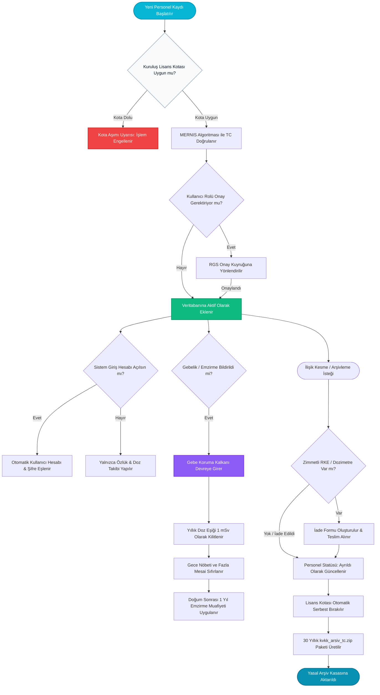

---json
{
  "pageTitle": "05. Personel Yönetimi ve Toplu Excel Veri Aktarımı — RADPYS v4 Kullanım Kılavuzu",
  "h1": "Personel Yönetimi, Lisans Kotası & Toplu İçe Aktarım",
  "lead": "Radyasyonla çalışan personelin özlük, lisans, unvan, görev yeri, radyasyon çalışma grubu (A/B), lisans kotası, sağlık muayeneleri, zimmetli koruyucu ekipman (RKE), gebe/emzirme kalkanı ve 30 yıllık yasal KVKK arşiv yönetim rehberi.",
  "overviewId": "overview",
  "badges": [],
  "readingTime": "5 Dakika"
}
---

## Hızlı Reçete: Personel Yaşam Döngüsü ve Yasal Uyum {#quick-recipe}

:::recipe Hızlı Reçete: Personel Yaşam Döngüsü ve Yasal Uyum | 20 SANİYELİK AKIŞ
### 1. İstenen Sonuç | slate
Radyasyon çalışanlarını kurum lisans kotası dahilinde kaydetmek, sağlık ve dozimetrik geçmişlerini kesintisiz yönetmek.

### 2. Yapılacak İşlem | cyan
<strong>[Yeni Personel Ekle]</strong> ile kayıt açın, gebe/emzirme durumunu bildirin, ayrılışta zimmetleri kapatıp <strong>30 Yıllık KVKK Arşiv Paketini (ZIP)</strong> oluşturun.

### 3. Sistem Etkisi | emerald
Kota aşımı engellenir; gebe personelin nöbeti sıfırlanıp dozu 1 mSv'e kilitlenir; ayrılan personelin yasal kayıtları 30 yıl saklanmak üzere şifrelenir.

- [metric] Yasal Saklama | 30 Yıl (NDK/İSG) | slate
- [metric] Lisans Denetimi | Aktif Kota Kontrolü | slate
- [metric] Koruma Kalkanı | Gebe & Emzirme | slate
- [metric] Platform | Hibrit: Desktop & Web | slate
:::

## 5N1K Kural ve Fonksiyon Tablosu {#table-5w1h}

 

 Personel yönetimi, lisans denetimi, arama filtreleri ve toplu aktarım araçlarının işleyişi.
 

 

| NE? (Ekran Kontrolü) | NEDEN? (Kullanım Amacı) | NASIL? (Çalışma Mantığı) | NE ZAMAN? (Hangi Durumda) | KİM? (Yetkili Kitle) |
| --- | --- | --- | --- | --- |
| <strong>Metin Arama Kutusu</strong>  Üst Filtre Çubuğu | Yüzlerce çalışan arasından hedeflenen personele anında ulaşmak. | Ad, Soyad, TC Kimlik No, Sicil No ve E-posta alanlarında harf girildikçe anlık dinamik filtreleme yapar. | Personel sorgulama ve işlem öncesinde. | Tüm Kullanıcılar |
| <strong>Çalışma Durumu Filtresi</strong>  Üst Filtre Çubuğu | Aktif çalışanlar ile işten ayrılmış eski personeli ayırmak. | "Tümü", "Aktif Çalışanlar" ve "Ayrılmış / Pasif" seçeneklerine göre listeyi filtreler. | Rutin işlemlerde aktifleri, denetimlerde eski personelleri incelerken. | Tüm Kullanıcılar |
| <strong>Yeni Personel Ekle</strong>  Üst Sol Buton | Kuruma yeni başlayan personeli yasal kotalar dahilinde sisteme dahil etmek. | Lisans kotası denetlenir; MERNIS algoritmasıyla TC kontrol edilir; rol izinlerine göre onay kuyruğuna yönlendirilir. | İşe yeni personel alımlarında. | Admin / İK / RGS |
| <strong>Personel Detay Kartı</strong>  Satır Çift Tık / Düzenle | Personelin tüm özlük, sağlık, zimmet ve doz geçmişini tek ekranda incelemek. | Sekmeli diyalog penceresi açılır: Özlük Bilgileri, İletişim, Sağlık & Muayeneler, Zimmetli RKE ve Dozimetreler listelenir. | Bilgi güncelleme, zimmet takibi ve sağlık kontrolünde. | Yetkili Kullanıcılar |
| <strong>Kullanıcı Hesabı Oluşturma</strong>  Yeni Personel Formu | Personelin masaüstü veya web portalına giriş yapabilmesini sağlamak. | Kutucuk seçildiğinde kullanıcı adı ve rolü belirlenir; personelle eşleşen sistem giriş hesabı otomatik açılır. | Personel sisteme kendi oturumuyla girecekse. | Sistem Yöneticisi |
| <strong>Gebe / Emzirme Kalkanı</strong>  Sağlık & Koruma Sekmesi | Mevzuat gereği anne ve bebeği radyasyon riskinden tam korumaya almak. | Ana birim ve alt birimin radyasyonlu alan durumu denetlenir; etkin doz eşiği 1 mSv'e kilitlenir, gece nöbetleri sıfırlanır, fazla mesai engellenir ve doğumdan sonra 1 yıl emzirme muafiyeti sürer. | Gebelik bildirimi veya doğum sonrası emzirme döneminde. | RGS / Hekim / Admin |
| <strong>İlişik Kes / Arşivle</strong>  Personel İşlem Menüsü | Ayrılan personelin zimmetlerini kapatıp lisans kotasını serbest bırakmak. | Zimmetli RKE ve aktif dozimetreler denetlenir (tek onayla otomatik zimmet iadesi yapılabilir); ilişik kesilir ve 30 yıllık KVKK arşiv paketi (ZIP) oluşturulup personel pasife alınır. | İşten ayrılma, tayin veya emeklilik durumunda. | Admin / RGS |
| <strong>Dışa Aktar (Rapor &amp; Excel / PDF / Word)</strong>  Tablo Araçları | Personel listesini denetim, raporlama veya yedek amacıyla filtrelenmiş resmi döküm olarak bilgisayara almak. | Ekrandaki aktif filtreleri (Aktif/Pasif, Birim, Arama) devralarak doğrudan şablonun varsayılan formatında tek tıkla kaydeder veya Rapor Merkezini açar. Tüm onay pencereleri standart Türkçe [Tamam / İptal] butonlarıyla çalışır. | Resmi raporlama, denetim ve yönetim sunumlarında. | Tüm Kullanıcılar |
| <strong>5 Adımlı Evrensel Toplu İçe Aktarım Sihirbazı</strong>  [Toplu İşlemler] Menüsü &amp; [Excel İçe Aktar] | Onlarca veya yüzlerce personeli, izin hakedişlerini, cihaz ve RKE envanterini tek tek girmek yerine Excel/CSV dosyalarından akıllı doğrulama ile sisteme yüklemek. | 5 aşamalı akış işletilir: 1. Dosya Seçimi &amp; Çift Sayfalı Şablon İndirme, 2. Otomatik Sütun Eşleştirme, 3. Dinamik Değer Sözlüğü (Lookup) Çözümleme, 4. Önizleme &amp; Kapsamlı Dry-Run Doğrulama (Geçerli/Uyarı/Hata sekmeleri), 5. Asenkron Arka Plan Aktarımı (Ekran donmaz, şifre dökümü ve hatalı satırların Excel raporu sunulur). | İlk sistem kurulumunda, toplu alımlarda veya dönem başı veri yüklemelerinde. | Sistem Yöneticisi |
| <strong>Pencereyi Kapat</strong>  Başlık Çubuğu &amp; [Kapat] Butonu | Personel listesi modülünden çıkıp ana ekrana dönmek. | Açık alt pencereler güvenle kapatılır ve sistem kaynakları serbest bırakılır. | İşlem tamamlandığında. | Tüm Kullanıcılar |

## Kritik Sahada Yanlış Bilinen Kurallar (Mit Avcısı) {#myth-buster}

 

 

 

 <h3 class="text-base font-bold text-slate-900 dark:text-white">
 Saha Mit Avcısı: "İşten Ayrılan Personeli Silersek Doz ve Sağlık Kayıtları Yok Olur mu?"
 </h3>
 En Sık Karşılaşılan Yasal Yanılgı
 

 

 

 

 
 

 <strong>Yanlış İnanış:</strong> <em>"İşten çıkan personeli silersek veritabanından tamamen uçar, geçmiş doz kayıtları ve sağlık raporları kaybolur; lisans kotasından düşsün diye kaydı silmemiz şarttır."</em>
 

 

 

 
 

 <strong>Doğru Gerçek:</strong> <strong>KESİNLİKLE HAYIR.</strong> NDK Radyasyon Güvenliği Yönetmeliği, 6331 sayılı İSG Kanunu ve EURATOM direktifleri uyarınca radyasyon çalışanlarının tüm periyodik sağlık raporları ve dozimetrik geçmişi <strong>30 yıl boyunca</strong> saklanmak zorundadır. RADPYS'de ayrılan personel veritabanından kalıcı olarak <strong>silinmez</strong>; durumu <em>"Ayrıldı / Arşivlendi"</em> statüsüne alınarak lisans kotasından düşürülür. Ayrılış anında personelin tüm 30 yıllık geçmişini içeren şifreli <strong>`kvkk_arsiv_{tc}.zip`</strong> yasal paketi oluşturularak arşiv kasasında güvence altına alınır.
 

 

 

## Personel Yaşam Döngüsü ve Mevzuat Akış Şeması {#workflow}

 

 Personel kaydı, lisans kotası denetimi, gebe koruma kalkanı ve ilişik kesme adımları.
 

 

 

 

## Arayüz Ekran Görünümleri {#screenshots}

 

 Personel Listesi, dinamik arama paneli ve detaylı personel kartı görünümleri.
 

 

## Adım Adım İşlem Rehberi {#step-by-step}

 

 Saha operasyonlarında en sık kullanılan 5 ana işlemin uygulama adımları.
 

 

 

 

 
 1
 
 <h3 class="text-base font-bold text-slate-900 dark:text-white">
 Yeni Personel Kaydı Açma ve Lisans Kotası Doğrulama
 </h3>
 

 <ol class="list-decimal list-inside space-y-2 text-xs sm:text-sm text-slate-600 dark:text-slate-300 pl-2">
 <li>Personel Listesi ekranının sol üst köşesindeki <strong>[Yeni Personel Ekle]</strong> butonuna tıklayın.</li>
 <li>Sistem arka planda kurum lisansının aktif personel kotasını sorgular. Kota dolu ise ekranda bilgilendirme modalı açılır.</li>
 <li>Formdaki zorunlu alanları doldurun:
 <ul class="list-disc list-inside pl-5 mt-1 text-slate-500 dark:text-slate-400 space-y-0.5">
 <li><strong>TC Kimlik No:</strong> 11 haneli geçerli MERNIS algoritmasına uygun numara.</li>
 <li><strong>Ad, Soyad ve Sicil No.</strong></li>
 <li><strong>Birim ve Görev / Unvan:</strong> Radyoloji, Nükleer Tıp veya Radyasyon Onkolojisi seçimi.</li>
 <li><strong>Radyasyon Çalışma Grubu:</strong> Grup A (Aylık Dozimetre) veya Grup B (3 Aylık Dozimetre).</li>
 </ul>
 </li>
 <li>Personelin programa kendi şifresiyle girmesi gerekiyorsa <strong>[Sistem Kullanıcı Hesabı Oluştur]</strong> kutusunu işaretleyip rolünü seçin.</li>
 <li><strong>[Kaydet]</strong> butonuna basarak işlemi tamamlayın. Onay gerektiren bir roldeyseniz kayıt RGS onay kuyruğuna iletilecektir.</li>
 </ol>
 

 

 

 
 2
 
 <h3 class="text-base font-bold text-slate-900 dark:text-white">
 Personel Detaylarını Güncelleme ve Doz / Sağlık Takibi
 </h3>
 

 <ol class="list-decimal list-inside space-y-2 text-xs sm:text-sm text-slate-600 dark:text-slate-300 pl-2">
 <li>Tabloda aradığınız personelin satırına çift tıklayın veya satır sonundaki <strong>[Düzenle]</strong> butonuna basın.</li>
 <li>Açılan <strong>Personel Detay Kartı</strong> penceresinde ilgili sekmeye geçin:
 <ul class="list-disc list-inside pl-5 mt-1 text-slate-500 dark:text-slate-400 space-y-0.5">
 <li><strong>Özlük Bilgileri:</strong> İletişim, adres, kan grubu, acil durum irtibatı.</li>
 <li><strong>Radyasyon Bilgileri:</strong> Grup A/B tercihi, TENMAK/NDK servis sağlayıcı kodu.</li>
 <li><strong>Zimmetler:</strong> Üzerine kayıtlı kurşun önlük, tiroid koruyucu ve aktif dozimetreler.</li>
 <li><strong>Sağlık Muayeneleri:</strong> İşe giriş ve periyodik hemogram/dermatoloji kontrol tarihleri.</li>
 </ul>
 </li>
 <li>Güncellemeleri tamamladıktan sonra <strong>[Değişiklikleri Kaydet]</strong> butonuna basarak formu kapatın.</li>
 </ol>
 

 

 

 
 3
 
 <h3 class="text-base font-bold text-slate-900 dark:text-white">
 Gebe ve Emziren Personel Koruma Protokolünün Devreye Alınması
 </h3>
 

 <ol class="list-decimal list-inside space-y-2 text-xs sm:text-sm text-slate-600 dark:text-slate-300 pl-2">
 <li>İlgili kadın personelin detay kartını açarak <strong>[Sağlık & Koruma]</strong> sekmesine gelin.</li>
 <li><strong>[Gebelik Durumu Bildirimi]</strong> kutusunu işaretleyin; hekim raporundaki gebelik başlangıç tarihini ve tahmini doğum tarihini girin.</li>
 <li><strong>[Kaydet]</strong> butonuna bastığınız anda RADPYS güvenlik motoru:
 <ul class="list-disc list-inside pl-5 mt-1 text-slate-500 dark:text-slate-400 space-y-0.5">
 <li>Personelin yıllık etkin doz eşiğini mevzuat uyarınca <strong>1 mSv</strong> değerine sabitler.</li>
 <li>Nöbet planlama modülünde personelin gece vardiyası ve fazla mesai almasını otomatik olarak engeller.</li>
 <li>Radyasyon Güvenlik Sorumlusu (RGS) paneline anlık uyarı bildirimi gönderir.</li>
 </ul>
 </li>
 <li>Doğum gerçekleştiğinde aynı sekmeden <strong>[Emzirme Durumu]</strong> seçilerek koruma süreci 1 yıl daha uzatılabilir.</li>
 </ol>
 

 

 

 
 4
 
 <h3 class="text-base font-bold text-slate-900 dark:text-white">
 İşten Ayrılış, Zimmet İadesi ve 30 Yıllık KVKK Arşiv Paketi
 </h3>
 

 <ol class="list-decimal list-inside space-y-2 text-xs sm:text-sm text-slate-600 dark:text-slate-300 pl-2">
 <li>İşten ayrılan personelin satır işlem menüsünden <strong>[İlişik Kes / Arşivle]</strong> butonuna basın.</li>
 <li>Sistem personelin zimmet dökümünü kontrol eder:
 <ul class="list-disc list-inside pl-5 mt-1 text-slate-500 dark:text-slate-400 space-y-0.5">
 <li>Üzerinde zimmetli kurşun önlük, koruyucu gözlük vb. varsa sistem <strong>"İade Edilmemiş RKE Bulunmaktadır"</strong> uyarısı verir.</li>
 <li>Aktif periyot dozimetresi teslim edilmemişse uyarı çıkar.</li>
 </ul>
 </li>
 <li>Zimmetler depoya iade edildikten sonra ayrılış tarihini ve nedenini girerek onay verin.</li>
 <li>Sistem personeli <em>"Ayrıldı"</em> statüsüne alıp lisans kotasını serbest bırakır.</li>
 <li>Otomatik olarak NDK mevzuatı gereği 30 yıl saklanacak olan <strong>`kvkk_arsiv_{tc}.zip`</strong> kriptolu arşiv dosyasını bilgisayarınıza indirmeniz için dosya kaydetme penceresi sunar.</li>
 </ol>
 

 

 

 
 5
 
 <h3 class="text-base font-bold text-slate-900 dark:text-white">
 5 Adımlı Evrensel İçe Aktarım Sihirbazı ile Toplu Veri Yükleme
 </h3>
 

 <ol class="list-decimal list-inside space-y-3 text-xs sm:text-sm text-slate-600 dark:text-slate-300 pl-2 leading-relaxed">
 <li><strong>1. Adım (Veri Kaynağı ve 2 Sayfalı Şablon):</strong> <strong>[Toplu İşlemler]</strong> menüsünden <strong>[Örnek Excel Şablonu İndir]</strong> butonuna tıklayın. İndirilen dosya 2 sayfadan oluşur:
 <ul class="list-disc list-inside pl-5 mt-1 text-slate-500 dark:text-slate-400 space-y-1">
 <li><strong>Veri Listesi Sekmesi:</strong> Personellerin TC Kimlik No, Ad, Soyad, Sicil No, Departman ve Görev bilgilerinin girileceği alandır. Sayısal veri kayıplarını ve baştaki sıfırların silinmesini önlemek için hücreler kurumsal metin biçiminde kilitlenmiştir.</li>
 <li><strong>Geçerli Değerler Kılavuzu Sekmesi:</strong> Sisteminizde halihazırda tanımlı olan aktif departmanlar, unvanlar ve izin türleri bu sayfada referans liste olarak sunulur; hatalı yazımların önüne geçilir.</li>
 </ul>
 Dosyanızı hazırladıktan sonra <strong>[Dosya Seç]</strong> ile sihirbaza yükleyin ve <strong>[İleri]</strong> butonuna basın.
 </li>
 <li><strong>2. Adım (Akıllı Sütun Eşleştirme):</strong> Sistem dosyanızdaki sütun başlıklarını otomatik olarak algılar ("T.C.", "TC Kimlik No", "Adı Soyadı" gibi eşanlamlılar doğrudan eşleşir). Eşleşmeyen opsiyonel sütunları açılır kutulardan seçebilir veya eşlemeyi özelleştirebilirsiniz.</li>
 <li><strong>3. Adım (Dinamik Değer Sözlüğü Çözümleme):</strong> Excel dosyanızdaki bir departman veya unvan sistemde birebir bulunamadığında sihirbaz duraksamaz; her bilinmeyen değer için 3 esnek seçenek sunar:
 <ul class="list-disc list-inside pl-5 mt-1 text-slate-500 dark:text-slate-400 space-y-0.5">
 <li><em>Var Olanla Eşleştir:</em> Sistemdeki mevcut bir departman veya unvana bağlayın.</li>
 <li><em>Yeni Tanım Olarak Ekle:</em> Sisteme yetkiniz dahilinde yeni bir tanım olarak kaydedilmesini sağlayın.</li>
 <li><em>Satırı Atla:</em> Bu değeri içeren satırları içe aktarımdan hariç tutun.</li>
 </ul>
 </li>
 <li><strong>4. Adım (Önizleme &amp; Kapsamlı Doğrulama - Dry Run):</strong> Veritabanına hiçbir kayıt yazılmadan önce simülasyon çalıştırılır:
 <ul class="list-disc list-inside pl-5 mt-1 text-slate-500 dark:text-slate-400 space-y-0.5">
 <li><strong>Geçerli Kayıtlar:</strong> Yeşil rozetle gösterilir; doğrudan aktarıma hazırdır.</li>
 <li><strong>Uyarılar:</strong> Sarı rozetle vurgulanır; mükerrer isim veya eksik opsiyonel alanları gösterir.</li>
 <li><strong>Hatalı Kayıtlar:</strong> Kırmızı rozetle işaretlenir; geçersiz TC Kimlik, aktif kota aşımı veya eksik zorunlu alanlar gerekçesiyle listelenir. Tablo üzerindeki filtreleme sekmeleriyle hataları anında ayıklayabilirsiniz.</li>
 </ul>
 </li>
 <li><strong>5. Adım (Asenkron Arka Plan Aktarımı &amp; Hata Raporu):</strong> <strong>[Aktarımı Başlat]</strong> butonuna bastığınızda aktarım arka planda yürütülür; binlerce satırlık listelerde dahi program donmaz veya kilitlenmez. İşlem tamamlandığında otomatik oluşturulan kullanıcı hesaplarının şifre dökümü sunulur; aktarılamayan hatalı satırlar varsa <strong>[Hataları Excel Olarak İndir]</strong> butonu ile hata gerekçeleriyle birlikte raporlanır.</li>
 </ol>
 

## Sıkça Sorulan Sorular (SSS) {#faq}

:::faq
### Kuruluş lisans kotamız dolduğunda yeni personel ekleyebilir miyiz? ▾
Hayır. RADPYS lisans sözleşmenizdeki aktif personel kotası aşıldığında sistem yeni personel kaydını engeller ve kota artırımı için yöneticinize bildirim yapmanızı önerir. Ancak işten ayrılan eski personellerin ilişiği kesilip arşivlendiğinde, boşalan kontenjan kadar yeni personel kaydı anında açılabilir.

### Personel TC Kimlik Numarası girildiğinde sistem neden hata veriyor? ▾
RADPYS, NDK ve Sağlık Bakanlığı resmi bildirimlerinde mükerrer veya sahte kayıt oluşmasını önlemek amacıyla MERNIS 11 haneli matematiksel algoritma kontrolü uygular. İlk hanesi 0 olan veya sağlama toplamı tutmayan TC kimlik numaraları sistem tarafından reddedilir. Ayrıca aynı TC numarası ile sistemde zaten aktif bir kayıt varsa mükerrer kayıt uyarısı verilir.

### Gebe personel doğum yaptıktan sonra koruma kalkanı devam eder mi? ▾
Evet. İlgili mevzuat uyarınca doğum sonrası emzirme döneminde de personelin radyoaktif kontaminasyon riski bulunan sahalarda çalışması ve gece nöbeti tutması kısıtlıdır. Personel detay kartındaki [Emzirme Durumu] seçeneği işaretlendiğinde koruma kalkanı doğum tarihinden itibaren tam 1 yıl boyunca otomatik olarak devrede kalmaya devam eder.

### İşten ayrılan personelin üzerinde zimmetli kurşun önlük kalırsa ne yapılmalıdır? ▾
Sistem, kurum demirbaşlarının kaybolmasını ve sahipsiz radyasyon koruyucu ekipman kalmasını önlemek için ilişik kesme anında zimmet denetimi yapar. Personel Detay Kartı > Zimmetler sekmesinden veya RKE Modülü üzerinden ilgili ekipman "Depoya İade Edildi" olarak işaretlenmeli, ardından personelin ilişik kesme ve arşivleme işlemi onaylanmalıdır.

### Web portalından eklenen personel masaüstü uygulamasında hemen görünür mü? ▾
Evet. Web portalı ile masaüstü uygulaması aynı merkezi PostgreSQL veritabanını paylaşır. Web portalından veya mobil arayüzden yapılan tüm personel ekleme, güncelleme ve ayrılış işlemleri masaüstü ekranındaki [Yenile] butonuna basıldığında veya tablo açıldığında anında eşzamanlı olarak yansır.

### Toplu personel Excel'i yüklerken dosyadaki departman veya unvan sistemde yoksa ne olur? ▾
RADPYS Evrensel İçe Aktarım Sihirbazı işlemi durdurmaz veya tüm dosyayı reddetmez. 3. Adımda (Dinamik Değer Çözümleme) sistemde eşleşmeyen her bir tanımsız değer için size seçenek sunar: İlgili değeri sistemdeki mevcut bir departman/unvanla eşleyebilir, yetkiniz dahilinde sisteme otomatik yeni tanım olarak ekleyebilir ya da yalnızca o satırları atlayarak diğer personellerin aktarımını başarıyla tamamlayabilirsiniz. Ayrıca indirilen şablonun ikinci sayfasındaki [Geçerli Değerler Kılavuzu] sekmesine bakarak sisteminizdeki tam isimleri önceden inceleyebilirsiniz.
:::
