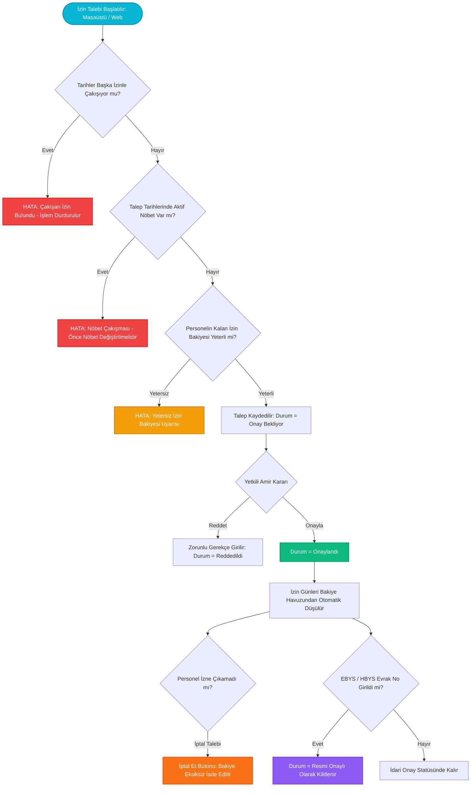

---json
{
  "pageTitle": "06. İzin Yönetimi, Şua İzni ve Yıllık İzin Hakedişleri — RADPYS v4 Kullanım Kılavuzu",
  "h1": "İzin Yönetimi, Şua Hakedişi & İzin Devir Motoru",
  "lead": "Radyasyonla çalışan sağlık personelinin yasal Şua İzni (sağlık izni), yıllık izin, mazeret ve hastalık izinlerinin talebi, nöbet ve çakışma kontrolleri, yetkili onayı, bakiye düşümü, geçmiş yıl devir aktarımı ve EBYS/HBYS evrak entegrasyonu rehberi.",
  "overviewId": "overview",
  "badges": [],
  "readingTime": "6 Dakika"
}
---

## Hızlı Reçete: Radyasyon İzinleri ve Yasal Hakediş Süreci {#quick-recipe}

:::recipe Hızlı Reçete: Radyasyon İzinleri ve Yasal Hakediş Süreci | 20 SANİYELİK AKIŞ
### 1. İstenen Sonuç | slate
Personelin hak ettiği izinleri mevzuata uygun kullandırmak, nöbet aksamalarını önlemek ve bakiye kayıplarını sıfırlamak.

### 2. Yapılacak İşlem | cyan
<strong>[İzin Talep Et]</strong> sihirbazından personeli ve tarihleri seçin, yönetici ekranından onaylayın veya web portalından <strong>[EBYS Kaydet]</strong> ile resmiyete dökün.

### 3. Sistem Etkisi | emerald
Nöbet çakışmaları engellenir, onay anında bakiye düşülür, iptal halinde bakiye iade edilir; şua izni 31 Aralık'ta devretmeksizin yanar.

- [metric] Yasal Şua Tavanı | 30 Gün / Yıl | slate
- [metric] Hak Katsayısı | 50 Saat = 1 Gün | slate
- [metric] Devir Tavanı | Max 5 Gün (Yıllık) | slate
- [metric] Platform | Masaüstü & Web | slate
:::

## 5N1K Kural ve Arayüz Çözümleme Tablosu {#5w1h}

 

 İzin modülünde yer alan kontrollerin yasal dayanakları, çalışma mekanizmaları ve kullanıcı rolleri.
 

 

| NE? (Bileşen / Kontrol) | NEDEN? (Amacı) | NASIL? (Çalışma Mantığı) | NE ZAMAN? | KİM? |
| --- | --- | --- | --- | --- |
| <strong>İzin Tablosu & Arama</strong>  Üst Filtre Çubuğu | Departmandaki tüm izin hareketlerini ve onay durumlarını listelemek. | 300 ms gecikmeli debounced arama ile ad, soyad, TC ve EBYS no taranır; durum ve izin türü filtrelenir. | Rutin takip ve denetimlerde. | Yönetici, Süpervizör, İK |
| <strong>Yeni İzin Talebi [+ İzin Talep Et]</strong>  2 Adımlı Talep Sihirbazı | Personel adına mevzuata uygun izin kaydı açmak. | Adım 1'de personel seçilir ve anlık bakiye kartı açılır. Adım 2'de tarihler, tür, vekil ve açıklama girilir. | İzin talebi oluştuğunda. | Personel, Birim Amiri |
| <strong>Şua İzni Hakedişi (Mevzuat Standardı)</strong>  Yasal Hakediş Kuralı | Radyasyon çalışanlarının kanuni sağlık iznini hesaplamak. | Fiili çalışma süresine göre her 50 saatte 1 gün hesaplanır (tavan 30 gün). Cari yıl kazanımı takip eden yıl kullanılır; devretmez, 31 Aralık'ta yanar. | Yıllık izin planlamasında. | Radyasyon Çalışanları |
| <strong>Çakışma & Nöbet Kilidi</strong>  Otomatik Çakışma Denetimi | Personelin nöbet gününde izne çıkmasını veya mükerrer izin almasını engellemek. | Talep edilen tarihler personelin onaylı/bekleyen izniyle veya nöbet çizelgesindeki aktif göreviyle kesişiyorsa işlem durdurulur. | İzin kaydetme anında. | Sistem (Otomatik Kilit) |
| <strong>İzin Onayla</strong>  Üst Araç Çubuğu (Yeşil) | Bekleyen talebi onaylayıp bakiyeyi güncellemek. | İzin durumu 'Onaylandı' yapılır; personelin ilgili yıl için tanımlı kalan izninden gün sayısı anında düşülür. | Amir incelemesinden sonra. | Yönetici, Departman Sorumlusu |
| <strong>İzin Reddet</strong>  Üst Araç Çubuğu (Kırmızı) | Uygun görülmeyen izin talebini gerekçeli sonlandırmak. | Açılan diyalogda ret gerekçesi girilmesi zorunludur. Bakiye düşümü yapılmaz, durum 'Reddedildi' olarak arşivlenir. | Hizmet aksaması durumunda. | Yönetici, Süpervizör |
| <strong>İzin İptali</strong>  Üst Araç Çubuğu (Turuncu) | Kullanılmayacak onaylı izni geri çekip hakkı iade etmek. | İzin 'İptal Edildi' statüsüne çekilir; önceden düşülen izin günleri personelin bakiye havuzuna geri aktarılır. | Görevin iptal edilmesinde. | Yönetici, Süpervizör |
| <strong>Devir Aktar & Yılı Kilitle</strong>  [Devir Aktar & Yılını Kilitle Butonu] | Yıllık izin devrini gerçekleştirmek, 12 aylık fiili hizmetten yeni yılın Şua İzni hakedişini kesinleştirmek ve kaynak yılı dondurmak. | Kapanan yılın kalan yıllık izinlerini tavan sınırına (azami 5 gün) göre devreder. Kaynak yılın 12 aylık fiili radyasyon saatlerini tarayarak yeni yıl Şua İzni hakedişini (her 50 saate 1 gün, azami 30 gün) oluşturur ve kaynak yılı dondurur. Bu işlem yüzlerce personel için arka planda asenkron iş parçacığıyla yürütülür; arayüz donmaz, canlı ilerleme penceresi gösterilir ve tamamlandığında özet bildirim kartı sunulur. | Yıl başında yeni yıl hakedişleri açılırken. | Sistem Yöneticisi, İK |
| <strong>Web Portalı EBYS Kaydı</strong>  [EBYS Kaydet Formu] | Resmi kurum evrak numarasını izin kaydına işlemek. | İlk evrak no girişinde izin doğrudan 'Resmi Onaylı' statüsü kazanır. Sonradan değiştirilmek istenirse onay masasına düşer. | Resmi yazı çıktığında. | Personel, İdari İşler |
| <strong>Toplu İzin &amp; Hakediş İçe Aktar</strong>  [Toplu İçe Aktar Butonu] | Geçmiş yıllara ait izin hareketlerini veya yıllık izin hakedişlerini 2 sayfalı kurumsal Excel şablonuyla topluca sisteme yüklemek. | Evrensel İçe Aktarım Sihirbazı ile hakediş veya geçmiş izin şablonu seçilir; izin türleri dinamik sözlükte çözümlenir; Dry-Run önizlemesinden sonra asenkron olarak güvenle kaydedilir. | İlk kurulum aşamasında veya yıl başı toplu izin bakiye tanımlamalarında. | İK / Sistem Yöneticisi |

## Kritik Sahada Yanlış Bilinen Kurallar (Mit Avcısı) {#myth-buster}

 

 

 

 <h3 class="text-base font-bold text-slate-900 dark:text-white">
 Saha Mit Avcısı: "Kullanılmayan Şua İzinleri Bir Sonraki Yıla Devreder mi ya da Paraya Çevrilebilir mi?"
 </h3>
 En Yaygın Radyasyon Mevzuatı Yanılgısı
 

 

 

 

 
 

 <strong>Yanlış İnanış:</strong> <em>"Yoğunluktan ötürü bu yıl 30 günlük şua iznimi kullanamadım, seneye aktarılır 60 gün kullanırım veya kullanamadığım günlerin ücretini idareden talep edebilirim."</em>
 

 

 

 
 

 <strong>Doğru Gerçek:</strong> <strong>KESİNLİKLE HAYIR.</strong> 3153 sayılı Kanun, Radyasyon Güvenliği Yönetmeliği ve Sağlık Bakanlığı içtihatları uyarınca Şua İzni (sağlık izni), personelin vücudundaki radyasyon biyolojik hasarını tolere etmek ve hücresel onarımı sağlamak amacıyla verilmiş <strong>kamu düzenine ilişkin bir dinlenme hakkıdır</strong>. Şua izni ertelenemez, takvim yılı (31 Aralık) bittiğinde <strong>zaman aşımına uğrayarak yanar</strong>, sonraki yıla devredilemez veya nakdi tazminata dönüştürülemez. RADPYS hakediş motoru bu nedenle şua izinlerini cari yılda kilitler ve yıl sonu devrine izin vermez.
 

 

 

## İzin Talep, Çakışma Denetimi ve Onay Akış Şeması {#workflow}

 

 Personel izin talebinden bakiye kontrolüne, nöbet çakışmasından EBYS evrak kaydına tam süreç döngüsü.
 

 

 

 

## Arayüz Ekran Görünümleri {#screenshots}

 

 İzin Listesi kokpiti ve 2 adımlı İzin Talep Sihirbazı ekranları.
 

 

## Adım Adım İşlem Rehberi {#step-by-step}

 

 Saha operasyonlarında en sık kullanılan 5 ana işlemin uygulama adımları.
 

 

 

 

 
 1
 
 <h3 class="text-base font-bold text-slate-900 dark:text-white">
 2 Adımlı Sihirbaz ile Yeni İzin Talebi Oluşturma
 </h3>
 

 <ol class="list-decimal list-inside space-y-2 text-xs sm:text-sm text-slate-600 dark:text-slate-300 pl-2">
 <li>İzin Listesi ekranının sol üst köşesindeki mor <strong>[+ İzin Talep Et]</strong> butonuna tıklayın.</li>
 <li>Açılan sihirbazın 1. Adımında:
 <ul class="list-disc list-inside pl-5 mt-1 text-slate-500 dark:text-slate-400 space-y-0.5">
 <li><strong>Personel Seçimi:</strong> TC Kimlik veya Ad ile personeli bulun.</li>
 <li><strong>Bakiye Kontrolü:</strong> Sağ taraftaki panelde personelin cari yıldaki Yıllık Hakedilen, Devir Eden ve Şua İzni kalan haklarını kontrol edin.</li>
 </ul>
 </li>
 <li>Alt kısımdaki <strong>[İleri >]</strong> butonuna basarak 2. Adıma geçin:
 <ul class="list-disc list-inside pl-5 mt-1 text-slate-500 dark:text-slate-400 space-y-0.5">
 <li><strong>İzin Türü:</strong> Yıllık İzin, Şua İzni (Sağlık İzni), Mazeret İzni vb. seçin.</li>
 <li><strong>Başlangıç / Bitiş Tarihleri:</strong> Tarihleri seçtiğinizde sistem resmi tatil ve hafta sonu parametrelerine göre net gün ve saat süresini otomatik hesaplar.</li>
 <li><strong>Vekil Personel:</strong> İzin esnasında görevi devralacak meslektaşınızı belirleyin.</li>
 </ul>
 </li>
 <li><strong>[Kaydet]</strong> butonuna basın. Çakışma ve nöbet kontrolleri olumluysa talep 'Onay Bekliyor' statüsünde listeye düşecektir.</li>
 </ol>
 

 

 

 
 2
 
 <h3 class="text-base font-bold text-slate-900 dark:text-white">
 İzin Taleplerini İnceleme, Onaylama ve Gerekçeli Reddetme
 </h3>
 

 <ol class="list-decimal list-inside space-y-2 text-xs sm:text-sm text-slate-600 dark:text-slate-300 pl-2">
 <li>İzin Listesinde üst filtrelerden durumu <strong>'Beklemede'</strong> olarak seçin.</li>
 <li>İncelenmek istenen satırı tıklayın veya detaylarını görmek için <strong>[Ayrıntı / Düzenle]</strong> butonuna basın.</li>
 <li><strong>Onaylamak İçin:</strong> Yeşil renkli <strong>[Onayla]</strong> butonuna tıklayın. Sistem personelin izin bakiyesinden gün sayısını anında düşer ve satır rozetini yeşil 'ONAYLANDI' yapar.</li>
 <li><strong>Reddetmek İçin:</strong> Kırmızı renkli <strong>[Reddet]</strong> butonuna tıklayın. Açılan pencereye ret gerekçesini yazıp onaylayın. Durum 'REDDEDİLDİ' olur, personelin bakiyesine dokunulmaz.</li>
 </ol>
 

 

 

 
 3
 
 <h3 class="text-base font-bold text-slate-900 dark:text-white">
 Onaylı İzni Güvenle İptal Etme ve Bakiye İadesi
 </h3>
 

 <ol class="list-decimal list-inside space-y-2 text-xs sm:text-sm text-slate-600 dark:text-slate-300 pl-2">
 <li>Önceden onaylanmış ancak acil görev, nöbet veya plan değişikliği nedeniyle çıkılamayan izni listeden seçin.</li>
 <li>Üst araç çubuğundaki turuncu <strong>[İptal Et]</strong> butonuna basın.</li>
 <li>Ekrana gelen onay uyarısında 'Evet' dediğinizde sistem izin kaydını 'İPTAL EDİLDİ' statüsüne alır.</li>
 <li>Önceden personelin bakiyesinden düşülen tüm izin günleri, personelin izin havuzuna otomatik ve eksiksiz olarak geri iade edilir.</li>
 <li><em>Not: Onaylı izinlerin kalıcı olarak silinmesi yasal denetim izi gereğince engellenmiştir; daima İptal Et işlemi uygulanmalıdır.</em></li>
 </ol>
 

 

 

 
 4
 
 <h3 class="text-base font-bold text-slate-900 dark:text-white">
 İzin Hakedişlerini İnceleme ve Geçmiş Yıl Devri Aktarma
 </h3>
 

 <ol class="list-decimal list-inside space-y-2 text-xs sm:text-sm text-slate-600 dark:text-slate-300 pl-2">
 <li>İzin Listesi sağ üst araç çubuğundaki <strong>[Kalan Hak / Hakediş]</strong> butonuna veya sol menüden hakediş sayfasına geçin.</li>
 <li>Yıl seçicisinden incelemek istediğiniz takvim yılını belirleyin. Tüm personelin hakediş, devir ve kullanılan gün toplamları listelenir.</li>
 <li>Ocak ayı başında geçmiş tamamlanmış yıldan kalan izinleri aktarmak ve Şua hakedişini kesinleştirmek için <strong>[Devir Aktar & Yılını Kilitle]</strong> butonuna tıklayın.</li>
 <li>Sistem, yıllık izin devrini tavan sınırına (en fazla 5 gün) göre aktarır. Aynı anda kaynak yılın 12 aylık fiili hizmet puantajını tarayarak personellerin yeni yıl Şua İzni hakedişlerini yasal bareme (her 50 saate 1 gün, azami 30 gün) göre kesinleştirir ve kaynak yılı yıllık kilitle dondurur. Bu toplu işlem arka planda asenkron olarak yürütülür; arayüz donmaz, canlı yüzde ilerleme penceresi görüntülenir ve işlem bittiğinde özet sonuç kartı iletilir. Kaynak yıl kilitlendikten sonra buton metni <strong>[Devir Aktar (Kilitli)]</strong> olarak güncellenir.</li>
 </ol>
 

 

 

 
 5
 
 <h3 class="text-base font-bold text-slate-900 dark:text-white">
 Web Portalından İzin Talebi ve EBYS Evrak Numarası Eşleştirme
 </h3>
 

 <ol class="list-decimal list-inside space-y-2 text-xs sm:text-sm text-slate-600 dark:text-slate-300 pl-2">
 <li>Saha personeli veya amir kurum içi Web Portalına (`web_portal`) kullanıcı adı ve şifresiyle giriş yapar.</li>
 <li><strong>[İzinlerim]</strong> sekmesinden hızlıca yeni izin talebi gönderir veya onaylı izinlerinin listesini görüntüler.</li>
 <li>Kurum genel evrak biriminden resmi EBYS onay yazısı çıktığında, izin satırındaki <strong>[EBYS Kaydet]</strong> formuna resmi evrak sayısı ve tarihini girer.</li>
 <li>Sistem ilk evrak kaydında izni doğrudan <strong>'RESMİ ONAYLI'</strong> statüsüne yükseltir ve masaüstü yönetim tablosuna anında yansıtır.</li>
 </ol>
 

## Sıkça Sorulan Sorular (SSS) {#faq}

:::faq
### Şua izni hak etmek için kaç saat fiili radyasyon çalışması gerekir?
Mevzuat ve RADPYS kural motoru gereğince (RED-IZN-01), radyasyon denetimli alanlarında fiilen çalışılan <strong>her 50 saatlik süre 1 günlük şua izni kazandırır</strong>. Yıllık toplam hakediş en fazla <strong>30 takvim günüdür</strong>. Bir takvim yılında çalışılan süreler karşılığında kazanılan şua izni, takip eden yılda kullandırılır.

### İzin talebi gönderirken neden 'Nöbet Çakışması Uyarısı' alıyorum?
RADPYS, nöbet hizmetlerinin aksamaması için izin motoru ile nöbet planlama modülünü entegre çalıştırmaktadır (RED-IZN-02). Talep ettiğiniz tarihlerde aktif nöbet çizelgesinde üzerinize yazılmış bir nöbet görevi bulunuyorsa izin talebi engellenir. Bu durumda önce nöbet sorumlunuzla görüşerek nöbetinizi devretmeli veya takas etmelisiniz.

### Onaylanmış veya Resmi Onaylı bir izni tablodan silebilir miyim?
Hayır. Resmi denetim izini korumak amacıyla onaylanmış veya resmi EBYS numarası işlenmiş izinlerin doğrudan silinmesi engellenmiştir. Eğer personelin izni iptal edilecekse <strong>[İptal Et]</strong> butonu kullanılır. Bu işlem izin kaydını silmeden iptal eder ve düşülen günleri personelin kalan bakiye havuzuna otomatik olarak iade eder.

### Geçmiş yıldan kaç gün izin devredilebilir? Cari yıl içinde devir yapılır mı?
Devir aktarımı yalnızca takvim yılı tamamlanmış geçmiş yıllar için uygulanabilir. Devam eden cari yıl bitmeden yeni yıla devir yapılamaz. Kurum parametrelerine göre devredilebilecek azami yıllık izin süresi <strong>en fazla 5 gündür</strong>. Tavanı aşan kalan izin günleri mevzuat gereğince yeni yıla devretmez ve dondurulur.
:::
