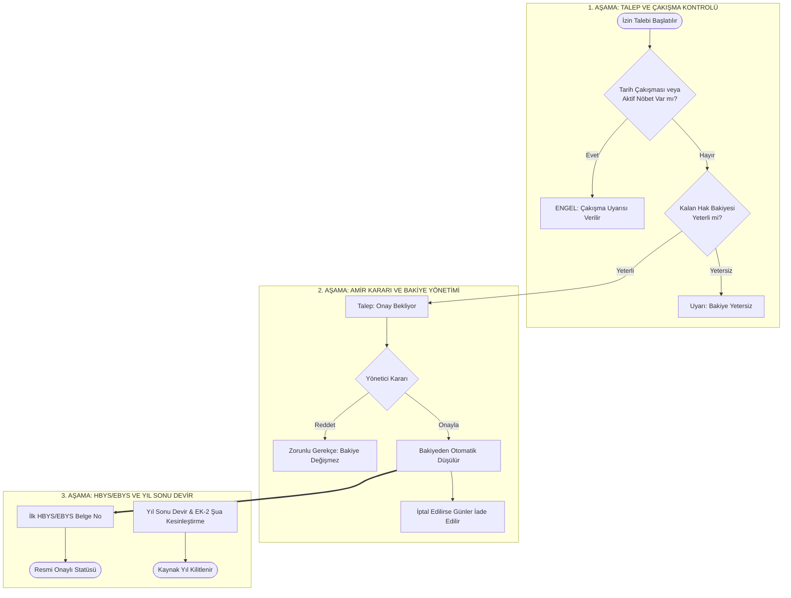

---json
{
  "pageTitle": "06. İzin Yönetimi, Şua İzni ve Yıllık İzin Hakedişleri — RADPYS v4 Kullanım Kılavuzu",
  "h1": "İzin Yönetimi, Şua Hakedişi & İzin Devir Motoru",
  "lead": "3153 sayılı Kanun Ek Madde 1 ve 32162 sayılı Yönetmelik EK-2 kapsamındaki Şua İzni (sağlık izni) ile yıllık, mazeret ve hastalık izinlerinin talebini, tarih/nöbet çakışma denetimini, bakiye düşüm ve iadesini, yıl sonu devir/kilitleme motorunu ve Web Portal HBYS/EBYS evrak entegrasyonunu yönetmenizi sağlar.",
  "overviewId": "overview",
  "badges": [
    {
      "text": "3153 SK & 32162 Yönetmelik EK-2 Uyumlu",
      "tone": "emerald"
    }
  ],
  "readingTime": "5 Dakika",
  "legalNote": "<strong>Yasal Güvence:</strong> Şua (sağlık) izni takip eden takvim yılı içinde kesintisiz kullanılır ve ertesi yıla devredilmez; onaylı izinler denetim izini korumak için silinemez, yalnızca iptal edilerek bakiye iade edilir."
}
---

## Kısa Reçete: İzin Talebi Oluşturma, Onaylama ve Resmi Evrak Eşleştirme {#quick-recipe}

:::recipe Kısa Reçete: İzin Talebi Oluşturma, Onaylama ve Resmi Evrak Eşleştirme | 20 SANİYELİK AKIŞ
### 1. İstenen Sonuç | slate
Personel izinlerini kalan hak bakiyesi ve aktif nöbet çizelgesiyle çakışmadan onaylamak, bakiye düşümünü otomatik yapmak ve HBYS/EBYS evrak numarasıyla resmileştirmek.

### 2. Yapılacak İşlem | cyan
<strong>[İzin Talep Et]</strong> penceresinde personeli, izin türünü ve tarihleri seçip <strong>[İleri]</strong> üzerinden varsa belgeyi ekleyerek <strong>[Kaydet]</strong> butonuna basın. Amir listesinden <strong>[Onayla]</strong> işlemi tamamlandıktan sonra Web Portalından HBYS/EBYS belge numarasını girin.

### 3. Sistem Etkisi | emerald
Mevcut izin veya aktif nöbet çakışması varsa talep engellenir; onay anında bakiye düşülür, iptalde eksiksiz iade edilir ve ilk resmi evrak numarası girildiğinde kayıt Resmi Onaylı duruma yükselir.

- [metric] Yasal Şua Tavanı | 30 Gün / Yıl | cyan
- [metric] EK-2 Şua Kuralı | Her 50 Saate 1 Gün | emerald
- [metric] Kurum Devir Ayarı | Varsayılan 5 Gün | amber
- [metric] Platform | Masaüstü & Web Portal | slate
:::

## 5N1K Kural ve Arayüz Çözümleme Tablosu {#5w1h}

*Şua hakediş hesabı, çakışma kilitleri, bakiye iadesi, yıl sonu devir kilidi ve resmi evrak kuralları.*

| NE? (Bileşen / Kontrol) | NEDEN? (Amacı) | NASIL? (Çalışma Mantığı) | NE ZAMAN? (Tetiklenme) | KİM? (Yetkili Rol) |
| --- | --- | --- | --- | --- |
| <strong>EK-2 Kademeli Şua ve Aylık Dilim</strong> [Yıllık Hakediş] &amp; [Şua Aylık Hakediş] | Yıllık Şua hakkını mevzuata göre hesaplarken aylık görünümde ara toplam şişmesini önlemek. | Yıllık toplam hak 32162 Yönetmelik EK-2'ye göre 50 saatlik kademeli dilimlerle (azami 30 gün) kesinleşir; aylık sekme yalnızca tamamlanan 50 saatlik dilimleri gösterir ve cari yıl Şua hakkı devretmez. | Aylık kontrollerde ve yıl sonu kesinleştirmede. | Radyasyon Çalışanları / İK |
| <strong>Tarih ve Aktif Nöbet Çakışma Kilidi</strong> Otomatik Kayıt &amp; İkame Denetimi | Yayınlanmış nöbet çizelgesiyle planlı izinlerin çakışmasını önlemek ve acil raporlarda boşluğu yakalamak. | Yayınlanmış nöbet varken planlı izin talebi engellenir; acil rapor veya mazeret izni onaylandığında ise çakışan nöbet otomatik boşaltılıp birim sorumlusuna ikame uyarısı iletilir ve belge zorunlu türlerde onay öncesi kanıt evrakı aranır. | İzin talebi kaydedilirken veya onaylanırken. | Sistem (Otomatik Kilit) / Birim Amiri |
| <strong>Tam Gün / Yarım Gün / Saatlik ve Yıl Aşan Hesap</strong> [İzin Bilgileri] Süre Seçimi | İzin türünün hafta sonu, resmi tatil ve günlük mesai saatine göre net düşümünü hesaplamak. | Saatlik izinleri kurumun günlük mesai saatine bölerek ondalık güne çevirir, yılbaşına sarkan izinleri ilgili takvim yıllarına paylaştırır ve belge zorunlu türlerde onay öncesi kanıt arar. | İzin formu doldurulurken ve onaylanırken. | Personel / Birim Amiri |
| <strong>[İptal Et] Bakiye İadesi ve Silme Yasağı</strong> Denetim İzi Kalkanı | Onaylı izin kayıtlarının silinmesini önlemek ve iptal edilen iznin günlerini iade etmek. | Onaylı veya Resmi Onaylı izinlerde doğrudan silme engellenir; iptal edildiğinde düşülen günler bakiyeye iade edilir ve nöbet devri senkronize edilir. | Onaylı izne çıkılamadığında. | Yönetici / Süpervizör |
| <strong>[Devir Aktar (Önceki Yıldan)] ve Yıl Kilidi</strong> Yıl Sonu Kesinleştirme Motoru | Kapanan yılın kalan yıllık iznini tekrarsız aktarmak, Şua hakkını kesinleştirmek ve kaynak yılı dondurmak. | Yalnızca tamamlanmış önceki yıl için çalışır; Şua izni devrini kesin olarak reddeder, tekrar çalıştırılsa dahi bakiyeyi bozmadan kurum devir tavanı (varsayılan 5 gün) kadar aktarır ve yılı kilitler. | Yıl başında devir aktarımı yapılırken. | Sistem Yöneticisi / İK |
| <strong>HBYS / EBYS Resmi Evrak Kaydı</strong> Web Portalı Resmi Belge Formu | Onaylı izne resmi kurum evrak numarasını işleyip hukuki tescil kazandırmak. | İlk evrak numarası ve tarihi girildiğinde izin doğrudan Resmi Onaylı statüsüne geçer; sonraki değişiklikler yönetici onayına düşer. | Kurumdan resmi yazı numarası çıktığında. | Personel / İdari İşler |

## Kritik Sahada Yanlış Bilinen Kurallar (Mit Avcısı) {#myth-buster}

:::myth Kullanılmayan Şua İzinleri Ertesi Yıla Devreder mi veya Ücrete Çevrilir mi?
### Yanlış Algı
<em>"Yoğunluk nedeniyle bu yıl 30 günlük Şua iznimi kullanamadım; gelecek yıla devreder veya kullanamadığım günlerin parasını alabilirim."</em>

### Gerçek Sistem Mantığı
<strong>Ertesi yıla devretmez; aktif çalışmada ücrete çevrilemez.</strong> 3153 sayılı Kanun Ek Madde 1, 657 DMK m. 103/3 ve 32162 sayılı Yönetmelik m. 8 uyarınca Şua (sağlık) izni çalışanın radyasyondan korunması ve biyolojik onarımı içindir; bölünemez, devretmez ve çalışırken paraya dönüştürülemez. İşten ayrılış veya fesih halinde ise 657'ye tabi memurlarda ücrete dönüşmezken, 4857'ye tabi işçilerde Yargıtay 9. Hukuk Dairesi içtihatları çerçevesindeki durum kurum İK ve hukuk birimince değerlendirilir.
:::

## Süreç Akış Şeması {#workflow}

1. **Talep ve Çakışma Kontrolü:** Talep edilen tarihler başka bir izinle veya aktif nöbet çizelgesiyle kesişiyorsa ya da kalan hak yetersizse işlem durdurulur.
2. **Amir Kararı ve Bakiye Yönetimi:** Onaylanan talebin günleri kalan haktan düşülür; zorunlu gerekçeli rette bakiye değişmez, onaylı iznin iptalinde ise günler iade edilir.
3. **HBYS/EBYS ve Yıl Sonu Devir:** İlk resmi evrak numarası kaydıyla izin Resmi Onaylı statüsüne geçer; yıl sonunda tamamlanan yılın devri ve EK-2 Şua hakedişi hesaplanarak kaynak yıl kilitlenir.

## Arayüz Ekran Görünümleri {#screenshots}

## Adım Adım İşlem Rehberi {#step-by-step}

### 1. 2 Adımlı Sihirbaz ile Yeni İzin Talebi Oluşturma

1. **[İzin Yönetimi] &gt; [İzin Listesi]** ekranında **[İzin Talep Et]** butonuna tıklayın.
2. **1. İzin Bilgileri** adımında personeli seçerek sağdaki **Personel Kalan Hak Özeti** kartından güncel yıllık ve Şua bakiyesini doğrulayın; izin türünü, süre tipini (**[Tam Gün]**, **[Yarım Gün]** veya **[Saatlik]**), tarih aralığını, varsa hafta sonu/resmi tatil kapsamını ve vekil personeli belirleyin.
3. **[İleri]** butonuna basarak **2. Belgeler** adımına geçin, gerekiyorsa **[Belge Ekle]** ile rapor/dilekçe yükleyin ve **[Kaydet]** butonuna tıklayın.

### 2. İzin Taleplerini Onaylama, Gerekçeli Reddetme ve İptal Etme

1. İzin Listesinde bekleyen kayıtları süzün; satırı seçip **[Onayla]** butonuna basarak izni onaylayın ve bakiyeden düşümünü tamamlayın (uygun görmediğiniz taleplerde **[Reddet]** ile zorunlu gerekçe girin).
2. Onaylanmış ancak kullanılamayan bir izni geri almak için satırı seçip **[İptal Et]** butonuna tıklayın; düşülen günler bakiyeye iade edilir ve nöbet havuzu güncellenir.
3. Geçmiş izin veya hakediş hareketlerini topluca yüklemek için **[Araçlar]** menüsünden **[Toplu Import]** sihirbazını çalıştırın.

### 3. Yıllık Hakediş, Şua Aylık İzleme ve Yıl Sonu Devir / Kilitleme

1. Araç çubuğundaki **[Kalan Hak / Hakediş]** butonunu açıp **[Yıllık Hakediş]** veya **[Şua Aylık Hakediş]** sekmesine geçin; yıl sonu yaklaşan hakları görmek için **[Zamanaşımı Yaklaşan Şua İzinleri]** filtresini kullanın.
2. Seçili yıl için toplu yıllık hak oluşturmak gerektiğinde **[Toplu Hesapla (Yıl)]** butonunu çalıştırın.
3. Önceki takvim yılı tamamlandıktan sonra **[Devir Aktar (Önceki Yıldan)]** butonuna tıklayarak kurum parametresi sınırında yıllık izin devrini yapın, 12 aylık fiili hizmetten EK-2 Şua hakedişini kesinleştirin ve kaynak yılı kilitleyin.

### 4. Web Portalı Üzerinden İzin Talebi ve HBYS / EBYS Belge Eşleştirme

1. Saha personeli veya birim sorumlusu tarayıcı ya da mobilden **Web Portalı**'ndaki izin ekranını açarak kalan bakiyesini görüntüler ve yeni izin talebi oluşturur.
2. İzin onaylandıktan ve resmi evrak sayısı çıktıktan sonra ilgili izin satırından **HBYS / EBYS** belge numarası ile kayıt tarihini girip gönderir; ilk kayıtta izin doğrudan **Resmi Onaylı** statüsüne yükselir.

## Sıkça Sorulan Sorular (SSS) {#faq}

:::faq
### İzin talebi kaydederken neden Nöbet Çakışması Uyarısı alıyorum?
RADPYS, vardiya düzeninin bozulmaması için izin ve nöbet çizelgesini birlikte denetler. Talep ettiğiniz tarihlerde yayınlanmış nöbet çizelgesinde aktif nöbetiniz varsa izin kaydı engellenir; önce nöbet devri veya ikame işlemi tamamlanmalıdır.

### Geçmiş yıldan en fazla kaç gün yıllık izin devredilebilir?
Devir aktarımı yalnızca takvim yılı kapanmış geçmiş yıllar için çalıştırılabilir. 657 sayılı Kanun m. 103'te cari yıl ile önceki yıl izninin birleştirilmesi, 4857 sayılı İş Kanunu'nda ise kesintisiz devir esas alınır; RADPYS'deki varsayılan <strong>5 gün</strong> sınırı Sistem Ayarları üzerinden kurum statüsüne göre değiştirilebilen bir kurum parametresidir.

### Yıl sonu devir ve Şua kesinleştirme sırasında eksik fiili hizmet ayı uyarısı alırsam ne yapmalıyım?
Kaynak yıla ait 12 aylık fiili hizmet (FHZ) puantajlarından henüz hesaplanmamış veya kilitlenmemiş aylar varsa Şua hakkı eksik doğabilir. Önce <strong>[Fiili Hizmet Yönetimi]</strong> ekranından eksik ayların hesaplama ve kilitleme işlemlerini tamamlayıp ardından devir işlemini çalıştırmanız önerilir.
:::
