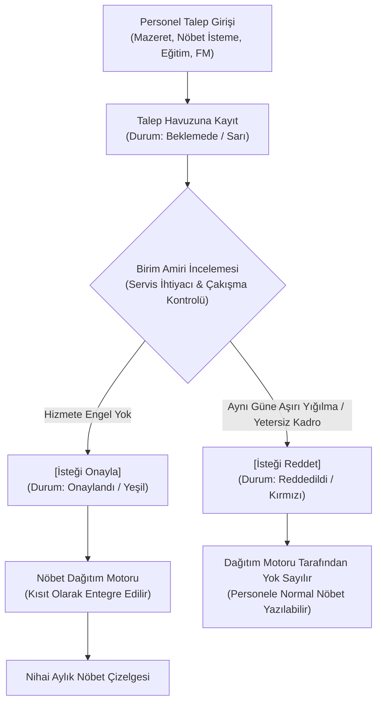

---json
{
  "pageTitle": "07. 07 5 Personel Talepleri Ve Onay Yonetimi — RADPYS v4 Kullanım Kılavuzu",
  "h1": "Personel Talepleri, Mazeretler & Onay Yönetimi",
  "lead": "Personelin nöbet istemediği mazeret günleri, özel nöbet yazılma istekleri, lisansüstü eğitim ders kısıtları ve isteğe bağlı fazla mesai tavan taleplerinin birim amirince incelenmesi, onaylanması veya reddedilmesi sürecini kapsar.",
  "overviewId": "hero",
  "badges": [],
  "readingTime": "4 Dakika"
}
---

## Hızlı Reçete: Personel Taleplerinin Yönetimi ve Onay Akışı {#recipe}

:::recipe Hızlı Reçete: Personel Taleplerinin Yönetimi ve Onay Akışı | 20 SANİYELİK AKIŞ
### 1. İstenen Sonuç | slate
Personelin haklı mazeret ve tercihlerinin kurumsal adalet zedelenmeden nöbet dağıtım algoritmasına iletilmesi.

### 2. Yapılacak İşlem | cyan
Dönem ayını seçin, mazeretleri inceleyin, uygun olanları <strong>[İsteği Onayla]</strong>, sakıncalı olanları gerekçe belirterek <strong>[İsteği Reddet]</strong> ile sonuçlandırın.

### 3. Sistem Etkisi | emerald
Sadece amir onayından geçen talepler Nöbet Dağıtım Motoruna kısıt olarak aktarılır; reddedilen veya askıdaki talepler dikkate alınmaz.

- [metric] Dönem Seçimi | Yıl / Ay Ayrımı | slate
- [metric] 4 Temel Talep Türü | Mazeret, İstek, Ders, FM | slate
- [metric] Onay Yetkisi | Birim Sorumlusu / Amir | slate
- [metric] Dağıtım Motoru Etkisi | Otomatik Kısıt Besleme | slate
:::

## 5N1K: Personel Talepleri Arayüz Bileşenleri ve Saha Kuralları {#5w1h}

 

 Ekranda gördüğünüz butonlar, kutular ve listelerin görevleri, kullanım kuralları ve sistemdeki etkileri.
 

 

| NE? (Arayüzdeki İsim) | NEDEN? (Amacı) | NASIL? (Çalışma Mantığı) | NE ZAMAN? | KİM? |
| --- | --- | --- | --- | --- |
| Dönem Yılı & Dönem Ayı Seçimi | Talepleri sadece planlanacak olan nöbet ayına filtrelemek ve geçmiş aylarla karışmasını önlemek. | Açılır kutudan ay ve yıl değiştirildiğinde liste anında filtrelenir; sadece ilgili ayın talepleri ekrana gelir. | İncelemeye başlarken. | Birim Amiri, Planlayıcı |
| Birim / Departman Filtresi | Çok birimli hastanelerde sadece sorumlu olunan servisin mazeretlerine odaklanmak. | Birim seçildiğinde personel listesi ve mazeret tablosu seçilen birimin kadrosuna göre sınırlandırılır. | Departman incelemelerinde. | Birim Sorumlusu |
| Talep Türü Açılır Kutusu | Personelin talebini kategorize ederek algoritmanın doğru kısıtı kurmasını sağlamak. | 5 seçenek sunar: Nöbet Yazılmasın (Mazeret), Nöbet Yazılsın (İstek), Eğitim Kısıtı (Hafta İçi Ders Programı), Nöbet Muafiyeti ve Fazla Mesai Talebi. Aynı güne birden fazla talep denk gelirse sistem en koruyucu kuralı (Muafiyet &gt; Eğitim &gt; Nöbet Yazılmasın &gt; Nöbet Yazılsın) uygular. | Talep girerken / incelerken. | Personel / Birim Amiri |
| Başlangıç Tarihi & Bitiş Tarihi | Mazeretin veya nöbet talebinin geçerli olacağı takvim aralığını kesinleştirmek. | Tek günlük taleplerde iki kutu aynı güne ayarlanır; çok günlük kongre/ders durumlarında aralık seçilir. | Tarih tanımlarken. | Talep Eden / Onaylayan |
| Tercih Edilen / İstenmeyen Nöbet Türü | Personelin gün bazında belirli bir vardiyayı (Örn: Gece nöbeti istememe veya sadece Gündüz 8-16 isteme) belirtmesi. | Birimde tanımlı slotlar açılır listede gelir; "Tüm Slotlar" seçilirse personelin o gün hiçbir nöbete atanmaması sağlanır. | Belirli vardiya mazeretlerinde. | Personel |
| Gerekçe / Talep Açıklaması Kutusu | Amirin kararı verirken talebin meşruiyetini ve dayanağını görebilmesini temin etmek. | Serbest metin alanıdır; kongre katılımı, sınav belgesi veya ailevi mazeret gibi detaylar yazılır. | Talep oluşturulurken. | Personel |
| İsteği Onayla Butonu (Yeşil) | Seçili personelin talebini resmen geçerli kılarak nöbet dağıtım motoruna yetkilendirmek. | Talebin durumu "Onaylandı" haline gelir; satır yeşil renkle vurgulanır ve nöbet dağıtım kısıt tablosuna anında yansır. | Talep uygun görüldüğünde. | Birim Amiri / Süpervizör |
| İsteği Reddet Butonu (Kırmızı) | Hizmeti aksatacak, aynı güne aşırı yığılma yaratan veya haksız talepleri iptal etmek. | Talebin durumu "Reddedildi" olarak güncellenir; gerekirse açıklama notu düşülür; nöbet dağıtım motoru bu talebi tamamen yok sayar. | Talep reddedildiğinde. | Birim Amiri |
| Personel İstek ve Mazeret Listesi Tablosu | İlgili ay için toplanan tüm istekleri, personelleri, tarihleri, durumları ve gerekçeleri toplu sergilemek. | Tabloda tek bir satıra tıklandığında üst form otomatik dolar ve [İsteği Onayla] / [İsteği Reddet] butonları aktifleşir. | Tüm inceleme sürecinde. | Yönetici, Planlayıcı |

## Personel Nöbet Talebi ve Onay Süreç Şeması {#workflow}

 

 Personelin talep girişinden birim amirinin değerlendirmesine ve Nöbet Dağıtım Motoruna aktarımına kadar uçtan uca akış.
 

 

 

 

## Arayüz Yerleşimi ve Saha Kullanım Görünümü {#ui-layout}

 

 RADPYS masaüstü arayüzünde "Personel İstekleri" sekmesinin yerleşimi ve onay kontrolleri.
 

 

 

 

 

  Satır Seçimi ve Buton Aktivasyonu
 
Tabloda herhangi bir talebe tıklandığında alttaki <strong>[İsteği Onayla]</strong> ve <strong>[İsteği Reddet]</strong> butonları otomatik olarak aktif hale gelir. Seçim yapılmadığında butonlar tıklanamaz.

 

 

  Dağıtım Motoru Etkileşimi
 
Mazeret onaylandığında nöbet dağıtım motoru bu personeli seçili gün ve saat aralığında <strong>kesinlikle nöbete yazmaz</strong>. Özel nöbet isteği onaylandığında ise personeli o slota <strong>yüksek öncelikle</strong> yerleştirir.

 

 

 

## Adım Adım Personel Talebi Onay / Red Kılavuzu {#step-by-step}

 

 Nöbet çizelgesi çözülmeden önce amirlerin takip etmesi gereken 4 standart adım.
 

 

 

 

 

 1
 

 

 <h3 class="font-bold text-slate-900 dark:text-white">Dönem Yılı ve Ayını Belirleyin</h3>
 

 Pencerenin üstündeki <strong>Dönem Yılı</strong> ve <strong>Dönem Ayı</strong> kutularından nöbeti hazırlanacak olan ayı seçin. Sorumlu olduğunuz departmanı seçerek listeyi daraltın.
 

 

 

 

 

 2
 

 

 <h3 class="font-bold text-slate-900 dark:text-white">Mazeretleri ve Çakışmaları Değerlendirin</h3>
 

 Tablodaki talepleri gözden geçirin. Özellikle aynı gün ve vardiyaya birden fazla personelin mazeret yazıp yazmadığını (serviste personel açığı oluşup oluşmayacağını) kontrol edin.
 

 

 

 

 

 3
 

 

 <h3 class="font-bold text-slate-900 dark:text-white">Talebi Onaylayın veya Reddedin</h3>
 

 Satırı seçin; uygunsa <strong>[İsteği Onayla]</strong> butonuna basın (durum yeşile döner). Hizmet aksaması yaratacaksa <strong>[İsteği Reddet]</strong> butonuna basarak reddedin.
 

 

 

 

 

 4
 

 

 <h3 class="font-bold text-slate-900 dark:text-white">Nöbet Dağıtımına Geçiş Yapın</h3>
 

 Tüm mazeretler sonuçlandırıldıktan sonra Modül 08 (Nöbet Hazırlık & Nöbet Dağıtım Motoru) ekranına geçerek otomatik çizelge dağıtımını başlatabilirsiniz. Onaylanan talepler otomatik olarak hesaba katılacaktır.
 

 

 

 

## Sıkça Sorulan Sorular (SSS) {#faq}

:::faq
### Personel talep giriş süresini kaçırırsa ne yapılır?
Birim amiri veya sistem yöneticisi, bu ekran üzerinden personel adına manuel olarak doğrudan yeni talep ekleyebilir ve anında onaylayabilir.

### Onaylanan bir "Nöbet Yazılsın (İstek)" talebi nöbet dağıtım motoru tarafından kesinlikle karşılanır mı?
"Nöbet Yazılsın" istekleri yüksek öncelikli yumuşak kısıt (Soft Constraint) olarak ele alınır. Personelin 24 saat dinlenme kuralı veya fazla mesai tavanı ihlal edilmiyorsa nöbet dağıtım motoru bu isteği %100'e yakın oranla karşılar. Ancak sert bir dinlenme kuralıyla çakışırsa dinlenme kuralı üstün gelir.

### "Nöbet Yazılmasın (Mazeret)" talebi onaylandığında nöbet dağıtım motoru bunu esnetebilir mi?
Hayır. Amir tarafından onaylanmış bir mazeret, nöbet dağıtım motoru için <strong>sert kısıt (Hard Constraint)</strong> niteliğindedir. O personelin o gün nöbete yazılması kesinlikle engellenir. Eğer hiçbir personel bulunamazsa dağıtım motoru o slotu boş bırakıp kullanıcıyı uyarır ama onaylı mazereti çiğnemez.

### İsteği onaylanan personele sonradan acil durum nedeniyle nöbet yazılabilir mi?
Evet. Çizelge yayınlandıktan sonra ortaya çıkan ani hekim/teknisyen yetersizliklerinde, Modül 09 (Nöbet Devir & Mazeret) üzerinden personelin rızasıyla ikame ataması yapılabilir.
:::
