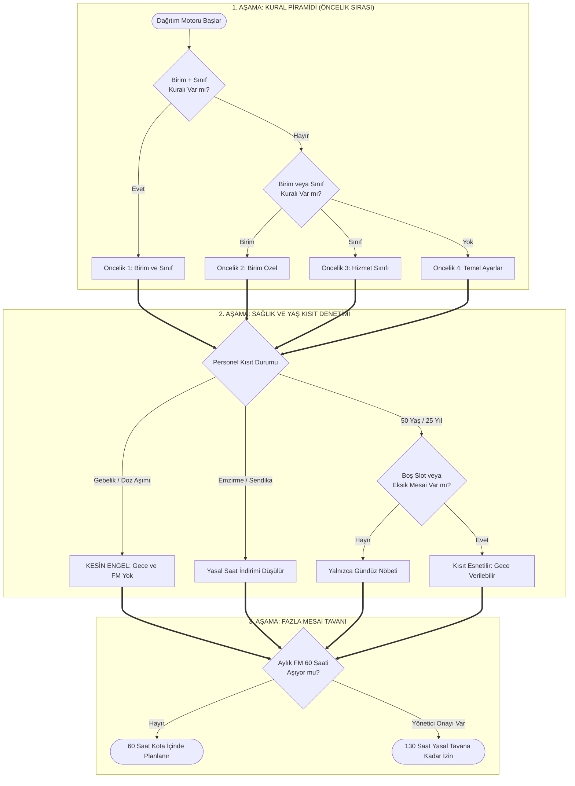

---json
{
  "pageTitle": "07. Nöbet Ayarları, Birim Kuralları ve Kısıt Hiyerarşisi — RADPYS v4 Kullanım Kılavuzu",
  "h1": "Nöbet Ayarları, Kural Piramidi & Kısıt Hiyerarşisi",
  "lead": "RADPYS otomatik nöbet dağıtım motorunun uymak zorunda olduğu 4 kademeli kural piramidini, 35 saat ve 40 saat haftalık mesai standartlarını, birim vardiya slotlarını, esnek fazla mesai sınırlarını, 50 yaş / 25 yıl kıdem önceliğini ve bireysel yasal kısıt hiyerarşisini yönetmenizi sağlar.",
  "overviewId": "overview",
  "badges": [
    {
      "text": "4 Kademeli Kural Piramidi",
      "tone": "amber"
    }
  ],
  "readingTime": "6 Dakika",
  "legalNote": "<strong>Yasal Güvence:</strong> Gebelik ve radyasyon doz aşımı gibi kanuni yasaklar mutlak ve delinemez sert kısıt olarak uygulanırken; 50 yaş ve 25 hizmet yılı gibi koruyucu kurum politikaları öncelikle gündüz vardiyası verir ve açık slot kaldığında servis sürekliliği için esnetilebilir."
}
---

## Modül 07 Özel Ayar ve Yönetim Kılavuzları {#alt-kilavuzlar}

:::subguides
:::

## Kısa Reçete: Nöbet Kural Altyapısı ve Dağıtım Motoru Kısıt Düzeni {#quick-recipe}

:::recipe Kısa Reçete: Nöbet Kural Altyapısı ve Dağıtım Motoru Kısıt Düzeni | 20 SANİYELİK AKIŞ
### 1. İstenen Sonuç | slate
Nöbet çizelgelerinin mevzuata, çalışan sağlığına ve klinik hizmet ihtiyaçlarına uyumlu biçimde hatasız üretilmesi.

### 2. Yapılacak İşlem | cyan
<strong>[Temel Ayarlar]</strong> sekmesinden genel dinlenme ve fazla mesai sınırlarını kaydedin; <strong>[Birim Kuralları]</strong> üzerinden vardiya slotlarını açıp gerekirse <strong>[Birim Kuralını Kopyala]</strong> ile aktarın; özel sağlık ve talep kayıtlarını ilgili sekmelerden onaylayın.

### 3. Sistem Etkisi | emerald
Özel birim ve hizmet sınıfı kuralı genel ayarı ezer; gebelik ve dinlenme kuralları korunur; 60 saatlik koruyucu kota ve 50 yaş muafiyeti acil hizmet ihtiyacında yönetici inisiyatifiyle esnetilebilir.

- [metric] Kural Piramidi | 4 Kademeli Öncelik | slate
- [metric] Kurumsal Kota | 60s / Yasal Tavan 130s | amber
- [metric] Dinlenme Standardı | Min 24 Saat Dinlenme | cyan
- [metric] Yönetim Kokpiti | Masaüstü Özel Modül | emerald
:::

## 5N1K Kural ve Arayüz Çözümleme Tablosu {#5w1h}

*Nöbet kural sisteminin çekirdek karar piramidi ve sekmeler arası ortak yönetim prensipleri (tekil parametre detayları 07.1–07.5 alt sayfalarındadır).*

| NE? (Bileşen / Kontrol) | NEDEN? (Amacı) | NASIL? (Çalışma Mantığı) | NE ZAMAN? (Tetiklenme) | KİM? (Yetkili Rol) |
| --- | --- | --- | --- | --- |
| <strong>4 Kademeli Kural Öncelik Piramidi</strong> Hiyerarşik Çözüm Sırası | Çakışan kurallarda dağıtım motorunun hangi kuralı üstün tutacağını belirlemek. | Birim ve Hizmet Sınıfı ortak kuralı birinci, yalnızca Birim kuralı ikinci, Hizmet Sınıfı kuralı üçüncü ve Temel Ayarlar son sırada değerlendirilir; özel kural genel ayarı ezer. | Çizelge dağıtımında. | Dağıtım Motoru / Yönetici |
| <strong>35s / 40s Haftalık Mesai Denklik Oranı</strong> Çalışma Rejimi Ayrımı | Radyasyonlu alan (3153 SK) ile genel klinik alan (657 SK) hedeflerini adil dengelemek. | Radyasyon çalışanlarında haftalık 35 saat, genel personelde 40 saat standart kabul edilir ve karma çalışanlar oransal denklik katsayısıyla hesaplanır. | Plan ve mesai hesabında. | Sistem Yöneticisi |
| <strong>Sert ve Yumuşak Kısıt Ayrımı</strong> [Yasal &amp; Kurumsal Kısıtlar] | Mutlak kanuni yasakları esnek adalet kurallarından ayırmak. | Sert (Yasal) sınıfındaki kısıtlar çözümsüzlük çıksa bile delinmez; Yumuşak (Kurumsal) kısıtlar ise adalet ceza puanı üzerinden dengelenir. | Kısıt tanımlandığında. | Başhekimlik / Yönetici |
| <strong>50 Yaş ve 25 Hizmet Yılı Kalkanı</strong> Kıdemli Personel Önceliği | Kıdemli personeli gece ve hafta sonu yükünden korurken birim işleyişini kilitlememek. | Dağıtım motoru öncelikle gündüz vardiyası verir; serviste açık slot kalırsa veya zorunlu saat dolmazsa gece nöbetine otomatik esnetir. | Vardiya dağıtımında. | Planlayıcı / Motor |
| <strong>60s Kurumsal Kota ve 130s Yasal Tavan</strong> Fazla Mesai Koruma Sınırı | Tükenmişliği sınırlandırmak ve 657 DMK Ek Madde 33 ödeme sınırını korumak. | Aylık koruyucu kota 60 saattir; zorunlu hallerde yönetici onayıyla 130 saatlik yasal ödeme tavanına kadar esnetilebilir. | Aylık planlamada. | Birim Amiri / Yönetici |

## Kritik Sahada Yanlış Bilinen Kurallar (Mit Avcısı) {#myth-buster}

:::myth 50 Yaşını veya 25 Hizmet Yılını Dolduran Personele Hiçbir Şekilde Gece Nöbeti Yazılamaz mı?
### Yanlış Algı
<em>"Personel 50 yaşını geçti veya 25 yıllık memur oldu; servis nöbeti kilitlense bile sistem gece nöbeti atayamaz."</em>

### Gerçek Sistem Mantığı
<strong>Mutlak bir kanuni yasak değil, koruyucu öncelik politikasıdır.</strong> Gebelik veya radyasyon doz aşımı gibi kanuni engeller kesin olarak delinemezken, 50 yaş veya 25 yıl kıdem kriteri öncelikle gündüz vardiyası veren bir kurum politikasıdır. Serviste boş slot kalması veya personelin zorunlu çalışma süresini dolduramaması halinde motor bu kuralı otomatik esneterek gece nöbeti atayabilir.
:::

## Süreç Akış Şeması {#workflow}

1. **Öncelik Piramidi:** Motor en dar kapsamlı kuraldan başlar (Birim + Sınıf &gt; Birim &gt; Hizmet Sınıfı &gt; Temel Ayarlar); üst basamak alt basamağı ezer.
2. **Kısıtlar ve Esnetme:** Gebelik ve doz aşımı mutlak yasaktır; emzirme ve sendika indirimi hedeften düşülür; 50 yaş / 25 yıl kıdem ise yalnızca boş slot veya eksik saat kalırsa esnetilir.
3. **Fazla Mesai Tavanı:** Standart kurumsal kota 60 saattir; acil hizmet ihtiyacında yönetici onayıyla 657 DMK Ek Madde 33 kapsamındaki 130 saatlik yasal ödeme tavanına kadar çıkılabilir.

## Arayüz Ekran Görünümleri {#screenshots}

## Adım Adım İşlem Rehberi {#step-by-step}

### 1. Genel Çalışma ve Muafiyet Standartlarını Kaydetme (07.1)

1. Sol menüden **[Nöbet Yönetimi] &gt; [Nöbet Ayarları ve Kurallar]** ekranını açın ve **[Temel Ayarlar]** sekmesinde kalın.
2. Ardışık nöbet günü, nöbet sonrası dinlenme saati, haftalık mesai (35s / 40s), aylık fazla mesai tavanı ile yaş (50) / hizmet yılı (25) kriterlerini belirleyip **[Temel Ayarlari Kaydet]** butonuna basın.

### 2. Departman Vardiya Slotlarını Açma ve Kopyalama (07.2)

1. **[Birim Kuralları]** sekmesinde departmanı seçin, başlangıç saati, süre ve nöbetçi sayısını tanımlayıp **[Birim Kuralı Ekle]** butonuna tıklayın.
2. Benzer vardiya yapısını başka bir birime aktarmak için **[Birim Kuralını Kopyala]** butonunu kullanın (hedef birimin eski slotları silinerek kaynak şablon sıfırdan yazılır).

### 3. Hizmet Sınıfı Kuralları, Özel Sağlık Kısıtları ve Talepleri Yönetme (07.3 – 07.5)

1. Meslek grubu veya birim bazlı istisnalar için **[Yasal &amp; Kurumsal Kısıtlar]** sekmesinden **Sert** ya da **Yumusak** sınıfında yeni kural ekleyin.
2. Gebelik, emzirme, sendika ve sağlık raporu kayıtlarını **[Personel Özel Kısıtları]** sekmesinden **[Kısıt Ekle]** ile tanımlayın; personelden gelen mazeret ve ders programı isteklerini ise **[Personel Talepleri]** sekmesinden **[Onayla]** veya **[Reddet]** ile sonuçlandırın.

## Sıkça Sorulan Sorular (SSS) {#faq}

:::faq
### Birim kuralı ile genel temel ayarlar çakışırsa hangisi uygulanır?
RADPYS Kural Piramidi gereğince <strong>en özel kural daima önceliklidir</strong>. Birime ve hizmet sınıfına özel tanımlanan kural, genel temel ayarları ezer; örneğin genel ayarlarda ardışık limit 2 gün iken Acil Radyoloji için 1 gün tanımlanmışsa Acil birimine 1 gün uygulanır.

### Aylık fazla mesai sınırı 60 saati geçerse planlama durur mu?
Kurumsal koruyucu kota 60 saattir; ancak olağanüstü personel eksikliğinde yönetici onayıyla esnetilebilir. 657 sayılı Devlet Memurları Kanunu Ek Madde 33 kapsamındaki aylık nöbet ücreti ödeme tavanı ise <strong>130 saattir</strong> ve fazlası sonraki döneme devreder.

### Birim kuralını kopyalarken hedef birimdeki mevcut slotlar korunur mu?
Hayır. Mükerrer vardiya tanımını ve saat çakışmasını önlemek için <strong>[Birim Kuralını Kopyala]</strong> işlemi hedef birimin mevcut tüm slotlarını temizler ve kaynak birimin slotlarını sıfırdan oluşturur.

### Nöbet sonrasında en az kaç saat dinlenme uygulanır?
Varsayılan asgari dinlenme süresi iki nöbet arasında <strong>24 saattir</strong>. Gece nöbetleri arasında personelin toparlanması için ayrıca tanımlanan asgari gece boşluğu kuralı işletilir.
:::
