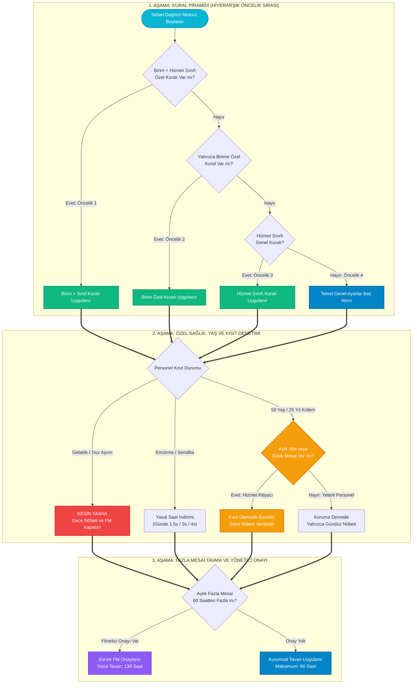

---json
{
  "pageTitle": "07. Nöbet Ayarları, Birim Kuralları ve Kısıt Hiyerarşisi — RADPYS v4 Kullanım Kılavuzu",
  "h1": "Nöbet Ayarları, Kural Piramidi & Kısıt Hiyerarşisi",
  "lead": "RADPYS otomatik nöbet dağıtım motorunun uymak zorunda olduğu hiyerarşik kurallar, 24 saat çalışma ve asgari dinlenme standartları, departman vardiya slotları, esnek fazla mesai tavanları, 50 yaş muafiyeti ve yasal kısıt yönetim rehberi.",
  "overviewId": "overview",
  "badges": [],
  "readingTime": "6 Dakika"
}
---

## Modül 07 Özel Ayar ve Yönetim Kılavuzları {#alt-kilavuzlar}

:::subguides
:::

## Hızlı Reçete: Nöbet Kural Altyapısı ve Dağıtım Motoru Kısıt Düzeni {#quick-recipe}

:::recipe Hızlı Reçete: Nöbet Kural Altyapısı ve Dağıtım Motoru Kısıt Düzeni | 20 SANİYELİK AKIŞ
### 1. İstenen Sonuç | slate
Nöbet çizelgelerinin kanuna, hekim/teknisyen sağlığına ve klinik hizmet gereksinimlerine tam uyumlu olarak hatasız üretilmesi.

### 2. Yapılacak İşlem | cyan
<strong>[Temel Ayarlar]</strong>'dan genel sınırları belirleyin, <strong>[Birim Kuralları]</strong>'ndan slotları açın ve gerekirse <strong>[Kural Kopyala]</strong> ile aktarın.

### 3. Sistem Etkisi | emerald
Özel kural genel kuralı ezer; dinlenme süreleri korunur; 50 yaş muafiyeti ve fazla mesai limitleri acil ihtiyaçta yöneticiyle esnetilir.

- [metric] Kural Piramidi | 4 Kademeli Öncelik | slate
- [metric] Temel FM Tavanı | 60 Saat (Esnetilebilir) | slate
- [metric] Dinlenme Standardı | Min 24 Saat Dinlenme | slate
- [metric] Yönetim Kokpiti | Masaüstü Özel Modül | slate
:::

## 5N1K Kural ve Arayüz Çözümleme Tablosu {#5w1h}

 

 Nöbet kural sisteminde yer alan bileşenlerin işlevleri, çalışma mantıkları ve Nöbet Dağıtım Motoruna etkileri.
 

 

| NE? (Bileşen / Kontrol) | NEDEN? (Amacı) | NASIL? (Çalışma Mantığı) | NE ZAMAN? | KİM? |
| --- | --- | --- | --- | --- |
| <strong class="text-slate-900 dark:text-white">Kural Hiyerarşisi Piramidi</strong>  Arayüz Bilgilendirme Notu & Kural Seviyeleri | Çakışan kurallarda Nöbet Dağıtım Motorunun hangi kuralı üstün tutacağını ilan etmek. | Birim+Sınıf Kuralı > Birim Kuralı > Sınıf Kuralı > Genel Temel Ayar. En özel kural daima genel kuralı ezer. | Çizelge dağıtımında. | Nöbet Dağıtım Motoru, Yönetici |
| <strong class="text-slate-900 dark:text-white">Ardışık Nöbet & Dinlenme</strong>  Maksimum Ardışık Gün & Min Dinlenme (Saat) | Personelin üst üste nöbet tutmasını ve dinlenmeden işe gelmesini engellemek. | Maksimum ardışık gün (varsayılan 2) ve nöbet sonrası minimum dinlenme (varsayılan 24 saat) sert kısıt olarak uygulanır. | Her nöbet atamasında. | Sistem Yöneticisi |
| <strong class="text-slate-900 dark:text-white">Fazla Mesai Tavanı</strong>  Maksimum Fazla Mesai Süresi (Saat) Kutusu | Aylık fazla mesaiyi adil sınırda tutmak; acil durumda yöneticinin esnetmesine izin vermek. | Kurumsal temel sınır 60 saattir; ancak olağanüstü durumlarda yönetici onayıyla esnetilebilir. Yasal tavan 130 saattir. | Aylık planlama esnasında. | Yönetici Onayı |
| <strong class="text-slate-900 dark:text-white">50 Yaş / 25 Yıl Muafiyet Kalkanı</strong>  Muafiyet Yaş Sınırı & Hizmet Yılı Kutuları | Kıdemli personele gece nöbetinde koruma önceliği tanımak. | Algoritma öncelikle gündüz nöbeti atar; ancak boş slot kalması veya zorunlu mesai eksikliği durumunda otomatik esneterek gece yazabilir. | Planlama ve dağıtımda. | Kıdemli Personel |
| <strong class="text-slate-900 dark:text-white">Birim Nöbet Slotları & Akıllı Saat</strong>  Birim Slot Tablosu, Başlangıç Saati & Süre Girişi | Departmanın vardiyalarını ve gerekli personel sayılarını belirlemek. | Başlangıç saati + Süre = Bitiş saati akıllı hesaplayıcı ile otomatik üretilir; gece yarısı devrinde 24 saat modülü uygulanır. | Slot oluştururken. | Departman Sorumlusu |
| <strong class="text-slate-900 dark:text-white">Birim Kuralı Kopyalama Butonu</strong>  Birim Kuralını Kopyala (Mor Buton) | Bir birimin kurallarını başka bir birime saniyeler içinde çoğaltmak. | Kaynak birimdeki slotları hedef birime aktarır. Hedef birimdeki eski slotlar temizlenerek kaynak slotlar sıfırdan yazılır. | Yeni birim yapılandırırken. | Sistem Yöneticisi |
| <strong class="text-slate-900 dark:text-white">Personel Talepleri & Mazeretler</strong>  Talepler Listesi & İsteği Onayla / Reddet Butonları | Personelin mazeret, istek, eğitim ve FM taleplerini yönetmek. | Talepler listelenir; amir tarafından [İsteği Onayla] veya [İsteği Reddet] butonlarıyla onaylanır. Onaylı talepler nöbet dağıtım motoruna aktarılır. | Ay öncesi talep döneminde. | Personel, Nöbet Amiri |
| <strong class="text-slate-900 dark:text-white">Özel Sağlık ve Hukuki Kısıtlar</strong>  Personel Kısıt Listesi & Kısıt Tipi Açılır Kutusu | Yasal emzirme, gebelik, sendika ve engelli personeli korumak. | Emzirme (3s/1.5s), sendika (4s/2s) mesai azaltımları ve gebelik gece yasağı tanımlanır. Nöbet dağıtım motoru otomatik muaf tutar. | Sağlık raporu çıktığında. | İK, Süpervizör |

## Kritik Sahada Yanlış Bilinen Kurallar (Mit Avcısı) {#myth-buster}

 

 

 

 <h3 class="text-base font-bold text-slate-900 dark:text-white">
 Saha Mit Avcısı: "50 Yaşını veya 25 Hizmet Yılını Dolduran Personele Hiçbir Şekilde Gece Nöbeti Yazılamaz mı?"
 </h3>
 En Sık Karşılaşılan Nöbet Dağıtım Yanılgısı
 

 

 

 

 
 

 <strong>Yanlış İnanış:</strong> <em>"Personel 50 yaşını geçti veya 25 yıllık memur oldu; kanunen gece nöbeti yazılması kesinlikle yasaktır, servis kilitlense bile sisteme gece nöbeti eklenemez."</em>
 

 

 

 
 

 <strong>Doğru Gerçek:</strong> <strong>HAYIR, MUTLAK BİR YASAK DEĞİLDİR.</strong> 50 yaş veya 25 hizmet yılı kriteri, gebe/emziren personeldeki gibi mutlak bir kanuni yasaklama değil; <strong>kurum içi koruyucu bir öncelik politikasıdır</strong>. RADPYS optimizasyon motoru bu personele öncelikli olarak gündüz vardiyaları tahsis eder. Ancak serviste açık nöbet slotu kalması, personel yetersizliği veya personelin aylık zorunlu çalışma süresini dolduramaması gibi durumlarda algoritma bu kısıtı <strong>otomatik olarak esneterek gece nöbeti atayabilir</strong>. Personelin rızası ve amir onayıyla da nöbet planlanabilir.
 

 

 

## Kural Değerlendirme ve Kısıt Çözümleme Akış Şeması {#workflow}

 

 Hiyerarşik kural piramidinin nöbet dağıtım motoru tarafından değerlendirilme sırası ve esneklik kontrolleri.
 

 

 

 

 
 
 Hiyerarşik Kural & Çözümleme Mantığı (3 Aşamalı Akış)
 
 1:1 Doğal Ölçek
 

 

 

 

 

 

 1
 Öncelik Piramidi
 

 

 <strong>Öncelik Sırası:</strong> Birim+Sınıf Birim Özel Hizmet Sınıfı Temel Ayar. Algoritma eşleştiği ilk kuralı uygular; üst basamak altı ezer.
 

 

 

 

 2
 Kısıtlar & Esnetme
 

 

 <strong>Sağlık Koruması:</strong> Gebe veya Doz Aşımında gece/FM <u>mutlak yasaktır</u>. 50 yaş / 25 yıl kıdemde ise açık slot kalırsa otomatik esnetilir.
 

 

 

 

 3
 Fazla Mesai Tavanı
 

 

 <strong>Tavan ve Onay:</strong> Kurumsal üst sınır 60 saattir. Yönetici yazılı onayıyla yasal üst tavan olan 130 saate kadar esnek izin verilir.
 

 

 

 

## Arayüz Ekran Görünümleri {#screenshots}

 

 Temel ayarlar, kural piramidi bilgi notu ve birim slot yönetim paneli.
 

 

## Adım Adım İşlem Rehberi {#step-by-step}

 

 Saha operasyonlarında en sık kullanılan 5 ana işlemin uygulama adımları.
 

 

 

 

 
 1
 
 <h3 class="text-base font-bold text-slate-900 dark:text-white">
 Temel Nöbet Parametrelerini ve Muafiyetleri Belirleme
 </h3>
 

 <ol class="list-decimal list-inside space-y-2 text-xs sm:text-sm text-slate-600 dark:text-slate-300 pl-2">
 <li>Sol menüden <strong>[Nöbet Yönetimi] > [Nöbet Ayarları ve Kurallar]</strong> ekranını açın.</li>
 <li><strong>[Temel Ayarlar]</strong> sekmesinde klinik çalışma disiplinini belirleyin:
 <ul class="list-disc list-inside pl-5 mt-1 text-slate-500 dark:text-slate-400 space-y-0.5">
 <li><strong>Ayda Max Hafta Sonu / Bayram Nöbeti:</strong> Ayda en fazla kaç hafta sonu (örn: 4) ve bayram nöbeti (örn: 2) tutulabileceğini girin.</li>
 <li><strong>Maksimum Fazla Mesai Süresi:</strong> Temel tavanı belirleyin (örn: 60 saat). <em>(Acil durumlarda yönetici onayıyla esnetilebilir.)</em></li>
 <li><strong>Muafiyet Kriterleri:</strong> Yaş sınırı (50) ve hizmet yılı (25) değerlerini kaydedin.</li>
 </ul>
 </li>
 <li>Sağ alttaki yeşil <strong>[Temel Ayarları Kaydet]</strong> butonuna basın ve onaylayın.</li>
 </ol>
 

 

 

 
 2
 
 <h3 class="text-base font-bold text-slate-900 dark:text-white">
 Departman Nöbet Slotu Tanımlama ve Akıllı Saat Hesabı
 </h3>
 

 <ol class="list-decimal list-inside space-y-2 text-xs sm:text-sm text-slate-600 dark:text-slate-300 pl-2">
 <li>Üst sekme çubuğundan <strong>[Birim Kuralları]</strong> sekmesine geçin.</li>
 <li>Sol üstteki açılır kutudan ilgili departmanı (Örn: Acil Radyoloji) seçin.</li>
 <li>Alt kısımdaki <strong>Vardiya Tanımlama</strong> panelinde:
 <ul class="list-disc list-inside pl-5 mt-1 text-slate-500 dark:text-slate-400 space-y-0.5">
 <li><strong>Nöbet Adı & Kodu:</strong> "Acil Gece" / "ACL_GECE" yazın.</li>
 <li><strong>Başlangıç & Süre:</strong> Başlangıç saatini 20:00 ve süreyi 12 saat yaptığınızda, akıllı saat motoru bitiş saatini otomatik olarak 08:00 yapar.</li>
 <li><strong>Nöbetçi Sayısı:</strong> Bu slotta aynı anda kaç teknisyenin görev yapacağını belirleyin.</li>
 <li><strong>Gün Kısıtı:</strong> "Her Gün", "Sadece Hafta İçi" veya "Sadece Hafta Sonu" seçeneklerinden birini belirleyin.</li>
 </ul>
 </li>
 <li><strong>[Birim Kuralı Ekle]</strong> butonuna tıklayarak slotu sisteme kaydedin.</li>
 </ol>
 

 

 

 
 3
 
 <h3 class="text-base font-bold text-slate-900 dark:text-white">
 Birim Kuralını Başka Birime Kopyalama (Slot Silinme Uyarılı)
 </h3>
 

 <ol class="list-decimal list-inside space-y-2 text-xs sm:text-sm text-slate-600 dark:text-slate-300 pl-2">
 <li><strong>[Birim Kuralları]</strong> sekmesindeyken araç çubuğundaki mor <strong>[+ Birim Kuralını Kopyala]</strong> butonuna basın.</li>
 <li>Açılan pencerede <strong>Kaynak Birim</strong> (kuralları hazır olan) ve <strong>Hedef Birim</strong> seçimini yapın.</li>
 <li>ÖNEMLİ UYARI: Hedef birimde daha önceden tanımlanmış tüm slotlar temizlenerek kaynak birimdeki slotlar sıfırdan oluşturulacaktır.</li>
 <li>Ekrana gelen onay mesajında "Evet" dediğinizde tüm vardiya yapısı hedef birime saniyeler içinde kopyalanır.</li>
 </ol>
 

 

 

 
 4
 
 <h3 class="text-base font-bold text-slate-900 dark:text-white">
 Personel Nöbet İsteklerini (Mazeret / İstek) İnceleme ve Onaylama
 </h3>
 

 <ol class="list-decimal list-inside space-y-2 text-xs sm:text-sm text-slate-600 dark:text-slate-300 pl-2">
 <li><strong>[Personel Talepleri]</strong> sekmesine geçin ve ilgili yıl/ay filtresini seçin.</li>
 <li>Personellerin ilettiği talepleri (Nöbet Yazılmasın, Nöbet Yazılsın, Eğitim Kısıtı, Fazla Mesai) tabloda inceleyin.</li>
 <li>İlgili talebin satırını seçin:
 <ul class="list-disc list-inside pl-5 mt-1 text-slate-500 dark:text-slate-400 space-y-0.5">
 <li>Talebi kabul etmek için yeşil <strong>[İsteği Onayla]</strong> butonuna tıklayın.</li>
 <li>Talebi geri çevirmek için kırmızı <strong>[İsteği Reddet]</strong> butonuna tıklayın.</li>
 </ul>
 </li>
 <li>Onaylanan talepler, nöbet dağıtım motoru otomatik plan oluştururken birinci öncelikle dikkate alınır.</li>
 </ol>
 

 

 

 
 5
 
 <h3 class="text-base font-bold text-slate-900 dark:text-white">
 Bireysel Sağlık ve Yasal Kısıtları (Gebe/Emzirme/Sendika) Tanımlama
 </h3>
 

 <ol class="list-decimal list-inside space-y-2 text-xs sm:text-sm text-slate-600 dark:text-slate-300 pl-2">
 <li><strong>[Personel Özel Kısıtları]</strong> sekmesine gelin ve personeli arama kutusundan bulun.</li>
 <li><strong>Kısıt Türü</strong> açılır kutusundan ilgili durumu seçin:
 <ul class="list-disc list-inside pl-5 mt-1 text-slate-500 dark:text-slate-400 space-y-0.5">
 <li><strong>Yasal Emzirme İzni:</strong> İlk 6 ay günde 3 saat, ikinci 6 ay 1.5 saat mesai azaltımı sağlar.</li>
 <li><strong>Gebelik Muafiyeti:</strong> Gece nöbeti ve fazla mesaiyi kapatır, doz limitini 1 mSv yapar.</li>
 <li><strong>Sendika İzni:</strong> Memur için haftalık 4 saat, işçi için haftalık 2 saat mesai indirimi tanımlar.</li>
 </ul>
 </li>
 <li>Fazla mesai yapması kesinlikle yasak olan personel için <strong>[Fazla Mesai Yapamaz (FM Off)]</strong> kutusunu işaretleyin.</li>
 <li><strong>[Kısıt Ekle]</strong> butonuna basarak kuralı devreye alın.</li>
 </ol>
 

## Sıkça Sorulan Sorular (SSS) {#faq}

:::faq
### Birim kuralı ile genel temel ayarlar çakışırsa hangi kural geçerli olur?
RADPYS Kural Piramidi uyarınca <strong>"En Özel Kural Daima Önceliklidir"</strong>. Birim kuralı, genel temel ayarlardan daha spesifik bir hiyerarşik kademede yer aldığından genel ayarı ezer (override eder). Örneğin Genel Ayarlarda ardışık nöbet 2 gün iken, Acil Radyoloji biriminde 1 gün seçilmişse Acil teknisyenlerine 1 gün kuralı uygulanır.

### Aylık fazla mesai sınırı 60 saati geçerse sistem ne yapar?
Kurumsal temel tavan 60 saattir. Ancak acil servis ihtiyaçları veya olağanüstü personel eksikliklerinde bu sınır katı bir engel değildir; <strong>Yönetici Onayı ile esnetilebilir</strong>. Nihai aşılmaz tavan ise kanuni üst sınır olan 130 saattir. 130 saati aşan hiçbir fazla mesai ataması yasal olarak yapılamaz.

### Birim kuralını başka bir birime kopyaladığımda eski nöbet slotları kaybolur mu?
Evet. Mükerrer nöbet tanımlarını ve vardiya saat çakışmalarını önlemek amacıyla hedef birimin mevcut tüm slotları silinir ve kaynak birimdeki slotlar sıfırdan oluşturulur. Bu nedenle kopyalama öncesi hedef birimin incelenmesi önerilir.

### Nöbet bittikten sonra en az kaç saat dinlenme verilmesi zorunludur?
RADPYS sağlık standardı uyarınca bir nöbetin bitiş saati ile bir sonraki nöbetin başlangıç saati arasında en az <strong>24 saatlik kesintisiz dinlenme süresi</strong> bulunması zorunludur. Gece nöbetleri arasında ise hekim ve teknisyenin biyolojik toparlanması için asgari 48 saatlik aralık hedeflenir.
:::
