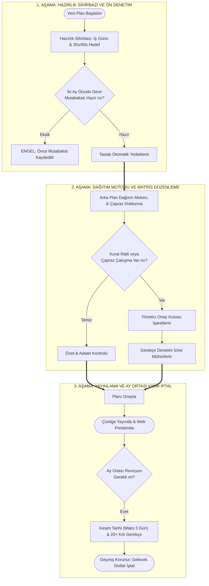

---json
{
  "pageTitle": "08. Nöbet Hazırlık, Çizelge Matrisi ve Dağıtım Motoru — RADPYS v4 Kullanım Kılavuzu",
  "h1": "Nöbet Hazırlık, Çizelge Matrisi & Dağıtım Motoru",
  "lead": "Aylık 35 saat ve 40 saat çalışma parametrelerinin hazırlandığı 3 adımlı sihirbazı, otomatik taslak yedekli arka plan dağıtım motorunu, çapraz birimden slot tamamlamayı, manuel kural ihlali onayını, yıllık adalet sayacını ve 3 gün sınırlı kısmi plan iptalini yönetmenizi sağlar.",
  "overviewId": "overview",
  "badges": [
    {
      "text": "Otomatik Taslak Yedeği & Kısmi İptal",
      "tone": "amber"
    }
  ],
  "readingTime": "6 Dakika",
  "legalNote": "<strong>Denetim Güvencesi:</strong> Kural ihlali onay kutusu işaretlenerek yapılan her manuel atama onaylayan yöneticinin kimliği, tarihi ve gerekçesiyle denetim izine işlenir; yayınlanmış bir planda ay ortası kısmi iptal ise geriye dönük en fazla 3 gün ile sınırlandırılmıştır."
}
---

## Kısa Reçete: Otomatik Nöbet Dağıtımı, Matris Yönetimi ve Kısmi İptal {#quick-recipe}

:::recipe Kısa Reçete: Otomatik Nöbet Dağıtımı, Matris Yönetimi ve Kısmi İptal | 20 SANİYELİK AKIŞ
### 1. İstenen Sonuç | slate
Radyasyon maruziyet sınırlarına (35s/40s) ve klinik kurallara uyumlu, çakışmasız aylık nöbet çizelgesinin saniyeler içinde üretilmesi.

### 2. Yapılacak İşlem | cyan
<strong>[Yeni Plan]</strong> ile dönemi ve birimi oluşturun; 3 adımlı hazırlık sihirbazında parametreleri doğrulayıp <strong>[Plan Taslağını Kaydet]</strong>'e basın. Matris ekranında <strong>[Otomatik Oluştur]</strong> ile çizelgeyi üretin; eksik günleri <strong>[Çapraz Birimden Doldur]</strong> ile tamamlayıp <strong>[Planı Onayla]</strong> ile yayına alın.

### 3. Sistem Etkisi | emerald
Dağıtım başlamadan önce mevcut taslak otomatik yedeklenir; hesaplama arayüzü dondurmadan arka planda çalışır; manuel ihlaller denetim izine mühürlenir ve ay ortası kısmi iptalde kesim tarihine kadar tutulan nöbetler korunur.

- [metric] Mesai Rejimi | 35s / 40s Standartı | slate
- [metric] Dağıtım Motoru | Arka Plan İş Parçacığı | cyan
- [metric] Taslak Güvenliği | Otomatik Yedek &amp; Geri Yükleme | emerald
- [metric] Kısmi İptal Sınırı | En Fazla 3 Gün Geri | rose
:::

## 5N1K Kural ve Arayüz Çözümleme Tablosu {#5w1h}

*Nöbet hazırlık sihirbazı, dağıtım motoru, matris kontrolleri, adalet sayacı ve kısmi iptal kuralları.*

| NE? (Bileşen / Kontrol) | NEDEN? (Amacı) | NASIL? (Çalışma Mantığı) | NE ZAMAN? (Tetiklenme) | KİM? (Yetkili Rol) |
| --- | --- | --- | --- | --- |
| <strong>3 Adımlı Hazırlık Sihirbazı ve Simülatör</strong> Önizleme, Talepler &amp; Kapasite | Ayın iş günlerini, tatilleri, onaylı talepleri ve kadro yeterliliğini dağıtımdan önce doğrulamak. | Çalışma parametrelerini (35s/40s), gerekirse <strong>[Çapraz Görevlendirme]</strong> ve <strong>[Hızlı Talep Ekle]</strong> kayıtlarını derleyip kişi başı ortalama nöbet yükünü simüle eder. | Yeni plan açıldığında veya taslakta. | Nöbet Planlama Sorumlusu |
| <strong>[Otomatik Oluştur] ve Mutabakat Kilidi</strong> Akıllı Dağıtım Motoru | İki ay önceki fazla mesai bakiyesi eksik kalmadan çakışmasız çizelge üretmek. | Planlanan aydan iki ay önceki dönemin mutabakatını denetler; eksik varsa işlemi durdurur, hazırsa taslağı yedekleyip dağıtımı arka planda çalıştırır. | Taslak matrisinde başlatıldığında. | Birim Sorumlusu / Motor |
| <strong>Otomatik Taslak Yedeği ve [Yedek Yükle]</strong> Tek Tıkla Taslak Kurtarma | Otomatik oluşturma sonucunda önceki manuel düzenlemelerin kaybolmasını engellemek. | Her otomatik oluşturma öncesinde taslak otomatik yedeklenir ve istenildiğinde <strong>[Yedek Yükle]</strong> ile önceki duruma tek tıkla geri dönülür. | Her otomatik dağıtım öncesi. | Sistem Otomatik / Sorumlu |
| <strong>[Çapraz Birimden Doldur] &amp; [Uygun İkame Öner]</strong> Destek Birimi Tamamlama | Birimin dolduramadığı boş günleri uygun diğer birim personelleriyle çakışmasız tamamlamak. | Dolu nöbetlere dokunmadan yalnız boş slotları tarar; adayların kendi birim nöbeti, izni ve dinlenme süresini doğrulayarak yerleştirir. | Boş slot veya ikame ihtiyacında. | Birim Sorumlusu / Yönetici |
| <strong>Manuel Hücre Müdahalesi ve Kural İhlali Onayı</strong> Denetim İzli İstisna | Zorunlu klinik hallerde yönetici sorumluluğunda kural dışı atama yapabilmek. | İhlalli veya başka birimde çakışmalı personelde onay kutusu işaretlenmeden kayıt engellenir; onaylanan gerekçe plan notlarına mühürlenir. | Hücre çift tıklandığında. | Yetkili Yönetici |
| <strong>[Ay Ortası Plan İptali] ve 3 Gün Kuralı</strong> Kesim Tarihi &amp; Şifre Doğrulama | Yayındaki planda olağanüstü kriz anında gerçekleşen nöbetleri silmeden gelecek günleri iptal etmek. | Kesim tarihi bugünden en fazla 3 gün geriye seçilir; en az 20 karakter gerekçe ve yönetici şifresiyle gelecek slotlar iptal edilip plan taslağa alınır. | Acil revizyon gerektiğinde. | Yönetici (Şifre Onaylı) |
| <strong>[Nöbet Adalet Sayacı]</strong> 0,5 / 1,0 / 2,0 Ağırlıklı İzleme | Yıl içindeki hafta sonu, bayram, fazla mesai ve çapraz nöbet dağılımını şeffaf izlemek. | 10 saatten kısa vardiyaları 0,5, 12 saatlik vardiyaları 1,0 ve 24 saatlikleri 2,0 nöbet olarak ağırlıklandırıp saat karşılığıyla listeler. | Yıllık adalet kontrolünde. | Birim Sorumlusu / Yönetici |

## Kritik Sahada Yanlış Bilinen Kurallar (Mit Avcısı) {#myth-buster}

:::myth Otomatik Dağıtım Çalıştırıldığında Mevcut Manuel Taslağım Kalıcı Olarak Silinir mi?
### Yanlış Algı
<em>"Günlerce üzerinde uğraştığım taslak çizelgede yanlışlıkla [Otomatik Oluştur] butonuna basarsam tüm manuel düzenlemelerim sonsuza kadar kaybolur."</em>

### Gerçek Sistem Mantığı
<strong>Kesinlikle kaybolmaz.</strong> Dağıtım motoru çalışmaya başlamadan hemen önce sistem mevcut çizelgenin tam bir taslak anlık görüntüsünü otomatik olarak arşivler. Üretilen yeni dağıtımdan memnun kalmazsanız çizelge araç çubuğundaki <strong>[Yedek Yükle]</strong> butonuna tıklayarak saniyeler içinde bir önceki taslağınıza dönebilirsiniz.
:::

## Süreç Akış Şeması {#workflow}

1. **Hazırlık ve Ön Denetim:** Dönem iş günleri ile 35s/40s hedefleri hesaplanır; iki ay önceki dönemin fazla mesai mutabakatı tamamlanmamışsa otomatik dağıtım başlatılmaz, hazırsa taslak otomatik yedeklenir.
2. **Dağıtım ve Matris Düzenleme:** Arka planda çalışan dağıtım motoru ve çapraz tamamlama aracı slotları doldurur; zorunlu hallerde yönetici onay kutusuyla yapılan istisnalar denetim izine yazılır.
3. **Yayınlama ve Kısmi İptal:** Onaylanan plan Web Portalına yansır; ay ortası krizinde kesim tarihine (en fazla 3 gün geri) kadarki gerçekleşmiş nöbetler korunarak yalnızca gelecek günler iptal edilir.

## Arayüz Ekran Görünümleri {#screenshots}

## Adım Adım İşlem Rehberi {#step-by-step}

### 1. Yeni Nöbet Planı Açma ve 3 Adımlı Hazırlık Sihirbazı

1. Sol menüden **[Nöbet Yönetimi] &gt; [Nöbet Planları]** sayfasında **[Yeni Plan]** butonuna tıklayın; Yıl, Ay, Birim ve Hizmet Sınıfını seçip **[Kaydet]**'e basın.
2. Açılan **Nöbet Planlama Hazırlığı** sihirbazında sırasıyla resmi tatiller ile 35s/40s hedeflerini gözden geçirin (gerekirse **[Çapraz Görevlendirme]** üzerinden **[Adalet Sırasına Göre Seç]** ile destek personel ekleyin), **[İleri]** ile talepler ekranında varsa **[Hızlı Talep Ekle]** girişlerini yapın ve 3. adımda kapasite simülasyonunu doğrulayarak **[Plan Taslağını Kaydet]** butonuna tıklayın.

### 2. Otomatik Dağıtım, Çapraz Doldurma ve Yedekten Geri Yükleme

1. Plan listesinde satırı seçip **[Çizelgeyi Düzenle]** butonuna tıklayın ve çizelge matrisine girin.
2. Üst araç çubuğunda **[Otomatik Oluştur]** butonuna basın; sistem iki ay önceki mutabakat kontrolünü geçtikten sonra mevcut taslağı otomatik yedekler ve arka planda nöbetleri yerleştirir (beğenmezseniz **[Yedek Yükle]** ile önceki taslağa dönebilirsiniz).
3. Hâlâ boş kalan slotlar varsa **[Çapraz Birimden Doldur]** penceresinden destek birimi ve gün kapsamını seçip **[Otomatik Doldur]** butonunu çalıştırın; ardından **[Planı Onayla]** ile çizelgeyi yayınlayın.

### 3. Hücreye Manuel Müdahale, İkame Önerisi ve Kural İhlali Onayı

1. Matriste değiştirmek istediğiniz hücreye çift tıklayın veya araç çubuğundan **[Yeni Kayıt]** / **[Kaydı Düzenle]** butonunu kullanın; diğer birimlerden seçim için **[Diğer Birimlerden Atama Yap]** kutusunu veya uygun aday listesi için **[Uygun İkame Öner]** butonunu kullanın.
2. Seçilen personelde izin, 24 saat dinlenme veya tavan ihlali varsa kırmızı uyarı bloğu açılır; acil zorunluluk halinde yalnızca yetkili yönetici **[Kural ihlallerini onaylıyorum (Denetim izi notlara kaydedilecektir)]** kutusunu işaretleyip **[Kaydet]**'e basabilir.

### 4. Ay Ortasında Kısmi Plan İptali Uygulama ve Adalet Sayacını İzleme

1. Yayındaki planda acil değişiklik gerektiğinde planı açıp **[Ay Ortası Plan İptali]** butonuna tıklayın; bugünden en fazla 3 gün geriye kadar kesim tarihini, en az 20 karakter gerekçeyi ve yönetici şifrenizi girip **[İptal Et ve Taslağa Çek]** butonuna basın.
2. Yıllık dağılım adaletini ve çapraz görev yüklerini incelemek için sol menüden **[Nöbet Adalet Sayacı]** sayfasını açıp gerektiğinde **[Excel'e Aktar]** ile dışa aktarın.

## Sıkça Sorulan Sorular (SSS) {#faq}

:::faq
### Otomatik Oluştur butonuna bastığımda iki ay önceki mutabakat uyarısı neden çıkıyor?
Planlanan aya önceki aylardan devredecek doğru fazla mesai saatlerini yansıtabilmek için sistem iki ay önceki dönemin mutabakatını denetler. O dönemde nöbeti olup <strong>[Fazla Mesai Borç / Alacak Devri]</strong> ekranında kaydedilmemiş personel varsa dağıtım durdurulur; ilgili dönemi kaydedip tekrar deneyin.

### Aynı gün içinde gündüz ve gece vardiyası atandığında sistem neden ihlal vermeyebilir?
Çakışmayan gündüz ve gece vardiyaları birimin günlük izin verilen azami çalışma süresini (örneğin 24 saat) aşmıyorsa dinlenme ihlali oluşmaz. Ancak bayram ve hafta sonu adalet sayacında bu iki vardiya ayrı iki nöbet olarak sayılır ve eşitlik korunur.

### Ay ortasında personel ayrılırsa tüm ayın çizelgesini silmek zorunda mıyım?
Hayır. <strong>[Ay Ortası Plan İptali]</strong> kesim tarihine kadar fiilen tutulmuş tüm nöbetleri ve hak edişleri korur; yalnızca kesim tarihinden ay sonuna kadar olan gelecek slotları iptal ederek revizyon taslağı açar.

### Başka bir birimde aynı ay nöbeti olan personel matriste nasıl fark edilir?
Personelin diğer departmanlarda da nöbeti veya yakın tarihli çakışma riski bulunuyorsa sağ özet tablosunda ve ilgili matris hücresinde sarı/kehribar uyarı vurgusu ile diğer birimin detay ipucu görüntülenir.
:::
