---json
{
  "pageTitle": "08. Nöbet Hazırlık ve Google OR-Tools Solver Motoru — RADPYS v4 Kullanım Kılavuzu",
  "h1": "Nöbet Hazırlık, Çizelge Matrisi & Solver Motoru",
  "lead": "Aylık fiili çalışma parametrelerinin hazırlanması, arka plan iş parçacığında çalışan kural tabanlı optimizasyon motoru, interaktif çizelge matrisi, kural ihlal onay mekanizması, otomatik anlık görüntü (snapshot) koruması ve kesim tarihli kısmi plan iptal rehberi.",
  "overviewId": "overview",
  "badges": [],
  "readingTime": "7 Dakika"
}
---

## Hızlı Reçete: Otomatik Nöbet Dağıtımı, Matris Yönetimi ve Kısmi İptal {#quick-recipe}

:::recipe Hızlı Reçete: Otomatik Nöbet Dağıtımı, Matris Yönetimi ve Kısmi İptal | 20 SANİYELİK AKIŞ
### 1. İstenen Sonuç | slate
Radyasyon maruziyet sınırlarına (35s/40s) ve klinik ihtiyaçlara tam uyumlu, adil ve çakışmasız aylık nöbet çizelgesinin saniyeler içinde üretilmesi.

### 2. Yapılacak İşlem | cyan
<strong>[Yeni Plan]</strong> ile ayı ve birimi seçip <strong>[Hazırlık Sihirbazı]</strong> parametrelerini onaylayın; <strong>[Otomatik Olustur]</strong> ile motoru çalıştırın; kalan boş günleri <strong>[Çapraz Birimden Doldur]</strong> ile tamamlayın veya <strong>[Çizelgeyi Düzenle]</strong> ile matrisi yönetin.

### 3. Sistem Etkisi | emerald
Mevcut taslak JSON olarak otomatik yedeklenir; solver arka planda koşturulurken UI donmaz; manuel ihlaller denetim izine kaydedilir; kısmi iptalde kesim tarihine kadar geçmiş korunur.

- [metric] Radyasyon Oranı | 35s / 40s Standartı | slate
- [metric] Solver Motoru | Arka Plan İş Parçacığı | slate
- [metric] Dinlenme Kuralı | 24s / 48s Asgari Boşluk | slate
- [metric] Güvenlik Kalkanı | Otomatik JSON Snapshot | slate
:::

## 5N1K Kural ve Arayüz Çözümleme Tablosu {#5w1h}

 

 Nöbet hazırlık, çizelge düzenleme ve solver motorunda yer alan bileşenlerin işlevleri, çalışma mantıkları ve klinik etki düzeyleri.
 

 

| NE? (Bileşen / İşlem) | NEDEN? (Amacı) | NASIL? (Çalışma Mantığı) | NE ZAMAN? | KİM? |
| --- | --- | --- | --- | --- |
| <strong class="text-slate-900 dark:text-white">[Yeni Plan] & Hazırlık Sihirbazı</strong>  Yıl / Ay / Birim Seçimi & Ön Parametre Ekranı | İlgili ay için klinik takvim günlerini, resmi tatilleri ve birim kadrosunu hazırlamak. | Ayın iş günü sayısını hesaplar; personelin radyasyon çalışma türüne göre (35 saat veya 40 saat) aylık zorunlu mesai hedefini otomatik çıkarır. | Her ayın son haftasında. | Nöbet Planlama Sorumlusu |
| <strong class="text-slate-900 dark:text-white">[Otomatik Olustur] (Solver Motoru)</strong>  Arka Plan İş Parçacığı ile Otomatik Dağıtım | Yüzlerce kısıtı saniyeler içinde matematiksel olarak çözüp sıfır çakışmalı çizelge üretmek. | İşlemi arka plan iş parçacığında çalıştırır; ana ekranı kilitlemez. Önce mevcut taslağın otomatik JSON anlık görüntüsünü alır, ardından kural piramidine göre slotları doldurur. | Taslak oluşturma aşamasında. | Sistem Algoritması |
| <strong class="text-slate-900 dark:text-white">Otomatik Snapshot Güvenlik Kalkanı</strong>  JSON Yedekleme & [Yedekten Taslak Yükle] | Kullanıcının manuel yaptığı veya önceki dağıtımlardaki çizelgelerin kaybolmasını önlemek. | Otomatik dağıtım başlamadan hemen önce mevcut plan durumunu güvenli dizine zaman damgasıyla kaydeder. İstenildiğinde [Yedekten Taslak Yükle] ile tek tıkla eski haline döndürülür. | Her otomatik oluşturma öncesinde. | Otomatik Koruma |
| <strong class="text-slate-900 dark:text-white">Çizelge Matrisi & Renk Kodları</strong>  Gündüz, Gece, İzin, Çakışma ve İhlal Göstergeleri | Vardiyaların, izinlerin ve kural ihlallerinin bir bakışta görsel olarak ayrıştırılmasını sağlamak. | Gündüz mavi, Gece lacivert, İzin açık yeşil, Mazeret mor, İhlal kırmızı arka planla boyanır. Başka birimle çakışma varsa hücre sarı/amber vurgulanır. | Çizelge inceleme ve düzenlemede. | Kullanıcı & Amiri |
| <strong class="text-slate-900 dark:text-white">Manuel Hücre Düzenleme & İhlal Onayı</strong>  Açılır Kutu Seçimi & [Kural ihlallerini onaylıyorum] | Zorunlu klinik hallerde yöneticinin kural dışı personel nöbet ataması yapabilmesini sağlamak. | Hücre çift tıklandığında açılır listeden personel seçilir. Seçilen personel dinlenme veya izin kuralını ihlal ediyorsa sistem uyarı verir; yönetici onay kutusunu işaretlemedikçe kayda izin vermez. İşlem denetim izine loglanır. | Manuel müdahale anında. | Yetkili Yönetici |
| <strong class="text-slate-900 dark:text-white">[Geçici Personel Ekle]</strong>  Farklı Birimden Ay / Plan Bazlı Görevlendirme | Birim içi personel açığını başka departmandan ödünç personelle kapatmak. | Kalıcı kadro yapısını bozmadan, personeli sadece o aya ve o plana mahsus geçici nöbetçi olarak matris tablosuna satır olarak ekler. | Kadro eksikliği durumunda. | Birim Sorumlusu |
| <strong class="text-slate-900 dark:text-white">[Çapraz Birimden Doldur] &amp; [Uygun İkame Öner]</strong>  Destek Biriminden Otomatik Boş Slot Tamamlama &amp; Ana Birim Çakışma Kalkanı | Birim kadrosunun dolduramadığı boş günleri seçilen destek biriminden çakışmasız tamamlamak ve tekil hücrelerde çapraz ikame bulmak. | Mevcut dolu nöbetlere dokunmadan yalnızca boş kalan günleri tarar; seçilen destek birimindeki personellerin kendi ana birimlerindeki nöbetlerini, izinlerini, 24s/48s dinlenme ve ardışık gün sınırlarını kontrol ederek uygun adayları adil sırayla yerleştirir. Zorunlu hallerde yönetici onay kutusu ile manuel atama yapılabilir. | Çapraz görevlendirme ve boş slot tamamlamada. | Birim Sorumlusu &amp; Yönetici |
| <strong class="text-slate-900 dark:text-white">[Ay Ortası Plan İptali] & 3 Gün Kuralı</strong>  Kesim Tarihi, 20 Karakter Gerekçe & Yönetici Şifresi | Yayınlanmış planda ay ortası krizlerinde geçmiş gerçekleşen nöbetleri koruyarak geleceği iptal etmek. | Kesim tarihi seçilir. Kesim tarihinden önceki fiili nöbetler korunur; sonraki nöbetler iptal edilir. Kesim tarihi bugünden en fazla 3 gün geriye seçilebilir. 20+ karakter gerekçe ve yönetici şifresi zorunludur. | Olağanüstü acil iptal hallerinde. | Yönetici (Sudo Doğrulama) |
| <strong class="text-slate-900 dark:text-white">[Adalet Sayacı] (Yıllık Dağılım)</strong>  Buçuklu (0.5 / 1.0 / 2.0) Nöbet, Saat Karşılığı ve Çapraz Görev Dengesi | Seçilen yıl boyunca birimdeki personeller arasındaki kümülatif hafta sonu, bayram, fazla mesai ve çapraz görev adaletini hem nöbet adedi hem de saat bazında denetlemek. | 10 saatin altındaki kısa vardiyaları 0.5 nöbet, 12 saatlik vardiyaları 1.0 nöbet ve 24 saatlik nöbetleri 2.0 nöbet olarak ağırlıklandırır; Hafta Sonu, Bayram ve Çapraz Nöbet sayaçlarını parantez içinde toplam saat karşılığıyla (örn. 33.5 Nöbet (405 sa)) ve birim kısa kodlarıyla listeler. | Yıllık adalet kontrolünde. | Birim Sorumlusu &amp; Yönetici |

## Kritik Sahada Yanlış Bilinen Kurallar (Mit Avcısı) {#myth-buster}

 

 

 

 <h3 class="text-base font-bold text-slate-900 dark:text-white">
 Saha Mit Avcısı: "Otomatik Dağıtım Motoru Çalıştırıldığında Mevcut Taslağım Kalıcı Olarak Silinir mi?"
 </h3>
 En Sık Karşılaşılan Solver ve Çizelge Yanılgısı
 

 

 

 

 
 

 <strong>Yanlış İnanış:</strong> <em>"Üzerinde günlerce elle düzenleme yaptığım taslak planda yanlışlıkla [Otomatik Olustur] butonuna basarsam tüm manuel çalışmalarım üzerine yazılır, silinir ve eski halini asla geri getiremem."</em>
 

 

 

 
 

 <strong>Doğru Gerçek:</strong> <strong>HAYIR, ASLA KAYBOLMAZ.</strong> RADPYS Güvenlik Kalkanı uyarınca, <strong>[Otomatik Olustur]</strong> butonuna tıklandığı milisaniyede sistem mevcut çizelgenin eksiksiz bir JSON anlık görüntüsünü (snapshot) otomatik olarak arşiv dizinine depolar. Dağıtım motorunun ürettiği yeni sonucu beğenmezseniz veya önceki taslağınıza dönmek isterseniz, çizelge ekranındaki <strong>[Yedekten Taslak Yükle]</strong> butonuna tıklayarak saniyeler içinde çalışmanızı kurtarabilirsiniz.
 

 

 

## Nöbet Hazırlık, Çözümleme ve Yayın Döngüsü Şeması {#workflow}

 

 Yeni plan oluşturmadan solver motoru optimizasyonuna, matris denetiminden ay ortası kısmi iptal yönetimine kadar tüm yaşam döngüsü.

```mermaid
graph TD
 A(["Planlama Dönemi Başlar"]) --> B["Yeni Plan Dialogu Açılır"]
 B --> C["Yıl, Ay ve Klinik Birim Seçilir"]
 C --> D["Hazırlık Sihirbazı: İş Günü & Hedef Mesai 35s/40s Hesaplanır"]
 
 %% Otomatik Dağıtım Döngüsü
 D --> E{"Dağıtım Yöntemi Seçimi"}
 E -->|"Otomatik Dağıtım"| F["Otomatik Oluştur Tıklanır"]
 F --> G["GÜVENLİK KALKANI: Mevcut Durumun JSON Snapshot Yedeği Alınır"]
 G --> H["Solver Motoru Arka Plan İş Parçacığında Çalışır - QThread"]
 H --> I["Kural Piramidi & Dinlenme Kontrolleri Uygulanır"]
 
 E -->|"Manuel Giriş / Boş Taslak"| J["Boş Çizelge Matrisi Açılır"]
 I --> J
 
 %% Çizelge Matrisi & Düzenleme
 J --> K["Çizelge Matrisinde Renk Kodlu İnceleme"]
 K --> L{"Kural İhlali veya Çakışma Var mı?"}
 
 L -->|"Evet: Kırmızı/Amber Alarm"| M["Hücreye Çift Tıklanır - Değişiklik Yapılır"]
 M --> N{"Yönetici İhlali Onaylıyor mu?"}
 N -->|Evet| O["Kural İhlallerini Onaylıyorum İşaretlenir"]
 O --> P["Yönetici ID, Tarih ve İhlal Nedeni Denetim İzine Kaydedilir"]
 N -->|Hayır| M
 
 L -->|"Hayır: Temiz Çizelge"| Q["Çizelge Önizleme & İstatistik Kontrolü"]
 P --> Q
 
 %% Yayınlama ve Kısmi İptal
 Q --> R["Onaya Sun / Yayınla Butonu"]
 R --> S(["Nöbet Çizelgesi Yayında - Mobil Portala Düşer"])
 
 S --> T{"Ay Ortasında Kriz / Revizyon İhtiyacı?"}
 T -->|"Hayır: Ay Tamamlanır"| U(["Dönem Kapanışı ve Bordroya Aktarım"])
 T -->|"Evet: Acil Müdahale"| V["Ay Ortası Plan İptali Dialogu Açılır"]
 V --> W["Kesim Tarihi Seçilir - En Fazla 3 Gün Geriye Limitli"]
 W --> X["20+ Karakter Gerekçe & Yönetici Şifresi Girilir"]
 X --> Y["Geçmiş Nöbetler Korunur, Kalan Gelecek Slotlar İptal Edilir"]
 Y --> Z(["Kısmi İptal Tamamlandı - Revizyon Taslağı Açılabilir"])

 style A fill:#06b6d4,stroke:#0891b2,stroke-width:2px,color:#fff
 style F fill:#3b82f6,stroke:#2563eb,stroke-width:2px,color:#fff
 style G fill:#10b981,stroke:#059669,stroke-width:2px,color:#fff
 style H fill:#8b5cf6,stroke:#7c3aed,stroke-width:2px,color:#fff
 style O fill:#f59e0b,stroke:#d97706,stroke-width:2px,color:#fff
 style R fill:#059669,stroke:#047857,stroke-width:2px,color:#fff
 style V fill:#ef4444,stroke:#dc2626,stroke-width:2px,color:#fff
 style Y fill:#e11d48,stroke:#be123c,stroke-width:2px,color:#fff
```
 

 

 

 

## Arayüz Ekran Görünümleri {#screenshots}

 

 Nöbet plan listesi, çizelge düzenleme matrisi, istatistiki önizleme ve kısmi iptal diyalogları.
 

 

![Çizelge Matrisi ve Hücre Düzenleme Ekranı | Nöbet Planı > [Çizelgeyi Düzenle] Ekranı | İnteraktif Çizelge Matrisi, Renk Kodları & Solver Kontrolü](assets/img/08_nobet_cizelge_dialog.png "<strong>Yasal Bilgilendirme:</strong> Matris hücrelerindeki vardiya atamaları ve renk göstergeleri mevzuat kısıtlarının doğrulanması amacıyla örneklendirilmiştir.")
![Nöbet Planı Önizleme ve İstatistik Ekranı | Nöbet Planı > [Önizleme] Ekranı | Personel Saat Dağılımı, Hafta Sonu & Fazla Mesai Analizi](assets/img/08_nobet_plan_onizleme.png "<strong>Yasal Bilgilendirme:</strong> Önizleme panelindeki adalet puanları ve çalışma saatleri analitik dengeleme motorunun sonuçlarını yansıtır.")
![Ay Ortası Plan İptali Diyalogu | Nöbet Planı > [Ay Ortası Plan İptali] Ekranı | Kesim Tarihi, 3 Gün Sınırı & Yönetici Şifre Doğrulaması | rose](assets/img/08_nobet_plan_iptal_dialog.png "<strong>Yasal Bilgilendirme:</strong> Kısmi plan iptali işlemi geçmiş nöbetlerin hak ediş ve fiili hizmet puanlarını kesinlikle silmez; yalnızca gelecek günleri iptal eder.")

## Adım Adım İşlem Rehberi {#step-by-step}

 

 Saha operasyonlarında nöbet hazırlık ve solver motorunun en sık kullanılan 5 ana senaryosu.
 

 

 

 

 
 1
 
 <h3 class="text-base font-bold text-slate-900 dark:text-white">
 Yeni Bir Nöbet Planı Başlatma ve Hazırlık Parametrelerini Onaylama
 </h3>
 

 <ol class="list-decimal list-inside space-y-2 text-xs sm:text-sm text-slate-600 dark:text-slate-300 pl-2">
 <li>Sol menüden <strong>[Nöbet Yönetimi] > [Nöbet Planları]</strong> ekranına gidin.</li>
 <li>Araç çubuğundaki yeşil <strong>[+ Yeni Plan]</strong> butonuna tıklayın.</li>
 <li>Açılan pencerede planlanacak <strong>Yıl</strong>, <strong>Ay</strong> ve <strong>Klinik Birim</strong> (Örn: Girişimsel Radyoloji) seçimini yapın.</li>
 <li>Sistem takvim analizini otomatik olarak tamamlar:
 <ul class="list-disc list-inside pl-5 mt-1 text-slate-500 dark:text-slate-400 space-y-0.5">
 <li>Ayın gün sayısı ve resmi tatil günleri listelenir.</li>
 <li>Radyasyon personeli için haftalık 35 saat (aylık iş günü × 7 saat) kuralı otomatik hesaplanır.</li>
 <li>Radyasyon dışı personel için haftalık 40 saat (iş günü × 8 saat) standardı ayrıştırılır.</li>
 </ul>
 </li>
 <li><strong>[Planı Oluştur]</strong> butonuna basarak taslak plan kaydını oluşturun.</li>
 </ol>
 

 

 

 
 2
 
 <h3 class="text-base font-bold text-slate-900 dark:text-white">
 Solver Dağıtım Motorunu Çalıştırma ve Otomatik Çizelgeleme
 </h3>
 

 <ol class="list-decimal list-inside space-y-2 text-xs sm:text-sm text-slate-600 dark:text-slate-300 pl-2">
 <li>Oluşturulan taslak planın satırına tıklayıp <strong>[Çizelgeyi Düzenle]</strong> butonuna basın.</li>
 <li>Üst araç çubuğundaki mavi <strong>[Otomatik Olustur]</strong> butonuna tıklayın.</li>
 <li>Planlama başlamadan önce sistem, fazla mesai devrinin kaynağı olan dönemin (planlanan aydan iki ay önceki dönem) mutabakatını denetler. Bu dönemde nöbeti olup <strong>[Fazla Mesai Borç / Alacak Devri]</strong> ekranında kaydedilmemiş personel varsa otomatik oluşturma durdurulur ve eksik personel listelenir; önce ilgili dönemin mutabakatını hesaplayıp kaydedin. Sistemin ilk kullanımında veya o dönemde hiç nöbet yoksa devir 0 kabul edilir.</li>
 <li>Sistem arka planda aşağıdaki güvenlik ve hesaplama adımlarını işletir:
 <ul class="list-disc list-inside pl-5 mt-1 text-slate-500 dark:text-slate-400 space-y-0.5">
 <li>Mevcut çizelgenin zaman damgalı JSON anlık görüntüsü (snapshot) otomatik arşivlenir.</li>
 <li>Dağıtım motoru ayrı bir arka plan iş parçacığında çalıştırılarak ana ekranın donması önlenir.</li>
 <li>Önceden onaylanmış personel talepleri ve sağlık kısıtları (gebelik, emzirme, 50 yaş) kilitlenir.</li>
 <li>Birim slotları kural hiyerarşisine göre en uygun personel kombinasyonlarıyla doldurulur.</li>
 </ul>
 </li>
 <li>Optimizasyon tamamlandığında çizelge matrisi otomatik olarak güncellenir ve renk kodlarıyla ekrana gelir.</li>
 </ol>
 

 

 

 
 3
 
 <h3 class="text-base font-bold text-slate-900 dark:text-white">
 Çizelge Matrisinde Manuel Değişiklik ve Kural İhlal Onayı Verme
 </h3>
 

 <ol class="list-decimal list-inside space-y-2 text-xs sm:text-sm text-slate-600 dark:text-slate-300 pl-2">
 <li>Matris tablosunda değiştirmek istediğiniz hücreye çift tıklayın.</li>
 <li>Açılan personel listesinden yeni görevliyi seçin.</li>
 <li>Eğer seçilen personel o gün izinliyse, 24 saatlik dinlenme süresini doldurmamışsa veya fazla mesai tavanını aşıyorsa sistem kırmızı renkli <strong>Kural İhlali Uyarısı</strong> görüntüler.</li>
 <li>Aynı gün içinde çakışmayan gündüz ve gece vardiyaları (örneğin 08:00-20:00 ve 20:00-08:00) birimin günlük izin verilen süresini (örneğin 24 saat) aşmıyorsa, sistem "aynı tarihte nöbeti var" veya "24 saat dinlenme" uyarısı vermez. Bayram ve hafta sonu nöbet sayacında bu iki vardiya ise iki ayrı nöbet sayılır; böylece 24 saat tutan personel ile 12 saat tutan personel arasında bayram adaleti korunur. Limit uyarıları "Aylık maksimum bayram/tatil nöbeti üst limiti" ve "Aylık maksimum hafta sonu nöbeti üst limiti" olarak ayrı ayrı gösterilir.</li>
 <li>Acil klinik zorunluluk nedeniyle bu atamayı yapmak zorundaysanız:
 <ul class="list-disc list-inside pl-5 mt-1 text-slate-500 dark:text-slate-400 space-y-0.5">
 <li>Diyalogdaki <strong>[Kural ihlallerini onaylıyorum]</strong> onay kutusunu işaretleyin.</li>
 <li><strong>[Kaydet]</strong> butonuna basın.</li>
 </ul>
 </li>
 <li>Bu işlem sistem tarafından otomatik olarak denetim izine (Audit Trail) yönetici kullanıcı adı, işlem zamanı ve ihlal gerekçesiyle kalıcı olarak kaydedilir.</li>
 </ol>
 

 

 

 
 4
 
 <h3 class="text-base font-bold text-slate-900 dark:text-white">
 Farklı Birimden Geçici Personel Görevlendirme
 </h3>
 

 <ol class="list-decimal list-inside space-y-2 text-xs sm:text-sm text-slate-600 dark:text-slate-300 pl-2">
 <li>Çizelge matrisi ekranında araç çubuğundaki <strong>[Geçici Personel Ekle]</strong> butonuna tıklayın.</li>
 <li>Kurum genel personel listesinden ilgili teknisyen veya hekimi aratarak seçin.</li>
 <li>Personelin dahil edileceği plan dönemi onaylandığında, personelin kadrosu kendi ana biriminde kalır; ancak bu ayki çizelge matrisine yeni bir satır olarak eklenir.</li>
 <li>Personel aynı ay içerisinde kendi ana biriminde de nöbete yazılmışsa, matristeki hücreleri sarı/amber vurgulanarak çakışma riski yöneticiye bildirilir.</li>
 </ol>
 

 

 

 
 5
 
 <h3 class="text-base font-bold text-slate-900 dark:text-white">
 Ay Ortasında Kısmi Plan İptali Uygulama (3 Gün Sınırı & Sudo Doğrulama)
 </h3>
 

 <ol class="list-decimal list-inside space-y-2 text-xs sm:text-sm text-slate-600 dark:text-slate-300 pl-2">
 <li>Yayınlanmış nöbet planında ay ortası krizleri (istifa, salgın, acil tadilat) meydana geldiğinde ilgili planı seçip <strong>[Ay Ortası Plan İptali]</strong> butonuna tıklayın.</li>
 <li><strong>Kesim Tarihi</strong> alanından iptalin başlayacağı günü seçin. <em>(Yasal kısıt: Kesim tarihi bugünden en fazla 3 gün geriye seçilebilir; geçmiş aylara veya haftalara dönük tahrifat engellenmiştir.)</em></li>
 <li><strong>İptal Gerekçesi</strong> alanına en az 20 karakterlik kurumsal gerekçe girin.</li>
 <li>Yetkisiz veya sehven iptalleri önlemek için <strong>Yönetici Şifrenizi</strong> yazın.</li>
 <li><strong>[Kısmi İptali Onayla]</strong> butonuna basın.</li>
 <li>Sistem kesim tarihinden önceki fiili nöbetleri, saatleri ve şua hak edişlerini kesinlikle korur; kesim tarihinden ay sonuna kadar olan tüm nöbet atamalarını iptal eder.</li>
 </ol>
 

## Sıkça Sorulan Sorular (SSS) {#faq}

:::faq
### Ay ortasında personel işten ayrılırsa tüm ayın çizelgesini iptal etmek zorunda mıyım?
<strong>Kesinlikle hayır.</strong> RADPYS'nin <strong>[Ay Ortası Plan İptali]</strong> özelliği tam olarak bu senaryolar için geliştirilmiştir. Seçtiğiniz kesim tarihine kadar tutulmuş olan tüm fiili nöbetler, fazla mesai saatleri ve şua puanları sistemde kalıcı olarak korunur. Yalnızca kesim tarihinden ay sonuna kadar olan gelecek nöbet slotları iptal edilerek yeni revizyon planına imkan tanınır.

### Geçmişe dönük en fazla kaç gün öncesine iptal kesim tarihi seçebilirim?
Sistem güvenlik protokolü gereğince kesim tarihi bugünün tarihinden <strong>en fazla 3 gün geriye</strong> seçilebilir. Bu kural, geçmişe dönük bordro, fiili hizmet zammı ve nöbet ücreti tahrifatını engellemek amacıyla konulmuş bir yasal denetim kilididir.

### Kural ihlali içeren bir nöbet atamasını zorunlu olarak onaylarsam hukuki sorumluluk kime aittir?
Kural ihlali uyarısına rağmen <strong>[Kural ihlallerini onaylıyorum]</strong> kutucuğu işaretlendiğinde işlem, onaylayan yöneticinin kullanıcı kimliği (ID), tam tarih/saat damgası ve ihlal edilen kural parametreleriyle birlikte <strong>Denetim İzi (Audit Trail)</strong> veri tabanına kalıcı olarak mühürlenir. İdari teftişlerde bu kayıtlar resmi kanıt niteliğindedir.

### Bir personel aynı ay içerisinde başka bir birimde de nöbet tutuyorsa sistem beni uyarır mı?
Evet. Çizelge matrisi, personelin diğer departmanlardaki nöbetlerini dinamik olarak sorgular. Personelin başka bir birimde aynı güne nöbeti varsa veya aradaki dinlenme süresi ihlal ediliyorsa ilgili hücre <strong>sarı/amber (#FEF3C7) arka plan</strong> ile renklendirilir ve hücre ipucunda diğer birimin nöbet detayı gösterilir.

### Solver dağıtım motoru binlerce permutasyonu çözerken uygulama donar veya kilitlenir mi?
Hayır. Solver algoritması ana kullanıcı arayüzü iş parçacığından (Main GUI Thread) bağımsız olarak özel bir <strong>arka plan iş parçacığında (QThread)</strong> koşturulur. Bu esnada ekranda ilerleme animasyonu akar, arayüz akıcı kalır ve kullanıcı dilerse işlemi güvenle iptal edebilir.
:::
