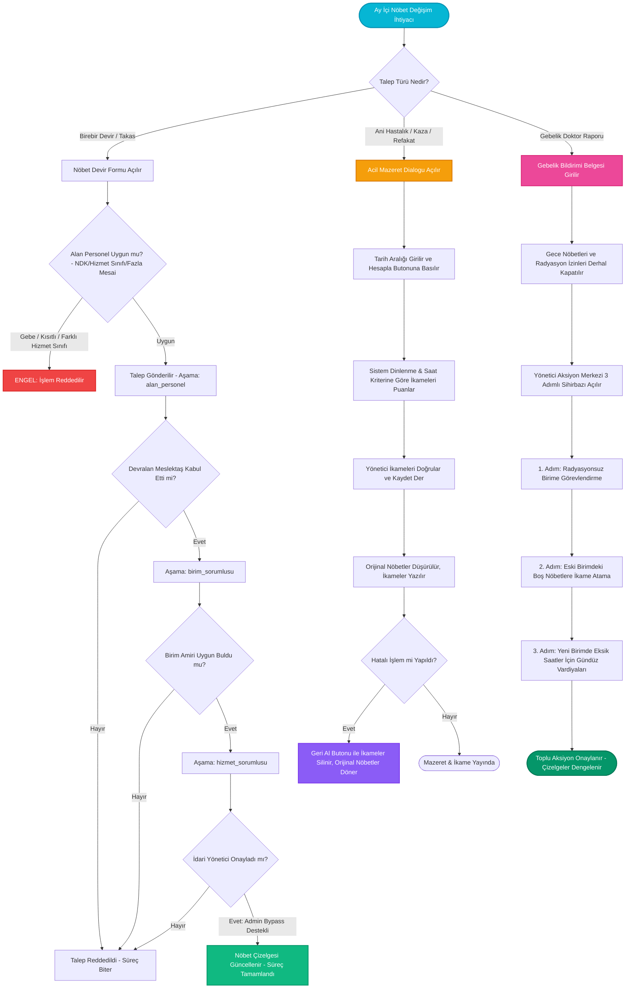

---json
{
  "pageTitle": "09. Nöbet Devir, Karşılıklı Değişim ve Acil İkame Yönetimi — RADPYS v4 Kullanım Kılavuzu",
  "h1": "Nöbet Devir, İkame & Acil Mazeret Yönetimi",
  "lead": "Personeller arası P2P nöbet devri ve karşılıklı takas akışı, çok kademeli onay zinciri, acil mazeretlerde akıllı ikame puanlayıcı, nöbet değişim pazaryeri (havuz), gebe personeli radyasyonsuz alana transfer eden 3 adımlı Yönetici Aksiyon Sihirbazı ve eğitim programı revizyon rehberi.",
  "overviewId": "overview",
  "badges": [],
  "readingTime": "6 Dakika"
}
---

## Hızlı Reçete: Ay Ortası Nöbet Değişimleri, İkame Önerisi ve Gebelik Transferi {#quick-recipe}

:::recipe Hızlı Reçete: Ay Ortası Nöbet Değişimleri, İkame Önerisi ve Gebelik Transferi | 20 SANİYELİK AKIŞ
### 1. İstenen Sonuç | slate
Kesinleşmiş nöbet çizelgelerindeki ay içi mazeret ve takasların mevzuata (NDK, hizmet sınıfı, dinlenme süresi) tam uyumlu, adil ve sahipsiz slot bırakmadan çözülmesi.

### 2. Yapılacak İşlem | cyan
P2P devir için <strong>[Nöbet Devret]</strong> ile talep açın; ani krizlerde <strong>[Acil Mazeret]</strong> ile ikameleri hesaplayın; gebelikte <strong>[Yönetici Aksiyon Merkezi]</strong> sihirbazını uygulayın.

### 3. Sistem Etkisi | emerald
Gebe personele nöbet devri engellenir; taban saat karşılıksız devredilemez; 3 kademeli onay tamamlanınca çizelge güncellenir; hatalı mazeretler tek tıkla geri alınır.

- [metric] Yasal Kalkan | Gebe Nöbet Yasağı | slate
- [metric] Hizmet Sınıfı | Eşit Unvanlar Arası | slate
- [metric] 36s Havuz TTL | İdari İnisiyatif & Kota | slate
- [metric] Geri Alma | Tek Tıkla Mazeret İptali | slate
:::

## 5N1K Kural ve Arayüz Çözümleme Tablosu {#5w1h}

 

 Nöbet devri, takas, mazeret, havuz ve yönetici aksiyon merkezindeki kontrollerin işleyiş mantığı.
 

 

| NE? (Bileşen / İşlem) | NEDEN? (Amacı) | NASIL? (Çalışma Mantığı) | NE ZAMAN? | KİM? |
| --- | --- | --- | --- | --- |
| <strong class="text-slate-900 dark:text-white">[Nöbet Devir Talebi]</strong>  P2P Nöbet Devir & Takas Penceresi | Personelin bir nöbetini meslektaşına devretmesini veya karşılıklı takas etmesini sağlamak. | Alan personel açılır menüden seçilir; sağlık kısıtı, gebelik ve hizmet sınıfı eşitliği denetlenir. Zorunlu gerekçe girilip talep kaydedilir. | Nöbete gelinemeyeceği anlaşıldığında. | Nöbetçi Personel |
| <strong class="text-slate-900 dark:text-white">[Tüm Devir İşlemleri Listesi]</strong>  7 Sütunlu Merkezi İzleme Tablosu | Kurum genelindeki tüm devir/takas hareketlerini ve onay aşamalarını tek ekrandan izlemek. | Talep tarihi, nöbet günü, türü, devreden, devralan, birim ve tek sütunluk renkli durum rozetiyle salt-okunur listeler. Sağ panelde doğal dil özeti sunar. | Rutin denetim ve izlemede. | Birim Sorumlusu, Yönetici |
| <strong class="text-slate-900 dark:text-white">3 Aşamalı Onay Zinciri</strong>  Alan Personel Birim Sorumlusu Yönetici | İlgili personelin rızası ve amirlerin onayı olmadan çizelgenin bozulmasını engellemek. | Önce devralan meslektaş kabul eder; ardından birim sorumlusu klinik uygunluğu onaylar; son olarak yönetici onaylar. Yönetici acil hallerde tek tıkla bypass edebilir. | Talep açıldığında aşama aşama. | Meslektaş, Amir, Yönetici |
| <strong class="text-slate-900 dark:text-white">[Acil Mazeret] & Toplu İkame</strong>  Akıllı İkame Öneri Algoritması | Ani hastalık veya kaza durumunda nöbetlerin açıkta kalmasını engellemek. | Personel ve tarih aralığı seçilip [Hesapla] denir. Sistem boş kalan her slot için dinlenme süresi dolmuş ve hedef saat açığı olan meslektaşları puanlayıp ikame önerir. | Beklenmeyen kriz hallerinde. | Birim Sorumlusu, Yönetici |
| <strong class="text-slate-900 dark:text-white">[Geri Al] (Mazeret İptali)</strong>  Mazeret ve İkame Kaydını Geri Döndürme | Hatalı girilen mazeretlerde çizelgeyi eski haline getirmek. | Geçmiş sekmesinden ilgili mazeret seçilip [Geri Al] butonuna basılır. Sistem ikame atamalarını siler ve mazeretli personelin nöbetlerini geri yükler. | Hatalı mazeret girişlerinde. | Yönetici (Sudo Parolalı) |
| <strong class="text-slate-900 dark:text-white">[Ders Programı Revizyonu]</strong>  Eğitim Kısıtı Güncelleme Diyalogu | Üniversite ders günleri dönem ortasında değişen personeli güncellemek. | Revizyon tarihi seçilir; eski talep dondurulur; yeni haftalık ders günleri (Pazartesi .. Pazar) işaretlenerek yeni kısıt kaydı oluşturulur. | Dönem içi ders programı değiştiğinde. | Personel, Birim Sorumlusu |
| <strong class="text-slate-900 dark:text-white">[Yönetici Aksiyon Merkezi]</strong>  3 Adımlı Gebe Personel Yönetim Sihirbazı | Gebe personelin haklarını korurken klinik nöbet ve mesai açıklarını tek ekrandan çözmek. | 1. Adım: Radyasyonsuz birime transfer 2. Adım: Eski birimdeki boş nöbetlere ikame ataması 3. Adım: Yeni birimde eksik saatler için gündüz vardiyaları oluşturma. | Gebelik doktor raporu çıktığında. | Başhekimlik, İdari Yönetici |
| <strong class="text-slate-900 dark:text-white">Nöbet Değişim Havuzu & 36s TTL</strong>  Web Portal Marketplace & Zaman Aşımı | Muhatap aramadan nöbet değişimini pazaryerine sunmak; son 36 saatte idari süreci başlatmak. | Personel nöbetini havuza bırakır (maks 48s/ay); meslektaşlar teklif verir. Nöbete 36 saat kala havuz ilanı zaman aşımına uğrar; personelin talebi ve yöneticinin tespitiyle acil mazerete aktarılır. | Nöbet takası arayışında. | Personel, İdari Yönetici |

## Kritik Sahada Yanlış Bilinen Kurallar (Mit Avcısı) {#myth-buster}

 

 

 

 <h3 class="text-base font-bold text-slate-900 dark:text-white">
 Saha Mit Avcısı: "Havuzda 36 Saat Kala Eşleşmeyen Nöbetler Otomatik Olarak Acil Mazerete mi Aktarılır?"
 </h3>
 En Sık Karşılaşılan Havuz ve Mazeret Yanılgısı
 

 

 

 

 
 

 <strong>Yanlış İnanış:</strong> <em>"Nöbetimi değişim havuzuna bıraktım; nöbete 36 saat kala kimse talip olmazsa sistem otomatik olarak mazeret izni açar, beni nöbetten siler ve yerime zorunlu ikame yazar."</em>
 

 

 

 
 

 <strong>Doğru Gerçek:</strong> <strong>HAYIR, BU SÜREÇ OTOMATİK İŞLEMEZ.</strong> Nöbet saatine 36 saat kaldığında sistem nöbetin sahipsiz kalmasını önlemek için ilanı <strong>zaman aşımına (ZAMAN_ASIMI)</strong> uğratır ve havuzdan çeker. Ancak acil mazeret ve ikame atama süreci kendiliğinden devreye girmez. <strong>Personelin birim yöneticisine yazılı/sözlü başvuruda bulunması ve yöneticinin klinik bir zorunluluk olduğunu tespit etmesi</strong> neticesinde yönetici inisiyatifiyle acil mazeret ve ikame protokolü başlatılır.
 

 

 

## Devir, İkame, Mazeret ve Aksiyon Akış Şeması {#workflow}

 

 P2P devir talebinden 3 kademeli onaya, acil mazeretten gebe personel sihirbazına kadar tüm karar döngüsü.
 

 

 

 

## Arayüz Ekran Görünümleri {#screenshots}

 

 Nöbet devir listesi, devir talep formu, pazar yeri havuzu ve yönetici aksiyon merkezi ekranları.
 

 

![Nöbet Devir Talebi Oluşturma Ekranı | Nöbet Çizelgesi > [Nöbet Devret] Diyalogu | P2P Devir Formu, Kısıt Doğrulaması & Zorunlu Gerekçe](assets/img/09_nobet_devir_dialog.png "<strong>Yasal Bilgilendirme:</strong> Devralacak personel seçildiğinde yasal çalışma kısıtları ve hizmet sınıfı uygunluğu anlık denetlenir.")

## Adım Adım İşlem Rehberi {#step-by-step}

 

 Nöbet devri, takas, mazeret, havuz ve idari transfer senaryolarında izlenecek uygulama adımları.
 

 

 

 

 
 1
 
 <h3 class="text-base font-bold text-slate-900 dark:text-white">
 Personeller Arası P2P Nöbet Devir Talebi Oluşturma
 </h3>
 

 <ol class="list-decimal list-inside space-y-2 text-xs sm:text-sm text-slate-600 dark:text-slate-300 pl-2">
 <li>Nöbet çizelgesi ekranında devretmek istediğiniz nöbet hücresine sağ tıklayıp <strong>[Nöbet Devret]</strong> seçeneğini seçin (veya Web Portal Nöbetlerim ekranından *'Devret'* butonuna basın).</li>
 <li>Açılan pencerede kaynak nöbet bilgileri (personel, tarih, vardiya türü) otomatik gösterilir.</li>
 <li><strong>[Alan Personel]</strong> açılır kutusundan nöbeti devralacak meslektaşınızı seçin:
 <ul class="list-disc list-inside pl-5 mt-1 text-slate-500 dark:text-slate-400 space-y-0.5">
 <li>Sistem farklı hizmet sınıfındaki personelleri (örn: Hemşire - Teknisyen) otomatik filtreler.</li>
 <li>Gebe, emziren veya sağlık raporu olan personeller listeye dahil edilmez.</li>
 </ul>
 </li>
 <li><strong>[Devir Nedeni]</strong> kutusuna resmi gerekçenizi yazın.</li>
 <li><strong>[Kaydet]</strong> butonuna tıklayın. Talep önce devralacak meslektaşın onayına iletilir.</li>
 </ol>
 

 

 

 
 2
 
 <h3 class="text-base font-bold text-slate-900 dark:text-white">
 Çok Kademeli Onay Sürecini Yürütme ve Tamamlama
 </h3>
 

 <ol class="list-decimal list-inside space-y-2 text-xs sm:text-sm text-slate-600 dark:text-slate-300 pl-2">
 <li><strong>1. Aşama (Alan Personel):</strong> Devralacak meslektaş Bildirim Merkezi veya Web Portal üzerinden gelen devir talebini inceler ve <strong>[Kabul Et]</strong> butonuna basar.</li>
 <li><strong>2. Aşama (Birim Sorumlusu):</strong> Birim amiri servisin o günkü işleyişini ve vardiya dengesini inceleyerek talebi birim düzeyinde onaylar.</li>
 <li><strong>3. Aşama (Yönetici Onayı):</strong> İdari yönetici talebi onaylar. Üç onay tamamlandığı anda nöbet çizelgesinde personelin adı değişir, saatler yeniden hesaplanır ve her iki tarafa bildirim gider.</li>
 <li><em>(Acil Hallerde: Sistem Yöneticisi doğrudan tek tıkla nihai onayı vererek alt aşamaları tamamlayabilir.)</em></li>
 </ol>
 

 

 

 
 3
 
 <h3 class="text-base font-bold text-slate-900 dark:text-white">
 Acil Mazeret Bildirimi ve Toplu Akıllı İkame Atama
 </h3>
 

 <ol class="list-decimal list-inside space-y-2 text-xs sm:text-sm text-slate-600 dark:text-slate-300 pl-2">
 <li>Nöbet çizelgesi ekranındayken üst araç çubuğundaki <strong>[Acil Mazeret]</strong> butonuna tıklayın.</li>
 <li>Açılan pencerede <strong>[Personel]</strong> seçimini yapın ve mazeret kapsamındaki <strong>[Başlangıç Tarihi]</strong> ile <strong>[Bitiş Tarihi]</strong> alanlarını girin.</li>
 <li><strong>[İptal Nedeni]</strong> kutusundan resmi izin türünü (veya *'Diğer / Gayri-Resmi Mazeret'* seçeneğini) belirleyin.</li>
 <li><strong>[Etkilenen Nöbetleri Getir / Hesapla]</strong> butonuna basın.</li>
 <li>Sistem personelin o tarihlerdeki tüm nöbetlerini listeler; her nöbetin karşısına kural ihlali yapmayan ve en yüksek uygunluk puanına sahip yedek personelleri otomatik önerir.</li>
 <li>İkame personelleri onaylayıp <strong>[Kaydet]</strong> butonuna basarak işlemi tamamlayın.</li>
 </ol>
 

 

 

 
 4
 
 <h3 class="text-base font-bold text-slate-900 dark:text-white">
 Hatalı Mazeretleri Tek Tıkla Geri Alma (Rollback)
 </h3>
 

 <ol class="list-decimal list-inside space-y-2 text-xs sm:text-sm text-slate-600 dark:text-slate-300 pl-2">
 <li><strong>[Acil Mazeret]</strong> penceresinde <strong>[Geçmiş]</strong> sekmesine geçin.</li>
 <li>Daha önce kaydedilmiş mazeret logları listesinden geri alınacak satırı seçin.</li>
 <li>Alttaki <strong>[Geri Al]</strong> butonuna tıklayın.</li>
 <li>Ekrana gelen onay kutusunu teyit edin. Sistem atanan ikame nöbetleri siler ve mazeretli personelin nöbetlerini sıfır veri kaybıyla eski haline döndürür.</li>
 </ol>
 

 

 

 
 5
 
 <h3 class="text-base font-bold text-slate-900 dark:text-white">
 Gebe Personel Bildirimi ve Yönetici Aksiyon Sihirbazı
 </h3>
 

 <ol class="list-decimal list-inside space-y-2 text-xs sm:text-sm text-slate-600 dark:text-slate-300 pl-2">
 <li>Personel özlük kartı detayındayken <strong>[Gebelik Bildirimi]</strong> butonuna tıklayın.</li>
 <li>Bildirim tarihi, tahmini doğum tarihi ve doktor raporu dosyasını sisteme kaydedin.</li>
 <li>Sistem gece nöbeti ve radyasyon kilitlerini anında kapatır; <strong>[Yönetici Aksiyon Merkezi]</strong> sihirbazı açılır:
 <ul class="list-disc list-inside pl-5 mt-1 text-slate-500 dark:text-slate-400 space-y-0.5">
 <li><strong>1. Adım:</strong> Personelin atanacağı radyasyonsuz yeni birimi seçin.</li>
 <li><strong>2. Adım:</strong> Gebe personelin eski biriminde düşen nöbetlerine listeden ikame personelleri atayın.</li>
 <li><strong>3. Adım:</strong> Personelin yeni birimde eksik kalan aylık çalışma saatini tamamlamak için önerilen gündüz vardiyalarını onaylayın.</li>
 </ul>
 </li>
 <li><strong>[Tüm Aksiyonları Onayla ve Çizelgeyi Güncelle]</strong> butonuna basarak işlemi tek adımda tamamlayın.</li>
 </ol>
 

## Sıkça Sorulan Sorular (SSS) {#faq}

:::faq
### Gebe veya emziren personele nöbet devredilebilir mi?
<strong>Kesinlikle hayır.</strong> RADPYS Güvenlik Kalkanı (`RED-NOBET_RADIATION_PREGNANCY_BREACH_IN_SWAP`) uyarınca aktif gebelik bildirimi, emzirme izni, heyet raporu veya radyasyon doz aşımı bulunan personele sistem hiçbir koşulda nöbet devrine veya takasına izin vermez. Devir formu bu personelleri seçim listesine dahil etmez.

### Radyoloji Teknikeri ile Hemşire arasında nöbet devri veya takası yapılabilir mi?
<strong>Hayır.</strong> Hizmet Sınıfı Eşitliği ilkesi gereğince nöbet devri ve takası yalnızca aynı hizmet sınıfındaki meslektaşlar arasında yapılabilir. Farklı unvanlara sahip personeller (örn: Hemşire ile Radyasyon Teknikeri) birbirinin nöbetini devralamaz.

### Bir personel aylık zorunlu taban çalışma saatini tek yönlü olarak başkasına devredebilir mi?
Hayır. Personelin aylık zorunlu çalışma süresi (örneğin 140 saat) altındaki taban nöbetleri karşılıksız devredilemez. Yalnızca fazla mesai kapsamındaki nöbetler tek yönlü devredilebilir. Personel taban süresini doldurmamışsa mutlaka <strong>"Karşılıklı Takas"</strong> seçeneğini kullanmak zorundadır.

### Nöbet değişim havuzunda 36 saat kala nöbet otomatik olarak acil mazerete mi düşer?
Hayır. Nöbet saatine 36 saat kaldığında sistem nöbetin açıkta kalmasını önlemek için havuz ilanını zaman aşımına uğratır (`ZAMAN_ASIMI`). Ancak acil mazeret ve ikame atama süreci otomatik olarak işletilmez. Personelin yöneticiye başvurusu ve amirin klinik bir zorunluluk olduğunu teyit etmesi neticesinde yönetici inisiyatifiyle acil mazeret protokolü devreye alınır.

### Acil mazeretle iptal edilen nöbetler sonradan geri alınabilir mi?
Evet. Acil mazeret diyalogundaki **[Geçmiş]** sekmesine gidilerek ilgili mazeret kaydı seçilip **[Geri Al]** butonuna basıldığında, sistem atanan ikame nöbetleri siler ve mazeretli personelin orijinal nöbetlerini çizelgeye geri döndürür.
:::
