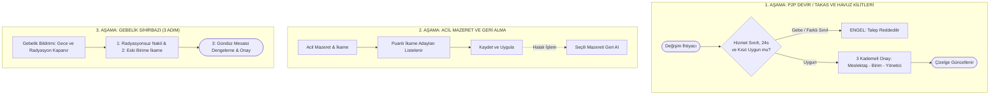

---json
{
  "pageTitle": "09. Nöbet Devir, Karşılıklı Değişim ve Acil İkame Yönetimi — RADPYS v4 Kullanım Kılavuzu",
  "h1": "Nöbet Devir, İkame & Acil Mazeret Yönetimi",
  "lead": "Personeller arası birebir devir ve karşılıklı takas taleplerini, 3 kademeli onay zincirini, Web Portalı Nöbet Değişim Havuzunu (48 saat aylık kota ve 36 saat son teslim sınırı), acil mazeret akıllı ikame ve geri alma işlemini, ders programı revizyonunu ve 3 adımlı gebe personel aksiyon sihirbazını yönetmenizi sağlar.",
  "overviewId": "overview",
  "badges": [
    {
      "text": "Hibrit Devir & Acil İkame",
      "tone": "purple"
    }
  ],
  "readingTime": "6 Dakika",
  "legalNote": "<strong>Yasal Güvence:</strong> Gebe, emziren, heyet raporu muafiyeti olan veya radyasyon doz aşımı bulunan personele nöbet devredilemez; devir ve takas yalnızca aynı hizmet sınıfındaki meslektaşlar arasında ve aynı ay içinde yapılabilir."
}
---

## Kısa Reçete: Ay Ortası Nöbet Değişimi, İkame ve Gebelik Transferi {#quick-recipe}

:::recipe Kısa Reçete: Ay Ortası Nöbet Değişimi, İkame ve Gebelik Transferi | 20 SANİYELİK AKIŞ
### 1. İstenen Sonuç | slate
Kesinleşmiş çizelgedeki ay içi nöbet değişimi, ani hastalık veya gebelik bildirimlerinin sahipsiz vardiya bırakmadan ve mevzuata tam uyumlu çözülmesi.

### 2. Yapılacak İşlem | cyan
Karşılıklı değişim için masaüstünden <strong>[Devir Talebi]</strong> veya Web Portalından <strong>Nöbet Değişim Merkezi</strong> üzerinden talep açın; ani krizlerde <strong>[Acil Mazeret ve İkame]</strong> ile uygun yedekleri atayın; gebelik bildiriminde <strong>Merkezi Yönetici Aksiyon ve Onay Sihirbazı</strong> adımlarını onaylayın.

### 3. Sistem Etkisi | emerald
Hizmet sınıfı eşitliği, 24 saat dinlenme ve taban çalışma saati otomatik denetlenir; 3 kademeli onay tamamlanınca çizelge güncellenir ve hatalı girilen mazeretler tek tıkla eski haline döndürülür.

- [metric] Hizmet Sınıfı | Eşit Unvanlar Arası | slate
- [metric] Havuz Sınırı | Aylık 48s / 36s Son Süre | purple
- [metric] Dinlenme &amp; Ön Süre | 24 Saat Kalkanı | cyan
- [metric] Geri Alma | Tek Tıkla Mazeret İptali | emerald
:::

## 5N1K Kural ve Arayüz Çözümleme Tablosu {#5w1h}

*Nöbet devri, takas, Web Portalı havuzu, acil mazeret ve gebe personel aksiyon merkezindeki kurallar.*

| NE? (Bileşen / Kontrol) | NEDEN? (Amacı) | NASIL? (Çalışma Mantığı) | NE ZAMAN? (Tetiklenme) | KİM? (Yetkili Rol) |
| --- | --- | --- | --- | --- |
| <strong>Hizmet Sınıfı Eşitliği ve Taban Saat Kilidi</strong> Otomatik Devir Doğrulaması | Unvan uyumsuzluğunu ve zorunlu aylık çalışmanın karşılıksız düşmesini önlemek. | Farklı meslek grupları arası değişimi ve aylık taban saati dolmamış personelin tek taraflı devrini engeller; yalnızca karşılıklı aynı ay içi takasa izin verir. | Devir talebi açılırken. | Nöbetçi Personel / Sistem |
| <strong>24 Saat Ön Süre ve Dinlenme Kalkanı</strong> Tükenmişlik Önleme | Son dakika sahipsiz nöbet kalmasını ve personelin dinlenmeden çalışmasını engellemek. | Başlangıcına 24 saatten az kalan nöbetlerde devir açılamaz; devralan personelin önceki veya sonraki 24 saatlik dinlenmesini ihlal eden talepler reddedilir. | Talep kaydı ve onayında. | Sistem Güvenlik Kilidi |
| <strong>3 Kademeli Onay Zinciri &amp; Doğal Dil Paneli</strong> [Tüm Devir İşlemleri] | Tarafların rızası ve amirlerin klinik kontrolü olmadan çizelgenin değişmesini önlemek. | Önce devralan meslektaş kabul eder, ardından birim sorumlusu ve idari yönetici onaylar; yönetici acil hallerde tek adımda nihai onayı verebilir. | Devir süreci ilerlerken. | Meslektaş / Amir / Yönetici |
| <strong>Web Portalı Nöbet Değişim Havuzu</strong> 48 Saat Kota &amp; 36 Saat Sınırı | Doğrudan muhatap bulamadan ilana çıkmak ve son 36 saatte idari süreci korumak. | Aylık en fazla 48 saat havuza bırakılabilir ve nöbete 36 saat kala ilan otomatik zaman aşımına uğrar; mazerete aktarımı ise yönetici tespitiyle başlatılır. | Havuz ilanı ve son 36 saatte. | Personel / İdari Yönetici |
| <strong>[Acil Mazeret ve İkame] &amp; [Seçili Mazereti Geri Al]</strong> Puanlı Yedek Önerici | Ani hastalık veya mazerette boş kalan slotları en uygun yedekle doldurup hatayı kurtarmak. | Dinlenme ve saat dengesine göre adayları puanlayıp listeler; geçmiş sekmesinden geri alındığında ikame silinir ve orijinal nöbet geri yüklenir. | Beklenmeyen mazerette. | Birim Sorumlusu / Yönetici |
| <strong>Merkezi Yönetici Aksiyon ve Onay Sihirbazı</strong> 3 Adımlı Gebelik Çözümü | Gebe personeli korurken eski birim açığını ve yeni birim mesai dengesini tek seferde çözmek. | Birinci adımda radyasyonsuz birime nakli, ikinci adımda boşalan nöbetlere ikameyi, üçüncü adımda eksik saatler için gündüz vardiyalarını tek onayla uygular. | Gebelik raporu girildiğinde. | Başhekimlik / İdari Yönetici |

## Kritik Sahada Yanlış Bilinen Kurallar (Mit Avcısı) {#myth-buster}

:::myth Havuzda 36 Saat Kala Eşleşmeyen Nöbetler Otomatik Olarak Acil Mazerete Aktarılır mı?
### Yanlış Algı
<em>"Nöbetimi Web Portalı değişim havuzuna bıraktım; nöbete 36 saat kala kimse talip olmazsa sistem nöbeti üzerimden otomatik düşürüp yerime zorunlu ikame yazar."</em>

### Gerçek Sistem Mantığı
<strong>Bu süreç kendiliğinden otomatik işlemez.</strong> Nöbete 36 saat kaldığında sistem nöbetin açıkta kalmasını önlemek için ilanı zaman aşımına uğratıp havuzdan çeker; ancak acil mazeret ve ikame kaydı otomatik açılmaz. Personelin birim yöneticisine başvurması ve yöneticinin klinik zorunluluk tespit ederek acil mazeret protokolünü başlatması gerekir.
:::

## Süreç Akış Şeması {#workflow}

1. **Devir, Takas ve Havuz:** Gebelik, heyet muafiyeti, farklı hizmet sınıfı veya 24 saat dinlenme ihlali varsa sistem engeller; uygun talepler devralan meslektaş, birim sorumlusu ve yönetici onaylarıyla çizelgeye işlenir.
2. **Acil Mazeret ve Geri Alma:** Yönetici ani mazerette puanlı ikameleri tek pencerede atar; hatalı girişlerde geçmiş sekmesinden orijinal nöbetleri geri döndürebilir.
3. **Gebelik Aksiyon Sihirbazı:** Gebelik kaydı gece ve radyasyon kilitlerini anında kapatır; yönetici aynı sihirbazda nakli, eski birim ikamesini ve yeni birim gündüz mesaisini tek onayla tamamlar.

## Arayüz Ekran Görünümleri {#screenshots}

## Adım Adım İşlem Rehberi {#step-by-step}

### 1. Masaüstü veya Web Portalından Devir / Havuz Talebi Açma ve Onaylama

1. Masaüstünde yayındaki plandan **[Devir Talebi]** butonuna tıklayın (veya çizelgede satırı seçip talep açın); **Alan Personel**, **Devir Nedeni** ve gerekirse notu girip **[Devir Talebi Olustur]** butonuna basın.
2. Web Portalında **Nöbet Değişim Merkezi** ekranından **Açık Havuz** sekmesinde **[Havuza Bırak]** ile ilan açabilir, **Doğrudan Devir / Takas** ile meslektaşınıza teklif gönderebilir, **Onay Bekleyenler** ve **Geçmiş** sekmelerinden süreci izleyebilirsiniz.
3. Masaüstündeki **[Tüm Devir İşlemleri]** ekranında satır seçildiğinde sağ panelde talebin özeti ve onay aşamaları doğal dille görüntülenir.

### 2. Acil Mazeretle Toplu İkame Atama ve Hatalı Kaydı Geri Alma

1. Yayındaki plan inceleme ekranında **[Acil Mazeret ve İkame]** butonuna basın; **Yeni Acil Mazeret ve İkame** sekmesinde Personel, Başlangıç/Bitiş Tarihleri ve İptal Nedenini seçip **[Etkilenen Nöbetleri ve İkame Önerilerini Getir]** butonuna tıklayın.
2. Sistem her boş nöbet için uygunluk puanına göre adayları sıralar; yedekleri doğrulayıp **[Kaydet ve Uygula]** butonuna basın.
3. Hatalı bir işlem olduysa **Mazeret Geçmişi ve Geri Alma** sekmesinden satırı seçip **[Seçili Mazereti Geri Al]** butonuna tıklayarak eski nöbetleri geri yükleyin.

### 3. Ders Programı Revizyonu ve Gebelik Yönetici Aksiyon Sihirbazı

1. Dönem ortasında üniversite ders günleri değişen personel için Nöbet Ayarları > Personel Talepleri içindeki **[Ders Programını Revize Et]** butonuna basın; revizyon başlangıç tarihini ve yeni hafta içi günlerini (**Pzt**–**Cum**) işaretleyip **[Revizyonu Kaydet]** butonuna tıklayın.
2. Gebe personel bildiriminde özlük kartından **Gebelik Bildirimi** ekranını açıp rapor ve tahmini doğum bilgilerini kaydederek **[Bildirimi Kaydet ve Nöbetleri İptal Et]**'e basın; açılan **Merkezi Yönetici Aksiyon ve Onay Sihirbazı** üzerinde yeni radyasyonsuz birimi, eski birim ikamelerini ve gündüz vardiyalarını doğrulayıp **[Tüm Aksiyonları Onayla ve Çizelgeyi Güncelle]** butonuna tıklayın.

## Sıkça Sorulan Sorular (SSS) {#faq}

:::faq
### Gebe veya emziren personele acil durumda nöbet devredilebilir mi?
<strong>Kesinlikle hayır.</strong> 657 DMK m. 101, 4857 İş Kanunu m. 74 ve Radyasyon Güvenliği Yönetmeliği m. 12 gereğince aktif gebelik, emzirme, heyet raporu veya radyasyon doz aşımı bulunan personele nöbet devri ve takası tamamen kapatılır.

### Farklı hizmet sınıfları (örneğin Teknisyen ile Hemşire) arasında takas yapılabilir mi?
Hayır. Hizmet Sınıfı Eşitliği ilkesi gereğince nöbet devri ve takası yalnızca aynı görev grubu ve hizmet sınıfındaki meslektaşlar arasında yapılabilir.

### Aylık zorunlu mesaisini tamamlamamış personel tek taraflı nöbet devredebilir mi?
Hayır. Aylık zorunlu taban çalışma süresi altındaki nöbetler karşılıksız tek yönlü devredilemez; yalnızca fazla mesai kapsamındaki saatler devredilebilir. Taban saat altındaki değişimler için aynı ay içinde <strong>Karşılıklı Takas</strong> seçilmelidir.

### Nöbete 36 saat kaldığında havuz ilanı nasıl sonuçlanır?
Nöbet başlangıcına 36 saatten az kaldığında yeni havuz ilanı açılamaz, mevcut ilan ise zaman aşımına alınarak kapatılır. Zorunlu bir mazeret varsa personel amirine başvurur ve yönetici inisiyatifiyle <strong>[Acil Mazeret ve İkame]</strong> süreci işletilir.
:::
