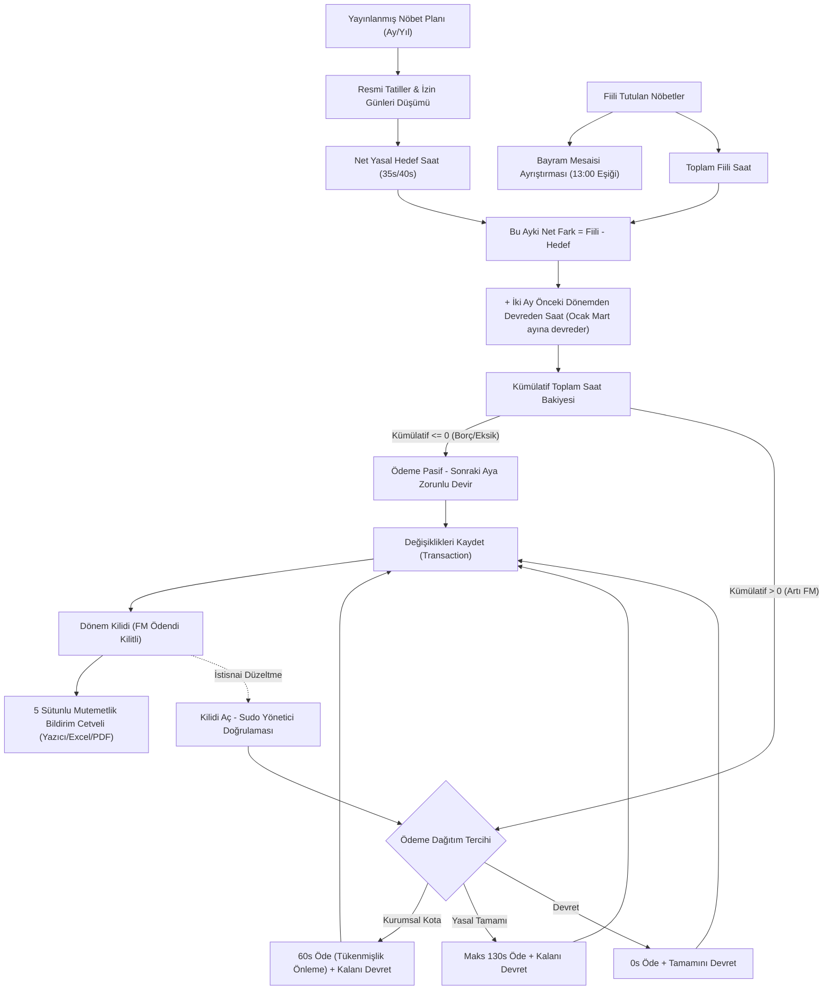

---json
{
  "pageTitle": "10. Nöbet Borç / Alacak Bakiyesi ve Fazla Mesai Hakedişleri — RADPYS v4 Kullanım Kılavuzu",
  "h1": "Nöbet Borç / Alacak ve Fazla Mesai Yönetimi",
  "lead": "Bu modül; radyoloji ve sağlık çalışanlarının aylık yasal mesai rejimlerine (<strong>3153 Sayılı Kanun</strong> kapsamındaki haftalık 35 saatlik radyasyon ortamı veya <strong>657 Sayılı Kanun</strong> kapsamındaki 40 saatlik genel klinik ortam), resmi tatil/arife indirimlerine ve onaylı izinlerine göre <strong>bireysel aylık hedef çalışma saatlerini</strong> belirler. Personelin tuttuğu fiili nöbetleri, resmi bayram mesailerini ve geçmiş aydan devreden saat bakiyelerini hesaba katarak mutemetlik ödemesi ve dönem devirlerini yönetir.",
  "overviewId": "genel-bakis",
  "badges": []
}
---

## Vizyonder Hızlı Karar Reçetesi (Amir & Mutemet Özeti) {#hizli-recete}

:::recipe Vizyonder Hızlı Karar Reçetesi (Amir & Mutemet Özeti) | 20 SANİYELİK AKIŞ
### 1. Hedef Saati ve İzinleri Doğrulayın | cyan
Ay başında personelin mesai rejimi (35s Radyasyon vs 40s Genel) ve onaylı izin günlerinin hedef saatten otomatik düşürüldüğünü kontrol edin.

### 2. Net Bakiyeyi İzleyin | emerald
Fiili çalışma hedefi aştığında yeşil alacak, eksik kaldığında kırmızı borç bakiyesi oluşur. Geçmiş aydan devreden saatler kümülatif bakiyeye otomatik eklenir.

### 3. Mutemetlik Onayı ve Kilitleme | blue
60 saatlik koruyucu kota ve 130 saatlik mutlak tavan denetimiyle bordro icmalini üretin. <em>FM Öde</em> işlemi dönemi kilitler ve yetkisiz değişiklikleri engeller.
:::

## Temel Eşikler & Koruyucu Yasal Sınırlar {#kpi-kartlari}

 

 

 Yasal Mutlak Tavan
 
 <svg class="w-4 h-4" fill="none" stroke="currentColor" viewBox="0 0 24 24"><path stroke-linecap="round" stroke-linejoin="round" stroke-width="2" d="M12 15v2m-6 4h12a2 2 0 002-2v-6a2 2 0 00-2-2H6a2 2 0 00-2 2v6a2 2 0 002 2zm10-10V7a4 4 0 00-8 0v4h8z"/></svg>
 
 

 
130.0 saat/ay

 

 Mevzuat gereği bir personele bir ayda ödenebilecek mutlak üst sınırdır. 130 saati aşan kısımlar sonraki aya zorunlu devreder.
 

 

 

 

 Tükenmişlik Önleme Kotası
 
 <svg class="w-4 h-4" fill="none" stroke="currentColor" viewBox="0 0 24 24"><path stroke-linecap="round" stroke-linejoin="round" stroke-width="2" d="M4.318 6.318a4.5 4.5 0 000 6.364L12 20.364l7.682-7.682a4.5 4.5 0 00-6.364-6.364L12 7.636l-1.318-1.318a4.5 4.5 0 00-6.364 0z"/></svg>
 
 

 
60.0 saat/ay

 

 Personel sağlığını korumak ve mesleki tükenmişliği (burnout) engellemek adına kurumun belirlediği standart ödeme kotasıdır.
 

 

 

 

 Çift Havuzlu Rejim
 
 <svg class="w-4 h-4" fill="none" stroke="currentColor" viewBox="0 0 24 24"><path stroke-linecap="round" stroke-linejoin="round" stroke-width="2" d="M9 19v-6a2 2 0 00-2-2H5a2 2 0 00-2 2v6a2 2 0 002 2h2a2 2 0 002-2zm0 0V9a2 2 0 012-2h2a2 2 0 012 2v10m-6 0a2 2 0 002 2h2a2 2 0 002-2m0 0V5a2 2 0 012-2h2a2 2 0 012 2v14a2 2 0 01-2 2h-2a2 2 0 01-2-2z"/></svg>
 
 

 
35s / 40s denklik

 

 Radyasyonlu alan (haftalık 35 saat) ile genel alan (haftalık 40 saat) nöbetleri oransal denklikle birleştirilip kıstelyevm uygulanır.
 

 

 

 

 Bayram Mesaisi
 
 <svg class="w-4 h-4" fill="none" stroke="currentColor" viewBox="0 0 24 24"><path stroke-linecap="round" stroke-linejoin="round" stroke-width="2" d="M8 7V3m8 4V3m-9 8h10M5 21h14a2 2 0 002-2V7a2 2 0 00-2-2H5a2 2 0 00-2 2v12a2 2 0 002 2z"/></svg>
 
 

 
13:00 arife eşiği

 

 Dini ve milli bayramlar ile arife günleri saat 13:00 sonrasında tutulan nöbetler dakika hassasiyetinde ayrı bordro sütununa yazılır.
 

 

 

## Bakiye Hesaplama ve Karar Mantık Akışı {#is-akisi-semasi}

 

## 4. 5N1K Kural ve Arayüz Bileşen Envanteri {#5n1k-tablosu}

 Sıfır Hayalet Bileşen
 

| Bileşen / Ayar | Amacı (Neden?) | Çalışma Mantığı & Formülü (Nasıl?) | Tetiklenme (Ne Zaman?) | Yetkili Rol (Kim?) | Durum |
| --- | --- | --- | --- | --- | --- |
| [Yıl] & [Ay] Seçimi | İncelenecek ve hesaplanacak nöbet bordro dönemini belirlemek. | Yıl spin kutusu ve Ay açılır kutusundaki seçime göre yayınlanmış plan sorgulanır. | Dönem değiştiğinde | Nöbet Sorumlusu, Amir | Aktif |
| [Birim] Filtresi | Sadece belirli bir kliniğe/birime ait personelleri listelemek. | Personelin asıl birimi, görev yeri veya geçici görevlendirmesiyle süzülür. | Birim seçildiğinde | Birim Sorumlusu, Şef | Aktif |
| [Dönem Kilit Durumu] | Dönemin düzenlemeye açık mı, kesinleşip kilitli mi olduğunu bildirmek. | Kırmızı (FM Ödendi Kilitli), Sarı (Sudo Açık), Mavi (Kayıtlı), Yeşil (Açık Düzenleme). | Veri yenilendiğinde | Tüm Kullanıcılar | Aktif |
| [Kilidi Aç] Butonu | Kesinleşmiş ve kilitlenmiş dönemi istisnai düzeltmeye açmak. | Yönetici şifresi doğrulanırsa tablo kontrollerini geçici olarak aktifleştirir. | Kilitli dönemde tıklanınca | Sistem Yöneticisi, Amir | Aktif |
| [Yenile] Butonu | Tabloyu yayınlanan plan, izinler ve devirlerle baştan hesaplamak. | Kıstelyevm, resmi tatil düşümü ve çift havuzlu fiili nöbetleri yeniden derler. | Butona basıldığında | Nöbet Sorumlusu | Aktif |
| İki Ay Gecikmeli Devir Kuralı | Fazla mesai bakiyesinin, hesabı kesinleştikten sonra güvenle bir sonraki planlara yansıtılmasını sağlamak. | Ocak bakiyesi Mart planına, Şubat bakiyesi Nisan planına devreder (Kasım ve Aralık ertesi yılın Ocak ve Şubat planına). Devredecek dönemde kayıt yoksa devir 0 kabul edilir. | Otomatik nöbet planı oluşturulurken ve tablo hesaplanırken | Nöbet Sorumlusu | Aktif |
| Planlamada Zorunlu Mutabakat | Devredecek dönemin fazla mesai hesabı yapılmadan eksik veriyle nöbet dağıtılmasını önlemek. | Devredecek dönemde nöbeti olup mutabakatı kaydedilmemiş personel varsa [Otomatik Oluştur] durdurulur ve eksik personel adları listelenir. | [Otomatik Oluştur] butonuna basıldığında | Nöbet Sorumlusu, Amir | Aktif |
| [Değişiklikleri Kaydet] | Ödeme ve sonraki aya devir kararlarını veritabanına yazmak. | Tüm personellerin saat ve durum kayıtlarını tek transaction ile günceller. | Kararlar sonrası | Yetkili Kullanıcı, Amir | Aktif |
| [Yazdır] Menüsü | Mutemetlik için 5 sütunlu resmi bildirim cetvelini üretmek. | Normal FM ve Bayram FM saatlerini ayrıştırıp Yazıcı, Excel (.xlsx) veya PDF döker. | Seçenek tıklandığında | Mutemet, Sorumlu | Aktif |
| [Toplu İşlem] & [Seçilenlere Uygula] | Seçili personellere tek tıkla kota veya devir kararı uygulamak. | 60s Kurumsal Kota, 130s Yasal Tamamı veya Devret kararlarını seçili satırlara atar. | Uygula butonunda | Nöbet Sorumlusu | Aktif |
| [Devret] / [FM Öde] Seçimi | Bireysel satırda fazla mesai ödeme dağıtımını belirlemek. | [FM Öde] tıklandığında modal açılır; ödenecek saat ve sonraki aya devir belirlenir. | Radio tıklandığında | Birim Sorumlusu | Aktif |

## Ekran Konumları ve Görsel Rehber {#ekran-goruntuleri}

![Fazla Mesai Ödeme Dağıtımı Modalı (FMOdemeSecimDialog) | Nöbet Borç / Alacak Devri > [FM Öde] > Fazla Mesai Ödeme Dağıtımı | FMOdemeSecimDialog Modalı](assets/img/10_fm_odeme_secim_dialog.png "<strong>Simülasyon Notu:</strong> Bireysel 60 saat kurumsal kota, 130 saat yasal tavan ve sonraki aya devir hesaplama simülasyonu.")

## Adım Adım İşlem Rehberi {#kullanim-rehberi}

 

 A
 <h3 class="text-base sm:text-lg font-bold text-slate-900 dark:text-white">Aylık Nöbet Borç / Alacak Tablosunu İnceleme</h3>
 

 <ol class="list-decimal list-inside space-y-2 text-sm text-slate-600 dark:text-slate-300 leading-relaxed pl-2">
 <li>Sol menüden <strong>[Nöbet Yönetimi] &gt; [Nöbet Borç / Alacak Devri]</strong> sayfasına gidin.</li>
 <li>Üst araç çubuğundaki <strong>[Yıl]</strong> ve <strong>[Ay]</strong> alanlarından hesaplanacak nöbet dönemini seçin.</li>
 <li>Gerekiyorsa <strong>[Birim]</strong> ve <strong>[Hizmet Sınıfı]</strong> filtrelerini daraltın ve <strong>[Yenile]</strong> butonuna basın.</li>
 <li><strong>Devir mantığı:</strong> Fazla mesai bakiyesi iki ay gecikmeli devreder: Ocak dönemi Mart, Şubat dönemi Nisan planına yansır. Nöbet çizelgesi ayın bitmesine 5-10 gün kala hazırlandığı için devredecek ayın mutabakatı o sırada kesinleşmiş olur. Yeni bir ayın otomatik planını oluşturmadan önce, iki ay öncesinin mutabakatını bu ekranda hesaplayıp <strong>[Değişiklikleri Kaydet]</strong> ile kaydetmeniz gerekir.</li>
 <li>Tabloda personellerin yasal hedef saatleri, fiili saatleri, ayın net farkı, iki ay önceki dönemden devreden bakiye ve kümülatif toplam saatleri listelenir:
 <ul class="list-disc list-inside pl-5 mt-1 space-y-1 text-xs">
 <li>Artı Kümülatif Saatler: Yeşil renkle gösterilir; personelin fazla mesai hak edişi olduğunu belirtir.</li>
 <li>Eksi Kümülatif Saatler: Kırmızı renkle gösterilir; personelin çalışma saati borcu olduğunu ve sonraki aya devredeceğini gösterir.</li>
 <li><strong>Zengin Tooltip:</strong> Fiili saat hücresinin üzerine geldiğinizde personelin kendi biriminde, diğer birimlerde, resmi bayramlarda ve 35s/40s hibrit oranlarında tuttuğu süreler detaylı olarak izah edilir.</li>
 </ul>
 </li>
 </ol>
 

 

 

 B
 <h3 class="text-base sm:text-lg font-bold text-slate-900 dark:text-white">Bireysel Fazla Mesai Ödeme Dağıtımı (FMOdemeSecimDialog)</h3>
 

 <ol class="list-decimal list-inside space-y-2 text-sm text-slate-600 dark:text-slate-300 leading-relaxed pl-2">
 <li>Artı bakiyesi olan personelin satırındaki <strong>[FM Öde]</strong> radio butonuna tıklayın.</li>
 <li>Açılan <strong>Fazla Mesai Ödeme Dağıtımı</strong> penceresinde:
 <ul class="list-disc list-inside pl-5 mt-1 space-y-1 text-xs">
 <li>Personelin kümülatif fazla mesaisi, yasal mutlak tavan (130s) ve kurumsal koruyucu kota (60s) gösterilir.</li>
 <li>Personelin tükenmişliğini önlemek ve sağlığını korumak için <strong>[Kurumsal Kota (60s)]</strong> butonuna basabilir,</li>
 <li>Mevzuatın izin verdiği tüm hak edişi ödemek için <strong>[Tamamı (Maks 130s)]</strong> butonuna basabilir,</li>
 <li>Veya <strong>[Ödenecek Süre]</strong> kutusuna dilediğiniz özel saat miktarını girebilirsiniz.</li>
 </ul>
 </li>
 <li>Pencerenin altındaki <strong>[Sonraki Aya Devir]</strong> etiketi anlık olarak farkı hesaplar ve renklendirir.</li>
 <li><strong>[Onayla]</strong> butonuna basarak dağıtımı tamamlayın.</li>
 <li>İşlemler tamamlandığında sağ üstteki <strong>[Değişiklikleri Kaydet]</strong> butonuna basarak kararları veritabanına kaydedin.</li>
 </ol>
 

 

 

 C
 <h3 class="text-base sm:text-lg font-bold text-slate-900 dark:text-white">Toplu Kota veya Devir Uygulama</h3>
 

 <ol class="list-decimal list-inside space-y-2 text-sm text-slate-600 dark:text-slate-300 leading-relaxed pl-2">
 <li>Tablodan işlem yapmak istediğiniz personellerin satırlarını seçin (Ctrl veya Shift tuşuyla birden fazla satırı işaretleyin).</li>
 <li>Üst araç çubuğundaki <strong>[Toplu İşlem Seçiniz...]</strong> kutusundan kuralı belirleyin:
 <ul class="list-disc list-inside pl-5 mt-1 space-y-1 text-xs">
 <li><em>Kurumsal Kota Öde (60s, Kalanı Devret):</em> Tükenmişlik önleme sınırını uygular; ilk 60 saati öder, kalanı sonraki aya devreder.</li>
 <li><em>Tamamını Öde (Maks 130s):</em> Yasal 130 saat sınırına kadar olan tüm süreyi ödemeye ayırır.</li>
 <li><em>Tamamını Sonraki Aya Devret:</em> Ödeme yapmaz, kümülatif saatin tamamını sonraki aya devreder.</li>
 </ul>
 </li>
 <li><strong>[Seçilenlere Uygula]</strong> butonuna tıklayın.</li>
 <li>Güncellenen satırları gözden geçirip <strong>[Değişiklikleri Kaydet]</strong> butonuna basın.</li>
 </ol>
 

 

 

 D
 <h3 class="text-base sm:text-lg font-bold text-slate-900 dark:text-white">Kesinleşmiş Dönem Kilidini Açma (Sudo Doğrulaması)</h3>
 

 <ol class="list-decimal list-inside space-y-2 text-sm text-slate-600 dark:text-slate-300 leading-relaxed pl-2">
 <li>Ödemeleri kaydedilmiş bir dönem incelenirken sağ üstte kırmızı kilit rozeti ve <strong>[Kilidi Aç]</strong> butonu görüntülenir.</li>
 <li><strong>[Kilidi Aç]</strong> butonuna tıklayın.</li>
 <li>Açılan <strong>Yönetici Şifre Doğrulama (Sudo)</strong> penceresine şifrenizi girip onaylayın.</li>
 <li>Sistem geçici düzenleme moduna geçer; durum rozeti sarıya döner ve kilitli form elemanları aktifleşir.</li>
 <li>Gerekli düzeltmeleri yaptıktan sonra tekrar <strong>[Değişiklikleri Kaydet]</strong> butonuna basarak yeni kararları onaylayın.</li>
 </ol>
 

 

 

 E
 <h3 class="text-base sm:text-lg font-bold text-slate-900 dark:text-white">Resmi Mutemetlik Fazla Mesai Bildirim Cetveli Alma</h3>
 

 <ol class="list-decimal list-inside space-y-2 text-sm text-slate-600 dark:text-slate-300 leading-relaxed pl-2">
 <li>Ödeme kararları kaydedildikten sonra <strong>[Yazdır]</strong> butonuna tıklayın.</li>
 <li>Açılan menüden dilediğiniz aktarım formatını seçin:
 <ul class="list-disc list-inside pl-5 mt-1 space-y-1 text-xs">
 <li><strong>Yazıcıdan Yazdır:</strong> T.C. Kimlik No, Personel Adı Soyadı, Görev Yeri, Normal Fazla Mesai (Saat), Bayram Mesaisi (Saat) ve Hazırlayan / Onaylayan imza blokları içeren resmi cetveli doğrudan yazıcıya gönderir.</li>
 <li><strong>Excel Olarak Dışa Aktar (.xlsx):</strong> Mutemetlik ve bordro birimlerine iletilmek üzere standart Excel tablosu oluşturur.</li>
 <li><strong>PDF Olarak Dışa Aktar (.pdf):</strong> Arşivleme ve paraf için imzaya hazır PDF belgesi üretir.</li>
 </ul>
 </li>
 </ol>
 

## Hibrit Platform Görünümü: Masaüstü vs Web Portalı {#hibrit-entegrasyon}

 

 

 <svg class="w-5 h-5" fill="none" stroke="currentColor" viewBox="0 0 24 24"><path stroke-linecap="round" stroke-linejoin="round" stroke-width="2" d="M9.75 17L9 20l-1 1h8l-1-1-.75-3M3 13h18M5 17h14a2 2 0 002-2V5a2 2 0 00-2-2H5a2 2 0 00-2 2v10a2 2 0 002 2z"/></svg>
  Masaüstü Uygulaması (Tam Yetkili İşlem Merkezi)
 

 <ul class="text-xs sm:text-sm text-slate-600 dark:text-slate-300 space-y-2 list-disc list-inside">
 <li>Kıstelyevm ve tatil düşümlü yasal hedef saat hesaplama motoru.</li>
 <li>Bireysel FM dağıtım modalı (<code>FMOdemeSecimDialog</code>).</li>
 <li>Toplu kurumsal kota (60s), tam ödeme (130s) veya devir atama.</li>
 <li>Kesinleşmiş dönem kilidi ve <code>SudoDialogController</code> yönetici şifre doğrulaması.</li>
 <li>Yazıcıdan yazdırma, Excel (.xlsx) ve PDF (.pdf) bordro dökümü.</li>
 </ul>
 

 

 

 <svg class="w-5 h-5" fill="none" stroke="currentColor" viewBox="0 0 24 24"><path stroke-linecap="round" stroke-linejoin="round" stroke-width="2" d="M21 12a9 9 0 01-9 9m9-9a9 9 0 00-9-9m9 9H3m9 9a9 9 0 01-9-9m9 9c1.657 0 3-4.03 3-9s-1.343-9-3-9m0 18c-1.657 0-3-4.03-3-9s1.343-9 3-9m-9 9a9 9 0 019-9"/></svg>
  Web Portalı (Denetim, İzleme & Dışa Aktarma)
 

 <ul class="text-xs sm:text-sm text-slate-600 dark:text-slate-300 space-y-2 list-disc list-inside">
 <li>Nöbet Paneli &gt; <em>Fazla Mesai Borç / Alacak (5a)</em> sekmesi.</li>
 <li>Personelin hedef, fiili ve net bakiye saatlerini tarayıcıdan izleme.</li>
 <li>Onaylı izin günleri için <strong>"X Gün İzinli"</strong> rozeti ve hedef saat izahı.</li>
 <li>Pozitif bakiyeler yeşil, borçlu bakiyeler kırmızı durum rozetiyle sunulur.</li>
 <li>Yöneticiler için tek tıkla Excel ve PDF rapor indirme butonu (<code>DashboardExportButton</code>).</li>
 </ul>
 

 

## Bordro, Mesai & Mit Avcısı (Kritik Kurallar) {#mit-avcilari}

 

 

 <svg class="w-4 h-4" fill="none" stroke="currentColor" viewBox="0 0 24 24">
 <path stroke-linecap="round" stroke-linejoin="round" stroke-width="2" d="M6 18L18 6M6 6l12 12" />
 </svg>
 Yaygın Yanılgı (Mit 1)
 

 

 "Personel ay içinde ne kadar nöbet tutarsa tutsun, biriken tüm saatler o ay nakit fazla mesai olarak ödenebilir."
 

 

 
 <svg class="w-3.5 h-3.5" fill="none" stroke="currentColor" viewBox="0 0 24 24">
 <path stroke-linecap="round" stroke-linejoin="round" stroke-width="2" d="M5 13l4 4L19 7" />
 </svg>
 Doğru Yasal Kural:
 
 

 657 Sayılı Kanun ve kurum mevzuatı uyarınca bir personelin bir ayda alabileceği yasal fazla mesai ödeme tavanı <strong>130 saattir</strong>. 130 saatin üzerindeki hak edişler silinmez, sonraki aya zorunlu saat bakiyesi olarak devreder.
 

 

 

 

 

 <svg class="w-4 h-4" fill="none" stroke="currentColor" viewBox="0 0 24 24">
 <path stroke-linecap="round" stroke-linejoin="round" stroke-width="2" d="M12 9v2m0 4h.01m-6.938 4h13.856c1.54 0 2.502-1.667 1.732-3L13.732 4c-.77-1.333-2.694-1.333-3.464 0L3.34 16c-.77 1.333.192 3 1.732 3z" />
 </svg>
 Yaygın Yanılgı (Mit 2)
 

 

 "Radyasyon alanında çalışan tüm sağlık personeli de haftalık 40 saat üzerinden mesaiye tabidir."
 

 

 
 <svg class="w-3.5 h-3.5" fill="none" stroke="currentColor" viewBox="0 0 24 24">
 <path stroke-linecap="round" stroke-linejoin="round" stroke-width="2" d="M5 13l4 4L19 7" />
 </svg>
 Doğru Yasal Kural:
 
 

 3153 Sayılı Kanun gereğince radyasyon görevlilerinin haftalık çalışma süresi <strong>35 saattir</strong> (günlük 7 saat). RADPYS, personelin görev tipine göre hedef saati otomatik 35 saat üzerinden hesaplar.
 

 

 

 

 

 <svg class="w-4 h-4" fill="none" stroke="currentColor" viewBox="0 0 24 24">
 <path stroke-linecap="round" stroke-linejoin="round" stroke-width="2" d="M13 16h-1v-4h-1m1-4h.01M21 12a9 9 0 11-18 0 9 9 0 0118 0z" />
 </svg>
 Yaygın Yanılgı (Mit 3)
 

 

 "Mutemetliğe onay verilip dönem kilitlendikten sonra nöbet çizelgesinde yapılan değişiklikler bordroya otomatik yansır."
 

 

 
 <svg class="w-3.5 h-3.5" fill="none" stroke="currentColor" viewBox="0 0 24 24">
 <path stroke-linecap="round" stroke-linejoin="round" stroke-width="2" d="M5 13l4 4L19 7" />
 </svg>
 Doğru Yasal Kural:
 
 

 Mali audit izi gereğince <code>FM Ödendi</code> kararı verilmiş dönemler kesin kilitlenir. Çizelge değişikliği gerekiyorsa Sistem Yöneticisi Sudo şifresiyle kilidi kaldırmalı ve mutemetlik icmali yeniden üretilmelidir.
 

 

 

 

## Sıkça Sorulan Sorular & Kritik Uyarılar {#sss-ve-sorun-giderme}

:::faq
### Personelin kümülatif fazla mesaisi 150 saat ise neden sistem en fazla 130 saat ödemeye izin veriyor?
657 Sayılı Devlet Memurları Kanunu ve ilgili sağlık mevzuatı uyarınca bir personelin bir ayda alabileceği yasal fazla mesai ödeme tavanı <strong>130 saattir</strong>. Bu nedenle sistem 130 saatin üzerindeki kısmı otomatik olarak bir sonraki döneme devreder.

### 60 saatlik Kurumsal Kota personelin hakkını kısıtlar mı?
Hayır. 60 saatlik kota bir bütçe kısıtı değil, personelin fiziksel ve ruhsal sağlığını korumak, aşırı yıpranmayı sınırlandırmak ve mesleki tükenmişliği (burnout) engellemek amacıyla kurum tarafından konulmuş bir <strong>iş sağlığı sınırıdır</strong>. 60 saatin üzerindeki saatler silinmez; sonraki aya bakiye olarak devredilerek personelin izin veya denkleştirme olarak dinlenmesi teşvik edilir.

### Eksik mesaisi (borcu) olan personele ödeme yapılabilir mi?
Hayır. Kümülatif bakiyesi eksi veya sıfır olan personellerde [FM Öde] seçeneği sistem tarafından otomatik kilitlenir. Bu personeller için tek geçerli işlem borcun bir sonraki aya devredilmesidir (<code>SonrakiAyaEklendi</code>).

### Kaydedilmiş bir dönem neden kilitlenir ve kim açabilir?
Mutemetliğe bildirilen bordro saatlerinin sonradan yetkisiz şekilde değiştirilmesini önlemek amacıyla, <code>FM Ödendi</code> kararı verildiğinde dönem kilitlenir. Kilit yalnızca idari amir veya Sistem Yöneticisi tarafından <strong>Sudo Yönetici Şifresi</strong> girilerek geçici olarak açılabilir.
:::
