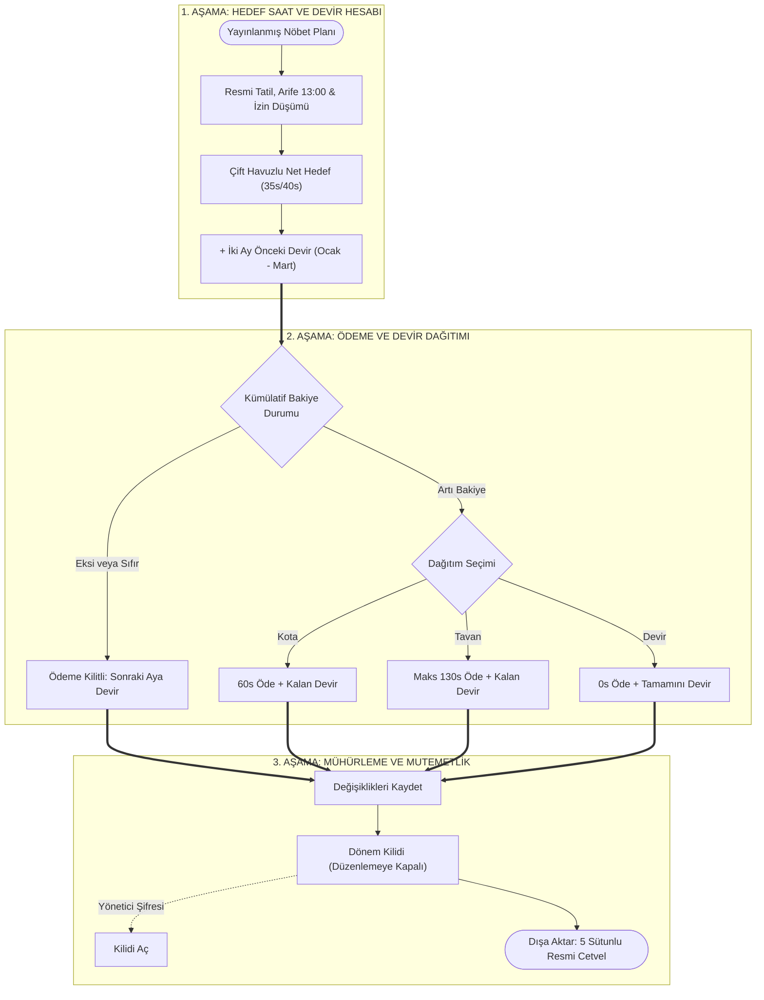

---json
{
  "pageTitle": "10. Nöbet Borç / Alacak Bakiyesi ve Fazla Mesai Hakedişleri — RADPYS v4 Kullanım Kılavuzu",
  "h1": "Nöbet Borç / Alacak ve Fazla Mesai Yönetimi",
  "lead": "3153 sayılı Kanun (haftalık 35 saat) ve 657 sayılı Kanun (haftalık 40 saat) mesai rejimlerine, resmi tatil ve arife saat 13:00 indirimlerine ile onaylı izinlere göre aylık yasal hedef saati hesaplar; iki ay gecikmeli devir, 60 saat koruyucu kota, 657 DMK Ek Madde 33 kapsamındaki 130 saatlik ödeme tavanı ve mutemetlik bildirim cetvelini yönetmenizi sağlar.",
  "overviewId": "overview",
  "badges": [
    {
      "text": "657 DMK Ek m. 33 & 130s Tavan",
      "tone": "emerald"
    }
  ],
  "readingTime": "6 Dakika",
  "legalNote": "<strong>Yasal Çerçeve:</strong> 657 DMK Ek Madde 33 gereğince bir personele bir ayda nöbet ücreti ödenebilecek üst sınır 130 saattir; fazlası ile eksi bakiyeler takip eden dönemlere devreder."
}
---

## Kısa Reçete: Fazla Mesai Mutabakatı, Ödeme Dağıtımı ve İcmal Alma {#quick-recipe}

:::recipe Kısa Reçete: Fazla Mesai Mutabakatı, Ödeme Dağıtımı ve İcmal Alma | 20 SANİYELİK AKIŞ
### 1. İstenen Sonuç | slate
Yayınlanmış çizelgeden doğan fazla veya eksik mesailerin hatasız kesinleştirilmesi, koruyucu kota/yasal tavan kurallarıyla mutemetlik bildirim cetvelinin üretilmesi.

### 2. Yapılacak İşlem | cyan
Dönemi ve birimi seçip <strong>[Yenile]</strong> ile hesaplamayı alın; bireysel satırlarda <strong>[FM Öde]</strong> üzerinden veya toplu olarak <strong>[Toplu İşlem Seçiniz...]</strong> + <strong>[Seçilenlere Uygula]</strong> ile ödeme/devir kararını belirleyip <strong>[Değişiklikleri Kaydet]</strong> ve <strong>[Dışa Aktar]</strong> adımlarını uygulayın.

### 3. Sistem Etkisi | emerald
İki ay önceki devir (örneğin Ocak bakiyesi Mart planına) otomatik işlenir; ödeme kararı kaydedildiğinde dönem mühürlenir ve yalnızca yönetici şifresiyle geçici düzenlemeye açılır.

- [metric] Yasal Ödeme Tavanı | 130.0 Saat / Ay | rose
- [metric] Sağlık Koruma Kotası | 60.0 Saat / Ay | amber
- [metric] Devir Gecikmesi | 2 Ay Gecikmeli | cyan
- [metric] Bayram Ayrımı | Arife 13:00 Eşiği | slate
:::

## 5N1K Kural ve Arayüz Çözümleme Tablosu {#5w1h}

*Fazla mesai hesaplama, devir gecikmesi, kota/tavan kalkanları, dönem kilidi ve mutemetlik çıktısı kuralları.*

| NE? (Bileşen / Kontrol) | NEDEN? (Amacı) | NASIL? (Çalışma Mantığı) | NE ZAMAN? (Tetiklenme) | KİM? (Yetkili Rol) |
| --- | --- | --- | --- | --- |
| <strong>Çift Havuzlu Yasal Hedef, Arşiv Planlar ve Kıstelyevm</strong> 35s / 40s Denklik &amp; 2. Yıl Emzirme | Yayınlanmış ve arşivlenmiş tüm planlarda radyasyon ve genel alan hedef saatini hatasız hesaplamak. | <em>Yayında</em> ve <em>Arşiv</em> planlardaki nöbetleri toplar; resmi tatil, arife saat 13:00 sonrası, onaylı izin ve tekilleştirilmiş süt izni indirimlerini düşer (2. yıl gece muafiyetinde saat düşülmez, radyasyon unvanlı personel 35s esasıyla korunur). | Dönem tablosu hesaplanırken. | Mutemet / Birim Sorumlusu |
| <strong>İki Ay Gecikmeli Devir &amp; Birim Bazlı Plan Kilidi</strong> Ocak → Mart Kaynak Ay Başlığı | Yalnızca ilgili birimin kesinleşmiş dönem devrini zorunlu kılıp kısmi ödemeleri doğru aktarmak. | Tablo başlığı gerçek kaynak ayı (örneğin <em>Ocak 2026'dan Devreden</em>) gösterir ve kısmi ödemeden kalan saatleri eksiksiz devreder; planlama kilidi yalnızca ilgili birimin <em>Yayında</em>/<em>Arşiv</em> planlarını denetler, başka birimin taslağı planlamayı engellemez. | Tablo hesaplamada ve planlamada. | Nöbet Sorumlusu / Amir |
| <strong>[FM Öde] Dağıtım Penceresi ve Sunucu Denklik Kalkanı</strong> 60s Kota / 130s Yasal &amp; Kişisel Tavan | Yasal veya kişisel fazla mesai sınırının aşılmasını ve bakiye uyumsuzluğunu önlemek. | Eksi/sıfır bakiyede ve fazla mesai muafiyetinde ödeme kapalıdır; kayıt anında birim yetki kapsamı, 130s yasal tavan, kişisel kısıt tavanı ve <em>Ödenen + Devreden = Kümülatif Fark</em> eşitliği zorunlu doğrulanır. | Satırda [FM Öde] ve kayıtta. | Birim Sorumlusu / Mutemet |
| <strong>[Toplu İşlem Seçiniz...] &amp; [Seçilenlere Uygula]</strong> Çoklu Satır Kota/Devir | Birden fazla personele tek seferde aynı ödeme veya devir politikasını uygulamak. | Tablodan seçilen artı bakiyeli satırlara 60s Kurumsal Kota, Maks 130s Ödeme veya Tamamını Devret kararını topluca işler. | Çoklu satır işleminde. | Nöbet Sorumlusu |
| <strong>Dönem Kilit Durumu ve [Kilidi Aç] Sıfırlaması</strong> Filtre Değişiminde Otomatik Kilit | Bir dönem için açılan geçici kilidin başka dönem veya birimlere taşınmasını engellemek. | Kayıt sonrasında dönem kilitlenir ve <strong>[Kilidi Aç]</strong> yönetici şifresi ister; yıl, ay, birim veya hizmet sınıfı filtresi değiştirildiği anda geçici kilit otomatik sıfırlanır. | Kayıt sonrası / filtre değişiminde. | Yönetici / İdari Amir |
| <strong>[Dışa Aktar] 5 Sütunlu Cetvel &amp; Yılbaşı Tatil Ayrımı</strong> Excel / PDF / Word / Yazıcı | Arşivlenen aylar ve 31 Aralık gecesi başlayan nöbetler dahil resmi mutemetlik icmali üretmek. | <em>Yayında</em> ve <em>Arşiv</em> planları kapsar; 31 Aralık'tan 1 Ocak sabahına sarkan vardiya saatleri dahil tüm resmi tatil ve arife saat 13:00 sonrası mesaileri ayrı sütuna ayırır. | Kararlar kaydedildikten sonra. | Mutemet / Birim Sorumlusu |

## Kritik Sahada Yanlış Bilinen Kurallar (Mit Avcısı) {#myth-buster}

:::myth Personelin Biriken Fazla Mesaisinin Tamamı Aynı Ay Nakden Ödenebilir mi?
### Yanlış Algı
<em>"Personel ay içinde geçmişten devreden saatlerle birlikte 150 saat fazla mesai biriktirdiyse, amirin onayıyla tamamı o ay nöbet ücreti olarak bordroya yazılır."</em>

### Gerçek Sistem Mantığı
<strong>Hayır, yasal ödeme tavanı aşılamaz.</strong> 657 sayılı Devlet Memurları Kanunu Ek Madde 33 uyarınca bir personele bir ayda nöbet ücreti ödenebilecek üst sınır <strong>130 saattir</strong>. Ayrıca kurum sağlığı için önerilen koruyucu kota <strong>60 saattir</strong>; ödenmeyen kalan hak edişler kesinlikle yanmaz ve sonraki dönemlere saat bakiyesi olarak devreder.
:::

## Süreç Akış Şeması {#workflow}

1. **Hedef ve Devir Hesabı:** Yayınlanmış nöbetler, resmi tatil/arife 13:00 indirimleri, izinler ve iki ay önceki dönemden devreden bakiye birleştirilerek kümülatif saat netleştirilir.
2. **Ödeme ve Devir Dağıtımı:** Eksi/sıfır bakiyede ödeme kapalı kalır; artı bakiyede koruyucu 60 saat kota, yasal 130 saat tavan veya tam devir kararı seçilir.
3. **Mühürleme ve Mutemetlik:** Kayıtla birlikte dönem kilitlenir (yalnızca yönetici şifresiyle açılır) ve bayram saati ayrıştırılmış 5 sütunlu resmi cetvel Excel, PDF, Word veya yazıcı çıktısı olarak alınır.

## Arayüz Ekran Görünümleri {#screenshots}

## Adım Adım İşlem Rehberi {#step-by-step}

### 1. Dönemi Yükleme ve Bakiye Hesabını Doğrulama

1. Sol menüden **[Nöbet Yönetimi] &gt; [Fazla Mesai Borç / Alacak Devri]** ekranını açın; Yıl, Ay, Birim ve Hizmet Sınıfı süzgeçlerini seçip **[Yenile]** butonuna tıklayın.
2. Tabloda yasal hedef saati, fiili nöbet saatini (fare imlecini hücre üzerine getirerek 35s/40s ve birim detayını görebilirsiniz), iki ay önceki devri (örneğin Ocak bakiyesi Mart planına) ve kümülatif net farkı inceleyin.

### 2. Bireysel ve Toplu Ödeme / Devir Kararını Kaydetme

1. Artı bakiyeli bir satırda **[FM Öde]** butonuna tıklayın; açılan pencerede **[Kurumsal Kota (60s)]**, **[Tamamı (130s)]** veya özel saat girerek alttaki canlı devir hesabını kontrol edip **[Onayla]** butonuna basın.
2. Birden fazla satırı seçip üstteki **[Toplu İşlem Seçiniz...]** menüsünden kural seçerek **[Seçilenlere Uygula]** butonunu çalıştırın; işlemler bitince sağ üstteki **[Değişiklikleri Kaydet]** butonuna tıklayarak dönemi onaylayıp kilitleyin.

### 3. Kilitli Dönemi Açma, Mutemetlik İcmali Alma ve Web İzleme

1. Kesinleşmiş kilitli bir dönemde düzeltme gerekirse **[Kilidi Aç]** butonuna basın, yönetici şifrenizi doğrulayın, düzenlemeden sonra tekrar **[Değişiklikleri Kaydet]** ile dönemi kilitleyin.
2. Kayıt tamamlandıktan sonra **[Dışa Aktar]** butonundan Excel, PDF, Word veya Yazıcı seçeneğiyle T.C. Kimlik No, Ad Soyad, Görev Yeri, Normal FM ve Bayram FM sütunlarını içeren resmi cetveli alın.
3. **Web Portalında İzleme:** Nöbet Paneli altındaki borç/alacak sekmesinden hedef, fiili ve fark saatleri, onaylı izin gün sayısını (<strong>X Gün İzinli</strong> rozeti) ve tek tıkla Excel/PDF çıktısını tarayıcıdan takip edebilirsiniz.

## Sıkça Sorulan Sorular (SSS) {#faq}

:::faq
### Kümülatif fazla mesai 150 saat iken sistem neden en fazla 130 saat ödetiyor?
657 sayılı Devlet Memurları Kanunu Ek Madde 33 gereğince bir ayda ücret ödenebilecek azami fazla mesai sınırı <strong>130 saattir</strong>. Bu tutarı aşan süre silinmez ve takip eden döneme devir bakiyesi olarak aktarılır.

### 60 saatlik Kurumsal Kota personelin hakkını azaltır mı?
Hayır. 60 saatlik kota bir bütçe kısıtlaması değil, personelin tükenmişliğini önlemeye yönelik koruyucu iş sağlığı kotasıdır. Ödenmeyen kalan süre hak edişten silinmez, sonraki aya devrederek denkleştirme ve izin olanağı sağlar.

### Neden yeni ayın otomatik nöbet planını oluştururken geçmiş mutabakat uyarısı alıyorum?
Fazla mesai devri iki ay gecikmeli çalıştığı için planlanan aydan iki ay önceki döneme ait nöbetçi personellerin borç/alacak mutabakatı henüz kaydedilmemişse dağıtım motoru durur. İlgili ayı bu ekrandan hesaplayıp <strong>[Değişiklikleri Kaydet]</strong> ile kaydettiğinizde engel kalkar.

### Ödemesi kaydedilen dönem kilitlendikten sonra nasıl düzeltilebilir?
Mutemetliğe iletilen saatlerin yetkisiz değişmesini önlemek için kayıt sonrası dönem kilitlenir. Düzeltme ihtiyacı yalnızca yetkili yöneticinin <strong>[Kilidi Aç]</strong> butonundan kendi kullanıcı şifresini doğrulamasıyla geçici olarak açılabilir.
:::
