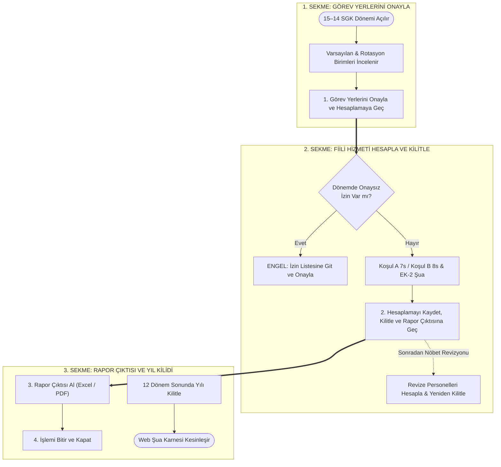

---json
{
  "pageTitle": "11. Fiili Hizmet Zammı (FHZ - Yıpranma Payı) ve Şua Hesaplama — RADPYS v4 Kullanım Kılavuzu",
  "h1": "Fiili Hizmet ve Şua Hesaplama (FHZ)",
  "lead": "5510 sayılı Sosyal Sigortalar ve Genel Sağlık Sigortası Kanunu m. 40 kapsamındaki Fiili Hizmet Süresi Zammı (FHZ) puantajlarını ve 3153 sayılı Kanun Ek Madde 1 ile 13.04.2023 / 32162 sayılı Yönetmelik EK-2 Sağlık İzni Tablosu uyarınca Şua İzni hakedişlerini 3 sekmeli entegre sihirbaz üzerinden hesaplar, onaysız izin bariyeri ve sıralı dönem/yıl kilitleriyle korur.",
  "overviewId": "overview",
  "badges": [
    {
      "text": "SGK 5510 m.40 & 32162 Yön. EK-2",
      "tone": "emerald"
    }
  ],
  "readingTime": "6 Dakika",
  "legalNote": "<strong>Mevzuat Güvencesi:</strong> FHZ yalnızca radyasyonlu alanda fiilen çalışılan süreler için doğar; yıllık izin, rapor ve idari izinler fiili çalışmadan düşülür. Yıllık Şua İzni 32162 sayılı Yönetmelik EK-2 uyarınca en fazla 30 gün ile sınırlıdır ve sonraki yıla devretmez."
}
---

## Kısa Reçete: 3 Sekmeli FHZ ve Şua Puantaj Sihirbazı {#quick-recipe}

:::recipe Kısa Reçete: 3 Sekmeli FHZ ve Şua Puantaj Sihirbazı | 20 SANİYELİK AKIŞ
### 1. İstenen Sonuç | slate
15–14 SGK bordro dönemine ait görev yerlerinin onaylanması, net fiili çalışma saatlerinin ve EK-2 Şua hak edişlerinin hesaplanıp kilitlenerek SGK puantaj cetvelinin alınması.

### 2. Yapılacak İşlem | cyan
1. sekmede varsayılan ve rotasyonlu görev yerlerini kontrol edip <strong>[1. Görev Yerlerini Onayla ve Hesaplamaya Geç]</strong>'e basın; 2. sekmede hesaplamayı doğrulayıp <strong>[2. Hesaplamayı Kaydet, Kilitle ve Rapor Çıktısına Geç]</strong> butonunu kullanın; 3. sekmede <strong>[3. Rapor Çıktısı Al (Excel / PDF)]</strong> ile çıktıyı alıp <strong>[4. İşlemi Bitir ve Kapat]</strong>'a tıklayın.

### 3. Sistem Etkisi | emerald
Onaysız izin varsa güvenlik bariyeri hesaplamayı durdurur; Koşul A (7s) ve Koşul B (8s) ayrıştırılır; yıl içi kümülatif toplamda 32162 Yönetmelik EK-2 basamakları (azami 30 gün) uygulanır ve dönem mühürlenir.

- [metric] SGK Döngüsü | Ayın 15'i – Sonraki 14'ü | amber
- [metric] Şua Tavanı | 30 Gün (1.451–1.500s) | rose
- [metric] Çalışma Koşulu | Koşul A (7s) / Koşul B (8s) | emerald
- [metric] Hibrit Takip | Masaüstü Sihirbaz &amp; Web Karne | cyan
:::

## 5N1K Kural ve Arayüz Çözümleme Tablosu {#5w1h}

*15–14 SGK döngüsü, Koşul A/B ayrımı, onaysız izin engeli, EK-2 Şua hesabı, nöbet revizyon uyarısı ve sıralı kilit kuralları.*

| NE? (Bileşen / Kontrol) | NEDEN? (Amacı) | NASIL? (Çalışma Mantığı) | NE ZAMAN? (Tetiklenme) | KİM? (Yetkili Rol) |
| --- | --- | --- | --- | --- |
| <strong>15–14 SGK Döngüsü &amp; [Sadece Değişenler]</strong> Görev Dağılım Süzgeci | 5510 sayılı Kanun bordro takvimini korumak ve asıl birim dışına çıkan rotasyonları hemen görmek. | Dönem ayın 15'inden sonraki ayın 14'üne kurulur; filtre asıl birimi ile fiili görev yeri farklı olan satırları süzerek vurgular. | 1. sekme açıldığında. | Birim Sorumlusu / Mutemet |
| <strong>Koşul A / Koşul B ve İzin Düşümü</strong> Net Fiili Saat Motoru | Radyasyonlu alanda çalışma sürelerini idari/destek çalışmasından kesin olarak ayırmak. | Radyasyon çalışanlarında Koşul A (7.0 saat), idari/izlenen çalışanlarda Koşul B (8.0 saat) esas alınır; resmi tatil ve onaylı izinler düşülür. | 2. sekmede hesaplama çalışırken. | Hesaplama Motoru |
| <strong>Onaysız İzin Güvenlik Bariyeri</strong> [İzin Listesine Git / Resmi Onay Ver] | Resmi onayı eksik izinlerin SGK bildiriminde fazladan fiili hizmet günü oluşturmasını önlemek. | Dönemde taslak veya ön onaylı izin bulunursa hesaplama durdurulur ve tek tıkla İzin Listesi ekranına geçiş sunulur. | Hesaplama sırasında eksik onayda. | Sistem Güvenlik Kilidi |
| <strong>EK-2 Kümülatif Şua ve Aylık Tam Dilim</strong> Şişme Önleyici Barem | Yıllık toplamı 32162 Yönetmelik EK-2'ye göre hesaplarken aylık ara görünümlerde hata oluşmasını önlemek. | Yıllık kümülatif toplamda her 50 saatlik dilim 1 gün (0–50s: 1 gün, 1.451–1.500+s: azami 30 gün) sayılır; tekil aylık satırlarda ise yalnızca tam 50 saatlik bloklar gösterilir. | Aylık ve yıllık hesaplamada. | Radyasyon Çalışanları / İK |
| <strong>Nöbet Revizyon Uyarısı &amp; Seçici Kilit</strong> [Revize Personelleri Hesapla] | Kilitlenmiş dönemdeki çizelge revizyonlarında tüm dönemi bozmadan yalnızca etkilenen kişiyi güncellemek. | Revize edilmiş personeli üstte vurgular; <strong>[Revize Personelleri Hesapla]</strong> ve <strong>[Değişiklikleri Onayla ve Yeniden Kilitle]</strong> ile yeniden mühürler. | Kilitli dönemdeki nöbette değişiklikte. | Mutemet / Birim Sorumlusu |
| <strong>Sıralı Dönem Kilidi &amp; [Yılı Kilitle]</strong> [Dönem Kilidini Aç] (Yönetici) | Ay atlanarak eksik puantaj kapatılmasını ve yıl sonunda kesinleşen hakların değiştirilmesini önlemek. | Önceki ay kilitlenmeden cari ay kilitlenemez; <strong>[Yılı Kilitle]</strong> yalnızca Admin veya Süpervizör tarafından tüm yılı kalıcı dondurur. | Dönem veya yıl kapatılırken. | Birim Sorumlusu / Admin |

## Kritik Sahada Yanlış Bilinen Kurallar (Mit Avcısı) {#myth-buster}

:::myth Radyasyon Biriminde Kadrolu Personel İzinli Olsa da Her Ay Tam Fiili Hizmet Zammı Alır mı?
### Yanlış Algı
<em>"Radyoloji kadrosunda çalışan bir personel o ay ne kadar yıllık izin veya sağlık raporu kullanırsa kullansın her ay 30 gün üzerinden yıpranma payı (FHZ) alır."</em>

### Gerçek Sistem Mantığı
<strong>Kesinlikle almaz.</strong> 5510 sayılı Kanun ve SGK genelgeleri gereğince Fiili Hizmet Süresi Zammı yalnızca iyonlaştırıcı radyasyon kaynağının bulunduğu kontrollü alanda <strong>fiilen çalışılan gün ve saatler</strong> üzerinden tahakkuk ettirilir. Yıllık izin, mazeret izni, rapor veya idari izin günleri brüt süreden otomatik düşülür.
:::

## Süreç Akış Şeması {#workflow}

1. **Görev Yerlerini Onaylama:** 15–14 bordro dönemindeki varsayılan birimler ve varsa geçici rotasyon görevleri onaylanarak hesaplama adımına geçilir.
2. **Hesaplama ve Kilitleme:** Onaysız izin bariyeri geçildikten sonra Koşul A/B ayrımı, izin düşümü ve EK-2 Şua hesabı yapılır; kayıtla dönem kilitlenir ve sonradan nöbet değişikliği olursa yalnızca revize satırlar tekrar mühürlenir.
3. **Raporlama ve Yıl Kapatma:** Resmi SGK puantaj cetveli dışa aktarılıp sihirbaz kapatılır; yılın 12 ayı tamamlandığında yetkili yönetici yılı kilitleyerek Şua karnesini kesinleştirir.

## Arayüz Ekran Görünümleri {#screenshots}

## Adım Adım İşlem Rehberi {#step-by-step}

### 1. Görev Yerlerini Kontrol Etme ve Onaylama (1. Sekme)

1. Sol menüden **[Fiili Hizmet ve Şua]** ekranını açın ve **Görev Yerlerini Onayla** sekmesinde Yıl ile Dönemi (ayın 15'i – sonraki ayın 14'ü) doğrulayın.
2. Kadro birimi dışında görevlendirilenleri görmek için **[Sadece Değişenler]** kutusunu kullanın; rotasyon veya geçici görev eklemek için **[Rotasyon / Ek Görev Ekle]** ya da satır seçerek **[Görev Yerini Değiştir]** butonundan saat ve birim bilgilerini kaydedin.
3. Sağ üstteki **[1. Görev Yerlerini Onayla ve Hesaplamaya Geç]** butonuna tıklayarak 2. sekmeye geçin.

### 2. Fiili Hizmet ve Şua Hesaplama, Kilitleme ve Revizyon Güncelleme (2. Sekme)

1. **Fiili Hizmeti Hesapla** sekmesinde dönem içinde resmi onayı tamamlanmamış izin varsa sistem uyarı penceresi açar; **[İzin Listesine Git / Resmi Onay Ver]** butonuyla onayları tamamlayıp dönün.
2. Tabloda **Koşul A** (7.0s) / **Koşul B** (8.0s) ayrımını, net fiili çalışma saatini ve kümülatif EK-2 Şua günlerini doğrulayıp **[2. Hesaplamayı Kaydet, Kilitle ve Rapor Çıktısına Geç]** butonuna basın.
3. Kilitlenmiş bir dönemde nöbet revizyonu nedeniyle üstte uyarı şeridi belirdiğinde **[Revize Personelleri Hesapla]** butonuna basıp tutarları yenileyin ve **[Değişiklikleri Onayla ve Yeniden Kilitle]** ile dönemi tekrar mühürleyin (Admin veya Süpervizör gerekirse **[Dönem Kilidini Aç]** veya yıl sonunda **[Yılı Kilitle]** butonunu kullanabilir).

### 3. Rapor Çıktısı Alma, İşlemi Bitirme ve Web Portalı Şua Karnesi

1. **Rapor Çıktısı Al** sekmesinde resmi puantaj cetvelini inceleyip **[3. Rapor Çıktısı Al (Excel / PDF)]** menüsünden Excel, PDF veya Word çıktısını indirin ve **[4. İşlemi Bitir ve Kapat]** butonuyla sihirbazı tamamlayın.
2. **Web Portalı Şua Karnesi:** Yöneticiler ve çalışanlar tarayıcıdan kazanılan, kullanılan ve yıl sonunda yanma riski taşıyan kalan Şua günlerini takip eder; 20 gün ve üzeri kalanlar **Kritik Risk**, 1–19 gün kalanlar **Planlama Bekliyor**, 0 gün kalanlar **Eksiksiz Kullandırıldı** durumuyla izlenir.

## Sıkça Sorulan Sorular (SSS) {#faq}

:::faq
### Bir dönemi kilitlemek istediğimde neden "önceki dönem kilitlenmeden kilitlenemez" uyarısı alıyorum?
SGK denetim bütünlüğü gereğince aylar atlanarak mühürlenemez. Önce geçmiş ayların puantajını sırayla hesaplayıp kilitlemeniz gerekir; böylece kümülatif yıl içi Şua ve devir toplamları kesintisiz ilerler.

### Yıllık fiili çalışma 1.800 saat olmasına rağmen Şua izni neden 30 gün yazıyor?
3153 sayılı Kanun Ek Madde 1 ve 13.04.2023 / 32162 sayılı Yönetmelik EK-2 Sağlık İzni Tablosu gereğince bir takvim yılında kazanılabilecek azami Şua İzni tavanı <strong>30 gündür</strong> (1.451–1.500 saat basamağı); fazlası yasal tavanla sınırlandırılır.

### Aylık tabloda 40 saat çalışan personele neden 0 gün görünürken yıllık toplamda gün görünüyor?
Aylık ara satırlarda 50 saatin altındaki süreler için 1 gün yazılarak yıl içi toplamın şişmesini önlemek amacıyla yalnızca tam 50 saatlik dilimler gösterilir. Yıllık ve kümülatif Şua hakedişinde ise 32162 sayılı Yönetmelik EK-2 tablosu (0–50 saat arası 1 gün) esas alınır.

### Yılı Kilitle butonunu neden kullanamıyorum?
Yıllık kilit işlemi tüm 12 dönemi ve o yıla ait Şua hakedişlerini kalıcı olarak dondurduğu için yalnızca <strong>Admin</strong> veya <strong>Süpervizör</strong> yetkisine sahip kullanıcılar tarafından çalıştırılabilir.
:::
