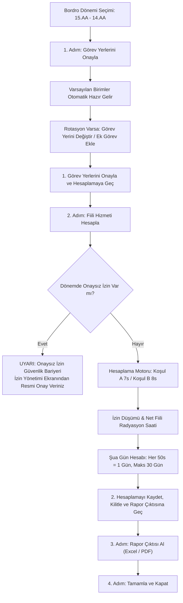

---json
{
  "pageTitle": "11. Fiili Hizmet Zammı (FHZ - Yıpranma Payı) ve Şua Hesaplama — RADPYS v4 Kullanım Kılavuzu",
  "h1": "Fiili Hizmet ve Şua Hesaplama (FHZ)",
  "lead": "Bu modül; radyoloji ve nükleer tıp çalışanlarının <strong>5510 Sayılı Kanun</strong> kapsamındaki <em>Fiili Hizmet Süresi Zammı (FHZ / Yıpranma Payı)</em> puantajlarını ve Sağlık Bakanlığı'nın mevzuat baremlerine göre <em>Sağlık İzni (Şua İzni)</em> hakedişlerini <strong>3 adımlı entegre bir sihirbaz</strong> üzerinden yönetir. Personellerin çalıştığı radyasyonlu birimlere, nöbet çizelgelerine ve resmi onaylı izinlerine göre net fiili çalışma saatlerini, yıpranma sürelerini ve yıllık Şua günlerini hesaplayıp kilit altına alır.",
  "overviewId": "genel-bakis",
  "badges": []
}
---

## Vizyonder Hızlı Karar Reçetesi (4 Adımda FHZ & Şua Sihirbazı) {#hizli-recete}

:::recipe Vizyonder Hızlı Karar Reçetesi (4 Adımda FHZ & Şua Sihirbazı) | 20 SANİYELİK AKIŞ
### 1. Görev Yerlerini Onayla | cyan
15-14 SGK döneminde varsayılan birimler otomatik hazır gelir. Sadece rotasyon veya geçici görevi olan personeli güncelleyip <strong>[1. Görev Yerlerini Onayla ve Hesaplamaya Geç]</strong> butonuna basın.

### 2. Hesapla, Kaydet ve Kilitle | emerald
Radyasyonlu birimdeki her 50 tam fiili çalışma saati için 1 gün Şua izni hesaplanır; <strong>[2. Hesaplamayı Kaydet, Kilitle ve Rapor Çıktısına Geç]</strong> butonuyla tek tıkla kaydedilip dönem kilitlenir.

### 3. Rapor Çıktısı Al & 4. Kapat | blue
Resmi puantaj cetveli hazır açılır; <strong>[3. Rapor Çıktısı Al (Excel / PDF)]</strong> ile indirilir ve <strong>[4. Tamamla ve Kapat]</strong> ile süreç tamamlanır.
:::

## Temel Eşikler & Yasal Baremler {#kpi-kartlari}

 

 

 Şua Hak Ediş Baremi
 
 <svg class="w-4 h-4" fill="none" stroke="currentColor" viewBox="0 0 24 24"><path stroke-linecap="round" stroke-linejoin="round" stroke-width="2" d="M12 8v4l3 3m6-3a9 9 0 11-18 0 9 9 0 0118 0z"/></svg>
 
 

 
50.0 saat = 1 gün

 

 Sağlık Bakanlığı baremleri gereğince personelin fiilen radyasyon alanında çalıştığı her 50 saat için 1 tam gün Şua izni hakedilir.
 

 

 

 

 Yıllık Azami Tavan
 
 <svg class="w-4 h-4" fill="none" stroke="currentColor" viewBox="0 0 24 24"><path stroke-linecap="round" stroke-linejoin="round" stroke-width="2" d="M9 12l2 2 4-4m5.618-4.016A11.955 11.955 0 0112 2.944a11.955 11.955 0 01-8.618 3.04A12.02 12.02 0 003 9c0 5.591 3.824 10.29 9 11.622 5.176-1.332 9-6.03 9-11.622 0-1.042-.133-2.052-.382-3.016z"/></svg>
 
 

 
30.0 gün/yıl

 

 Personel ne kadar fiili çalışma yaparsa yapsın, bir takvim yılı içinde kazanılabilecek Şua İzni azami 30 gün ile sınırlandırılmıştır.
 

 

 

 

 Çalışma Koşulu
 
 <svg class="w-4 h-4" fill="none" stroke="currentColor" viewBox="0 0 24 24"><path stroke-linecap="round" stroke-linejoin="round" stroke-width="2" d="M19 21V5a2 2 0 00-2-2H7a2 2 0 00-2 2v16m14 0h2m-2 0h-5m-9 0H3m2 0h5M9 7h1m-1 4h1m4-4h1m-1 4h1m-5 10v-5a1 1 0 011-1h2a1 1 0 011 1v5m-4 0h4"/></svg>
 
 

 
Koşul A / B

 

 Koşul A (7.0s radyasyon, Şua hakkı var) ile Koşul B (8.0s idari/destek, Şua hakkı yok) kurumsal rejimlere göre tam ayrıştırılır.
 

 

 

 

 SGK Bordro Döngüsü
 
 <svg class="w-4 h-4" fill="none" stroke="currentColor" viewBox="0 0 24 24"><path stroke-linecap="round" stroke-linejoin="round" stroke-width="2" d="M8 7V3m8 4V3m-9 8h10M5 21h14a2 2 0 002-2V7a2 2 0 00-2-2H5a2 2 0 00-2 2v12a2 2 0 002 2z"/></svg>
 
 

 
15 - 14 dönemi

 

 SGK 5510 standardı uyarınca her ayın 15'i ile bir sonraki ayın 14'ü arası hesaplanır. Ayarlar sekmesinden esnetilebilir.
 

 

 

## 3. 4 Adımlı Doğrusal Puantaj Sihirbazı İş Akışı {#is-akisi-semasi}

 

## 4. 5N1K Kural ve Arayüz Bileşen Envanteri {#5n1k-tablosu}

| Arayüz Bileşeni | Görevi ve Amacı (NE/NEDEN) | Formül / Mantık (NASIL) | Tetiklenme Anı (NE ZAMAN) | Yetkili Rol (KİM) | Durum |
| --- | --- | --- | --- | --- | --- |
| [Sihirbaz Adım Göstergesi] | 4 adımlı iş akışını (1. Görev Yerlerini Onayla 2. Fiili Hizmeti Hesapla 3. Rapor Çıktısı Al 4. Tamamla ve Kapat) yönlendirmek. | Adım tıklandığında sekme değişir; dönem parametreleri sekmeler arası senkronize edilir. | Adım çubuğuna tıklandığında | Nöbet Sorumlusu, Amir | Aktif |
| [Yıl] &amp; [Ay] Seçimi | 5510 Sayılı Kanun kapsamındaki 15-14 bordro dönemini seçmek. | 15.ay ile 14.(ay+1) aralığı dinamik hesaplanır ve varsayılan görev yerleri otomatik yüklenir. | Açılır kutu veya ok butonları değiştiğinde | Sorumlu, Mutemet | Aktif |
| [Sadece Görev Yeri Değişenler] | Asıl birimi dışında görevlendirilen personelleri hızlıca süzmek. | Kadro birimi ile görev yeri farklı olan satırları filtreler; kırmızı renkle vurgular. | Onay kutusu işaretlendiğinde | Birim Sorumlusu | Aktif |
| [Görev Yerini Değiştir] &amp; [Rotasyon / Ek Görev Ekle] | Nöbet listesi dışında başka birimde görevlendirilen veya rotasyona çıkan personelin çalışma alanını tanımlamak. | Yetki kapsamındaki personeller için tarih aralığı, birim ve günlük çalışma saatini (0-24s) kaydeder. | Butona veya satıra çift tıklandığında | Birim Sorumlusu, Nöbet Sorumlusu | Aktif |
| [1. Görev Yerlerini Onayla ve Hesaplamaya Geç] | Dönemdeki tüm hizmet sınıflarının taslak görev dağılımlarını onaylayıp 2. Adıma (Hesaplama) aktarmak. | Dönemdeki tüm taslak satırları 'Onaylı' yapar ve sekmeyi otomatik olarak [2. Fiili Hizmeti Hesapla] adımına taşır. | Butona tıklandığında | Birim Sorumlusu, Amir | Aktif |
| [2. Hesaplamayı Kaydet, Kilitle ve Rapor Çıktısına Geç] | Hesaplanan aylık fiili hizmet ve Şua hakedişlerini tek adımda kaydedip dönemi kilitlemek ve 3. Adıma geçmek. | Taslak nöbet planlarını ve önceki dönem kilidini denetler; filtre seçili olsa dahi tüm hizmet sınıflarını kaydeder, dönemi kilitler, yayındaki nöbet planlarını arşivler ve 3. adıma geçer. | Butona tıklandığında | Birim Sorumlusu, Amir | Aktif |
| [Dönem Kilidini Aç] &amp; [Yılı Kilitle] | Kilitli bir dönemi revizyon için açmak veya yıl sonunda tüm 12 ayı kalıcı olarak dondurmak. | [Dönem Kilidini Aç] yalnızca dönem kilitliyken görünür. [Yılı Kilitle] ise sadece Sistem Yöneticisi (Admin) veya Süpervizör yetkisiyle tüm yılı dondurur. | Butona tıklandığında | Amir / Sistem Yöneticisi (Admin) | Aktif |
| [3. Rapor Çıktısı Al (Excel / PDF)] &amp; [4. Tamamla ve Kapat] | SGK ve mutemetlik onaylı resmi puantaj dökümünü Excel/PDF olarak almak ve sihirbazı kapatmak. | Kullanıcının yetki kapsamındaki personellerin kimlik no, ad soyad, SGK günü, izin, fiili saat ve Şua günlerini dışa aktarır; [4. Tamamla ve Kapat] pencereyi kapatır. | Butona tıklandığında | Mutemet, Birim Sorumlusu | Aktif |

## Ekran Konumları ve Görsel Rehber {#ekran-goruntuleri}

 / Koşul B (8s) ayrımı, onaylı izin düşümleri ve 50 saate 1 gün Şua izni hakediş tablosu.")

## Adım Adım İşlem Rehberi {#kullanim-rehberi}

 

 1
 <h3 class="text-lg font-bold text-slate-900 dark:text-white">1. Adım: Görev Yerlerini Kontrol Etme ve Onaylama</h3>
 

 <ol class="list-decimal list-inside space-y-2 text-sm text-slate-600 dark:text-slate-300 pl-2">
 <li>Sol ana menüden <strong>[Fiili Hizmet ve Şua]</strong> modülüne tıklayın.</li>
 <li>Sihirbaz göstergesinde <strong>1. Görev Yerlerini Onayla</strong> sekmesinde olduğunuzu doğrulayın.</li>
 <li><strong>[Yıl]</strong> ve <strong>[Dönem]</strong> kutularından SGK bordro dönemini seçin. Tüm personelin varsayılan çalışma birimleri otomatik olarak listeye hazır gelir.</li>
 <li>Farklı bir birimde geçici çalışan personelleri süzmek için <strong>[Sadece Görev Yeri Değişenler]</strong> kutusunu işaretleyebilirsiniz.</li>
 <li>Nöbet listesi dışında farklı bir birimde görevlendirilen veya rotasyona çıkan personel varsa satırı seçip <strong>[Görev Yerini Değiştir]</strong> (veya ek görev için <strong>[Rotasyon / Ek Görev Ekle]</strong>) butonuna tıklayarak tarih aralığı, birim ve günlük çalışma saatini (0-24s) kaydedin.</li>
 <li>Sağ üstteki <strong>[1. Görev Yerlerini Onayla ve Hesaplamaya Geç]</strong> butonuna tıklayarak doğrudan 2. adıma ilerleyin.</li>
 </ol>
 

 

 

 2
 <h3 class="text-lg font-bold text-slate-900 dark:text-white">2. Adım: Fiili Hizmeti Hesaplama, Kaydetme ve Dönemi Kilitleme</h3>
 

 

 

 <strong>2. Fiili Hizmeti Hesapla</strong> ekranında seçili dönemin iş günü, resmi tatil ve personelin nöbet/görev saatleri harmanlanarak tablo otomatik hesaplanır:
 

 <ul class="list-disc list-inside pl-4 space-y-1">
 <li><strong>Çalışma Koşulu:</strong> Radyasyonlu alanda çalışan personelde <code class="px-1 py-0.5 rounded bg-slate-100 dark:bg-slate-800 font-mono">Koşul A</code> (7.0 saat), izlenen/idari alandakilerde <code class="px-1 py-0.5 rounded bg-slate-100 dark:bg-slate-800 font-mono">Koşul B</code> (8.0 saat) olarak listelenir.</li>
 <li><strong>Brüt İş Günü &amp; İzin Düşümü:</strong> Ay içi mesai günleri hesaplanır; personelin resmi onaylı izinleri düşülerek net çalışma günleri gösterilir.</li>
 <li><strong>Net Fiili Çalışma Saati:</strong> Fiilen radyasyonlu alanda icra edilen nöbet ve mesai saatlerinin net toplamıdır.</li>
 <li><strong>Hesaplanan Şua İzni (Gün):</strong> Her 50 fiili radyasyon saatine 1 gün olarak hesaplanır (Yıllık 30 gün tavanı aşıldığında sistem otomatik tavan kısıtı koyar).</li>
 </ul>
 

 

 <svg class="w-4 h-4 text-amber-600 dark:text-amber-400" fill="none" stroke="currentColor" viewBox="0 0 24 24"><path stroke-linecap="round" stroke-linejoin="round" stroke-width="2" d="M12 9v2m0 4h.01m-6.938 4h13.856c1.54 0 2.502-1.667 1.732-3L13.732 4c-.77-1.333-2.694-1.333-3.464 0L3.34 16c-.77 1.333.192 3 1.732 3z"/></svg>
 Onaysız İzin Güvenlik Uyarısı
 

 

 Eğer dönem içinde radyasyon görevlilerine ait henüz resmi onayı tamamlanmamış (taslak veya ön onaylı) izinler varsa sistem yasal hatayı önlemek adına hesaplamayı durdurur. Bu durumda <strong>İzin Yönetimi</strong> sayfasına geçerek izinlere resmi onay verdikten sonra hesaplama ekranına dönünüz.
 

 

 

 Sonuçlar doğrulandığında sağ üstteki <strong>[2. Hesaplamayı Kaydet, Kilitle ve Rapor Çıktısına Geç]</strong> butonuna tıklayın. Sistem hesaplamayı kaydeder, dönemi kilitler, yayındaki nöbet planlarını arşivler ve sizi doğrudan 3. adıma aktarır.
 

 

 

 

 

 3
 <h3 class="text-lg font-bold text-slate-900 dark:text-white">3. Adım: Rapor Çıktısı Alma &amp; 4. Adım: Tamamla ve Kapat</h3>
 

 

 

 <strong>3. Rapor Çıktısı Al</strong> sekmesinde SGK ve mutemetlik onaylı nihai icmal tablosu hazır olarak açılır. Sağ üstteki <strong>[3. Rapor Çıktısı Al (Excel / PDF)]</strong> butonuna basarak resmi bildirim cetvelini bilgisayarınıza aktarın ve <strong>[4. Tamamla ve Kapat]</strong> butonuyla işlemi sonlandırın.
 

 

 Yılın 12 dönemi de tamamlandıktan sonra, Sistem Yöneticisi (Admin) tarafından 2. adımdaki <strong>[Yılı Kilitle]</strong> butonuna basılarak tüm yıl dondurulur ve Şua izinleri İzin Modülü'ne aktarılmak üzere kesinleştirilir.
 

 

 

## Web Portalı Şua Karnesi & Risk Seviyeleri {#hibrit-entegrasyon}

 

 <h3 class="text-base font-bold text-slate-900 dark:text-white flex items-center gap-2">
  
 Masaüstü Uygulaması (Yetkili Merkez)
 </h3>
 <ul class="text-sm text-slate-600 dark:text-slate-300 space-y-2 pl-4 list-disc">
 <li>3 adımlı sihirbaz akışı ile görev dağılımı ve onaylama</li>
 <li>Otomatik görev atama ve özel tarihli görevlendirme girişi</li>
 <li>Onaysız izin güvenlik bariyeri ve otomatik düşümler</li>
 <li>Sıralı dönem kilidi ve Admin yetkili yıllık kilitleme</li>
 <li>SGK formatında Excel ve PDF puantaj rapor dökümü</li>
 </ul>
 

 

 <h3 class="text-base font-bold text-slate-900 dark:text-white flex items-center gap-2">
 
 Web & Mobil Portal (Şua Karnesi & Risk İzleme)
 </h3>
 

 
Personeller ve idareciler tarayıcı üzerinden <strong>Personel Şua Karnesi</strong> paneline erişerek radyasyon yükünü takip eder:

 

 

  Yüksek Risk (Kalan &ge; 20 Gün)
 İzinlerin yanma riski yüksek, acil planlama gerekli
 

 

  Orta Risk (Kalan 1 - 19 Gün)
 Yıl sonuna kadar dengeli kullanım önerilir
 

 

  Uyumlu (Kalan 0 Gün)
 Hak edilen tüm Şua izinleri başarıyla kullandırıldı
 

 

 

 

 

## FHZ, Şua İzni & Mit Avcısı (Kritik Kurallar) {#mit-avcilari}

 

 

 <svg class="w-4 h-4" fill="none" stroke="currentColor" viewBox="0 0 24 24">
 <path stroke-linecap="round" stroke-linejoin="round" stroke-width="2" d="M6 18L18 6M6 6l12 12" />
 </svg>
 Yaygın Yanılgı (Mit 1)
 

 

 "Yıl boyu çok yoğun nöbet tutan personelin 1.800 saat fiili çalışması varsa 36 gün Şua İzni kullanabilir."
 

 

 
 <svg class="w-3.5 h-3.5" fill="none" stroke="currentColor" viewBox="0 0 24 24">
 <path stroke-linecap="round" stroke-linejoin="round" stroke-width="2" d="M5 13l4 4L19 7" />
 </svg>
 Doğru Yasal Kural:
 
 

 Sağlık Bakanlığı baremleri ve Danıştay içtihatları gereğince bir takvim yılında kazanılabilecek azami Şua İzni <strong>30 gündür</strong>. 30 günü aşan hesaplamalar mevzuat tavanına sabitlenir.
 

 

 

 

 

 <svg class="w-4 h-4" fill="none" stroke="currentColor" viewBox="0 0 24 24">
 <path stroke-linecap="round" stroke-linejoin="round" stroke-width="2" d="M12 9v2m0 4h.01m-6.938 4h13.856c1.54 0 2.502-1.667 1.732-3L13.732 4c-.77-1.333-2.694-1.333-3.464 0L3.34 16c-.77 1.333.192 3 1.732 3z" />
 </svg>
 Yaygın Yanılgı (Mit 2)
 

 

 "Personel yıllık izinli veya sağlık raporlu olduğu günlerde de Fiili Hizmet Zammı (yıpranma) kazanmaya devam eder."
 

 

 
 <svg class="w-3.5 h-3.5" fill="none" stroke="currentColor" viewBox="0 0 24 24">
 <path stroke-linecap="round" stroke-linejoin="round" stroke-width="2" d="M5 13l4 4L19 7" />
 </svg>
 Doğru Yasal Kural:
 
 

 5510 Sayılı Kanunun 40. maddesi uyarınca yıpranma payı yalnızca personelin radyasyon kaynağıyla <em>fiilen çalıştığı</em> günler için verilir. İzin ve rapor günleri puantajdan kesinlikle düşülür.
 

 

 

 

 

 <svg class="w-4 h-4" fill="none" stroke="currentColor" viewBox="0 0 24 24">
 <path stroke-linecap="round" stroke-linejoin="round" stroke-width="2" d="M13 16h-1v-4h-1m1-4h.01M21 12a9 9 0 11-18 0 9 9 0 0118 0z" />
 </svg>
 Yaygın Yanılgı (Mit 3)
 

 

 "Aylık dönemleri tek tek kilitlemeye gerek yoktur; yıl sonunda doğrudan yıllık kilit yapılabilir."
 

 

 
 <svg class="w-3.5 h-3.5" fill="none" stroke="currentColor" viewBox="0 0 24 24">
 <path stroke-linecap="round" stroke-linejoin="round" stroke-width="2" d="M5 13l4 4L19 7" />
 </svg>
 Doğru Yasal Kural:
 
 

 SGK bildirim bütünlüğü gereği dönemler atlanarak kilitlenemez. RADPYS kural motoru, bir önceki ay kilitlenmeden cari ayın kilitlenmesine kesinlikle izin vermez.
 

 

 

 

## Sıkça Sorulan Sorular ve Kritik Kilitler {#sss-ve-sorun-giderme}

:::faq
### Soru 1: Bir dönemi kilitlemek istediğimde "Bir önceki dönem kilitlenmeden bu dönem kilitlenemez" hatası alıyorum. Neden?
Mevzuat ve SGK denetim bütünlüğü gereğince dönemler atlanarak kilitlenemez. Önceki aylara ait eksik puantajların tamamlanıp kilitlenmesi zorunludur. Geçmiş ayları sırasıyla kilitleyerek cari aya ulaşabilirsiniz.

### Soru 2: Personelin o yılki fiili radyasyon çalışması 1.800 saat (36 gün Şua) çıktı, fakat sistem 30 gün yazdı. Bir hesaplama hatası mı var?
Hayır, bu bir hata değildir. Sağlık Bakanlığı'nın mevzuat baremleri uyarınca bir takvim yılı içerisinde kazanılabilecek Şua İzni toplamı <strong>azami 30 gün</strong> ile sınırlandırılmıştır. 30 günü aşan kısımlarda sistem yasal tavan kısıtını uygular.

### Soru 3: Yıllık Kilidi Kapat butonunu neden göremiyorum veya tıklayamıyorum?
Yıllık kilit işlemi, geçmişe dönük tüm puantajı ve Şua hakedişlerini kalıcı olarak dondurduğundan (RED-09 emniyet kilidi), yalnızca <strong>Sistem Yöneticisi (Admin)</strong> veya <strong>Süpervizör</strong> rolüne sahip kullanıcılar tarafından yürütülebilir.
:::
