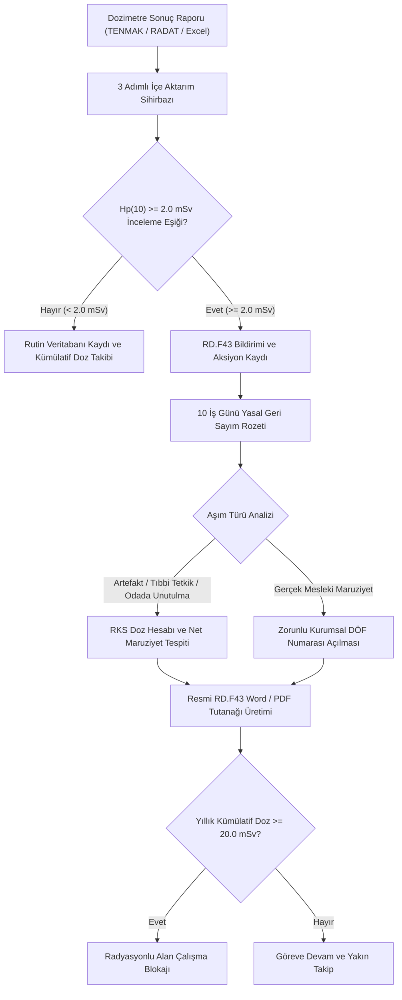

---json
{
  "pageTitle": "12. Kişisel Dozimetre Takibi ve RD.F43 Doz Aşımı Araştırması — RADPYS v4 Kullanım Kılavuzu",
  "h1": "12. Kişisel Dozimetre Takibi ve RD.F43 Doz Aşımı Araştırması",
  "lead": "Radyasyonla çalışan personelin mesleki maruziyet kayıtlarını, laboratuvar raporu (TENMAK, RADAT, Excel) içe aktarımını, kümülatif yasal limitleri (Hp(10) derin doz ve Hp(0.07) yüzey dozu), inceleme eşiğini aşan vakalarda 10 iş günü içinde tanzimi zorunlu resmi <strong>RD.F43 Doz Araştırma Formu</strong> sürecini ve RKS net maruziyet hesaplama algoritmasını yöneten merkezi modüldür.",
  "overviewId": "genel-bakis",
  "badges": [
    {
      "text": "MODÜL 12",
      "tone": "cyan"
    },
    {
      "text": "NDK & Mevzuat Uyumlu",
      "tone": "emerald"
    },
    {
      "text": "10 İş Günü Form Kuralı",
      "tone": "amber"
    }
  ]
}
---

## Vizyonder Hızlı Karar Reçetesi (Dozimetre & RKS Özeti) {#hizli-recete}

:::recipe Vizyonder Hızlı Karar Reçetesi (Dozimetre & RKS Özeti) | 20 SANİYELİK AKIŞ
### 1. Laboratuvar Dosyasını Yükleyin | cyan
TENMAK, RADAT veya Genel Excel/CSV dosyasını içe aktarma sihirbazına bırakın. Personel TC veya Dozimetre seri no üzerinden kayıtlar otomatik eşleşir.

### 2. Limit ve Renk Uyarıları | emerald
Derin doz (Hp(10)) 2.0 mSv aylık eşiği aşarsa sarı alarm; kümülatif doz 20 mSv sınırına yaklaştığında kırmızı alarm verilir ve nöbet planı uyarılır.

### 3. 10 İş Gününde 3 Adımlı RD.F43 Tanzimi | blue
Eşik aşımında [İnceleme Başlat] ile personele Web Portal beyan görevi düşer; çalışan beyanı geldikten sonra RKS 3 adımlı sihirbazda incelemeyi tamamlayarak 10 iş gününde dosyayı kapatır.
:::

## Arayüz Bileşenleri ve 5N1K Tablosu {#bilesenler}

 

 Dozimetre Takibi modülündeki ekran kontrolleri, butonlar ve filtreleme araçlarının işlevsel kullanım kılavuzu:
 

 

| Bileşen / Buton | Türü | Ne İşe Yarar? (Ne?) | Kim Kullanır? (Kim?) | Ne Zaman Kullanılır? (Ne Zaman?) | Nerede Yer Alır? |
| --- | --- | --- | --- | --- | --- |
| [Laboratuvardan İçe Aktar] | Buton | TENMAK/RADAT/Excel doz raporlarını aktarır; önizlemede çift tıkla [Personel Seç] penceresinden manuel eşleme, [Kalıcı Hafızaya Kaydet] ve [Eşleşmeyenleri Excel Olarak İndir] imkanı sunar. | RKS / Dozimetre Sorumlusu | Aylık dozimetre kaset sonuçları geldiğinde | Üst Araç Çubuğu |
| [Ölçüm Ekle] | Buton | Münferit veya Elektronik Kişisel Dozimetre (EPD) ara ölçümü kaydeder. | RKS / Süpervizör | Tekil acil ölçüm veya yeni kart girişinde | Üst Araç Çubuğu |
| [Dönem Filtresi] | Açılır Kutu | Tabloyu seçilen yıl ve döneme göre anında süzer. | Tüm Kullanıcılar | Geçmiş periyot kayıtları sorgulanırken | Filtre Paneli |
| [Dozimetre Tipi] | Açılır Kutu | Tüm Vücut, Yüzük/Ekstremite, Göz Lensi ve EPD türlerini ayrıştırır. | RKS | Ekstremite veya lens dozları denetlenirken | Filtre Paneli |
| [İnceleme Başlat] | Buton | Seçili eşik aşımı veya anomali kaydı için araştırma dosyasını başlatır, durumu <em>BEYAN BEKLİYOR</em> aşamasına geçirir ve çalışanın Web Portal ekranına anında beyan doldurma bildirimi gönderir. | RKS / Dozimetre Sorumlusu | İnceleme bekleyen yeni aşım veya anomali vakalarında | Aksiyonlar Sekmesi (Üst Araç Çubuğu) |
| [Doz Araştırma Formu Aç] | Buton | Resmi NDK/TENMAK RD.F43 formuyla birebir uyumlu, IAEA GSG-7 ve Webster formüllü 3 adımlı (<em>1. Çalışan Beyanı</em>, <em>2. RKS Saha İncelemesi</em>, <em>3. Karar, DÖF ve Evrak</em>) araştırma sihirbazını açar. Çalışan beyanı gelmeden RKS taslak kaydına veya kapatmaya izin vermez. | RKS / Kurum Amiri | Çalışan beyanı geldikten sonra saha incelemesi ve karar aşamasında | Aksiyonlar Sekmesi (Üst Araç Çubuğu) |
| [Düzeltme Yap / Formu Yeniden Aç] | Buton | Kapatılmış RD.F43 raporunda sehven yapılan hataları denetim izine gerekçe notu düşerek güvenle düzeltmeye açar. | RKS / Kurum Amiri | Kapatılmış tutanaklarda sehven hata tespit edildiğinde | Resmi Rapor Görüntüleyici Alt Paneli |
| [Takip Ölçümü Planla] | Buton | Modern planlama penceresiyle takip nedeni, dozimetre türü, başlangıç/bitiş tarihleri ve açıklama notu girilerek şüpheli vakalara ara takip veya EPD ölçüm görevi tanımlar. | RKS / Dozimetre Sorumlusu | Risk incelemesi ve yakın izleme gerektiren vakalarda | Aksiyonlar Sekmesi (Üst Araç Çubuğu) |
| [Birim İncelemesi Ekle] | Buton | RKS saha gözlemini, birim çalışma koşullarını, cihaz durumunu ve ortam radyasyon notlarını kurumsal kayıt penceresine işler. | RKS / Dozimetre Sorumlusu | Saha çalışma şartları ve birim ortam denetiminde | Aksiyonlar Sekmesi (Üst Araç Çubuğu) |
| [Formu Görüntüle] | Buton | Başlatılmış RD.F43 araştırma tutanağını, CDSS kural motoru kararlarını veya DÖF dosya detaylarını doğrudan incelemeye açar. | RKS / Kurum Amiri | Açık dosya takibinde veya kapatılmış arşiv incelemesinde | Aksiyonlar Sekmesi (Üst Araç Çubuğu) |
| [Aksiyonu Kapat] | Buton | Hem Aksiyonlar araç çubuğunda hem de RD.F43 sihirbazının 3. adımında yer alır. Çalışan beyanı, RKS tüm soru yanıtları ve nihai değerlendirme açıklaması tamamlanmadan dosyanın erken kapatılmasını engeller; tamamlanan dosyayı tek tıkla <em>TAMAMLANDI</em> durumuna geçirip arşivler. | RKS / Kurum Amiri | Soruşturması tamamlanan RD.F43 dosyalarının arşivlenmesinde | Aksiyonlar Sekmesi &amp; RD.F43 Sihirbazı (3. Adım) |
| [Önerilen Kararı ve Bulguları Forma Aktar] | Buton | RDS kurumsal zümrüt yeşili, 36px ergonomik yüksek kontrastlı buton. CDSS karar motorunun ürettiği bilimsel teşhis özetini, IAEA/NCRP gerekçe metnini ve DÖF tavsiyesini aynı ekrandaki (3. Adım) nihai tutanak ve RKS değerlendirme alanlarına tek tıkla aktarır. | RKS | CDSS teşhis ve analiz sonuçları resmi tutanağa bağlanırken | RD.F43 Sihirbazı (3. Adım: Karar, DÖF ve Evrak) |
| [İleri] / [Geri] | Butonlar | RDS kurumsal stilleriyle 3 adımlı RD.F43 sihirbazında adımlar arasında kontrollü ve ergonomik geçiş sağlar; eksik yanıt varsa ilgili adıma otomatik odaklanır. | RKS / Kurum Amiri | RD.F43 form adımları doldurulurken | RD.F43 Form Alt Gezinti Paneli |
| [Web Portal Görev Bildirimi] | Sistem Bildirimi | 2.0 mSv eşik aşımı veya anomali incelemesi başlatıldığında personelin Web Portal görev paneline otomatik bildirim düşer; personeli "Bölüm 2: Çalışan Beyanı" sorularını cevaplamaya yönlendirir. | Hakkında İnceleme Açılan Personel | Aksiyon oluşturulduğu anda anında tetiklenir | Web Portal Bildirim & Görev Merkezi |
| [Eşik Aşımı Alarmı (RKS & Yönetici)] | Sistem Alarmı | Hp(10) >= 2.0 mSv veya kümülatif limit aşımlarında RKS ve Kurum Amiri paneline anlık kırmızı alarm uyarısı iletilir (hem tekil ölçüm girişinde hem toplu laboratuvar aktarımında). | RKS / Kurum Amiri | Ölçüm kaydedildiği veya toplu dosya aktarıldığı anda | Masaüstü Bildirim Merkezi & Durum Çubuğu |
| [Geçmiş Ölçümler & Birim Takibi] | Tablo | Seçili personelin geçmiş tüm ölçümlerini dönemsel dozları ve o dönem görev yaptığı <strong>Birim</strong> bilgisiyle listeler. | Tüm Yetkililer | Personel rotasyonları ve birim bazlı doz geçmişi sorgulanırken | Ölçümler Sekmesi (Sağ Panel) |
| [Doz Hesapla] | Buton | Unutulma veya tetkik şüphesinde RKS'nin maruziyet dozunu hesaplar. | RKS | Artefakt veya sahte aşım vaka analizinde | RD.F43 Diyaloğu (Adım 3) |
| [Resmi RD.F43 Word İndir] | Buton | NDK onaylı resmi araştırma tutanağını Jinja2 Word (.docx) olarak üretir. | RKS / Yönetici | Form imzaya veya NDK denetimine sunulacağında | RD.F43 Form Başlığı |

## Laboratuvar Dosyası İçe Aktarma Sihirbazı (3 Adım) {#ice-aktarma}

 

 Dozimetre servis sağlayıcısından gelen toplu Excel/CSV raporlarının sisteme aktarımı, kurum personelleriyle otomatik T.C. Kimlik / Barkod eşleştirmesi ve aşım alarmlarının üretilmesi akışı:
 

 

 

 

 

 1. ADIM
 <h3 class="text-sm font-bold text-slate-900 dark:text-white">Dosya & Sağlayıcı Seçimi</h3>
 

 Sağlayıcı açılır kutusundan <strong>TENMAK</strong>, <strong>RADAT</strong> veya <strong>Genel Excel</strong> seçilir. İlgili yıl ve dönem belirlenip <strong>[Gözat]</strong> butonu ile rapor dosyası seçilir.
 

 

 

 2. ADIM
 <h3 class="text-sm font-bold text-slate-900 dark:text-white">Akıllı Eşleştirme &amp; Manuel Personel Seçimi</h3>
 

 <strong>[Dosyayı Çözümle]</strong> tıklandığında sistem T.C. Kimlik ve isimleri karşılaştırır; geçmişte hafızaya alınmış kayıtları otomatik bağlar. Eşleşmeyen satıra <strong>çift tıklayarak</strong> <strong>[Personel Seç]</strong> penceresinden personel atanabilir ve kalıcı hafızaya kaydedilebilir.
 

 

 

 3. ADIM
 <h3 class="text-sm font-bold text-slate-900 dark:text-white">Kayıt, Eşik Alarmı &amp; Hata Raporlama</h3>
 

 <strong>[İçe Aktarımı Tamamla]</strong> ile eşleşen satırlar kaydedilir, dozlar kümülatife işlenir ve ≥ 2.0 mSv vakalar RD.F43 kuyruğuna alınır. Çözümlenemeyen satırlar için <strong>[Eşleşmeyenleri Excel Olarak İndir]</strong> butonu kullanılır.
 

 

 

 

 

 

 

 

 <h3 class="text-base font-bold text-slate-900 dark:text-white">
 Önizleme Tablosunda Doğrudan Personel Eşleme &amp; Akıllı Eşleşme Hafızası
 </h3>
 

 Dış laboratuvar yazım farklılıklarını tek tıkla çözme ve gelecek periyotlar için otomatik hatırlama mimarisi
 

 

 

 

 

 1. Çift Tıkla [Personel Seç] Penceresi
 Laboratuvardan gelen raporda personelin adı eksik/farklı yazılmış veya T.C. hanesi boş kalmışsa, önizleme tablosundaki kırmızı/sarı satıra <strong>çift tıklayın</strong>. Açılan diyalogda kurum personel listenizden arama yaparak doğru kişiyi tek tıkla seçin.
 

 

 2. [Kalıcı Hafızaya Kaydet] Onay Kutusu
 Personel seçim penceresinde <strong>[Bu eşleşmeyi sonraki dönemler için hafızaya kaydet]</strong> kutusunu işaretlediğinizde, sistem bu laboratuvar yazımını kurum personelinizle kalıcı olarak eşleştirir. Sonraki aylarda aynı rapordaki kişi geldiğinde sistem hafızadan anında tanır; bir daha manuel işlem gerekmez.
 

 

 3. [Eşleşmeyenleri Excel Olarak İndir]
 Kurumunuz personeli olmayan (ayrılmış, başka hastaneden rotasyona gelmiş veya tanımsız) satırlar varsa işlem engellenmez. Önizleme ekranındaki <strong>[Eşleşmeyenleri Excel Olarak İndir]</strong> butonuna tıklayarak çözülemeyen satırları Excel formatında alıp ilgili birime iletebilirsiniz.
 

 

 

 

## Dozimetre Kokpiti ve Manuel Ölçüm Girişi {#olcum-girisi}

 

 Ana takip ekranı üzerindeki ölçüm satırları, kümülatif doz barları ve münferit ölçüm kaydı ekleme süreci:
 

 

 

 

 <h3 class="text-base font-bold text-slate-900 dark:text-white flex items-center gap-2">
 
 Dozimetre Takip Kokpiti ve Doz Renk Skalası
 </h3>

 <ul class="text-xs text-slate-600 dark:text-slate-300 space-y-2">
 <li class="flex items-center gap-2">
 
 <strong>Yeşil (&lt; 1.0 mSv):</strong> Güvenli normal arka plan / rutin maruziyet aralığı.
 </li>
 <li class="flex items-center gap-2">
 
 <strong>Sarı (1.0 - 2.0 mSv):</strong> Dikkat eşiği; kişisel ortalama sapmaları takip edilir.
 </li>
 <li class="flex items-center gap-2">
 
 <strong>Turuncu (2.0 - 5.0 mSv):</strong> İnceleme düzeyi aşımı; RD.F43 formu zorunludur.
 </li>
 <li class="flex items-center gap-2">
 
 <strong>Kırmızı (&ge; 5.0 mSv veya Yıllık &ge; 20 mSv):</strong> Kritik risk; çalışma blokajı uygulanır.
 </li>
 </ul>
 

 

 <h3 class="text-base font-bold text-slate-900 dark:text-white flex items-center gap-2">
 
 Manuel Dozimetre Ölçümü Ekleme
 </h3>

 

 
<strong>[Ölçüm Ekle]</strong> tıklandığında açılan bu modalda;

 
&bull; Personel seçilir, dozimetre tipi (Tüm Vücut / Yüzük / Göz Lensi / EPD) belirlenir.

 
&bull; Hp(10) derin doz ve opsiyonel Hp(0.07) yüzey dozu sayısal olarak girilir.

 
&bull; Doz değeri 2.0 mSv eşiğini geçerse sistem anında uyarı vererek aksiyon sekmesine yönlendirir.

 

 

 

 

 

 <h3 class="text-base font-bold text-slate-900 dark:text-white flex items-center gap-2">
 
 Tek ve Ferah 8 Sütunlu Bütünleşik Aksiyon Kokpiti & Güvenlik Kilitli İşlemler
 </h3>
 RADPYS V4.0.3.30 Standardı
 

 

 

 <h4 class="font-bold text-slate-900 dark:text-white flex items-center gap-2">
 
 Aksiyonlar Sekmesi: Tam Genişlik 8 Sütunlu Kokpit
 </h4>
 

 Bölünmüş ve daraltılmış eski tablolar yerine, tüm yasal eşik aşımları ve istatistiksel doz anomalileri tek bir ferah ana tabloda birleştirilmiştir:
 

 <ul class="space-y-1.5 pl-2">
 <li>&bull; <strong>8 Sütunlu Bütünleşik Tablo Düzeni:</strong> <code>[Personel Adı Soyadı | Birim | Ölçüm Dönemi | Hp(10) (mSv) | Risk Seviyesi | Aşım Gerekçesi | İnceleme Durumu | RD.F43 Raporu]</code>.</li>
 <li>&bull; <strong>5 Aşamalı Canlı <code>RD.F43 Raporu</code> Süreç Rozetleri:</strong> Dosyanın hangi aşamada olduğu tek bakışta izlenir: <code>HAZIRLANMADI</code> (inceleme başlatılmadı) &rarr; <code>BEYAN BEKLİYOR</code> (personele bildirim gitti, beyan bekleniyor) &rarr; <code>BEYAN GELDİ</code> (personel Web Portaldan yanıtladı) &rarr; <code>RKS İNCELEMEDE</code> (RKS saha incelemesi kaydedildi) &rarr; <code>TAMAMLANDI</code> (resmi tutanak ve aksiyon kapatıldı).</li>
 <li>&bull; <strong>Canlı Durum Filtreleme:</strong> Tablo üstündeki filtreleme menüsüyle <em>Tüm Kayıtlar</em>, <em>İnceleme Bekleyenler</em>, <em>Açık Aksiyonlar</em> ve <em>Kapatılanlar</em> tek tıkla süzülür.</li>
 <li>&bull; <strong>Çalışan Beyanı ve Tam Yanıt Kilidi:</strong> Bir aksiyonun taslak kaydedilebilmesi veya kapatılabilmesi için önce çalışanın beyanının alınmış olması, tüm RKS sorularının eksiksiz yanıtlanması ve değerlendirme açıklamasının girilmiş olması zorunludur.</li>
 <li>&bull; <strong>Modern Kurumsal Diyaloglar:</strong> Basit girişler yerine; <em>Takip Ölçümü Planlama</em> (tür, süre, klinik gerekçe), <em>Birim İncelemesi</em> (saha çalışma koşulları, ortam notu) ve <em>Aksiyonu Kapat</em> (dosya no, onay notu) işlemleri için özel tasarlanmış pencereler açılır.</li>
 </ul>
 

 

 <h4 class="font-bold text-slate-900 dark:text-white flex items-center gap-2">
 
 Ölçümler Sekmesi: Geçmiş Ölçümlerde Birim Rotasyon Takibi
 </h4>
 

 Ölçümler tablosunda bir personele tıklandığında sağ panelde açılan <strong>Geçmiş Ölçümler Tablosu</strong> genişletilmiş ve <strong>Birim</strong> sütunu eklenmiştir:
 

 <ul class="space-y-1.5 pl-2">
 <li>&bull; <strong>Sütun Düzeni:</strong> <code>[Dönem | Birim | Hp(10) | Hp(0,07) | Durum]</code>.</li>
 <li>&bull; <strong>Rotasyon ve Doz Analizi:</strong> Personelin hangi dönemde hangi radyoloji biriminde (Anjiyo, BT, Skopi vb.) görev yaptığı geriye dönük izlenir. Bir personelde ani doz yükselmesi görüldüğünde, o dönem çalıştığı birim anında tespit edilerek maruziyetin birim kaynaklı olup olmadığı doğrulanır.</li>
 <li>&bull; <strong>Ferah Arayüz:</strong> Sağ panel genişliği dengelenmiş (560px asgari genişlik), uzun birim adlarının kesilmemesi için esnek sütun hizalaması ve tabular yazı tipi uygulanmıştır.</li>
 </ul>
 

 

 

## Rol Tabanlı 3 Adımlı RD.F43 Doz Araştırma Sihirbazı ve Akıllı Karar Motoru (CDSS) {#rdf43-sureci}

 

 RADPYS V4.0.5.20
 Resmi NDK/TENMAK RD.F43 &amp; IAEA GSG-7 / NCRP 122 Uyumlu
 

 

 Aylık 2.0 mSv eşiğini aşan veya kişisel ortalamasından belirgin sapma gösteren ölçümlerde, NDK mevzuatı gereği <strong>en geç 10 iş günü içinde</strong> düzenlenmesi zorunlu resmi Doz Araştırma Formu (RD.F43). Sistem, çalışan beyanı ile RKS saha incelemesini ayırır ve 3. adımda CDSS karar motoru, DÖF ve resmi evrak kapatma işlemlerini tek ekranda birleştirir:
 

 

 

 

 

 

 1. ADIM (SAYFA 1)
 Sorumlu: Çalışan / Web Portal
 

 <h3 class="text-base font-bold text-slate-900 dark:text-white">1. Çalışan Beyanı (Sayfa 1 — Soru 1–9)</h3>
 

 Resmi NDK/TENMAK RD.F43 Sayfa 1 sorularını birebir içerir. İnceleme başlatıldığında personelin kendi <strong>Web Portal &gt; Profilim</strong> ekranına bildirim düşer; çalışan beyanını gönderdiğinde rozet <code>BEYAN GELDİ</code> olur ve RKS değerlendirme kilidi açılır:
 

 <ul class="text-xs text-slate-600 dark:text-slate-300 space-y-1.5 pl-2">
 <li>&bull; <strong>Çalışma Rejimi ve Taşıma Konumu:</strong> Günlük/aylık çalışma süresi, radyasyon kaynağı türü ve iki kademeli dozimetre taşıma konumu (kurşun önlük üstü/altı, yaka, göğüs, kemer, bilek, gözlük vb.).</li>
 <li>&bull; <strong>Olay ve Artefakt Soruları:</strong> Dozimetrenin başkası tarafından kullanılması, saklama yerinin radyasyon alanında olması, alanda unutulması (süre ve mesafe) ve çalışma süresince sürekli yanında bulundurulması.</li>
 <li>&bull; <strong>Şahsi Tıbbi Tetkik ve Koruyucu Ekipman:</strong> Personelin bizzat hasta olarak radyolojik/nükleer tıp tetkiki yaptırıp yaptırmadığı, kullanılan koruyucu donanımlar ve çalışan açıklaması.</li>
 </ul>
 

 

 

 2. ADIM (SAYFA 2)
 Sorumlu: RKS / Medikal Fizikçi
 

 <h3 class="text-base font-bold text-slate-900 dark:text-white">2. RKS Saha İncelemesi (Sayfa 2 — Soru 1–7)</h3>
 

 Çalışanın beyanı ulaştıktan sonra Radyasyondan Korunma Sorumlusu tarafından sahada yürütülen teknik denetim adımıdır; hiçbir soru varsayılan "Hayır" kabul edilmez, tüm sorular açıkça yanıtlanır:
 

 <ul class="text-xs text-slate-600 dark:text-slate-300 space-y-1.5 pl-2">
 <li>&bull; <strong>Tesis, Kaynak ve Olağandışı Durum:</strong> Tesiste, kaynakta veya çalışma koşullarında değişiklik, cihaz kusuru ve periyot içinde olağandışı bir durum olup olmadığı.</li>
 <li>&bull; <strong>Bulaşma &amp; Radyoizotop:</strong> Radyoaktif kirlilik (kontaminasyon) tespiti ve kullanılan radyoizotop açıklaması.</li>
 <li>&bull; <strong>Ortam Dozu &amp; Personel Doğrulaması:</strong> Ortam radyasyon ölçümlerinde artış, diğer çalışanlarda paralel doz artışı, kullanıcının radyasyon güvenliği bilgisi ve hizmet içi eğitim durumu.</li>
 <li>&bull; <strong>RKS Genel Kanaati:</strong> RKS değerlendirme tipi ve teknik inceleme açıklaması.</li>
 </ul>
 

 

 

 

 

 3. ADIM — BÖLÜM A (CDSS MOTORU)
 Akıllı Karar Matrisi
 

 <h3 class="text-base font-bold text-slate-900 dark:text-white">3. Karar, DÖF ve Evrak — Akıllı Teşhis Motoru</h3>
 

 1. ve 2. adımdaki gerçek yanıtlara göre kural motoru bilimsel teşhis üretir (boş formlarda yapay ön teşhis üretilmez):
 

 <ul class="text-xs text-slate-600 dark:text-slate-300 space-y-2 pl-2">
 <li>&bull; <strong>Akla Yatkınlık (Uyum) Skoru:</strong> Alanda unutulma vakalarında süre ve mesafeden ters kare kanunuyla teorik maruziyet hesaplanır ve laboratuvardan gelen ölçümle uyum skoru (%0-%100) üretilir.</li>
 <li>&bull; <strong>NCRP 122 Webster Çift Dozimetre Algoritması:</strong> Dozimetre kurşun önlük üstüne (yakaya) takılmışsa, iç organların aldığı tahmini biyolojik efektif doz katsayısıyla (<em>E</em> = 0.04 × Hyaka) düzeltilir.</li>
 <li>&bull; <strong>Otomatik Teşhis Kategorileri:</strong> Sistem durumu anında sınıflandırır:
 

 [KAT-A1: Medikal]
 [KAT-A2: Unutulma]
 [KAT-B1: Önlük Dışı]
 [KAT-C1: Tesis Kaçağı]
 [KAT-D3: Yasal Aşım]
 

 </li>
 <li>&bull; <strong>[Önerilen Kararı ve Bulguları Forma Aktar]:</strong> Zümrüt yeşili butona tıklandığında CDSS teşhis özeti, IAEA/NDK gerekçe metni ve DÖF önerisi hemen altındaki nihai tutanak ve RKS değerlendirme alanlarına tek tıkla işlenir.</li>
 </ul>
 

 

 

 3. ADIM — BÖLÜM B (NİHAİ TUTANAK)
 Yasal Karar, Evrak &amp; Kapatma
 

 <h3 class="text-base font-bold text-slate-900 dark:text-white">Yasal Değerlendirme, DÖF, KVKK Kasası ve Aksiyonu Kapatma</h3>
 

 Aynı 3. adım ekranının alt bölümünde resmi kurum kararı tamamlanarak dosya tek tıkla kapatılır:
 

 <ul class="text-xs text-slate-600 dark:text-slate-300 space-y-1.5 pl-2">
 <li>&bull; <strong>Yasal Değerlendirme Tipi ve Nihai Not:</strong> Teknik, Organizasyonel, Koruyucu Donanım Yetersizliği veya Ölçüm Tekrarı seçilerek nihai tutanak notu kaydedilir.</li>
 <li>&bull; <strong>DÖF (Düzeltici Önleyici Faaliyet):</strong> Gerekli görülen vakalarda kurumsal DÖF süreci başlatılarak DÖF takip numarası tescil edilir.</li>
 <li>&bull; <strong>KVKK Evrak Kasası:</strong> Islak imzalı resmi form taramaları veya sağlık raporları sisteme AES-256 şifreli olarak yüklenir.</li>
 <li>&bull; <strong>Tek Tıkla [Aksiyonu Kapat] ve [PDF Raporu İndir]:</strong> Resmi RD.F43 PDF dökümü indirilir ve <strong>[Aksiyonu Kapat]</strong> butonuyla pencereden ayrılmadan dosya <code>TAMAMLANDI</code> durumuna alınır.</li>
 </ul>
 

 

 

 

 

 <svg class="w-4 h-4" fill="none" stroke="currentColor" viewBox="0 0 24 24"><path stroke-linecap="round" stroke-linejoin="round" stroke-width="2" d="M3 6l3 1m0 0l-3 9a5.002 5.002 0 006.001 0M6 7l3 9M6 7l6-2m6 2l3-1m-3 1l-3 9a5.002 5.002 0 006.001 0M18 7l3 9m-3-9l-6-2m0-2v2m0 16V5m0 16H9m3 0h3"/></svg>
 

 

 <h3 class="text-sm font-bold text-slate-900 dark:text-white">
 Akıllı Devam Etme & Gerekçeli Düzeltme Modu (Audit Trail)
 </h3>
 

 Hatalı girişlerin denetim iziyle düzeltilmesi ve açık incelemelerin kaldığı yerden sürdürülmesi
 

 

 

 

 

 <strong class="text-amber-700 dark:text-amber-400 block mb-1">Açık İncelemelerde Kesintisiz Devam:</strong>
 Önceden başlatılmış açık bir doz araştırması tablodan seçilip "Doz Araştırma Formu Aç" tıklandığında; sistem kullanıcıyı engellemez, doğrudan var olan formu açarak kullanıcının kaldığı adımdan devam etmesini sağlar.
 

 

 <strong class="text-emerald-700 dark:text-emerald-400 block mb-1">Kapatılmış Dosyalarda Gerekçeli Düzeltme:</strong>
 Kapatılmış bir tutanakta sehven yapılan süre veya karar hatası fark edildiğinde; resmi rapor ekranındaki <strong>[Düzeltme Yap / Formu Yeniden Aç]</strong> butonu tıklanır. Yasal denetim için düzeltme gerekçesi girilerek form güvenle yeniden düzenlenebilir.
 

 

 

 

## RD.F43 Doz Araştırma Sihirbazı Ekran Görüntüleri {#rdf43-ekran-goruntuleri}

![RD.F43 Doz Araştırma Sihirbazı Adım 1 ve 2 | Dozimetre Yönetimi > [Doz Araştırma Formu Aç] > Bölüm 1 & 2 | RD.F43 Adım 1-2: Çalışan Beyanı & KKE Kontrolü](assets/img/12_1_doz_arastirma_form_dialog.png "<strong>Simülasyon Notu:</strong> Personelin çalışma rejimi, dozimetre takış konumu, alanda unutulma beyanı ve KKE kullanım bilgileri.")
![RD.F43 Doz Araştırma Sihirbazı Adım 3 CDSS Motoru | Dozimetre Yönetimi > [Doz Araştırma Formu Aç] > Bölüm 3 (CDSS Motoru) | RD.F43 Adım 3: Saha İncelemesi & CDSS Teşhis Motoru](assets/img/12_2_doz_arastirma_form_dialog.png "<strong>Simülasyon Notu:</strong> RKS saha bulguları, NCRP 122 Webster çift dozimetre düzeltmesi ve otomatik teşhis sınıflandırması.")
![RD.F43 Doz Araştırma Sihirbazı Adım 4 Yasal Karar | Dozimetre Yönetimi > [Doz Araştırma Formu Aç] > Bölüm 4 (Nihai Karar) | RD.F43 Adım 4: Yasal Karar, DÖF & Resmi PDF](assets/img/12_3_doz_arastirma_form_dialog.png "<strong>Simülasyon Notu:</strong> Nihai RKS değerlendirmesi, DÖF bağlantısı, KVKK evrak kasası ve resmi NDK RD.F43 PDF çıktısı.")

## Hibrit Arayüz ve Web Portalı Görünümü {#hibrit-portal}

 

 Masaüstü tam yetkili RKS merkezi ile çalışanların kendi doz karnelerini izlediği web portalı karşılaştırması:
 

 

 

 

 

 

 <svg class="w-5 h-5" fill="none" stroke="currentColor" viewBox="0 0 24 24"><path stroke-linecap="round" stroke-linejoin="round" stroke-width="2" d="M9.75 17L9 20l-1 1h8l-1-1-.75-3M3 13h18M5 17h14a2 2 0 002-2V5a2 2 0 00-2-2H5a2 2 0 00-2 2v10a2 2 0 002 2z"/></svg>
 

 <h3 class="text-base font-bold text-slate-900 dark:text-white">Masaüstü Yönetim İstemcisi (PySide6)</h3>
 

 <ul class="text-xs text-slate-600 dark:text-slate-300 space-y-2 leading-relaxed">
 <li class="flex items-start gap-2">
 &check;
 Laboratuvar dozimetre dosyalarını (TENMAK, RADAT, Excel) toplu içeri aktarma.
 </li>
 <li class="flex items-start gap-2">
 &check;
 Yasal 10 iş günü geri sayım rozetlerini ve eşik aşım kuyruğunu yönetme.
 </li>
 <li class="flex items-start gap-2">
 &check;
 4 adımlı resmi RD.F43 araştırma formu tanzimi ve RKS doz hesaplama motoru.
 </li>
 <li class="flex items-start gap-2">
 &check;
 NDK ve Mevzuat standartlarında kilitli resmi PDF RD.F43 tutanak dökümü alma ve DÖF başlatma.
 </li>
 </ul>
 

 

 

 

 <svg class="w-5 h-5" fill="none" stroke="currentColor" viewBox="0 0 24 24"><path stroke-linecap="round" stroke-linejoin="round" stroke-width="2" d="M12 18h.01M8 21h8a2 2 0 002-2V5a2 2 0 00-2-2H8a2 2 0 00-2 2v14a2 2 0 002 2z"/></svg>
 

 <h3 class="text-base font-bold text-slate-900 dark:text-white">Web & Mobil Portalı (DozimetreDashboard)</h3>
 

 <ul class="text-xs text-slate-600 dark:text-slate-300 space-y-2 leading-relaxed">
 <li class="flex items-start gap-2">
 &check;
 <strong>Radyal Gösterge (Radial Gauge):</strong> Yıllık 20 mSv tavanına olan mesafe halka grafik üzerinde izlenir.
 </li>
 <li class="flex items-start gap-2">
 &check;
 <strong>12 Aylık Trend Çizgisi:</strong> Personelin geçmiş dönemlerdeki doz dalgalanmaları görselleştirilir.
 </li>
 <li class="flex items-start gap-2">
 &check;
 <strong>Kişisel Doz Karnesi:</strong> Çalışan kendi geçmiş ölçüm geçmişini ve dozimetre numaralarını inceler.
 </li>
 <li class="flex items-start gap-2">
 &check;
 <strong>İnceleme Bildirimi & Çift Yönlü Çekmece Entegrasyonu:</strong> Kendi ölçümünde inceleme başlatılan personelin Web Portal görev paneline otomatik bildirim düşer; personeli "Bölüm 2: Çalışan Beyanı" sorularını yanıtlamaya yönlendirir. Çalışan beyanını portaldan tamamladığı anda, masaüstü uygulamasında RKS / Sağlık Fizikçisi bildirim çekmecesine doğrudan bildirim düşer; bildirime tıklandığında ilgili personelin RD-F43 formu anında açılarak inceleme süreci kesintisiz sürdürülür. Ayrıca Hp(10) ≥ 2.0 mSv ve limit aşımlarında RKS ve Kurum Amiri paneline anlık kırmızı alarm iletilir.
 </li>
 </ul>
 

 

## Dozimetre ve RD.F43 Karar Destek Akış Şeması {#akis-diyagrami}

 

 Laboratuvardan gelen ölçümün sisteme girişinden çalışma blokajı ve resmi raporlamaya kadar olan uçtan uca akış:
 

 

 

 

## Dozimetre Güvenliği & Mit Avcısı (Kritik Kurallar) {#mit-avcilari}

 

 

 <svg class="w-4 h-4" fill="none" stroke="currentColor" viewBox="0 0 24 24">
 <path stroke-linecap="round" stroke-linejoin="round" stroke-width="2" d="M6 18L18 6M6 6l12 12" />
 </svg>
 Yaygın Yanılgı (Mit 1)
 

 

 "Personelin dozimetresinde 15 mSv çıktı; personel o ay nükleer tıp hastası olarak sintigrafi/PET çektirmiş olsa bile bu doz yıllık mesleki limitine yazılır."
 

 

 
 <svg class="w-3.5 h-3.5" fill="none" stroke="currentColor" viewBox="0 0 24 24">
 <path stroke-linecap="round" stroke-linejoin="round" stroke-width="2" d="M5 13l4 4L19 7" />
 </svg>
 Doğru Yasal Kural:
 
 

 NDK mevzuatına göre personelin hasta sıfatıyla aldığı tıbbi tetkik dozları mesleki doz sayılmaz. RD.F43 formunda <strong>Tıbbi Tetkik / Artefakt</strong> seçilerek RKS formülüyle net mesleki doz ayrıştırılır ve artefakt düşülür.
 

 

 

 

 

 <svg class="w-4 h-4" fill="none" stroke="currentColor" viewBox="0 0 24 24">
 <path stroke-linecap="round" stroke-linejoin="round" stroke-width="2" d="M12 9v2m0 4h.01m-6.938 4h13.856c1.54 0 2.502-1.667 1.732-3L13.732 4c-.77-1.333-2.694-1.333-3.464 0L3.34 16c-.77 1.333.192 3 1.732 3z" />
 </svg>
 Yaygın Yanılgı (Mit 2)
 

 

 "Laboratuvardan gelen raporda yanlışlık varsa sistemdeki ilgili doz satırı doğrudan silinebilir."
 

 

 
 <svg class="w-3.5 h-3.5" fill="none" stroke="currentColor" viewBox="0 0 24 24">
 <path stroke-linecap="round" stroke-linejoin="round" stroke-width="2" d="M5 13l4 4L19 7" />
 </svg>
 Doğru Yasal Kural:
 
 

 Yasal delil ve audit bütünlüğü gereğince kaydedilmiş doz verisi fiziksel olarak silinemez. Düzeltme gerekiyorsa resmi gerekçe girilerek revizyon statüsüne alınır ve denetim izinde saklanır.
 

 

 

 

 

 <svg class="w-4 h-4" fill="none" stroke="currentColor" viewBox="0 0 24 24">
 <path stroke-linecap="round" stroke-linejoin="round" stroke-width="2" d="M13 16h-1v-4h-1m1-4h.01M21 12a9 9 0 11-18 0 9 9 0 0118 0z" />
 </svg>
 Yaygın Yanılgı (Mit 3)
 

 

 "Gebe çalışan personelin fötus koruma dozu da genel radyasyon görevlileri gibi yıllık 20 mSv'dir."
 

 

 
 <svg class="w-3.5 h-3.5" fill="none" stroke="currentColor" viewBox="0 0 24 24">
 <path stroke-linecap="round" stroke-linejoin="round" stroke-width="2" d="M5 13l4 4L19 7" />
 </svg>
 Doğru Yasal Kural:
 
 

 NDK Radyasyon Güvenliği Yönetmeliği uyarınca gebe çalışanın tüm gebelik dönemi boyunca alabileceği azami batın yüzeyi/fötus dozu <strong>1.0 mSv'dir</strong>. Bu eşik aşımında çalışan derhal radyasyonsuz birime çekilmelidir.
 

 

 

 

 

 <svg class="w-4 h-4" fill="none" stroke="currentColor" viewBox="0 0 24 24">
 <path stroke-linecap="round" stroke-linejoin="round" stroke-width="2" d="M9 12l2 2 4-4m5.618-4.016A11.955 11.955 0 0112 2.944a11.955 11.955 0 01-8.618 3.04A12.02 12.02 0 003 9c0 5.591 3.824 10.29 9 11.622 5.176-1.332 9-6.03 9-11.622 0-1.042-.133-2.052-.382-3.016z" />
 </svg>
 Yaygın Yanılgı (Mit 4)
 

 

 "Dozimetre seri numarası personelin kalıcı kimliğidir; sonraki dönemler için eşleştirmeyi dozimetre numarası üzerinden yapabiliriz."
 

 

 
 <svg class="w-3.5 h-3.5" fill="none" stroke="currentColor" viewBox="0 0 24 24">
 <path stroke-linecap="round" stroke-linejoin="round" stroke-width="2" d="M5 13l4 4L19 7" />
 </svg>
 Doğru Sistem Kuralı:
 
 

 <strong>KESİNLİKLE HAYIR.</strong> Dozimetre rozetleri laboratuvarlar tarafından her periyotta rotasyona tabi tutulur ve numaraları döngüsel olarak değişir. Bu nedenle kalıcı eşleştirme anahtarı asla dozimetre numarası olamaz; RADPYS hafızası eşleşmeyi <strong>sağlayıcı laboratuvar, personelin rapordaki adı-soyadı ve dış T.C. kimlik bilgisi</strong> üzerinden kurar ve korur.
 

 

 

 

## Sıkça Sorulan Sorular (SSS) {#sss}

:::faq
### Soru 1: Dozimetre raporu dosyasını içe aktarırken bazı personeller sarı/kırmızı uyarıyla eşleşmedi olarak görünüyor. Ne yapmalıyım?
Personel listesine gidip kayıt aramanıza gerek yoktur! Önizleme tablosunda eşleşmeyen personele <strong>çift tıklayarak</strong> açılan <strong>[Personel Seç]</strong> penceresinden kurum personelinizi aratıp seçebilirsiniz. Penceredeki <strong>[Bu eşleşmeyi sonraki dönemler için hafızaya kaydet]</strong> onay kutusunu işaretlediğinizde, sistem bu laboratuvar yazımını hafızaya alır ve sonraki aylarda otomatik tanır. Kurumunuz personeli olmayan veya çözümlenemeyen kayıtlar için ise <strong>[Eşleşmeyenleri Excel Olarak İndir]</strong> butonuna tıklayarak listeyi dışa aktarabilirsiniz.

### Soru 2: Kurumumuz TENMAK veya RADAT dışında farklı bir dozimetre laboratuvarından hizmet alıyor. Dosyayı nasıl aktarabiliriz?
Rapor dosyanızı standart Excel formatına dönüştürerek <strong>Genel Excel</strong> seçeneğiyle aktarabilirsiniz. Ancak laboratuvarınızın resmi raporunu doğrudan içeri almak isterseniz, örnek bir dozimetre raporuyla birlikte <strong>yazılım destek ekibimizle</strong> iletişime geçiniz; ilgili sağlayıcı için sisteme ücretsiz ayrıştırıcı güncellemesi eklenecektir.

### Soru 3: Personelin dozimetresinde 15.0 mSv okundu fakat personel o ay kendisi hasta olarak PET-BT çektirmiş. Personelin yıllık limiti dolmuş mu sayılır?
Hayır. RD.F43 Araştırma Formu'nun 3. Adımında aşım türünü <strong>"Artefakt / Tıbbi Tetkik"</strong> olarak işaretleyiniz ve tetkik bilgilerini giriniz. RKS tarafından yapılan hesaplama sonucunda sahte aşım personelin mesleki maruziyet kütüğünden düşülür ve yalnızca hesaplanan net mesleki doz kümülatif toplama eklenir.

### Soru 4: 10 iş günü geri sayım rozeti kırmızı renge dönüştü. Sistem bir ceza veya kilitleme uygular mı?
Sistem doğrudan bir teknik kilit koymaz; ancak NDK mevzuatı gereği 10 iş günü aşımı yasal bir ihlal teşkil ettiğinden, denetim izinde gecikme kaydı tutulur ve RKS panosunda kritik alarm üretilir. İlgili vakanın resmi formunu derhal tamamlayıp onaylayınız.
:::
