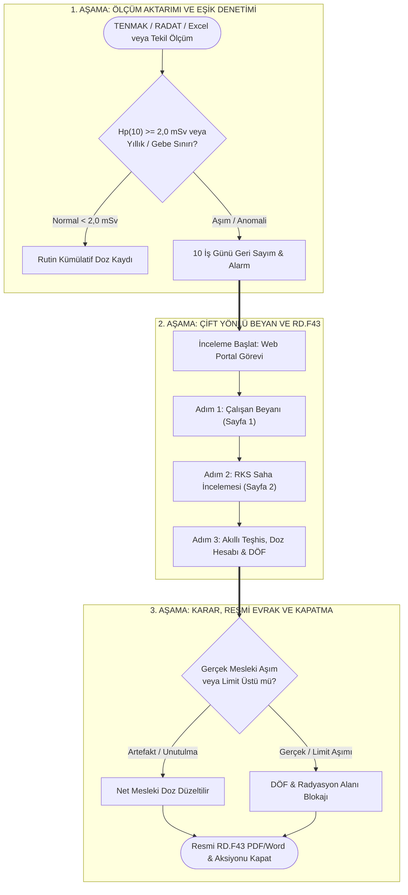

---json
{
  "pageTitle": "12. Kişisel Dozimetre Takibi ve RD.F43 Doz Aşımı Araştırması — RADPYS v4 Kullanım Kılavuzu",
  "h1": "Kişisel Dozimetre Takibi ve RD.F43 Doz Aşımı Araştırması",
  "lead": "Radyasyon çalışanlarının kişisel dozimetre ölçümlerini (TENMAK, RADAT ve Excel raporlarından aktarım, kalıcı eşleştirme hafızası), 2,0 mSv inceleme eşiği ve 20 / 50 mSv NDK yasal limit kontrollerini, çalışan beyanıyla bağlantılı 3 adımlı RD.F43 Doz Araştırma Formunu ve RKS net maruziyet değerlendirmesini yönetmenizi sağlar.",
  "overviewId": "overview",
  "badges": [
    {
      "text": "NDK Limit & 10 İş Günü Kuralı",
      "tone": "amber"
    }
  ],
  "readingTime": "6 Dakika",
  "legalNote": "<strong>Yasal Güvence:</strong> Radyasyon Güvenliği Yönetmeliği uyarınca mesleki etkin doz sınırı ardışık 5 yılın ortalamasında 20 mSv/yıl (5 yılda 100 mSv) ve herhangi bir tek yılda azami 50 mSv'dir; gebe çalışanlarda kalan gebelik boyunca fetüs dozu 1,0 mSv ile sınırlıdır ve 2,0 mSv inceleme aşımında 10 iş günü içinde RD.F43 formu düzenlenir."
}
---

## Kısa Reçete: Dozimetre Aktarımı, Eşik Alarmı ve RD.F43 Araştırması {#quick-recipe}

:::recipe Kısa Reçete: Dozimetre Aktarımı, Eşik Alarmı ve RD.F43 Araştırması | 20 SANİYELİK AKIŞ
### 1. İstenen Sonuç | slate
Laboratuvardan gelen periyodik doz sonuçlarının doğru personellere işlenmesi, eşik aşımlarının yakalanması ve 10 iş günü içinde resmi RD.F43 dosyasının kapatılması.

### 2. Yapılacak İşlem | cyan
<strong>[Yeni Donem Raporu]</strong> ile TENMAK, RADAT veya Excel dosyasını aktarın; Aksiyonlar sekmesinden <strong>[İnceleme Başlat]</strong> ile çalışan beyanı isteyin; beyan geldikten sonra <strong>[Doz Araştırma Formu (RD.F43)]</strong> üzerinden incelemeyi tamamlayıp <strong>[Aksiyonu Kapat]</strong> ile mühürleyin.

### 3. Sistem Etkisi | emerald
İsim ve T.C. bazlı kalıcı eşleştirme hafızası sonraki aylarda eşleşmeleri otomatik tanır; 2,0 mSv ve 5,0 mSv eşiklerinde anlık uyarı üretilir; çalışan beyanı ile RKS değerlendirmesi tamamlanmadan dosya kapanmaz.

- [metric] İnceleme Eşiği | 2,0 mSv (10 İş Günü RD.F43) | amber
- [metric] Müdahale Düzeyi | ≥ 5,0 mSv Kritik Alarm | rose
- [metric] Yıllık / 5 Yıl Sınır | 20 mSv Ort. / 50 mSv Tek Yıl | cyan
- [metric] Gebe Fetüs Sınırı | 1,0 mSv (Kalan Gebelik) | emerald
:::

## 5N1K Kural ve Arayüz Çözümleme Tablosu {#5w1h}

*Laboratuvar içe aktarımı, eşik denetimi, birim rotasyonu izleme, çalışan beyanı kilidi ve 3 adımlı RD.F43 araştırma kuralları.*

| NE? (Bileşen / Kontrol) | NEDEN? (Amacı) | NASIL? (Çalışma Mantığı) | NE ZAMAN? (Tetiklenme) | KİM? (Yetkili Rol) |
| --- | --- | --- | --- | --- |
| <strong>[Yeni Donem Raporu] &amp; Kalıcı Eşleşme Hafızası</strong> TENMAK, RADAT ve Excel Aktarımı | Farklı laboratuvar yazımlarındaki doz sonuçlarını hatasız biçimde personellere işlemek ve mühürlü dosyaları korumak. | Sağlayıcı, ad-soyad ve T.C. bilgisinden kalıcı eşleştirme hafızası kurar; boş birimlere yapay klinik adı yazmaz ve kapalı/kilitli RD.F43 dosyası bulunan dönem ölçümlerinin üzerine yazılmasını engeller (ayrılan personelin geçmiş dozları yıllık raporlarda korunur). | Periyodik doz raporu geldiğinde. | RKS / Dozimetre Sorumlusu |
| <strong>Periyodik ve Yıllık NDK Eşik Alarmları</strong> Tam Vücut, Göz, Ekstremite &amp; Öncelik Sırası | İnceleme düzeylerini ve ağır kümülatif yasal sınır aşımlarını maskelenmeden tespit etmek. | Önce gebe (1,0 mSv), tek yıl (50 mSv), 5 yıl (100 mSv), yıllık (20 mSv) ve stajyer (6 mSv) bloke edici NDK sınırlarını, ardından aylık 2,0 mSv inceleme, göz (2,0 mSv) ve ekstremite (50,0 mSv) eşiklerini denetler; negatif doz değerlerini reddeder. | Ölçüm eklendiğinde / aktarıldığında. | Sistem Motoru / RKS |
| <strong>Geçmiş Ölçümler ve Birim Rotasyon Takibi</strong> 5 Sütunlu Sağ Panel &amp; Kokpit Kapsamı | Personeldeki doz artışının hangi klinik birimde görev yaptığı dönemden kaynaklandığını KVKK sınırlarıyla izlemek. | Seçili personelin geçmiş ölçümlerini dönem, çalıştığı birim, derin/yüzey dozu ve durum bilgisiyle sıralar; kokpit kartları, grafikler ve aksiyon listeleri yalnızca yöneticinin yetkili olduğu birimleri gösterir. | Ölçüm satırı seçildiğinde / kokpitte. | RKS / Birim Sorumlusu |
| <strong>[İnceleme Başlat] &amp; Çift Yönlü Beyan Bildirimi</strong> 8 Sütunlu Aksiyon Kokpiti | Çalışanın savunması ve olay açıklaması alınmadan RKS dosyasının kapatılmasını önlemek. | Çalışanın Web Portal görev paneline Sayfa 1 beyan görevi düşürür; beyan yanıtı gelmeden taslak kaydı ve kapatma kilidi açılmaz. | Yeni eşik aşımı veya anomali açıldığında. | RKS / İlgili Personel |
| <strong>3 Adımlı [Doz Araştırma Formu (RD.F43)]</strong> Akıllı Karar ve RKS Değerlendirmesi | Odada unutulma, önlük üstü kullanım veya tıbbi tetkik artefaktını gerçek maruziyetten ayırmak. | Çalışan beyanı ve Web Portal üzerinden girilen RKS saha değerlendirmesinden sonra aktif gebelik durumunu kontrol eder, teorik doz ile önlük düzeltmesini hesaplar; kişisel maruziyet bulunmayan vakalarda gereksiz çalışma kısıtı açmaz, gerçek aşımlarda kısıtı otomatik başlatır. | Çalışan beyanı geldikten sonra. | RKS / Kurum Amiri |
| <strong>[Takip Ölçümü Planla] &amp; [Birim Notu Ekle]</strong> Ara İzleme ve Saha Gözlemi | Şüpheli vakalarda ara kontrol ve saha cihaz/ortam gözlemlerini kayıt altına almak. | Ara takip veya elektronik kişisel dozimetre görevi açar ve birim ortam koşullarını dosyaya ekler. | Araştırma sürecinde. | RKS / Dozimetre Sorumlusu |
| <strong>Güvenlik Kilitli [Aksiyonu Kapat] &amp; Yeniden Açma</strong> Denetim İzli Mühürleme &amp; Silme Koruması | Tutanak ve gerekçe eksikken vakanın kapatılmasını veya araştırmalı ölçümün silinmesini engellemek. | İptal dahil tüm kapanışlarda zorunlu gerekçe, RD.F43 kilidi ve göz/ekstremite/yıllık limit doğrulaması yapar; bağlı araştırma veya aksiyon kaydı olan ölçümlerin silinmesini engeller, geçici belgeleri görüntüleme sonrası otomatik temizler. | Dosya kapatılırken / revizyonda. | RKS / Kurum Amiri |

## Kritik Sahada Yanlış Bilinen Kurallar (Mit Avcısı) {#myth-buster}

:::myth Tıbbi Tetkik Dozu veya Döngüsel Rozet Numarası Mesleki Limite mi İşlenir?
### Yanlış Algı
<em>"Personel o ay hasta olarak PET-BT çektirdiği için dozimetresinde 15 mSv çıktı; bu doz artık yıllık yasal limitini doldurmuş sayılır ve eşleştirmede dozimetre seri numarası kalıcı kimlik olarak kullanılır."</em>

### Gerçek Sistem Mantığı
<strong>İkisi de doğru değildir.</strong> NDK mevzuatına göre çalışan hasta sıfatıyla aldığı tıbbi tetkik dozları mesleki maruziyet sayılmaz; RD.F43 formunda tıbbi tetkik veya alanda unutulma seçilerek RKS net doz hesabıyla düşülür. Ayrıca dozimetre kasetleri her periyotta rotasyona girdiği için kalıcı eşleştirme asla kaset numarasına göre değil, sağlayıcı laboratuvar, personel adı-soyadı ve T.C. kimlik bilgisine göre yapılır.
:::

## Süreç Akış Şeması {#workflow}

1. **Ölçüm Aktarımı ve Eşik Denetimi:** Laboratuvar raporu veya tekil ölçüm işlenir; 2,0 mSv inceleme düzeyi, 5,0 mSv müdahale düzeyi veya yıllık/gebe limitleri aşıldığında 10 iş günü sayacı ve alarm başlar.
2. **Çift Yönlü Beyan ve RD.F43:** İnceleme başlatıldığında çalışan Web Portalından Sayfa 1 beyanını gönderir; ardından RKS saha incelemesini ve 3. adımdaki karar motoru analizini tamamlar.
3. **Karar ve Resmi Kapatma:** Artefakt vakalarında net doz ayrıştırılır, gerçek aşımlarda DÖF ve gerekirse çalışma blokajı uygulanarak resmi Word/PDF RD.F43 tutanağıyla dosya mühürlenir.

## Arayüz Ekran Görünümleri {#screenshots}

## Adım Adım İşlem Rehberi {#step-by-step}

### 1. Laboratuvar Dosyası İçe Aktarma ve Eşleşme Hafızasını Kullanma

1. **[Kişisel Dozimetre Takibi]** ekranında araç çubuğundaki **[Yeni Donem Raporu]** butonuna tıklayın; format olarak **Otomatik Algıla**, **RADAT**, **TENMAK / NDK** veya **Genel Excel / CSV** seçip **[Dosya Seç...]** ile raporu yükleyin ve **[İleri]**'ye basın.
2. Önizleme tablosunda eşleşmeyen satır varsa satıra çift tıklayarak (veya **[Seçiliyi Personelle Eşle]** ile) doğru çalışanı arayıp seçin; kalıcı hafıza onay kutusunu işaretleyerek **[Bu Personelle Eşle]**'ye basın (kurum dışı veya ayrılmış kişiler için **[Eşleşmeyenleri Excel Olarak İndir]** ile listeyi alabilirsiniz).
3. Son adımda **[Tamamla]** butonuna basarak tüm ölçümleri kümülatife işleyin ve eşik aşımı varsa otomatik aksiyon kaydını oluşturun.

### 2. Manuel / EPD Ölçümü Ekleme ve Geçmiş Birim Rotasyonunu İzleme

1. Münferit veya elektronik kişisel dozimetre (EPD) sonucu girmek için **[Ölçüm Ekle]** butonuna tıklayın; personeli, dozimetre tipini (Tüm Vücut, Yüzük, Göz Lensi, EPD) ve derin/yüzey dozlarını girip **[Kaydet]**'e basın (2,0 mSv aşımında sistem anında uyarı verir).
2. Ölçümler tablosunda herhangi bir satıra tıkladığınızda sağ panelde personelin geçmiş ölçümleri o dönemde görev yaptığı klinik birim bilgisiyle birlikte görüntülenir.

### 3. Çalışan Beyanı ve 3 Adımlı RD.F43 Araştırmasını Tamamlama (Masaüstü ve Web)

1. **Aksiyonlar** sekmesinde inceleme bekleyen kaydı seçip **[İnceleme Başlat]** butonuna tıklayın; ilgili personelin Web Portalı görev ekranına Sayfa 1 beyan bildirimi otomatik iletilir ve durum **BEYAN BEKLİYOR** olur.
2. Personel Web Portalından kendi çalışma rejimi, dozimetre takış konumu ve olay beyanı sorularını yanıtladığında masaüstü bildirim çekmecesine uyarı düşer; bu sırada RKS isterse **[Takip Ölçümü Planla]** ve **[Birim Notu Ekle]** ile ek izleme kaydı açabilir.
3. RKS, **[Doz Araştırma Formu (RD.F43)]** butonuna basarak 3 adımlı sihirbazda Sayfa 1 yanıtlarını doğrular, Sayfa 2 saha sorularını doldurur ve 3. adımda gerekirse **[Hesapla]** ile teorik dozu hesaplar; **[Önerilen Kararı ve Bulguları Forma Aktar]** butonuna tıklayıp gerekirse **[DÖF Kaydı Aç / Yönet]** üzerinden DÖF bağlayarak **[PDF Raporu İndir]** / Word çıktısı alır ve **[Aksiyonu Kapat]** butonuna basar (sonradan düzeltme gerekirse rapor penceresinden **[Düzeltme Yap / Formu Yeniden Aç]** kullanılır).
4. **Web Portalı Kişisel Doz Karnesi:** Çalışanlar ve yöneticiler tarayıcıdan 20 / 50 mSv limitlerine olan mesafeyi gösteren radyal göstergeyi, 12 aylık doz trendini ve kendi ölçüm geçmişlerini anlık izleyebilir.

## Sıkça Sorulan Sorular (SSS) {#faq}

:::faq
### Dozimetre raporu aktarırken bazı personeller eşleşmezse sonraki aylarda tekrar mı seçmem gerekir?
Hayır. Eşleşmeyen satıra çift tıklayıp açılan personel seçim penceresinde eşleştirmeyi hafızaya kaydet kutusunu işaretlediğinizde, sistem sağlayıcı yazımı ile personeli kalıcı olarak eşleştirir ve sonraki dönemlerde otomatik tanır. Kurum personeli olmayan satırlar ise <strong>[Eşleşmeyenleri Excel Olarak İndir]</strong> ile dışa aktarılabilir.

### TENMAK veya RADAT dışında farklı bir dozimetri laboratuvarıyla çalışıyorsak nasıl aktarabiliriz?
Raporu standart Excel sütunlarına göre düzenleyip <strong>Genel Excel / CSV</strong> seçeneğiyle aktarabilirsiniz. Laboratuvarınızın özgün rapor formatını doğrudan tanıtmak isterseniz örnek bir dosyayı destek ekibiyle paylaşmanız yeterlidir.

### Kaydedilmiş bir dozimetri ölçümü yanlışsa neden doğrudan silinip yok edilemiyor?
NDK mevzuatı ve denetim izi bütünlüğü gereğince resmi doz kayıtları iz bırakmadan değiştirilemez. Düzeltme gerektiğinde tutanak veya kayıt üzerindeki gerekçeli düzeltme mekanizması kullanılır ve değişiklik denetim izine işlenir.

### 10 iş günü yasal geri sayım rozeti kırmızıya dönerse sistem işlem engeli koyar mı?
Sistem doğrudan teknik çalışma kilidi koymaz; ancak NDK açısından 10 iş günü aşımı kritik gecikme sayıldığı için RKS panosunda yüksek öncelikli alarm üretilir ve denetim izinde gecikme kaydı tutulur.
:::
