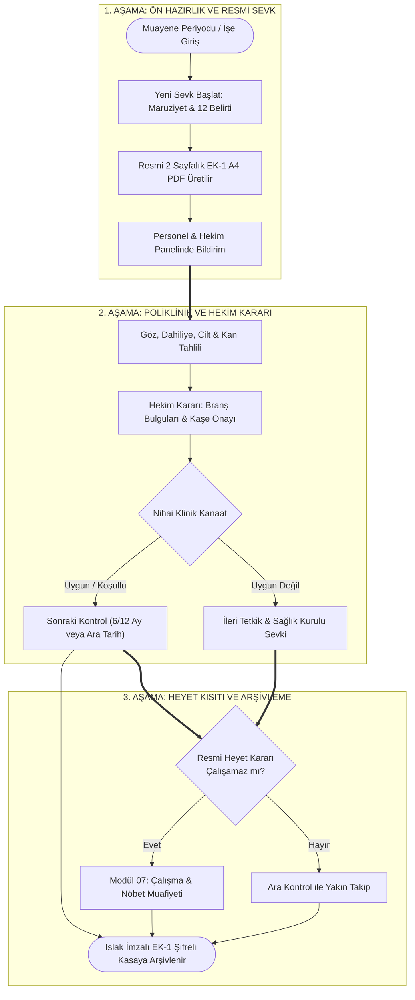

---json
{
  "pageTitle": "13. Radyasyon Çalışanları Sağlık Muayeneleri ve Periyodik Takip — RADPYS v4 Kullanım Kılavuzu",
  "h1": "Sağlık Muayeneleri ve Periyodik Takip",
  "lead": "Radyasyon çalışanlarının işe giriş ve periyodik sağlık gözetimini 2 aşamalı klinik iş akışı (Ön Hazırlık ve Sevk ile Hekim Kararı ve Arşivleme), 13.04.2023 / 32162 sayılı Yönetmelik EK-1 uyumlu iki sayfalık A4 PDF sevk belgesi, 3 uzmanlık branşı değerlendirmesi, 30 gün erken uyarısı ve şifreli evrak kasası ile yönetmenizi sağlar.",
  "overviewId": "overview",
  "badges": [
    {
      "text": "32162 Yönetmelik EK-1 Uyumlu",
      "tone": "emerald"
    }
  ],
  "readingTime": "5 Dakika",
  "legalNote": "<strong>Mevzuat Güvencesi:</strong> 32162 sayılı Yönetmelik EK-1 Tıbbi Gözetim Belgesi standardı gereğince Sayfa 2 poliklinik tabloları hekim muayenesinde elle kaşelenip imzalanmak üzere tamamen boş üretilir; rutin muayenede Uygun Değil görüşü doğrudan nöbet silmez, kalıcı kısıt yalnızca resmi Sağlık Kurulu Heyet Raporu ile tanımlanır."
}
---

## Kısa Reçete: Ön Hazırlık Sevk ve Hekim Kararı Akışı {#quick-recipe}

:::recipe Kısa Reçete: Ön Hazırlık Sevk ve Hekim Kararı Akışı | 20 SANİYELİK AKIŞ
### 1. İstenen Sonuç | slate
Personelin periyodik veya Şua muayenelerinin zamanında sevk edilmesi, resmi EK-1 formunun üretilmesi ve poliklinik kararlarının şifreli kasada arşivlenmesi.

### 2. Yapılacak İşlem | cyan
<strong>[Yeni Sevk Başlat]</strong> ile maruziyet, anamnez ve 12 EK-1 belirtisini kaydedip <strong>[EK-1 Formu (A4)]</strong> belgesini yazdırın; Göz, Dahiliye ve Dermatoloji sonuçları döndüğünde <strong>[Hekim Kararı]</strong> ekranından branş bulgularını, kaşe onaylarını ve taranmış imzalı raporu kaydedin.

### 3. Sistem Etkisi | emerald
Sevk anında hekim ve çalışana bildirim gider; Muayene Türüne göre 6 veya 12 aylık sonraki kontrol tarihi otomatik önerilir; süreye 30 gün kala sarı, süre dolduğunda kırmızı uyarı verilir.

- [metric] Periyodik Muayene | 12 Aylık Döngü | cyan
- [metric] Şua Muayenesi | 6 Aylık Ara Kontrol | amber
- [metric] Branş Protokolü | Dahiliye, Göz, Cilt | emerald
- [metric] Erken Uyarı | 30 Gün Kala Alarm | slate
:::

## 5N1K Kural ve Arayüz Çözümleme Tablosu {#5w1h}

*İki aşamalı klinik muayene süreci, resmi EK-1 belgesi, periyot hesabı ve heyet kısıt ayrımı kuralları.*

| NE? (Bileşen / Kontrol) | NEDEN? (Amacı) | NASIL? (Çalışma Mantığı) | NE ZAMAN? (Tetiklenme) | KİM? (Yetkili Rol) |
| --- | --- | --- | --- | --- |
| <strong>[Yeni Sevk Başlat] &amp; 12 Maddelik EK-1 Anamnez</strong> 1. Aşama: Ön Hazırlık ve Sevk | Poliklinik sevki öncesinde çalışanın maruziyet geçmişini ve 12 öznel belirtisini standart biçimde almak. | 2 adımlı sevk penceresinde maruziyet tipi, son 1 yıl öyküsü ve 12 belirti girilir; hekim ve çalışana anında sevk bildirimi iletilir. | Periyodik kontrol veya sevk başlarken. | İşyeri Hekimi / İSG / RKS |
| <strong>[EK-1 Formu (A4)] Resmi Sevk Belgesi</strong> Merkezi Standart, Tam 12 Aylık Doz &amp; Sayfa 2 Dürüst Boş | 32162 sayılı Yönetmelik EK-1 Tıbbi Gözetim Belgesini tüm muayene ekranlarından aynı standartla, tam son 12 aylık doz özeti ve doğru karar işaretiyle ekran donmadan basmak. | Sayfa 1'e künye, son 12 aylık doz özeti, çalışan beyanı ve hekimin verdiği nihai karar (Uygun, Koşullu Uygun veya Uygun Değil) tam karşılığıyla arka planda hazırlanarak işaretlenir; Sayfa 2'deki hemogram, cilt ve lens kutularına yapay işaret konulmadan hekimin elle doldurması için temiz ve boş sunulur, klinik bulgular yetkisiz rollerde maskelenir. | Sevk belgesi, liste ve PDF üretildiğinde. | İşyeri Hekimi / İSG / RKS |
| <strong>[Hekim Kararı] &amp; 3 Branş İmza Protokolü</strong> [Hekim Kaşesi ve İmzası Var] | Dahiliye, Göz ve Dermatoloji sonuçlarını toplayıp nihai uygunluk kararını mevzuata uyumlu tescillemek. | Tüm branşların aynı gün bitmesi gerekmez; en az bir branş sonucuyla kayıt açılıp diğer sonuçlar geldikçe güncellenir, genel uygunluk kararı en kısıtlayıcı branş sonucuna göre korunur ve onay kuyruğundan dönen talepler hekimin mevcut kararını ezmez. | Poliklinik sonuçları döndüğünde. | İşyeri Hekimi / RKS |
| <strong>Otomatik Periyot &amp; 30 Gün Erken Uyarı</strong> Ayrı Periyodik (12 Ay) / Şua (6 Ay) Takibi | Yıllık ve Şua muayenelerinin birbirini gizlemeden zamanında planlanmasını sağlamak. | Henüz hekim kararı tamamlanmamış sevk kayıtları ile işe giriş muayenelerine otomatik +1 yıl tarih atamaz; yalnızca tamamlanan muayenelerde türe göre 6 veya 12 ay sonrasını önerir, 12 aylık periyodik ve 6 aylık Şua muayenelerini gecikme ekranlarında ayrı takip eder. | Karar kaydı ve liste yenilemede. | Sistem Otomatik / İSG |
| <strong>İleri Tetkik vs Resmi Heyet Raporu Ayrımı</strong> Çalışma Kısıtı Güvencesi | Kesinleşmemiş şüpheli bulgularda çalışanın nöbet ve görev düzenini erken kilitlememek. | Rutin muayenede Uygun Değil görüşü personeli ileri tetkike yönlendirir ve bir silme işleminde çalışma kısıtı en güncel tamamlanmış muayeneye göre yeniden senkronize edilir; çalışma muafiyeti Nöbet Ayarları modülünden yönetilir. | Şüpheli klinik bulguda / revizyonda. | İşyeri Hekimi / Yönetici |
| <strong>Şifreli Evrak Kasası, KVKK Maskeleme &amp; Erişim İzi</strong> AES-256, Birim Kapsamı &amp; Geçici Dosya Temizliği | Özel nitelikli sağlık verilerini ve ıslak imzalı EK-1 taramalarını yalnızca yetkili rollere ve birim kapsamına açmak. | Yüklenen rapor şifreli kasada depolanır ve yalnızca veritabanı işlemi onaylandıktan sonra eski kopya temizlenir; klinik anamnez/notlar yalnızca İşyeri Hekimi, RKS ve yetkili yöneticilere gösterilip her görüntüleme erişim günlüğüne kaydedilir, geçici PDF dosyaları açım sonrası silinir. | Evrak yükleme, raporlama ve görüntülemede. | Yetkili Sağlık / RKS / Denetçi |

## Kritik Sahada Yanlış Bilinen Kurallar (Mit Avcısı) {#myth-buster}

:::myth Poliklinikte "Uygun Değil" Seçilince Nöbetler Otomatik Silinir mi ve 3 Branş Aynı Gün Zorunlu mu?
### Yanlış Algı
<em>"Hekim muayenede Uygun Değil seçeneğini işaretlediği anda sistem personelin tüm nöbetlerini siler; ayrıca 3 branş sonucu aynı gün çıkmadan muayene formu kaydedilemez."</em>

### Gerçek Sistem Mantığı
<strong>İkisi de yanlıştır.</strong> Rutin klinik takip ekranında Uygun Değil görüşü verilmesi personelin ilgili uzman kliniğe ileri tetkike sevk edilmesini sağlar; çalışamayacağına dair resmi Sağlık Kurulu Heyet Raporu kesinleştiğinde çalışma muafiyeti Modül 07 üzerinden tanımlanır. Ayrıca 3 branşın aynı gün bitmesi gerekmez; en az bir branş sonucu girilerek kayıt kaydedilebilir ve diğer branşlar tamamlandıkça güncellenebilir.
:::

## Süreç Akış Şeması {#workflow}

1. **Ön Hazırlık ve Sevk:** Çalışan maruziyeti, anamnez ve 12 EK-1 belirtisi girilerek sevk açılır; 2. sayfası boş bırakılmış resmi EK-1 A4 PDF sevk belgesi üretilir ve bildirim gönderilir.
2. **Poliklinik ve Hekim Kararı:** Göz, Dahiliye ve Dermatoloji branşlarının bulguları, hekim kaşe onayları ve genel uygunluk kanaati işlenir; gerekirse sonraki muayene tarihi erkene çekilebilir.
3. **Heyet Kısıtı ve Arşivleme:** Yalnızca resmi Sağlık Kurulu raporuyla kesinleşen engeller Modül 07 çalışma kısıtlarına aktarılır; ıslak imzalı EK-1 taraması şifreli evrak kasasında saklanır.

## Arayüz Ekran Görünümleri {#screenshots}

## Adım Adım İşlem Rehberi {#step-by-step}

### 1. Yeni Sevk Başlatma ve Resmi EK-1 A4 Formunu Üretme (1. Aşama)

1. Sol menüden **[Sağlık Muayeneleri]** ekranını açın ve araç çubuğundaki **[Yeni Sevk Başlat]** butonuna tıklayın.
2. İlk sayfada personeli, muayene türünü (İşe Giriş, Radyasyon Çalışanı, Periyodik veya 6 aylık Şua Muayenesi), radyasyon maruziyet tipini ve son 1 yıllık anamnez sorularını seçip **[İleri: Belirtiler]** butonuna basın.
3. 12 maddelik EK-1 öznel belirti taramasını doldurun (sorun yoksa **[Tümünü 'YOK' Olarak İşaretle]** kullanabilirsiniz), gerekiyorsa **[Matbu EK-1 Sevk Formu Yazdır]** ile çıktıyı alın ve **[Sevki Başlat ve Kaydet]** butonuna tıklayın (sonradan liste üzerinden **[EK-1 Formu (A4)]** ile de indirebilirsiniz).

### 2. Poliklinik Sonuçlarını ve Hekim Kararını Kaydetme (2. Aşama)

1. Poliklinik muayenelerinden kaşeli EK-1 formu döndüğünde ilgili satırı seçip **[Hekim Kararı]** butonuna tıklayın (istersek **[Ön Hazırlık / Sevk Verilerini Gör]** ile ilk beyana göz atabilirsiniz).
2. **Dahiliye**, **Göz** ve **Dermatoloji** bölümlerine branş sonuçlarını girin ve tamamlanan branşlar için **[Hekim Kaşesi ve İmzası Var]** kutularını işaretleyin (en az bir branş sonucu seçili olmalıdır).
3. Genel muayene kararını (Uygun, Koşullu Uygun veya Uygun Değil), hekim tavsiyelerini ve gerekirse manuel erkene çekilmiş **Sonraki Muayene Tarihi** alanını kontrol edin; taranmış ıslak imzalı belgeyi **[Seç]** ile ekleyip **[Muayeneyi Onayla ve Kapat]** butonuna basın.

### 3. Geçmiş İnceleme, Revizyon Takibi ve Web Portalı Görünümü

1. Bir çalışanın önceki yıllardaki tüm muayene kayıtlarını karşılaştırmak için satırı seçip **[Geçmiş]** butonuna tıklayın; güncellenen veya silinen kayıtların eski durumlarını görmek için tabloda satıra sağ tıklayıp **Değişiklik Geçmişi** seçeneğini açın.
2. **Web Portalı Sağlık Ekranı:** Çalışanlar kendi sağlık karnelerinden sonraki kontrol gün sayısını ve sevk bildirimlerini takip ederken, EK-1 çalışan beyanı ön formunu tarayıcıdan doldurabilir; yöneticiler ise Sağlık Dashboard üzerinden branş dağılımını, muayene uyum yüzdesini ve aylık yığılma tahminini izler.

## Sıkça Sorulan Sorular (SSS) {#faq}

:::faq
### Bir muayenede "Uygun Değil" seçildiğinde personel hemen nöbetten çıkarılır mı?
Hayır. Buradaki değerlendirme rutin klinik gözetim kaydıdır. Uygun Değil kanaati personelin ilgili branş kliniğine ileri tetkik için sevk edilmesini sağlar; çalışamayacağı resmi Sağlık Kurulu Heyet Raporu ile kesinleştiğinde nöbet ve çalışma muafiyeti Modül 07 üzerinden uygulanır.

### Üç branş (Göz, Dahiliye, Cilt) aynı gün tamamlanamazsa kaydı bekletmek zorunda mıyım?
Hayır. En az bir branş sonucunun girilmiş olması kaydı oluşturmak için yeterlidir. Diğer poliklinik sonuçları geldikçe ilgili satırı <strong>[Hekim Kararı]</strong> üzerinden açıp güncelleyebilirsiniz.

### Sistem sonraki muayene tarihini 12 ay sonraya attı; hekim 3 ay sonraya ara kontrol isterse değiştirebilir mi?
Evet. Sistem muayene türüne göre 6 veya 12 aylık varsayılan tarihi otomatik önerir; ancak hekimin tavsiyesi doğrultusunda sonraki muayene tarihi alanı manuel olarak daha erken bir güne çekilebilir.

### Silinmiş veya sonradan değiştirilmiş bir sağlık muayenesini denetimde nasıl kanıtlarım?
Muayene listesinde satıra sağ tıklayıp <strong>Değişiklik Geçmişi</strong> menüsünü açtığınızda, kaydın önceki verileri, işlemi yapan kullanıcı adı ve kesin tarih/saat damgası değiştirilemez denetim izi olarak listelenir.
:::
