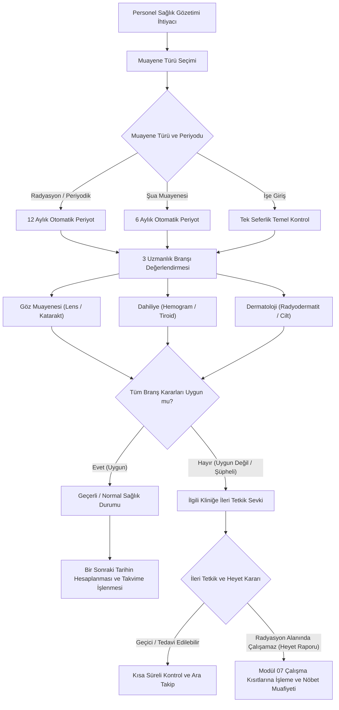

---json
{
  "pageTitle": "13. Radyasyon Çalışanları Sağlık Muayeneleri ve Periyodik Takip — RADPYS v4 Kullanım Kılavuzu",
  "h1": "13. Sağlık Muayeneleri ve Periyodik Takip",
  "lead": "Radyasyonla çalışan personelin işe giriş ve periyodik sağlık gözetim süreçlerini, iki aşamalı klinik iş akışını (Ön Hazırlık & Sevk ile Hekim Kararı & Arşivleme), Sağlık Bakanlığı ve NDK standartlarındaki resmi iki sayfalık EK-1 A4 PDF sevk formunu, üç temel uzmanlık branşının (Göz, Dahiliye, Dermatoloji) klinik değerlendirmelerini, otomatik randevu takvimini ve revizyon denetim izini yöneten modüldür.",
  "overviewId": "genel-bakis",
  "badges": [
    {
      "text": "MODÜL 13",
      "tone": "cyan"
    },
    {
      "text": "NDK & Sağlık Bakanlığı EK-1 Mevzuatı",
      "tone": "emerald"
    },
    {
      "text": "İki Aşamalı İş Akışı",
      "tone": "indigo"
    },
    {
      "text": "Resmi EK-1 A4 PDF",
      "tone": "blue"
    }
  ]
}
---

## Vizyonder Hızlı Karar Reçetesi (Klinik Takip & İSG Özeti) {#hizli-recete}

:::recipe Vizyonder Hızlı Karar Reçetesi (Klinik Takip & İSG Özeti) | 20 SANİYELİK AKIŞ

### 1. Aşama: Ön Hazırlık & Sevk | cyan

[Yeni Sevk Başlat] butonuyla personel seçimi, maruziyet, anamnez soruları ve 12 belirti/bulgu girilerek sevk kaydı oluşturulur; resmi 2 sayfalık A4 EK-1 formu otomatik üretilir.

### 2. Poliklinik & Laboratuvar Taraması | emerald

Çıktısı alınan EK-1 formu ile polikliniklere (Göz, Dahiliye, Cildiye ve Tam Kan Sayımı) sevk yapılır; uzman hekimler Sayfa 2'deki boş kutuları el yazısıyla doldurup kaşeler.

### 3. Aşama: Hekim Kararı & Arşivleme | blue

[Hekim Kararı] butonuyla poliklinik sonuçları ve nihai hekim kararı işlenir; ıslak imzalı taranmış rapor şifreli kasaya yüklenir. 30 gün kala sarı uyarı verilir.
:::

## Arayüz Bileşenleri ve 5N1K Tablosu {#bilesenler}

 

 Sağlık Muayeneleri modülündeki ekran kontrolleri, butonlar ve branş imza alanlarının işlevsel kullanım kılavuzu:
 

 

| Bileşen / Buton | Türü | Ne İşe Yarar? (Ne?) | Kim Kullanır? (Kim?) | Ne Zaman Kullanılır? (Ne Zaman?) | Nerede Yer Alır? |
| --- | --- | --- | --- | --- | --- |
| [Yeni Sevk Başlat] | Buton | 1. Aşama Ön Hazırlık ve Sevk modalını açar; personel seçimi, anamnez soruları ve 12 belirti girişiyle sevk kaydı oluşturur, hekim ve çalışan paneline anlık bildirim çekmecesi uyarısı iletir ve resmi iki sayfalık kilitli EK-1 PDF belgesini üretir. | Hekim / RKS / İSG Sorumlusu | Personelin periyodik muayene veya sevk süreci başlatıldığında | Liste Araç Çubuğu (Sol Üst) |
| [Hekim Kararı] | Buton | 2. Aşama Hekim Kararı modalını açar; polikliniklerden dönen branş muayenelerini (Göz, Dahiliye, Cildiye), laboratuvar bulgularını ve nihai hekim kararını işler; taranmış ıslak imzalı raporu şifreli kasaya arşivler. | İşyeri Hekimi / RKS | Poliklinik tetkik sonuçları tamamlanıp kesin karar verileceğinde (veya çift tık) | Liste Araç Çubuğu |
| [Resmi EK-1 PDF İndir] | Dışa Aktarma | Sağlık Bakanlığı ve NDK mevzuat formatında (docs/21.5.7077_Parça5.pdf) 2 sayfalık A4 resmi sevk ve muayene belgesini üretir. Sayfa 2 poliklinik hekimlerinin elle doldurması için dürüstçe boş sunulur. | Tüm Yetkililer | Sevk belgesi bastırılacağı veya dijital arşivleneceğinde | Sevk Formu / Liste Araç Çubuğu |
| [Geçmiş] | Buton | Personelin geçmiş yıllardaki tüm muayenelerini listeler. | Hekim / Denetçi | Personel geçmişi kıyaslanırken | Liste Araç Çubuğu |
| [Sil] | Buton | Hatalı girilmiş muayeneyi revizyon günlüğüne yazarak siler. | Süpervizör / Admin | Mükerrer veya yanlış kayıt iptalinde | Liste Araç Çubuğu |
| [Detay] | Buton | Seçili muayenenin branş bulguları ve rapor dosyasını açar. | Tüm Yetkililer | Klinik notlar incelenirken (veya çift tık) | Liste Araç Çubuğu |
| [Geçmiş] | Buton | Personelin geçmiş yıllardaki tüm muayenelerini listeler. | Hekim / Denetçi | Personel geçmişi kıyaslanırken | Liste Araç Çubuğu |
| [Sil] | Buton | Hatalı girilmiş muayeneyi revizyon günlüğüne yazarak siler. | Süpervizör / Admin | Mükerrer veya yanlış kayıt iptalinde | Liste Araç Çubuğu |
| [Arama Kutusu] | Giriş Alanı | Ad, soyad, TC kimlik no veya muayene notlarında filtreler. | Tüm Kullanıcılar | Hızlı personel veya vaka aramasında | Filtre Paneli |
| [Muayene Durumu] | Açılır Kutu | Süresi Geçmiş, Yaklaşıyor (30 gün) ve Normal satırları süzer. | RKS / İSG Uzmanı | Kontrolü yaklaşan veya geçen personeller taranırken | Filtre Paneli |
| [TC / Ad ile Ara] | Tamamlayıcı | Personeli harf yazarak otomatik tamamlar; unvan/dep yansıtır. | Kullanıcı | Muayene formu doldurulurken | Ekleme Modalı |
| [Dahiliye / Derm / Göz İmza] | Onay Kutusu | İlgili branş hekiminin muayeneyi tamamlayıp imzaladığını teyit eder. | Hekim | Branş muayenesi bittiğinde | Bulgular Grubu |
| [Muayene Formu Seç/Aç/Sil] | Dosya Butonları | Rapor PDF/görselini şifreli kasaya kopyalar veya görüntüler. | Kullanıcı | Heyet evrakı arşivlenirken | Belge Satırı |

## Muayene Takip Listesi ve Görsel Durum İkonları {#liste-ekrani}

 

 Personellerin periyodik muayene durumu, branş ikonları (Göz, Dahiliye, Dermatoloji) ve genel uygunluk kararlarının merkezi kokpiti:
 

 

 

 

 

 UYGUN
 <h3 class="text-sm font-bold text-slate-900 dark:text-white">Radyasyonla Çalışmaya Uygun</h3>
 

 Tüm branş kontrollerinde engel durum tespit edilmemiş, personelin radyasyonlu ortamda çalışmasında sakınca bulunmayan rutin kayıtlar.
 

 

 

 KOŞULLU UYGUN
 <h3 class="text-sm font-bold text-slate-900 dark:text-white">Şartlı & Yakın Takip</h3>
 

 Hekim tarafından koruyucu ekipman şartı veya daha sık aralıklarla ara kontrol tavsiyesi konulmuş çalışanları simgeler.
 

 

 

 SÜRESİ DOLDU
 <h3 class="text-sm font-bold text-slate-900 dark:text-white">Periyodu Geçmiş Muayene</h3>
 

 Bir sonraki kontrol tarihi üzerinden zaman geçmiş çalışanlar; sistem kırmızı uyarı verir ve gecikme raporunda listeler.
 

 

 

 

## İki Aşamalı Klinik Muayene Süreci ve Resmi EK-1 A4 PDF Çıktısı {#muayene-formu}

 

 RADPYS V4.0.3.30
 Sağlık Bakanlığı & NDK Mevzuat Uyumlu
 

 

 Sağlık muayene formu klinik iş akışına uygun olarak iki bağımsız aşamaya ayrılmıştır: <strong>1. Ön Hazırlık & Sevk</strong> aşamasında anamnez ve belirtiler sorgulanıp resmi EK-1 formu üretilir; <strong>2. Hekim Kararı & Arşivleme</strong> aşamasında ise poliklinik bulguları işlenir ve ıslak imzalı tutanak KVKK şifreli kasasına arşivlenir.
 

 

 

 

 

 1. AŞAMA
 [Yeni Sevk Başlat]
 

 <h3 class="text-base font-bold text-slate-900 dark:text-white flex items-center gap-2">
 
 Ön Hazırlık, Anamnez ve Resmi EK-1 Sevk Formu
 </h3>
 <ul class="text-xs text-slate-600 dark:text-slate-300 space-y-2.5 leading-relaxed">
 <li class="flex items-start gap-2">
 &bull;
 <strong>Personel Seçimi & Maruziyet:</strong> Personel seçildiğinde TC kimlik, departman ve unvan otomatik gelir; haftalık çalışma saati ve geçmiş radyasyon çalışma süresi doğrulanır.
 </li>
 <li class="flex items-start gap-2">
 &bull;
 <strong>Anamnez ve 12 Belirti Matrisi:</strong> Mevzuatta yer alan 12 klinik belirti/bulgu sorgulanır. Sevk kaydı oluşturulduğunda sistem otomatik olarak <strong>Resmi EK-1 A4 PDF</strong> belgesini üretir ve açar.
 </li>
 <li class="flex items-start gap-2">
 &bull;
 <strong>Resmi EK-1 A4 PDF Çıktısı (docs/21.5.7077):</strong> Sağlık Bakanlığı ve NDK standardında 2 sayfalık resmi sevk ve muayene belgesi üretilir.
 </li>
 <li class="flex items-start gap-2">
 &bull;
 <strong>Dürüst Boş Durum (Sıfır Sentetik Veri Kuralı):</strong> Sayfa 1'de çalışan künyesi ve beyanı basılırken; Sayfa 2'deki poliklinik muayene tabloları (El-Cilt, Malignite, Tam Kan Sayımı ve Katarakt) hekimin elle muayene yapıp doldurabilmesi için tamamen temiz ve boş bırakılır.
 </li>
 <li class="flex items-start gap-2">
 &bull;
 <strong>Resmi Matbu Tipografi (Times New Roman):</strong> Şablon fontu resmi sağlık kurulu evrakı standardı olan Times New Roman ile hazırlanmış olup 4 sütunlu tam genişlikli kan sayımı matrisi sunar. Belge adı `EK1_Saglik_Muayene_{Ad_Soyad}_{TC}_{Tarih}.pdf` olarak standartlaşır.
 </li>
 <li class="flex items-start gap-2">
 &bull;
 <strong>Otomatik Bildirim Çekmecesi & Hızlı Sevk Kartı:</strong> Personel "Sevk Edildi / Muayenede" durumuna alındığı anda masaüstü bildirim çekmecesine ve personelin web paneline anlık bildirim kartı iletilir. Bildirime tek tıkla tıklandığında personelin sağlık kartı doğrudan açılarak EK-1 formunun basılması ve poliklinik randevu hazırlığı garanti altına alınır.
 </li>
 </ul>
 

 

 

 

 2. AŞAMA
 [Hekim Kararı]
 

 <h3 class="text-base font-bold text-slate-900 dark:text-white flex items-center gap-2">
 
 Poliklinik Muayeneleri, Hekim Kararı ve KVKK Kasası
 </h3>
 <ul class="text-xs text-slate-600 dark:text-slate-300 space-y-2.5 leading-relaxed">
 <li class="flex items-start gap-2">
 &bull;
 <strong>Poliklinik Sonuçlarının İşlenmesi:</strong> Dahiliye (Tam Kan Sayımı, tiroid), Dermatoloji (cilt/lezyon) ve Göz (lens/katarakt) polikliniklerinden dönen kaşeli sonuçlar ve imzalar sisteme işlenir.
 </li>
 <li class="flex items-start gap-2">
 &bull;
 <strong>Nihai Hekim Kararı:</strong> İşyeri hekimi tarafından personelin radyasyon alanında çalışmasına dair genel kanaat (Uygun, Koşullu Uygun, Uygun Değil) belirlenir.
 </li>
 <li class="flex items-start gap-2">
 &bull;
 <strong>KVKK Şifreli Evrak Kasası:</strong> Poliklinik hekimlerince kaşelenip imzalanan ıslak imzalı resmi EK-1 raporu taranarak sisteme yüklenir; AES-256 Fernet ile şifrelenerek güvenli evrak kasasında saklanır.
 </li>
 <li class="flex items-start gap-2">
 &bull;
 <strong>Ferah ve Dengeli Liste Tablosu:</strong> Personel Adı, Birim ve Ünvan sütunları ekran genişliğini dengeli paylaşır; tarihler ve kararlar net genişliklerle kesilmeden ferah biçimde izlenir.
 </li>
 </ul>
 

 

 Tavsiyeler & Klinik Kanaat:
 
Hekimin tıbbi kanaati, koruyucu donanım şerhleri veya ara kontrol tavsiyeleri `Tavsiyeler` metin kutusuna girilir ve detayda saklanır.

 

 

 

## İleri Tetkik Sevk Süreci ve Resmi Heyet Raporu Kısıtı {#ileri-tetkik}

 

 Rutin periyodik kontrolde şüpheli bulgu saptandığında izlenen kurumsal sevk ve çalışma kısıtı protokolü:
 

 

 

 

 1. AŞAMA
 <h3 class="text-sm font-bold text-slate-900 dark:text-white">Şüpheli Bulgu & İleri Tetkik Sevki</h3>
 

 Periyodik muayenede branş hekimi tarafından *"Uygun Değil"* veya *"Koşullu Uygun"* kanaati belirtildiğinde, personel ilgili kliniğe ayrıntılı ileri tetkikler için sevk edilir.
 

 

 

 2. AŞAMA
 <h3 class="text-sm font-bold text-slate-900 dark:text-white">Resmi Sağlık Kurulu (Heyet) Kararı</h3>
 

 İleri tetkiklerin ardından Sağlık Kurulu toplanır. Personelin radyasyon ortamında çalışıp çalışamayacağı resmi Heyet Raporu tutanağına bağlanır.
 

 

 

 3. AŞAMA
 <h3 class="text-sm font-bold text-slate-900 dark:text-white">Nöbet Muafiyeti & Çalışma Kısıtı</h3>
 

 Heyet raporunda radyasyonsuz alanda çalışma kararı çıkarsa, Yönetici/RKS tarafından <strong>Modül 07</strong> üzerinden resmi çalışma kısıtı açılır ve nöbet motoru personeli korumaya alır.
 

 

 

## Hibrit Arayüz ve Web Portalı Görünümü {#hibrit-portal}

 

 Masaüstü klinik kayıt ve evrak yönetim merkezi ile web portalı sağlık göstergeleri karşılaştırması:
 

 

 

 

 

 

 <svg class="w-5 h-5" fill="none" stroke="currentColor" viewBox="0 0 24 24"><path stroke-linecap="round" stroke-linejoin="round" stroke-width="2" d="M9.75 17L9 20l-1 1h8l-1-1-.75-3M3 13h18M5 17h14a2 2 0 002-2V5a2 2 0 00-2-2H5a2 2 0 00-2 2v10a2 2 0 002 2z"/></svg>
 

 <h3 class="text-base font-bold text-slate-900 dark:text-white">Masaüstü Yönetim İstemcisi (PySide6)</h3>
 

 <ul class="text-xs text-slate-600 dark:text-slate-300 space-y-2 leading-relaxed">
 <li class="flex items-start gap-2">
 &check;
 Yeni muayene kaydı açma, branş sonuçları ve hekim imzalarını teyit etme.
 </li>
 <li class="flex items-start gap-2">
 &check;
 Taranmış sağlık heyet raporlarını AES-256 şifreli kasaya aktarma.
 </li>
 <li class="flex items-start gap-2">
 &check;
 Sağ tık ile personelin tüm kronolojik muayene geçmişini inceleme.
 </li>
 <li class="flex items-start gap-2">
 &check;
 Bildirim çekmecesinden tek tıkla sevk edilen personelin sağlık kartına doğrudan erişim.
 </li>
 <li class="flex items-start gap-2">
 &check;
 Değişiklik ve silme işlemlerinde revizyon günlüğü ve evrensel onay kuyruğu.
 </li>
 </ul>
 

 

 

 

 <svg class="w-5 h-5" fill="none" stroke="currentColor" viewBox="0 0 24 24"><path stroke-linecap="round" stroke-linejoin="round" stroke-width="2" d="M12 18h.01M8 21h8a2 2 0 002-2V5a2 2 0 00-2-2H8a2 2 0 00-2 2v14a2 2 0 002 2z"/></svg>
 

 <h3 class="text-base font-bold text-slate-900 dark:text-white">Web & Mobil Portalı (SaglikDashboard)</h3>
 

 <ul class="text-xs text-slate-600 dark:text-slate-300 space-y-2 leading-relaxed">
 <li class="flex items-start gap-2">
 &check;
 <strong>Sağlık Uyum Oranı (%):</strong> Kurum genelindeki personellerin muayene güncelliği.
 </li>
 <li class="flex items-start gap-2">
 &check;
 <strong>Branş Dağılım Çizelgesi:</strong> Göz, Dahiliye ve Dermatoloji uygunluk oranları grafiği.
 </li>
 <li class="flex items-start gap-2">
 &check;
 <strong>Muayene Yığılma Tahmini:</strong> 12 aylık periyotta beklenen kontrol randevu yoğunluğu.
 </li>
 <li class="flex items-start gap-2">
 &check;
 <strong>Kişisel Sağlık Karnesi:</strong> Personelin bir sonraki kontrolüne kalan gün sayısını görmesi.
 </li>
 <li class="flex items-start gap-2">
 &check;
 <strong>Sevk ve Muayene Bildirimleri:</strong> Muayeneye sevk edilen personele poliklinik hazırlık kartı ve EK-1 bilgilendirme uyarısı.
 </li>
 </ul>
 

 

## Sağlık Muayeneleri Karar Destek Akış Şeması {#akis-diyagrami}

 

 Periyodik kontrol planlamasından branş değerlendirmesi ve resmi heyet kısıtına kadar olan karar döngüsü:
 

 

 

 

## Sağlık Takibi & Mit Avcısı (Kritik Kurallar) {#mit-avcilari}

 

 

 <svg class="w-4 h-4" fill="none" stroke="currentColor" viewBox="0 0 24 24">
 <path stroke-linecap="round" stroke-linejoin="round" stroke-width="2" d="M6 18L18 6M6 6l12 12" />
 </svg>
 Yaygın Yanılgı (Mit 1)
 

 

 "Klinik muayenede hekim 'Uygun Değil' seçtiği anda sistem personelin tüm nöbetlerini otomatik iptal eder ve çalışmasını kilitler."
 

 

 
 <svg class="w-3.5 h-3.5" fill="none" stroke="currentColor" viewBox="0 0 24 24">
 <path stroke-linecap="round" stroke-linejoin="round" stroke-width="2" d="M5 13l4 4L19 7" />
 </svg>
 Doğru Yasal Kural:
 
 

 Rutin poliklinik muayenesi doğrudan çalışma engeli koymaz. Personel ileri tetkike sevk edilir; çalışamayacağı resmi Sağlık Kurulu (Heyet) Raporu ile kesinleşirse bu durum Modül 07'ye kısıt olarak işlenir.
 

 

 

 

 

 <svg class="w-4 h-4" fill="none" stroke="currentColor" viewBox="0 0 24 24">
 <path stroke-linecap="round" stroke-linejoin="round" stroke-width="2" d="M12 9v2m0 4h.01m-6.938 4h13.856c1.54 0 2.502-1.667 1.732-3L13.732 4c-.77-1.333-2.694-1.333-3.464 0L3.34 16c-.77 1.333.192 3 1.732 3z" />
 </svg>
 Yaygın Yanılgı (Mit 2)
 

 

 "Sağlık muayene formunu kaydedebilmek için 3 branşın da (Göz, Dahiliye, Cilt) aynı gün tamamlanmış olması şarttır."
 

 

 
 <svg class="w-3.5 h-3.5" fill="none" stroke="currentColor" viewBox="0 0 24 24">
 <path stroke-linecap="round" stroke-linejoin="round" stroke-width="2" d="M5 13l4 4L19 7" />
 </svg>
 Doğru Yasal Kural:
 
 

 Hayır. En az bir branş sonucu (örneğin sadece Dahiliye kan tahlili) girilerek form kısmi/taslak kaydedilebilir; diğer uzmanlık muayeneleri tamamlandıkça form açılarak güncellenir.
 

 

 

 

 

 <svg class="w-4 h-4" fill="none" stroke="currentColor" viewBox="0 0 24 24">
 <path stroke-linecap="round" stroke-linejoin="round" stroke-width="2" d="M13 16h-1v-4h-1m1-4h.01M21 12a9 9 0 11-18 0 9 9 0 0118 0z" />
 </svg>
 Yaygın Yanılgı (Mit 3)
 

 

 "Sonraki muayene tarihi sistem tarafından 12 ay sonraya atandığı için hekim ara kontrol istese de tarih değiştirilemez."
 

 

 
 <svg class="w-3.5 h-3.5" fill="none" stroke="currentColor" viewBox="0 0 24 24">
 <path stroke-linecap="round" stroke-linejoin="round" stroke-width="2" d="M5 13l4 4L19 7" />
 </svg>
 Doğru Yasal Kural:
 
 

 Sistem seçilen türe göre (6 veya 12 ay) varsayılan tarihi önerir; ancak hekimin klinik önerisi doğrultusunda <em>Sonraki Muayene Tarihi</em> alanına manuel olarak daha erken bir kontrol tarihi girilebilir.
 

 

 

 

## Sıkça Sorulan Sorular (SSS) {#sss}

:::faq

### Soru 1: Bir muayene kaydında "Uygun Değil" seçildiğinde personel hemen nöbetlerden düşürülür mü?

Bu muayene ekranı rutin klinik takip ekranıdır. "Uygun Değil" görüşü verildiğinde personel ilgili branş kliniğine ileri tetkik için yönlendirilir. Eğer ileri tetkiklerin ardından resmi Sağlık Kurulu (Heyet) Raporu ile çalışamayacağı kesinleşirse, bu durum Modül 07 (Nöbet Ayarları ve Kısıtlar) ekranından heyet raporu şerhiyle resmi kısıt olarak işlenir ve nöbet muafiyeti başlar.

### Soru 2: Muayenede üç branş hekiminden sadece biri sonuç verdiğinde formu kaydedebilir miyim?

Evet. Formda en az bir branş sonucunun (örneğin yalnızca Dahiliye hemogramı) seçilmiş olması kaydetmek için yeterlidir. Diğer branş muayeneleri tamamlandıkça form <strong>[Detay]</strong> butonundan açılarak güncellenebilir.

### Soru 3: Sonraki muayene tarihi otomatik geliyor fakat hekim 3 ay sonra ara kontrol önerdi. Tarihi değiştirebilir miyim?

Evet. Sistem seçilen türe göre (6 ay veya 12 ay) varsayılan sonraki tarihi otomatik hesaplar; ancak hekim tavsiyesi doğrultusunda `Sonraki Muayene Tarihi` alanına manuel olarak daha erken bir tarih yazılabilir.

### Soru 4: Geçmişte silinmiş veya değiştirilmiş bir sağlık muayenesini denetim esnasında nasıl kanıtlayabilirim?

Tablo satırına sağ tıklayıp <strong>Değişiklik Geçmişi</strong> seçeneğini açtığınızda; sistem kaydın eski JSON verisini, değiştiren/silen kullanıcının adını ve kesin işlem zaman damgasını resmi denetim izi tablosunda sunar.
:::
