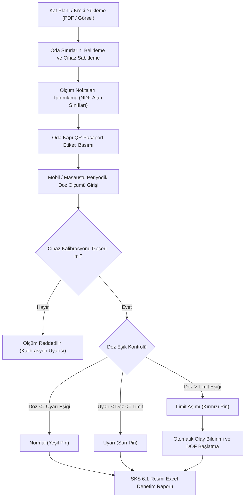

---json
{
  "pageTitle": "14. Ortam Dozu Ölçümleri, Alan Sınıflandırması ve Kroki Haritası — RADPYS v4 Kullanım Kılavuzu",
  "h1": "14. Ortam Dozu ve Kroki Haritası",
  "lead": "Kurumun mimari kat planları (vektörel PDF veya yüksek çözünürlüklü görsel) üzerinde radyasyon izleme noktalarını ve sabit cihaz konumlarını canlı pinler halinde haritalandıran, periyodik saçılma dozu ölçümlerini kaydeden, yasal eşik kontrollerini otomatik denetleyen, limit aşımında anında DÖF başlatan ve kapı QR pasaport etiketleri üreten modüldür.",
  "overviewId": "genel-bakis",
  "badges": [
    {
      "text": "MODÜL 14",
      "tone": "cyan"
    },
    {
      "text": "SKS 6.1 Standartları",
      "tone": "emerald"
    },
    {
      "text": "NDK RSGD-KLV-005",
      "tone": "indigo"
    }
  ]
}
---

## Vizyonder Hızlı Karar Reçetesi (Ortam Dozu & RKS Özeti) {#hizli-recete}

:::recipe Vizyonder Hızlı Karar Reçetesi (Ortam Dozu & RKS Özeti) | 20 SANİYELİK AKIŞ
### 1. Kat Planını ve Pinleri Konumlandırın | cyan
Vektörel PDF veya yüksek çözünürlüklü krokiyi yükleyin. Denetimli ve gözetimli alan sınıflarına göre izleme noktalarını haritaya iğneleyin.

### 2. Kalibre Dedektörle Ölçüm Girin | emerald
Yalnızca kalibrasyonu geçerli survey meter ile ölçüm yapın (RED-02). Sistem girilen değeri alan eşiğiyle kıyaslayıp anında yeşil/sarı/kırmızı renklendirir.

### 3. Kapı QR ve Otomatik DÖF | blue
Radyasyon kapısına yapıştırılan QR kod ile mobilden ölçüm yapın. Limit aşımı tespit edildiğinde sistem ilgili birime anında otomatik DÖF başlatır.
:::

## Arayüz Bileşenleri ve 5N1K Tablosu {#bilesenler}

 

 Ortam Dozu ve Kroki Haritası modülündeki ekran kontrolleri, butonlar ve harita eylemlerinin işlevsel kullanım matrisi:
 

 

| NE? (Bileşen) | NEDEN? (Amaç) | NEREDE? (Konum) | NASIL? (Çalışma Mantığı) | NE ZAMAN? | KİM? | DURUM |
| --- | --- | --- | --- | --- | --- | --- |
| [Birim / Departman] | İncelenecek radyasyon alanını belirlemek. | Filtre Çubuğu Sol | Seçilen birimin kat krokisini, noktalarını ve cihazlarını yükler. | Ekran açıldığında / değişimde. | RKS / Birim Sorumlusu | Aktif |
| [Ölçüm Kaydet] | Periyodik doz ölçümünü sisteme girmek. | Ana Araç Çubuğu | Nokta, tarih, doz hızı, cihaz ve personeli kaydeder; kalibrasyon denetler. | Periyodik ölçümde. | RKS / Fizikçi / Tekniker | Aktif |
| [Yeni Nokta Ekle] | Krokide yeni doz izleme noktası açmak. | Ana Araç Çubuğu | Ardışık kod üretir (<code class="font-mono">{DEP}-OD-01</code>), alan sınıfı eşiklerini atar. | Yeni oda/mahal eklendiğinde. | RKS / Sistem Yöneticisi | Aktif |
| [Kroki Yükle / Değiştir] | Mimari kat planı dosyasını bağlamak. | Ana Araç Çubuğu | PDF/PNG dosyasını doğrudan veritabanında merkezi olarak saklar, hızlı erişim için yerel önbelleğe alır ve birimle eşleştirir. | Plan atama veya revizyonda. | RKS / Sistem Yöneticisi | Aktif |
| [Sola Döndür / Sağa Döndür] | Kat planı yönelimini 90° adımlarla sahaya göre hizalamak. | Kroki Tuvali Altı | Planı saat yönünde veya tersinde 90° döndürür; üzerindeki ölçüm pinleri, cihazlar ve oda sınırlarını otomatik trigonometrik olarak yeni açıya taşır. | Kroki yönü ters olduğunda. | RKS / Sistem Yöneticisi | Aktif |
| [Çoklu Oda Sınırları] | Kat planındaki tüm odaların sınırlarını belirlemek ve Web Portalda göstermek. | Kroki Tuvali Altı & Web Portal Haritası | Her oda için bağımsız sınır, etiket ve kod tanımlar; masaüstü ve Web Portal haritasında kesikli renkli sınırlarla eşzamanlı görüntüler. | Oda sınırları tanımlanırken veya izlenirken. | RKS / Sistem Yöneticisi | Aktif |
| [Karekod / Etiket Bas] & Toplu QR Paketi (.ZIP) | Kapı veya nokta QR etiketi üretmek ve tüm ölçüm noktalarını matbaa baskısı için toplu paketlemek. | Ana Araç Çubuğu & Tablo Sağ Tık Menüsü | Oda kapı pasaportu ve tekil nokta etiketi basabilir; araç çubuğundaki [Toplu QR Etiket Paketi] veya sağ tık menüsünden tüm noktalar için 300 DPI ultra net PNG etiketleri, teknik baskı şartnamesi (00_Baski_ve_Uretim_Rehberi.txt) ve icmal CSV listesi içeren endüstriyel .ZIP paketi ihraç eder. | Fiziksel levha asılırken veya toplu tabela/etiket üretiminde. | RKS / İSG Uzmanı / Medikal Fizikçi | Aktif |
| [SKS Raporu (Excel)] | SKS 6.1 resmi denetim çıktısı almak. | Ana Araç Çubuğu | Renk kodlu, kurum antetli resmi denetim Excel dosyasını (<code class="font-mono">.xlsx</code>) üretir. | Kalite denetimlerinde. | Kalite Birimi / RKS | Aktif |
| [Pinler Kilitli / Taşıma] | Pinlerin kazara kaymasını önlemek. | Kroki Tuvali Altı | Kilitliyken sürüklemeyi engeller; açıldığında koordinat taşımaya izin verir. | Pin yerleşimi yapılırken. | Yetkili Kullanıcı | Aktif |
| [Oda Alanını Belirle] | Krokide zırhlı oda sınırını çizmek. | Kroki Tuvali Altı | Çizim modunu açar; fareyle seçilen dikdörtgeni odanın sınırları yapar. | Birim sınırları çizilirken. | RKS / Sistem Yöneticisi | Aktif |
| [Nokta Silme Engeli] | Kalite denetim geçmişini korumak. | Servis Katmanı | Üzerinde kayıtlı ölçüm bulunan noktaların silinmesini kesinlikle engeller. | Silme talebinde. | Sistem Motoru | Emniyet Kilidi |

## İnteraktif Kroki Tuvali ve Canlı Harita {#kroki-tuvali}

 

 Radyasyon alanlarının canlı harita üzerinde yönetimi, çok katmanlı görselleştirme ve pürüzsüz gezinme özellikleri:
 

 

 

 

 <h4 class="font-bold text-slate-900 dark:text-white text-sm flex items-center gap-2">
  Pürüzsüz Yakınlaşma (Zoom)
 </h4>
 

 Fare tekerleğini ileri çevirerek imlecin bulunduğu odaya yüksek çözünürlükte yakınlaşabilir, geri çevirerek tüm kat planına dönebilirsiniz.
 

 

 

 <h4 class="font-bold text-slate-900 dark:text-white text-sm flex items-center gap-2">
  Serbest Gezinme (Pan)
 </h4>
 

 Sol fare tuşunu basılı tutup sürükleyerek (ScrollHandDrag) harita tuvalinde kaydırma çubuklarına gerek kalmadan akıcı şekilde dolaşabilirsiniz.
 

 

 

 <h4 class="font-bold text-slate-900 dark:text-white text-sm flex items-center gap-2">
  Sabit Cihaz Pinleri
 </h4>
 

 BT, Skopi, X-Ray veya LINAC cihazları kendilerine ait SVG modalite simgeleriyle harita üzerinde sabitlenir; oda numarası ve künyesi gösterilir.
 

 

 

## NDK Alan Sınıfları ve Yasal Doz Eşikleri {#alan-siniflari}

 

 NDK RSGD-KLV-005 kılavuzuna göre üç temel alan sınıfı ve otomatik alarm eşikleri:
 

 

 

 

 

 [D] DENETİMLİ ALAN
 >6 mSv/yıl
 

 

 X-ışını tüpünün bulunduğu çekim odaları, zırhlı tedavi odaları ve sıcak laboratuvarlar.
 

 

 
Uyarı Eşiği:<strong class="text-amber-500">2.50 µSv/h</strong>

 
Limit Eşiği:<strong class="text-rose-600">10.00 µSv/h</strong>

 

 

 

 

 [G] GÖZETİMLİ ALAN
 1-6 mSv/yıl
 

 

 Denetimli alana bitişik teknisyen kumanda odası, kurşun cam arkası ve hazırlık mahalli.
 

 

 
Uyarı Eşiği:<strong class="text-amber-500">1.00 µSv/h</strong>

 
Limit Eşiği:<strong class="text-rose-600">2.50 µSv/h</strong>

 

 

 

 

 [H] HALKA AÇIK ALAN
 &lt;1 mSv/yıl
 

 

 Hasta bekleme salonları, servis koridorları, hekim odaları ve meskenler.
 

 

 
Uyarı Eşiği:<strong class="text-amber-500">0.25 µSv/h</strong>

 
Limit Eşiği:<strong class="text-rose-600">0.50 µSv/h</strong>

 

 

 

## Doz Ölçümü Kaydetme ve Kalibrasyon Emniyeti (RED-02) {#doz-olcum}

 

 Periyodik ölçüm giriş adımları ve kalibrasyon kontrolü emniyet mekanizması:
 

 

 

 <ol class="space-y-3 text-sm text-slate-600 dark:text-slate-300 list-decimal list-inside leading-relaxed">
 <li>Üst araç çubuğundaki <strong>[Ölçüm Kaydet]</strong> butonuna tıklayın veya harita üzerindeki ilgili ölçüm noktası pinine çift tıklayın.</li>
 <li>Açılan pencerede <strong>Ölçüm Noktası</strong>, <strong>Ölçüm Tarihi</strong>, ölçülen <strong>Doz Hızı (µSv/h)</strong> ve <strong>Doğal Arka Plan</strong> değerlerini girin.</li>
 <li>Kullanılan ölçüm aletinin marka, model ve seri numarasını yazın; ölçümü yapan personeli seçin.</li>
 <li><strong>Kalibrasyon Emniyet Kilidi (RED-02):</strong> Sistem, kullanılan cihazın veritabanında kayıtlı kalibrasyon süresini kontrol eder. Kalibrasyon süresi dolmuşsa sistem ölçüm kaydını emniyet kilidiyle reddeder:
 

 HATA: Kullanılan ölçüm cihazının kalibrasyon geçerlilik süresi dolmuştur. NDK ve SKS kalite standartları gereğince kalibrasyonu geçmiş cihazla resmi ölçüm kaydedilemez.
 

 </li>
 <li>Bilgiler eksiksiz ise <strong>[Ölçümü Kaydet]</strong> butonuna basarak işlemi tamamlayın.</li>
 </ol>
 

## Limit Aşımı Alarmı ve Otomatik DÖF Entegrasyonu {#dof-olay}

 

 Doz limitleri aşıldığında sistemin devreye soktuğu otomatik güvenlik ve kalite mekanizması:
 

 

 

 

 <h3 class="font-bold text-slate-900 dark:text-white text-base flex items-center gap-2">
  Otomatik Olay Bildirimi
 </h3>
 

 Ölçülen doz değeri ilgili noktanın limit eşiğini aştığı anda sistem arka planda <strong>Olay Bildirimi (Modül 15)</strong> modülüne otomatik kayıt oluşturur:
 

 <ul class="text-xs text-slate-500 dark:text-slate-400 space-y-1 list-disc list-inside">
 <li>Olay Tanımı: Nokta kodu, ölçülen doz ve yasal limit bilgisi.</li>
 <li>Olay Sonucu: "Orta Zarar" olarak derecelendirilir.</li>
 <li>Acil Müdahale: "Girişler sınırlandırıldı, zırhlama kontrolü başlatıldı."</li>
 <li>NDK Bildirim Bayrağı: Doz limitin 3 katını aşarsa zorunlu kılınır.</li>
 </ul>
 

 

 <h3 class="font-bold text-slate-900 dark:text-white text-base flex items-center gap-2">
  Otomatik DÖF Ataması
 </h3>
 

 Sistem yalnızca olay kaydı açmakla kalmaz; kalite yönetim süreci uyarınca sorumlu personele doğrudan düzeltici işlem görevi yükler:
 

 <ul class="text-xs text-slate-500 dark:text-slate-400 space-y-1 list-disc list-inside">
 <li>Faaliyet Tipi: "Düzeltici Önleyici Faaliyet (DÖF)"</li>
 <li>Açıklama: "Ortam dozu limit aşımı zırhlama ve sızıntı incelemesi"</li>
 <li>Sorumlu: Ölçümü yapan personel veya RKS sorumlusu</li>
 <li>DÖF Kapatma Kilidi: Sorun giderilip DÖF kapatılana dek olay açık kalır.</li>
 </ul>
 

 

## Karekod (QR) Pasaport Etiketi ve SKS Excel Raporu {#qr-sks}

 

 Fiziksel kapı/nokta levhalandırması ve Sağlık Bakanlığı kalite denetim çıktısı:
 

 

 

 

 <h3 class="font-bold text-slate-900 dark:text-white text-base">Oda Kapı QR Pasaportu</h3>
 

 Üstteki <strong>[Karekod / Etiket Bas]</strong> butonuna tıklayıp <em>Oda Kapı Karekod Etiketi Bas</em> seçeneğini belirleyin. Çıktı alınan etiket radyasyon odasının giriş kapısına yapıştırılır. Termal etiket yazıcıdan anında yazdırılabilir veya PNG olarak dışa aktarılabilir.
 

 

 

 <h3 class="font-bold text-slate-900 dark:text-white text-base">SKS 6.1 Resmi Excel Denetim Raporu</h3>
 

 <strong>[SKS Raporu (Excel)]</strong> butonuna basıldığında sistem; kurum antetini, birim adını, ölçüm noktası kodlarını, alan sınıflarını, ölçüm tarihlerini, ölçülen dozları ve eşikleri içeren, limit aşımını kırmızı, uyarıları sarı renkle vurgulayan resmi Excel raporunu (<code class="font-mono">.xlsx</code>) üretir.
 

 

 

## Hibrit Saha Tablet Akışı ve Web Portalı {#hibrit-portal}

 

 Masaüstü yönetim kokpiti ile mobil saha uygulamasının çift yönlü senkronizasyonu:
 

 

 

 

 

 <h4 class="font-bold text-slate-900 dark:text-white text-sm text-cyan-600 dark:text-cyan-400">1. Masaüstü Yönetim Merkezi (PySide6)</h4>
 

 Kat planı PDF dosyalarının yüklendiği, oda sınırlarının çizildiği, sabit cihazların konumlandırıldığı, yasal eşik limitlerinin belirlendiği, pin kilitlerinin açılıp kapandığı ve resmi denetim Excel raporlarının alındığı ana merkezdir.
 

 

 

 <h4 class="font-bold text-slate-900 dark:text-white text-sm text-indigo-600 dark:text-indigo-400">2. Saha Mobil Portalı (Tablet / Telefon)</h4>
 

 Saha teknisyeni kapıdaki QR kodu tablet kamerasıyla okutur; ekranda odaya ait zırhlı kroki ve ölçüm noktaları listelenir. Teknisyen cihazdan okuduğu dozu doğrudan sahada girer; veri anında masaüstü sistemine ve web analitik paneline yansır.
 

 

 

 

## Karar Akış Şeması {#akis-diyagrami}

 

 Ortam dozu ölçümü, eşik denetimi ve otomatik olay sürecinin mantıksal işleyiş şeması:
 

 

 

 

## Ortam Güvenliği & Mit Avcısı (Kritik Kurallar) {#mit-avcilari}

 

 

 <svg class="w-4 h-4" fill="none" stroke="currentColor" viewBox="0 0 24 24">
 <path stroke-linecap="round" stroke-linejoin="round" stroke-width="2" d="M6 18L18 6M6 6l12 12" />
 </svg>
 Yaygın Yanılgı (Mit 1)
 

 

 "Kalibrasyon geçerlilik süresi 1-2 hafta geçmiş radyasyon ölçüm cihazı ile acil durumlarda resmi ortam dozu kaydı yapılabilir."
 

 

 
 <svg class="w-3.5 h-3.5" fill="none" stroke="currentColor" viewBox="0 0 24 24">
 <path stroke-linecap="round" stroke-linejoin="round" stroke-width="2" d="M5 13l4 4L19 7" />
 </svg>
 Doğru Yasal Kural:
 
 

 NDK mevzuatı ve RED-02 güvenlik kilidi gereğince kalibrasyon süresi dolmuş hiçbir cihazla sisteme resmi ölçüm girilemez; sistem ölçüm kaydını kesin olarak engeller.
 

 

 

 

 

 <svg class="w-4 h-4" fill="none" stroke="currentColor" viewBox="0 0 24 24">
 <path stroke-linecap="round" stroke-linejoin="round" stroke-width="2" d="M12 9v2m0 4h.01m-6.938 4h13.856c1.54 0 2.502-1.667 1.732-3L13.732 4c-.77-1.333-2.694-1.333-3.464 0L3.34 16c-.77 1.333.192 3 1.732 3z" />
 </svg>
 Yaygın Yanılgı (Mit 2)
 

 

 "Kapıdaki QR kod sadece personelin bilgi alması içindir; ölçüm girmek için masaüstü yazılımı zorunludur."
 

 

 
 <svg class="w-3.5 h-3.5" fill="none" stroke="currentColor" viewBox="0 0 24 24">
 <path stroke-linecap="round" stroke-linejoin="round" stroke-width="2" d="M5 13l4 4L19 7" />
 </svg>
 Doğru Yasal Kural:
 
 

 Oda kapısındaki QR kod doğrudan mobil tarayıcıda hızlı doz giriş arayüzünü açar. RKS veya tekniker masaüstüne dönmeden sahada cep telefonuyla ölçümü anında tamamlar.
 

 

 

 

 

 <svg class="w-4 h-4" fill="none" stroke="currentColor" viewBox="0 0 24 24">
 <path stroke-linecap="round" stroke-linejoin="round" stroke-width="2" d="M13 16h-1v-4h-1m1-4h.01M21 12a9 9 0 11-18 0 9 9 0 0118 0z" />
 </svg>
 Yaygın Yanılgı (Mit 3)
 

 

 "Ölçüm geçmişi olan bir radyasyon izleme noktası kroki planı değiştiğinde kolayca silinebilir."
 

 

 
 <svg class="w-3.5 h-3.5" fill="none" stroke="currentColor" viewBox="0 0 24 24">
 <path stroke-linecap="round" stroke-linejoin="round" stroke-width="2" d="M5 13l4 4L19 7" />
 </svg>
 Doğru Yasal Kural:
 
 

 SKS 6.1 ve denetim izi gereğince üzerinde geçmiş ölçüm verisi bulunan hiçbir nokta silinemez; yalnızca 'Pasif'e alınabilir veya taşınabilir.
 

 

 

 

## Sıkça Sorulan Sorular (SSS) {#sss}

:::faq
### Mimari kat planı olarak vektörel PDF dosyası yükleyebilir miyim?
<strong>Evet.</strong> RADPYS v4 mimarisi PNG, JPG ve BMP resimlerinin yanı sıra vektörel mimari <code class="font-mono">.pdf</code> kat planlarını doğrudan destekler. Yüklenen PDF dosyasının ilk sayfası yüksek çözünürlükte render edilerek grafik tuvaline aktarılır.

### Haritadaki pinlerin fareyle gezinirken kazara kayması nasıl önlenir?
Varsayılan olarak harita <strong>[Pinler Kilitli]</strong> modunda açılır. Bu moddayken pinler sabitlenmiştir; fareyle sürüklenseniz dahi koordinatları değişmez. Konumları değiştirmek için butona basarak <strong>[Taşıma Aktif]</strong> moduna geçmeniz gerekir.

### Ölçüm geçmişi olan bir noktayı yanlışlıkla silmek mümkün müdür?
<strong>Hayır.</strong> SKS 6.1 ve NDK kalite denetim izlerinin korunması amacıyla, üzerinde en az bir adet kayıtlı doz ölçümü bulunan noktaların silinmesi sistem tarafından emniyet kilidiyle engellenir.

### Cihaz kalibrasyon süresi dolduğunda ne yapılmalıdır?
Kalibrasyon geçerlilik süresi dolmuş bir survey meter ile ölçüm girilemez (RED-02). Cihaz yetkili kalibrasyon merkezine (örn: TENMAK SSDL) gönderilmeli ve kalibrasyon tamamlandığında cihaz kartındaki tarih güncellenmelidir.

### Ortam dozu ölçüm noktalarının QR etiketlerini tabela veya matbaa üretimi için topluca nasıl alabilirim?
Üst araç çubuğundaki <strong>[Toplu QR Etiket Paketi]</strong> butonuna tıklayın veya ölçüm noktaları tablosunda sağ tıklayarak <em>"Toplu QR Etiket Paketi (.ZIP)"</em> seçeneğini çalıştırın. Sistem odadaki tüm ölçüm noktaları için <strong>300 DPI (800x1050 px)</strong> matbaa kalitesinde PNG etiketler, profesyonel tabela üreticisine iletilebilecek malzeme şartnamesi (<strong>00_Baski_ve_Uretim_Rehberi.txt</strong>) ve koordinat/oda bilgilerini içeren <strong>00_Etiket_Listesi_Icmal.csv</strong> dosyasını tek bir <strong>.ZIP</strong> arşivi olarak üretir.
:::
