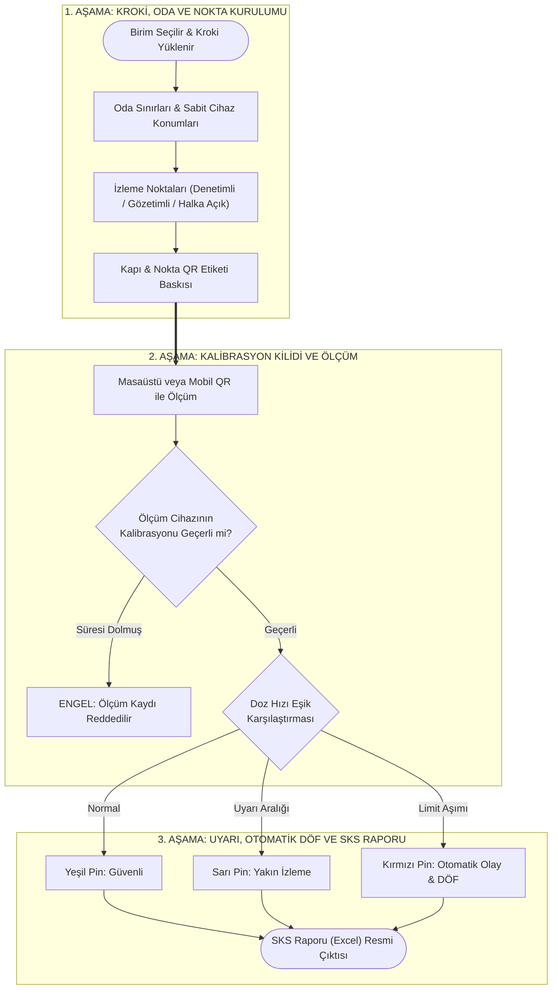

---json
{
  "pageTitle": "14. Ortam Dozu Ölçümleri, Alan Sınıflandırması ve Kroki Haritası — RADPYS v4 Kullanım Kılavuzu",
  "h1": "Ortam Dozu ve Kroki Haritası",
  "lead": "Kurumun mimari kat planları (vektörel PDF veya yüksek çözünürlüklü görsel) üzerinde radyasyon izleme noktalarını, çoklu oda sınırlarını ve sabit cihaz konumlarını canlı haritalandırır; kalibrasyon süresi geçerli ölçüm cihazlarıyla doz hızı kayıtları alır, limit aşımında otomatik olay ve DÖF başlatır, kapı QR pasaportu ve SKS 6.1 Excel raporu üretir.",
  "overviewId": "overview",
  "badges": [
    {
      "text": "NDK RSGD-KLV-005 & SKS 6.1",
      "tone": "cyan"
    }
  ],
  "readingTime": "6 Dakika",
  "legalNote": "<strong>Kalibrasyon ve Denetim Kilidi:</strong> Kalibrasyon geçerlilik süresi dolmuş bir radyasyon ölçüm cihazıyla resmi ölçüm kaydedilemez; üzerinde en az bir kayıtlı ölçüm bulunan izleme noktası ise denetim izi bütünlüğü için silinemez."
}
---

## Kısa Reçete: Kroki Üzerinde Ortam Dozu, QR ve Otomatik DÖF {#quick-recipe}

:::recipe Kısa Reçete: Kroki Üzerinde Ortam Dozu, QR ve Otomatik DÖF | 20 SANİYELİK AKIŞ
### 1. İstenen Sonuç | slate
Radyasyon alanlarının mimari kroki üzerinde sınıflandırılması, kalibrasyonlu cihazla periyodik ölçüm alınması ve limit aşımlarında anında kalite aksiyonu başlatılması.

### 2. Yapılacak İşlem | cyan
<strong>[Kroki Yükle]</strong> ile kat planını ekleyin; <strong>[Oda Alanını Belirle]</strong> ve <strong>[Yeni Nokta Ekle]</strong> ile alan eşiklerini konumlandırın; <strong>[Ölçüm Kaydet]</strong> ile kalibre cihazdan okunan dozu girin; saha baskıları için <strong>[Karekod / Etiket Bas]</strong> ve denetimler için <strong>[SKS Raporu (Excel)]</strong> butonlarını kullanın.

### 3. Sistem Etkisi | emerald
Kat planı döndürmesinde pin ve oda sınırları otomatik taşınır; eşik aşımlarında pin sarıya/kırmızıya döner ve otomatik Olay Bildirimi ile DÖF açılır; kapı QR kodundan mobil cihazla sahadan ölçüm girilebilir.

- [metric] Denetimli Alan | Uyarı 2,50 / Limit 10,00 µSv/h | rose
- [metric] Gözetimli Alan | Uyarı 1,00 / Limit 2,50 µSv/h | amber
- [metric] Halka Açık Alan | Uyarı 0,25 / Limit 0,50 µSv/h | emerald
- [metric] Baskı &amp; Çıktı | 300 DPI QR &amp; SKS Excel | cyan
:::

## 5N1K Kural ve Arayüz Çözümleme Tablosu {#5w1h}

*Mimari kat planı yönetimi, NDK alan eşikleri, kalibrasyon emniyet kilidi, otomatik DÖF ve QR baskı kuralları.*

| NE? (Bileşen / Kontrol) | NEDEN? (Amacı) | NASIL? (Çalışma Mantığı) | NE ZAMAN? (Tetiklenme) | KİM? (Yetkili Rol) |
| --- | --- | --- | --- | --- |
| <strong>[Kroki Yükle], Çoklu Oda Sınırları &amp; 90° Döndürme</strong> [Sola Döndür] / [Sağa Döndür] | Kat planını merkezi saklamak ve saha yönelimine göre pinlerle birlikte hizalamak. | PDF veya görsel plan veritabanında saklanır; 90° döndürme uygulandığında pinler, sabit cihazlar ve oda sınırları yeni açıya otomatik taşınır. | Plan ekleme ve revizyonda. | RKS / Sistem Yöneticisi |
| <strong>[Yeni Nokta Ekle] &amp; NDK Alan Eşikleri</strong> Ölçüm Geçmişi Silme Engeli | Denetimli, gözetimli ve halka açık alanları yasal limitlerle izleyip geçmişi korumak. | Alan sınıfına göre otomatik uyarı/limit eşiği atar; üzerinde kayıtlı ölçüm bulunan noktaların silinmesini emniyet kilidiyle engeller. | Nokta tanımlama ve silmede. | RKS / Sistem Yöneticisi |
| <strong>[Pinler Kilitli] &amp; Sabit Cihaz Konumları</strong> İnteraktif Kroki Tuvali | Haritada gezinirken noktaların kazara sürüklenip yerinden kaymasını önlemek. | Varsayılan olarak koordinatları kilitler; taşıma modu açıldığında izleme pinleri ve sabit cihaz konumları düzenlenebilir. | Kroki üzerinde çalışılırken. | Yetkili Kullanıcı |
| <strong>[Ölçüm Kaydet] &amp; Kalibrasyon Kilidi</strong> Geçerli Survey Meter Kontrolü | Kalibrasyon süresi geçmiş cihazla hatalı veya geçersiz doz ölçümü yapılmasını önlemek. | Seçilen ölçüm aletinin kayıtlı kalibrasyon bitiş tarihini denetler; süresi dolmuş cihazla ölçüm kaydedilmesini kesinlikle reddeder. | Her doz ölçümü kaydında. | RKS / Fizikçi / Tekniker |
| <strong>Limit Aşımında Otomatik Olay &amp; DÖF</strong> 3 Kat Aşımda NDK Bayrağı | Sınır aşımı tespit edildiği anda kalite ve zırhlama inceleme sürecini bekletmeden başlatmak. | Limit aşıldığında Modül 15 üzerinde otomatik olay ve düzeltici faaliyet açar; limitin 3 katı aşılırsa NDK bildirim bayrağını işaretler. | Ölçüm limit dışı çıktığında. | Sistem Motoru / RKS |
| <strong>[Karekod / Etiket Bas] &amp; [SKS Raporu (Excel)]</strong> 300 DPI Toplu QR &amp; Denetim Çıktısı | Kapı QR pasaportu üzerinden mobil doz girişi sağlamak ve SKS 6.1 resmi Excel çıktısı almak. | Tekil veya toplu 300 DPI QR etiket arşivi (baskı şartnamesi ve icmal listesiyle birlikte) ile renk kodlu resmi SKS Excel tablosu üretir. | Etiket baskısı ve denetimde. | RKS / Kalite Birimi |

## Kritik Sahada Yanlış Bilinen Kurallar (Mit Avcısı) {#myth-buster}

:::myth Kalibrasyonu Geçmiş Cihazla Acil Ölçüm Girilebilir mi ve Ölçümlü Nokta Silinebilir mi?
### Yanlış Algı
<em>"Survey meter kalibrasyonu birkaç gün önce dolmuş ama acil bir durumda onunla ortam ölçümü kaydedebiliriz; ayrıca kat planı değişince eski ölçümlü noktayı listeden doğrudan silebiliriz."</em>

### Gerçek Sistem Mantığı
<strong>Her iki işlem de sistem tarafından engellenir.</strong> NDK ve SKS 6.1 kuralları gereğince kalibrasyon süresi dolmuş hiçbir cihazla sisteme resmi ölçüm girilemez; cihazın önce TENMAK İkincil Standart Dozimetri Laboratuvarı gibi yetkili bir merkezde kalibre edilip tarihinin güncellenmesi gerekir. Üzerinde geçmiş ölçüm verisi bulunan noktalar da denetim kanıtını korumak için fiziksel olarak silinemez.
:::

## Süreç Akış Şeması {#workflow}

1. **Kroki ve Nokta Kurulumu:** Birime PDF veya görsel kat planı yüklenir; oda sınırları çizilir, sabit cihazlar ve alan sınıfı eşikli izleme noktaları konumlandırılıp kapı QR etiketleri basılır.
2. **Kalibrasyon Kilidi ve Ölçüm:** Saha veya masaüstünden doz girişi yapılırken cihazın kalibrasyon tarihi denetlenir; tarihi geçmiş cihazlarla kayıt engellenir.
3. **Otomatik Olay, DÖF ve Rapor:** Normal ve uyarı ölçümleri kroki pinlerini boyar; limit aşımında ise otomatik Olay Bildirimi ve DÖF açılarak tüm geçmiş SKS 6.1 Excel raporuna yansıtılır.

## Arayüz Ekran Görünümleri {#screenshots}

## Adım Adım İşlem Rehberi {#step-by-step}

### 1. Kat Planı Yükleme, Oda Sınırı Çizme ve Ölçüm Noktası Ekleme

1. Sol menüden **[Ortam Dozu ve Kroki Haritası]** ekranını açıp birimi seçin ve **[Kroki Yükle]** butonuyla vektörel PDF veya yüksek çözünürlüklü kat planını bağlayın (yön ters ise **[Sola Döndür]** / **[Sağa Döndür]** ile hizalayın, **[Ekrana Sığdır]** ile görünümü ortalayın).
2. **[Oda Alanını Belirle]** butonuna basarak harita üzerinde odaların zırhlı sınırlarını çizin; ardından **[Yeni Nokta Ekle]** ile ölçüm noktasını ve NDK alan sınıfını (Denetimli, Gözetimli veya Halka Açık Alan) tanımlayın.
3. Noktaların yerini düzenlemek için **[Pinler Kilitli]** düğmesini açıp sürükleyin ve yerleşim bittiğinde tekrar kilitleyin.

### 2. Kalibre Cihazla Ortam Dozu Ölçümü Kaydetme

1. Üst çubuktan **[Ölçüm Kaydet]** butonuna tıklayın (veya kroki üzerinde ilgili nokta pinine çift tıklayın).
2. Seçilen nokta için ölçüm tarihini, ölçülen doz hızını, doğal arka plan (fon) değerini, ölçümü yapan personeli ve kalibrasyonu geçerli ölçüm cihazını seçip **[Ölçümü Kaydet ve Haritayı Güncelle]** butonuna basın.
3. Limit aşımı varsa sistem uyarı vererek Olay Bildirimi (Modül 15) altında otomatik kayıt ve DÖF başlatır; ölçümleri gözden geçirmek için **Periyodik Ölçüm Geçmişi** sekmesini kullanın.

### 3. Kapı QR Pasaportu, Toplu Baskı Paketi, SKS Excel ve Saha Mobil Akışı

1. Oda giriş kapısı veya tekil nokta etiketi için **[Karekod / Etiket Bas]** menüsünden etiketi üretin (**[PNG Olarak Kaydet]** veya **[Yazıcıya Gönder]**); tüm noktaları matbaa ve tabela baskısı için toplu indirmek isterseniz toplu QR paketi seçeneğiyle 300 DPI etiketler, baskı rehberi ve icmal listesini içeren arşivi dışa aktarın.
2. Denetimler öncesinde **[SKS Raporu (Excel)]** butonuyla kurum antetli ve renk kodlu resmi denetim tablosunu oluşturun.
3. **Web ve Mobil Saha Kullanımı:** Saha personeli kapıdaki QR kodu telefon veya tabletle okutarak o odanın noktalarına sahadan doğrudan doz girişi yapabilir; yöneticiler ise Web Portal haritasında çoklu oda sınırlarını ve aylık doz trend grafiklerini canlı izleyebilir.

## Sıkça Sorulan Sorular (SSS) {#faq}

:::faq
### Mimari kat planı olarak vektörel PDF dosyası yükleyebilir miyim?
<strong>Evet.</strong> Kat planı olarak PNG ve JPG gibi görsellerin yanı sıra doğrudan vektörel PDF dosyaları da yüklenebilir. PDF dosyasının ilk sayfası yüksek netlikte kroki tuvaline aktarılır ve yakınlaştırmada bozulma olmaz.

### Kat planını döndürdüğümde üzerindeki pinler ve oda sınırları kaybolur mu?
Hayır. <strong>[Sola Döndür]</strong> veya <strong>[Sağa Döndür]</strong> uygulandığında sistem harita üzerindeki tüm ölçüm pinlerinin, sabit cihazların ve oda sınırlarının koordinatlarını yeni açıya göre otomatik hesaplayıp taşır.

### Üzerinde ölçüm geçmişi bulunan bir izleme noktasını neden silemiyorum?
SKS 6.1 ve NDK kalite izlenebilirliği gereğince üzerinde en az bir adet kayıtlı doz ölçümü bulunan noktaların silinmesi sistem tarafından engellenir; plan değiştiğinde geçmiş kayıtların korunması için nokta pasif veya taşınmış olarak yönetilmelidir.

### Cihaz kalibrasyon uyarısı aldığımda ölçüm girişini nasıl açabilirim?
Ölçüm aletinin yetkili kalibrasyon merkezinden (örneğin TENMAK İkincil Standart Dozimetri Laboratuvarı) alınan yeni kalibrasyon belgesini ve güncel bitiş tarihini Cihaz Yönetimi ekranından işledikten sonra ölçüm kaydı anında açılır.
:::
