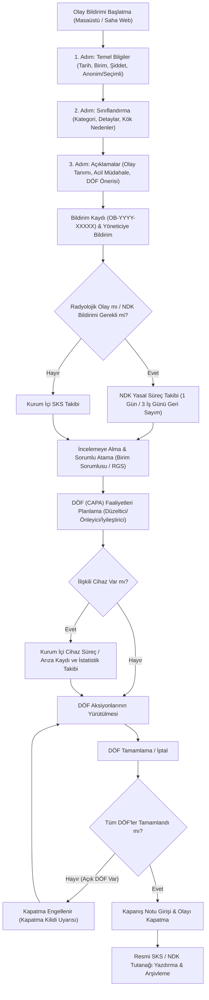

---json
{
  "pageTitle": "15. Radyasyon Olay Bildirimi ve DÖF / CAPA (Kök Neden Analizi) — RADPYS v4 Kullanım Kılavuzu",
  "h1": "15. Olay Bildirimi ve DÖF (CAPA)",
  "lead": "Radyasyon alanlarında meydana gelen kazaları, ramak kala olayları ve uygunsuzlukları SKS 6.1 uyumlu 3 adımlı sihirbazla kayıt altına alan, ana listeden doğrudan veya bağımsız Düzeltici Önleyici Faaliyet (DÖF) başlatan, 72 saatlik NDK yasal bildirim geri sayımını yürüten, 4 adımlı doğal inceleme akışıyla sorumlu atayan, açık aksiyonlar tamamlanmadan olayın kapatılmasını engelleyen ve resmi tek sayfalık SKS/NDK tutanağı üreten kurumsal kalite modülüdür.",
  "overviewId": "genel-bakis",
  "badges": [
    {
      "text": "MODÜL 15",
      "tone": "cyan"
    },
    {
      "text": "Sağlık Bakanlığı SKS 6.1",
      "tone": "emerald"
    },
    {
      "text": "NDK RSGD-KLV-005",
      "tone": "indigo"
    }
  ]
}
---

## Vizyonder Hızlı Karar Reçetesi (Olay & DÖF Özeti) {#hizli-recete}

 

 

 20s
 

 

 

 

 1. Olay Bildirimi veya Hızlı DÖF
 SKS 6.1 sihirbazıyla kaza/ramak kala kaydı açın veya ana listedeki <strong>[Yeni DÖF Ekle]</strong> butonuyla olaya bağlı veya bağımsız genel kalite faaliyeti başlatın.
 

 

 2. 72s NDK & Sorumlu Atama
 Yasal bildirim süresini (24s / 72s) izleyin. 2. Adımda sorumlu uzmanı zengin listeden seçin; sonraki adıma geçildiğinde sistem atamayı otomatik kaydeder.
 

 

 3. DÖF & Açık Emniyet Kilidi
 Gerekli düzeltici faaliyetleri yürütün. Tamamlanmamış açık DÖF varken sistem olayın kapatılmasını güvenle kilitler (CAPA Lock).
 

 

 4. Kapatma & Resmi Tutanak
 Tüm DÖF'ler bitince nihai karar notu girip <strong>[Olayı Kapat ve Tamamla]</strong> ile dosyayı mühürleyin; <strong>[Resmi Tutanağı Yazdır / PDF]</strong> ile tek tıkla resmi belge alın.
 

 

 

## 7 DÖF (CAPA) Faaliyetleri: Olaya Bağlı ve Bağımsız Kalite Yönetimi {#dof-yonetimi}

 

 Düzeltici ve Önleyici Faaliyetler (DÖF), hem inceleme sihirbazının 3. Adımından hem de ana listenin araç çubuğundaki <strong>[Yeni DÖF Ekle]</strong> butonundan başlatılabilir:
 

 

 

 BAĞIMSIZ VEYA OLAYA BAĞLI FAALİYET
 

 DÖF penceresinde yer alan <strong>"İlişkili Olay Bildirimi"</strong> açılır kutusu sayesinde faaliyet açık bir olaya bağlanabilir veya <em>(Bağımsız / Genel Kalite Faaliyeti — Olay Bildirimi Yok)</em> seçeneğiyle kurum genelindeki önleyici iyileştirmeler için serbestçe işletilebilir.
 

 

 

 ZENGİN PERSONEL VE ŞEFFAF TAKİP
 

 Görevlendirilecek personel unvan ve birim bilgisiyle seçilir, faaliyet tipi (<code class="font-mono">Düzeltici</code>, <code class="font-mono">Önleyici</code>, <code class="font-mono">İyileştirici</code>) ve termin tarihi atanır. DÖF takip tablosuna eklenen "İlişkili Olay" sütunuyla tüm aksiyonlar şeffafça izlenir.
 

 

 

 

## 8 Açık DÖF Kapatma Emniyet Kilidi ve Zorunlu Kapanış Notu {#kapatma-kilidi}

 

 SKS 6.1 ve kalite denetim standartları gereğince uygunsuzluklar önlemleri tamamlanmadan kağıt üzerinde kapatılamaz:
 

 

 <h4 class="font-bold text-rose-900 dark:text-rose-200 text-sm flex items-center gap-2">
 <svg class="w-4 h-4 text-rose-600 shrink-0" fill="none" stroke="currentColor" viewBox="0 0 24 24"><path stroke-linecap="round" stroke-linejoin="round" stroke-width="2" d="M12 15v2m-6 4h12a2 2 0 002-2v-6a2 2 0 00-2-2H6a2 2 0 00-2 2v6a2 2 0 002 2zm10-10V7a4 4 0 00-8 0v4h8z"/></svg>
 Açık DÖF Emniyet Kilidi (CAPA Closure Guard)
 </h4>
 

 İnceleme sihirbazının 4. Adımı açıldığında sistem bağlı DÖF faaliyetlerini sorgular. Eğer tamamlanmamış en az 1 DÖF varsa kapatma butonu kilitlenir ve kullanıcı DÖF sekmesine yönlendirilir. Tüm DÖF faaliyetleri başarıyla sonuçlandırıldığında ekran yeşil onay verir; zorunlu nihai kalite ve kapanış notu girilerek <strong>[Olayı Kapat ve Tamamla]</strong> butonuyla olay güvenle resmi "Kapalı" statüsüne alınır. Kapanış tarihi ana listeye anında yansıtılır.
 

 

 

## 9 Cihaz Arıza & Kurum İçi İstatistik Takibi {#cihaz-surec}

 

 Olay bildirimi tıbbi bir cihazın teknik arızasından kaynaklanmışsa (<code class="font-mono">ilgili_cihaz_id</code>):
 

 <ul class="list-disc pl-5 space-y-1 text-xs sm:text-sm">
 <li><strong>Süreç ve İstatistik Amacı:</strong> Sistem olay üzerinden teknik arıza izleme kaydı oluşturur. Bu kayıt, harici bir teknik servise veya bakım firmasına resmi çağrı göndermez; kurum içinde Radyasyon Güvenliği Komitesinin arıza-kaza korelasyonunu ve birim istatistiklerini takip etmesi içindir.</li>
 <li><strong>DÖF Referansı:</strong> Olay DÖF tablosuna otomatik olarak <em class="font-semibold">"Cihaz arıza kaydı açıldı (#Arıza ID)"</em> referansı eklenerek şeffaf takip sağlanır.</li>
 </ul>
 

## 10 Resmi SKS / NDK Olay ve DÖF Tutanağı (Kurumsal Antetli PDF) {#resmi-tutanak}

 

 Herhangi bir olayın resmi kalite dosyasını üretmek veya inceleme tamamlandığında resmi tutanak almak için <strong>[Resmi Tutanağı Yazdır / PDF]</strong> butonuna tıklayın:
 

 <ul class="list-disc pl-5 space-y-1 text-xs sm:text-sm">
 <li><strong>SKS 6.1 ve NDK Uyumlu Kurumsal Antet:</strong> Formun en üstünde kurum logosu, kurum adı, kalite birimi başlığı ve resmi doküman takip kartı (Doküman No, Revizyon Tarihi ve Sayfa No) yer alır.</li>
 <li><strong>Renkli Klinik Rozetler ve NDK Uyarı Şeridi:</strong> Olayın sonucu (Ramak Kala, Hafif/Ciddi Zarar) ve yasal NDK 72 saatlik bildirim durumu resmi denetimlerde ilk bakışta fark edilebilecek şık rozetlerle vurgulanır.</li>
 <li><strong>Tek Sayfaya Tam Oturan Düzen:</strong> Tüm olay künyesi, acil müdahale, DÖF planı ve yetkili imza kutuları (Bildiren, İnceleyen Uzman ve RKS/RSO) sayfa taşması ve imza parçalanması olmadan tek bir A4 sayfasına estetik ve eksiksiz olarak sığdırılmıştır.</li>
 <li><strong>Doğru İşe Tek Format Standardı:</strong> Resmi evrak niteliği taşıdığı için doğrudan antetli, mühürlü ve değiştirilemez <strong>PDF</strong> formatında üretilir.</li>
 </ul>
 

## 11 Hibrit Saha Mobil Formu ve Web Portalı {#hibrit-portal}

 

 RADPYS Olay Bildirimi ve DÖF modülü, masaüstü kurumsal yönetim ile saha mobil web portalının tam entegrasyonuyla çalışır:
 

 

 

 SAHA MOBİL FORMU (IncidentReportForm)
 

 Klinikteki teknisyen, hemşire veya fizikçi cep telefonu veya tabletinden 3 adımlı formu açarak kazayı veya ramak kala durumunu anında bildirir. Kayıt sunucuya iletildiği anda yönetici ekranında bildirim düşer.
 

 

 

 WEB ANALİTİK DASHBOARD (OlayBildirimiDashboard)
 

 Kalite direktörleri ve hastane yönetimi web portalı üzerinden toplam olay, bekleyen DÖF'ler, çözülen vakalar, NDK bekleyenler sayaçlarını ve aylık olay trend çizgi grafiklerini canlı takip eder.
 

 

 

 

## Ekran Konumları ve Görsel Rehber {#ekran-goruntuleri}

![Olay İnceleme ve DÖF Sihirbazı 1. Adım | Olay Bildirimi ve DÖF > [İncele / DÖF Yönet] > 1. Adım | Adım 1: Olay Künyesi & Sınıflandırma](assets/img/15_2_1_olay_inceleme_ve_dof_dialog.png "<strong>Simülasyon Notu:</strong> Olayın şiddeti, kategorisi, kök neden analizi ve NDK bildirim gereksiniminin belirlendiği birinci adım.")
![Olay İnceleme ve DÖF Sihirbazı 2. Adım | Olay Bildirimi ve DÖF > [İncele / DÖF Yönet] > 2. Adım | Adım 2: DÖF (CAPA) Faaliyet Planlama](assets/img/15_2_2_olay_inceleme_ve_dof_dialog.png "<strong>Simülasyon Notu:</strong> Düzeltici, önleyici ve iyileştirici faaliyetlerin (CAPA) sorumlu personel ve termin tarihiyle tanımlanması.")
![Olay İnceleme ve DÖF Sihirbazı 3. Adım | Olay Bildirimi ve DÖF > [İncele / DÖF Yönet] > 3. Adım | Adım 3: CAPA Kapatma Kilidi & Resmi Tutanak](assets/img/15_2_3_olay_inceleme_ve_dof_dialog.png "<strong>Simülasyon Notu:</strong> Açık DÖF emniyet kilidi kontrolü, zorunlu kapanış notu ve SKS/NDK antetli resmi PDF tutanak üretimi.")

## 12 Karar ve İş Akış Şeması (Mermaid) {#akis-diyagrami}

 Olay bildiriminin açılışından NDK yasal süre takibine, DÖF atamasından açık DÖF kapatma kilidine kadar olan operasyonel yaşam döngüsü:
 

 

 

## Olay Bildirimi, DÖF & Mit Avcısı (Kritik Kurallar) {#mit-avcilari}

 

 

 <svg class="w-4 h-4" fill="none" stroke="currentColor" viewBox="0 0 24 24">
 <path stroke-linecap="round" stroke-linejoin="round" stroke-width="2" d="M6 18L18 6M6 6l12 12" />
 </svg>
 Yaygın Yanılgı (Mit 1)
 

 

 "Açık bir DÖF faaliyeti varken de olayın dosyası acilen 'Kapatıldı' statüsüne geçirilebilir."
 

 

 
 <svg class="w-3.5 h-3.5" fill="none" stroke="currentColor" viewBox="0 0 24 24">
 <path stroke-linecap="round" stroke-linejoin="round" stroke-width="2" d="M5 13l4 4L19 7" />
 </svg>
 Doğru Yasal Kural:
 
 

 CAPA Lock emniyet kilidi gereğince üzerinde tamamlanmamış açık DÖF aksiyonu bulunan hiçbir olay kapatılamaz. Faaliyetlerin resmi olarak tamamlanması veya gerekçeli iptali zorunludur.
 

 

 

 

 

 <svg class="w-4 h-4" fill="none" stroke="currentColor" viewBox="0 0 24 24">
 <path stroke-linecap="round" stroke-linejoin="round" stroke-width="2" d="M12 9v2m0 4h.01m-6.938 4h13.856c1.54 0 2.502-1.667 1.732-3L13.732 4c-.77-1.333-2.694-1.333-3.464 0L3.34 16c-.77 1.333.192 3 1.732 3z" />
 </svg>
 Yaygın Yanılgı (Mit 2)
 

 

 "Personelin ismini gizleyerek yaptığı anonim ramak kala bildirimleri SKS denetimlerinde geçersizdir."
 

 

 
 <svg class="w-3.5 h-3.5" fill="none" stroke="currentColor" viewBox="0 0 24 24">
 <path stroke-linecap="round" stroke-linejoin="round" stroke-width="2" d="M5 13l4 4L19 7" />
 </svg>
 Doğru Yasal Kural:
 
 

 Sağlık Bakanlığı SKS 6.1 ve güvenlik kültürü ilkeleri gereğince anonim bildirimler resmi ve yasal olarak geçerlidir; aynı ciddiyetle incelenip düzeltici işlem başlatılır.
 

 

 

 

 

 <svg class="w-4 h-4" fill="none" stroke="currentColor" viewBox="0 0 24 24">
 <path stroke-linecap="round" stroke-linejoin="round" stroke-width="2" d="M13 16h-1v-4h-1m1-4h.01M21 12a9 9 0 11-18 0 9 9 0 0118 0z" />
 </svg>
 Yaygın Yanılgı (Mit 3)
 

 

 "Olay formunda cihaz arızası kaydedildiğinde sistem yetkili teknik servise otomatik iş emri açar."
 

 

 
 <svg class="w-3.5 h-3.5" fill="none" stroke="currentColor" viewBox="0 0 24 24">
 <path stroke-linecap="round" stroke-linejoin="round" stroke-width="2" d="M5 13l4 4L19 7" />
 </svg>
 Doğru Yasal Kural:
 
 

 Bu kayıt kurum içinde olay-arıza korelasyonunu takip etmek içindir; harici servise çağrı göndermez. Cihaz bakım ve servis yönetimi Modül 19 üzerinden yürütülür.
 

 

 

 

## 13 Sıkça Sorulan Sorular (SSS) {#sss}

:::faq
### Anonim yapılan bildirimler resmi SKS denetimlerinde geçerli sayılır mı?
<strong>Evet.</strong> Sağlık Bakanlığı SKS 6.1 ve kurum kalite politikaları uyarınca güvenli bildirim kültürünü teşvik etmek amacıyla personelin kimliğini gizleyerek yaptığı bildirimler resmi olarak geçerlidir ve aynı titizlikle incelenip DÖF açılır.

### Açık DÖF varken bir olayı acilen kapatmam gerekirse ne yapmalıyım?
Sistem açık DÖF varken olayın kapatılmasını emniyet kilidiyle kesinlikle engeller. Eğer bir faaliyet artık uygulanamaz durumdaysa veya mükerrer açılmışsa, faaliyet durumu gerekçesi belirtilerek <code class="font-mono">İptal</code> veya <code class="font-mono">Tamamlandı</code> yapılmalı, ardından kapanış notu girilerek olay kapatılmalıdır.

### Olaydan oluşturulan cihaz arıza kaydı teknik servise otomatik iş emri gönderir mi?
<strong>Hayır.</strong> Bu kayıt program içinde yalnızca süreci takip etmek, olay-arıza korelasyonunu izlemek ve birim hakkında istatistiki bilgi derlemek amaçlıdır; harici teknik servise veya bakım birimine resmi çağrı/iş emri göndermez.

### NDK bildirim süresi ne zaman başlar ve hafta sonları hesaba katılır mı?
Yasal süre olay tarihinden itibaren başlar. Acil kazalarda 1 iş günü (24 saat), diğer radyolojik uygunsuzluklarda 3 iş günüdür. Hesaplamada Cumartesi ve Pazar günleri ile resmi tatiller süreye dahil edilmez (<code class="font-mono">_add_business_days</code>).
:::
