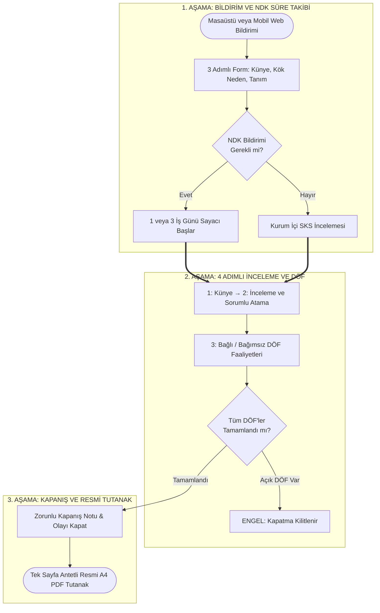

---json
{
  "pageTitle": "15. Radyasyon Olay Bildirimi ve DÖF / CAPA (Kök Neden Analizi) — RADPYS v4 Kullanım Kılavuzu",
  "h1": "Olay Bildirimi ve DÖF (CAPA)",
  "lead": "Radyasyon alanlarında oluşan kazaları, ramak kala olayları ve uygunsuzlukları SKS 6.1 uyumlu 3 adımlı bildirim sihirbazıyla (anonim seçenekli) kayıt altına alır; 1 ve 3 iş günlük NDK yasal süre takibini, olaya bağlı veya bağımsız DÖF yönetimini, açık DÖF kapatma emniyet kilidini ve tek sayfalık antetli resmi PDF tutanak çıktısını yönetmenizi sağlar.",
  "overviewId": "overview",
  "badges": [
    {
      "text": "SKS 6.1 & NDK RSGD-KLV-005",
      "tone": "rose"
    }
  ],
  "readingTime": "6 Dakika",
  "legalNote": "<strong>Yasal Güvence:</strong> Anonim ramak kala ve olay bildirimleri SKS 6.1 güvenlik kültürü gereği resmi olarak geçerlidir; tamamlanmamış açık DÖF faaliyeti bulunan hiçbir olay dosyası kapatılamaz."
}
---

## Kısa Reçete: Olay Bildirimi, DÖF Takibi ve Resmi Tutanak {#quick-recipe}

:::recipe Kısa Reçete: Olay Bildirimi, DÖF Takibi ve Resmi Tutanak | 20 SANİYELİK AKIŞ
### 1. İstenen Sonuç | slate
İstenmeyen radyolojik olayların ve ramak kala durumların yasal NDK süreleri kaçırılmadan incelenmesi, düzeltici önlemlerin tamamlanması ve tek sayfa resmi tutanakla mühürlenmesi.

### 2. Yapılacak İşlem | cyan
<strong>Yeni Olay Bildirimi</strong> sekmesinden olayı kaydedin (veya doğrudan <strong>[Yeni DÖF Ekle]</strong> açın); <strong>[İncele ve DÖF Yönet]</strong> üzerinden 4 adımlı inceleme penceresinde sorumlu atayın, NDK bildirimini işleyin ve tüm DÖF'ler bitince <strong>[Olayı Kapat ve Tamamla]</strong> ile <strong>[Resmi Tutanağı Yazdır / PDF]</strong> adımlarını çalıştırın.

### 3. Sistem Etkisi | emerald
Hafta sonu ve resmi tatiller hariç tutularak 1 veya 3 iş günlük NDK süresi geri sayılır; cihaz kaynaklı olaylarda kurum içi arıza istatistik kaydı açılır; açık DÖF varken dosya kapatma engellenir.

- [metric] NDK Bildirim Süresi | Acil 1 İş Günü / Diğer 3 İş Günü | rose
- [metric] Bildirim Sihirbazı | 3 Adım (Anonim Destekli) | cyan
- [metric] İnceleme Akışı | 4 Adımlı Doğal Süreç | amber
- [metric] Kalite Kilidi | Açık DÖF Varken Kapanmaz | emerald
:::

## 5N1K Kural ve Arayüz Çözümleme Tablosu {#5w1h}

*Anonim bildirim, NDK yasal iş günü sayacı, bağımsız DÖF, açık DÖF kapatma kilidi ve resmi PDF tutanağı kuralları.*

| NE? (Bileşen / Kontrol) | NEDEN? (Amacı) | NASIL? (Çalışma Mantığı) | NE ZAMAN? (Tetiklenme) | KİM? (Yetkili Rol) |
| --- | --- | --- | --- | --- |
| <strong>3 Adımlı Bildirim &amp; [Anonim Bildirim Yap]</strong> Yeni Olay Bildirimi Sihirbazı | Kaza ve ramak kala olaylarını çalışanı çekindirmeden yalnızca ilgili birime ve doğru detay açıklamasıyla kaydetmek. | Tarih, birim, şiddet, kategori, alt detay ve kök nedenleri toplar; ek açıklamayı yalnızca açıklama gerektiren seçeneğe yazar, anonim işaretlenirse kimliği gizler ve kokpit/raporlarda yalnızca yetkili birim kapsamını gösterir. | Olay veya ramak kala anında. | Tüm Personel |
| <strong>NDK Süre Sayacı ve [NDK Bildir]</strong> 1 İş Günü / 3 İş Günü &amp; Bildirim No | Radyolojik kazalarda NDK'ya yasal sürede bildirim yapılmasını ve son tarih ile evrak numarasının korunmasını sağlamak. | Hafta sonu ve resmi tatilleri dışarıda bırakarak acil kazada 1 iş günü, diğer olaylarda 3 iş günü geri sayar; inceleme ekranında kalan günü ve gecikme durumunu canlı gösterir, bildirim yapıldığında son bildirim tarihini bozmadan NDK bildirim numarasını tarihçeye işler. | Radyolojik olay kaydında ve bildirimde. | RKS / Birim Sorumlusu |
| <strong>Yetkili Sorumlu Havuzu ve Otomatik Atama</strong> 2. Adım: İnceleme, Yetki &amp; Onay Koruması | İncelemeyi olayın yaşandığı birimin sorumlusuna veya RKS'ye devretmek ve salt-okunur rolleri kilitlemek. | Birim sorumlusunu öncelikli önerir ve seçimi sonraki adıma geçerken otomatik kaydeder; satır seçildiğinde salt-okunur kullanıcılara kapalı olan aksiyon butonlarını yeniden açmaz ve onay gerektiren rollerin işlemlerini merkezi onay kuyruğuna yönlendirir. | İnceleme süreci başlatıldığında. | Yönetici / RKS |
| <strong>[Yeni DÖF Ekle] (Bağlı / Bağımsız Faaliyet)</strong> Araç Çubuğu &amp; İnceleme 3. Adım | Olaya bağlı önlemlerin yanında kurum geneli önleyici kalite iyileştirmeleri de açabilmek. | Açık bir olaya bağlanabilir veya bağımsız seçilir; Planlandı, Devam Ediyor, Tamamlandı ve İptal aşamalarıyla yönetilir, cihaz arızası içeren olayda kurum içi arıza istatistik kaydı oluşturur. | DÖF planlanırken ve güncellenirken. | RKS / Kalite Sorumlusu |
| <strong>Açık DÖF Kapatma &amp; İptal Emniyet Kilidi</strong> [Olayı Kapat ve Tamamla] &amp; Rapor Kapsamı | Tamamlanmamış veya planlanmış DÖF varken olay dosyasının kapatılmasını önlemek ve bitiş günü kayıtlarını koruyup iptal edilenleri ayırmak. | Tamamlanmamış veya planlanmış tek bir DÖF varsa hem doğrudan güncellemede hem onay akışında kapatmayı kilitler; iptal edilen olaylarda gerekçe, tarih ve kullanıcıyı kaydederek bekleyen kaza sayacından çıkarır, tarih aralığı raporlarında bitiş gününün tamamını (23:59'a kadar) dahil eder. | Dosya kapatma, iptal ve raporlamada. | Sistem Kilidi / Yönetici |
| <strong>[Resmi Tutanağı Yazdır / PDF]</strong> Tek Sayfa A4 SKS/NDK Tutanağı | Denetimlere kurum antetli, gerçek aktif RKS imzalı ve yasal süre bilgili resmi kanıt belgesi sunmak. | Kurum anteti, doküman takip kartı, şiddet ve NDK rozetleri ile aktif RKS görevlendirmesinden alınan gerçek sorumlu adını ve olayın gerçek 24 saat / 72 saat yasal süresini tek A4 PDF olarak üretir. | İnceleme sırasında ve kapanışta. | RKS / Kalite Birimi |

## Kritik Sahada Yanlış Bilinen Kurallar (Mit Avcısı) {#myth-buster}

:::myth Açık DÖF Varken Olay Kapatılabilir mi ve Olaydaki Cihaz Arızası Harici Servise Çağrı Açar mı?
### Yanlış Algı
<em>"Olayı acilen kapatmak için açık duran DÖF faaliyeti olsa bile dosyayı Kapalı yapabiliriz; ayrıca olayda cihaz arızası seçtiğimizde yetkili teknik servise otomatik iş emri gider."</em>

### Gerçek Sistem Mantığı
<strong>İkisi de doğru değildir.</strong> Açık ve tamamlanmamış bir DÖF faaliyeti varken sistem olay kapatma işlemini kesinlikle kilitler; her faaliyet tamamlanmalı veya gerekçeli iptal edilmelidir. Cihaz kaynaklı olaylarda açılan kayıt ise yalnızca kurum içi Radyasyon Güvenliği Komitesi arıza-kaza istatistiğini izlemek içindir; harici bakım firmasına resmi servis çağrısı göndermez (harici servis Modül 19'dan yönetilir).
:::

## Süreç Akış Şeması {#workflow}

1. **Bildirim ve NDK Süresi:** Masaüstü veya sahadan anonim seçenekli 3 adımlı olay bildirimi açılır; radyolojik olaylarda hafta sonu hariç 1 veya 3 iş günlük NDK geri sayımı işler.
2. **4 Adımlı İnceleme ve DÖF:** Birim sorumlusu veya RKS atanıp düzeltici/önleyici faaliyetler yürütülür; açık DÖF kaldığı sürece dosya kapanışı sistem tarafından engellenir.
3. **Kapanış ve Resmi Tutanak:** Tüm DÖF faaliyetleri bittiğinde zorunlu kapanış notuyla dosya kapatılır ve tek sayfalık antetli resmi SKS/NDK PDF tutanağı alınır.

## Arayüz Ekran Görünümleri {#screenshots}

## Adım Adım İşlem Rehberi {#step-by-step}

### 1. Yeni Olay Bildirimi Oluşturma ve Anonim Seçenek

1. **[Olay Bildirimi ve DÖF (CAPA) Yönetimi]** ekranında **Yeni Olay Bildirimi** sekmesine geçin.
2. **1. Adım: Olay Temel Bilgileri** bölümünde tarih, birim (gerekirse **[Diğer (Serbest Yaz)]**), olay sonucu ve bildireni seçin (kimliğinizi gizlemek için **[Anonim Bildirim Yap]** veya e-posta dönüşü için **[Geri Bildirim İstiyorum]** işaretleyebilirsiniz).
3. **[İleri]** butonlarıyla **2. Adım: Olay Sınıflandırması** (kategori, alt detaylar, olası kök nedenler) ve **3. Adım: Açıklamalar ve Öneriler** alanlarını doldurup **[Gönder / Olayı Bildir]** butonuna basın.

### 2. 4 Adımlı İnceleme Sihirbazı, Sorumlu Atama ve DÖF Yönetimi

1. Ana listeden bir satır seçip **[İncele ve DÖF Yönet]** butonuna tıklayın; 1. adımda olay künyesini inceleyip 2. adıma geçin, **[İncelemeye Al]** veya **[NDK Bildir]** işlemlerini yapın ve listeden yetkili sorumluyu seçin (**[Sonraki Adım]**'a geçerken atama otomatik kaydedilir).
2. 3. adımda **[Faaliyet Başlat]** ile Düzeltici, Önleyici veya İyileştirici DÖF tanımlayın; tamamlanan aksiyonlarda **[Seçili DÖF'ü Tamamlandı Yap]** butonunu kullanın (olaydan bağımsız genel kalite iyileştirmeleri için ana araç çubuğundaki **[Yeni DÖF Ekle]** butonu kullanılabilir).
3. 4. adımda tüm DÖF'lerin kapandığı doğrulandıktan sonra kapanış notunu yazıp **[Olayı Kapat ve Tamamla]** butonuna basın; **[Resmi Tutanağı Yazdır / PDF]** ile antetli resmi tutanağı, ana çubuktaki **[Excel]** ve **[Trend Raporu]** ile toplu analizleri alın.

### 3. Saha Web Portalından Olay Bildirimi ve Yönetici Analizi

1. Klinik personeli cep telefonu veya tabletten Web Portalındaki 3 adımlı bildirim formunu doldurarak anında kaza veya ramak kala kaydı açabilir; kayıt açıldığı anda masaüstü yönetici ekranında görünür.
2. Kalite ve hastane yönetimi Web Portalındaki **Olay Bildirimi** yönetim panelinden bekleyen DÖF sayılarını, NDK bildirim sürelerini ve aylık olay trendini canlı olarak takip eder.

## Sıkça Sorulan Sorular (SSS) {#faq}

:::faq
### Anonim yapılan bildirimler resmi SKS denetimlerinde geçerli sayılır mı?
<strong>Evet.</strong> Sağlık Bakanlığı SKS 6.1 ve kurumsal güvenlik kültürü ilkeleri uyarınca personelin kimliğini gizleyerek yaptığı ramak kala ve olay bildirimleri tamamen geçerlidir ve normal bildirimlerle aynı inceleme ve DÖF sürecine alınır.

### Açık DÖF varken bir olayı acilen kapatmam gerekirse ne yapmalıyım?
Açık DÖF faaliyeti varken olayın kapatılması emniyet kilidiyle engellenir. Bir faaliyet artık uygulanamayacak veya mükerrer durumdaysa ilgili DÖF satırı gerekçesiyle iptal edilmeli ya da tamamlandı olarak kapatılmalı, ardından olay dosyası kapatılmalıdır.

### Olaydan açılan cihaz arıza kaydı teknik servise resmi iş emri gönderir mi?
Hayır. Bu bağlantı yalnızca kurum içinde olay-arıza ilişkisini ve istatistiklerini izlemek içindir; harici bakım veya teknik servis firmasına resmi çağrı göndermez. Teknik servis ve arıza takibi Cihaz Arıza, Bakım ve QC modülünden yürütülür.

### NDK yasal bildirim süresi nasıl hesaplanır?
Süre olay tarihinden itibaren başlar; acil kazalarda 1 iş günü, diğer radyolojik olaylarda 3 iş günü olarak hesaplanır. Hafta sonu günleri ve resmi tatiller iş günü hesabına dahil edilmez.
:::
