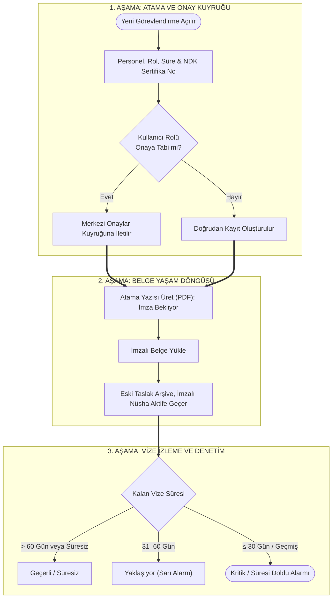

---json
{
  "pageTitle": "16. RGS / RSO Görevlendirme, Yetkilendirme ve Sertifika Takibi — RADPYS v4 Kullanım Kılavuzu",
  "h1": "RGS / RSO Görevlendirme ve Sertifika Takibi",
  "lead": "Nükleer Düzenleme Kurumu (NDK) 06.03.2025 tarihli Radyasyondan Korunma Sorumluları Usul ve Esasları uyarınca güncel resmi unvanı Radyasyondan Korunma Sorumlusu (RKS) olan — uygulama menülerinde RGS, RGS Yardımcısı ve RSO olarak kullanılan — sorumluların atamalarını, 5 kademeli sertifika vize takibini, atama yazısı PDF üretimini, imzalı belge sürüm tarihçesini ve şifreli KVKK evrak kasasını yönetmenizi sağlar.",
  "overviewId": "overview",
  "badges": [
    {
      "text": "NDK RKS / RGS Vize Takibi",
      "tone": "indigo"
    }
  ],
  "readingTime": "5 Dakika",
  "legalNote": "<strong>Arşiv Güvencesi:</strong> Yasal denetim izini korumak adına düzenleme penceresinde personel seçimi kilitlidir; ayrıca bir görevlendirme kaydı silinse dahi personelin şifreli evrak kasasındaki atama yazısı ve sertifika dosyası geçmiş denetim kanıtı olarak korunur."
}
---

## Kısa Reçete: RGS / RSO Ataması, Atama Yazısı ve Vize Takibi {#quick-recipe}

:::recipe Kısa Reçete: RGS / RSO Ataması, Atama Yazısı ve Vize Takibi | 20 SANİYELİK AKIŞ
### 1. İstenen Sonuç | slate
Kurumdaki RGS, RGS Yardımcısı ve RSO sorumlularının yasal atamalarının, 5 yıllık NDK sertifika vizelerinin ve imzalı atama yazılarının eksiksiz takip edilmesi.

### 2. Yapılacak İşlem | cyan
<strong>[Yeni Görevlendirme]</strong> ile personel, görev tipi, tarihler ve sertifika numarasını girip <strong>[Kaydet]</strong>'e basın; <strong>[Atama Yazısı Üret (PDF)]</strong> ile resmi yazı taslağını oluşturup imzalandıktan sonra <strong>[İmzalı Belge Yükle]</strong> ile arşivleyin.

### 3. Sistem Etkisi | emerald
Vize bitimine 60 ve 30 gün kala sarı/turuncu erken uyarı üretilir; imzalı belge yüklendiğinde eski taslak silinmeden sürüm geçmişine taşınır; onaya tabi rollerin işlemleri Merkezi Onaylar kuyruğuna iletilir.

- [metric] Görev Rolleri | RGS, RGS Yrd., RSO | cyan
- [metric] Erken Uyarı | 60 Gün &amp; 30 Gün Alarmı | amber
- [metric] Belge Yaşam Döngüsü | Taslak → Arşiv → İmzalı | emerald
- [metric] Evrak Güvenliği | AES-256 Şifreli Kasa | slate
:::

## 5N1K Kural ve Arayüz Çözümleme Tablosu {#5w1h}

*Çoklu görevlendirme, 5 kademeli sertifika geçerlilik motoru, imzalı belge yaşam döngüsü ve veri bütünlüğü kilidi.*

| NE? (Bileşen / Kontrol) | NEDEN? (Amacı) | NASIL? (Çalışma Mantığı) | NE ZAMAN? (Tetiklenme) | KİM? (Yetkili Rol) |
| --- | --- | --- | --- | --- |
| <strong>Çoklu Rol Ataması ve Süre Seçenekleri</strong> [Süresiz Görev] &amp; [Süresiz Sertifika] | Bir personelin farklı birim veya sorumluluklarda birden fazla görev alabilmesini ve daimi atamaları yönetmek. | RGS, RGS Yardımcısı ve RSO rollerinde çoklu kayıt açabilir; süresiz kutuları işaretlendiğinde bitiş tarihi alanı kilitlenir. | Yeni atama tanımlanırken. | RKS / İK / Admin |
| <strong>5 Kademeli NDK Sertifika Geçerlilik Motoru</strong> 60 / 30 Gün Erken Uyarı | 5 yıllık NDK sertifika vizesi dolmadan eğitim ve yenileme hazırlıklarını zamanında başlatmak. | Kalan süreye göre Geçerli (&gt;60 gün), Yaklaşıyor (31–60 gün), Kritik (≤30 gün), Süresi Doldu veya Süresiz durum rozetleri ve KPI sayaçları üretir. | Liste ve KPI güncellenirken. | RKS / Yönetici |
| <strong>[Atama Yazısı Üret (PDF)] &amp; [İmzalı Belge Yükle]</strong> Belge Durumu Rozeti | Kurum antetli resmi görevlendirme taslağı oluşturmak ve ıslak/e-imzalı nüshayı arşivlemek. | Taslak PDF üretip İmza Bekliyor rozeti atar; imzalı belge yüklendiğinde taslağı sessizce arşive alıp belge durumunu İmzalı yapar. | Görevlendirme belgelendirilirken. | RKS / Admin |
| <strong>[Belgeyi Aç], [Belge Geçmişi] &amp; Arşiv Kilidi</strong> Şifreli Kasa &amp; Sürüm İzleme | Atama yazılarını güvenle açmak, eski taslak-imzalı sürümleri görmek ve arşiv kanıtını korumak. | Belgeleri AES-256 şifreli kasadan açar ve dijital bütünlük tarihçesini gösterir; görev kaydı silinse dahi sertifika dosyası arşivde saklanır. | Belge inceleme ve silmede. | RKS / Denetçi / Admin |
| <strong>Düzenlemede Personel Kilidi &amp; Onay Kuyruğu</strong> Veri Bütünlüğü Koruma | Aynı kaydı başka kişiye çevirerek geçmiş denetim izinin karışmasını önlemek. | Düzenleme modunda Personel alanı salt-okunur kilitlenir; onaya tabi kullanıcıların kayıtları Merkezi Onaylar havuzuna yönlendirilir. | Kayıt düzenleme ve kayıtta. | Sistem Kilidi / Yönetici |
| <strong>[Dışa Aktar] Resmi Denetim Listesi</strong> Filtrelenmiş CSV Dışa Aktarımı | NDK ve iç kalite denetimlerine güncel sorumlu ve vize listesini sunmak. | Süzülen kayıtların personel, T.C., birim, rol, tarih, sertifika no, vize ve belge durumlarını Türkçe karakter uyumlu dosyaya döker. | Denetim dosyası hazırlanırken. | RKS / İK / Yönetici |

## Kritik Sahada Yanlış Bilinen Kurallar (Mit Avcısı) {#myth-buster}

:::myth Görevlendirme Silindiğinde Evrak Kasasındaki Sertifika da Silinir mi?
### Yanlış Algı
<em>"Eski bir RGS görevlendirmesini listeden sildiğimde yüklediğim sertifika ve atama yazısı da sistemden tamamen yok olur; ayrıca düzenleme ekranından aynı kaydı doğrudan başka bir hekime devredebilirim."</em>

### Gerçek Sistem Mantığı
<strong>İkisi de koruma kilitlidir.</strong> Yasal arşiv bütünlüğü gereğince görevlendirme kaydı listeden silinse dahi personelin şifreli evrak kasasındaki atama ve sertifika dosyaları geçmiş denetim kanıtı olarak saklanmaya devam eder. Ayrıca görev devri yapılacaksa mevcut kayıt üzerinden personel değiştirilemez (düzenlemede personel alanı kilitlidir); eski kayıt pasife alınıp yeni personel için yeni kayıt açılmalıdır.
:::

## Süreç Akış Şeması {#workflow}

1. **Atama ve Onay:** Personel, rol (RGS, RGS Yardımcısı, RSO), tarihler ve sertifika bilgileri girilir; onaya tabi kullanıcılarda işlem yönetici onayına düşer.
2. **Belge Yaşam Döngüsü:** Antetli atama yazısı taslağı üretildikten sonra imzalı nüsha yüklenerek sürüm tarihçesi (**Taslak → Arşiv → İmzalı**) oluşturulur.
3. **Vize İzleme ve Denetim:** 60 ve 30 gün eşikleriyle yaklaşan vizeler uyarılır; Web Portalındaki denetim kokpiti ile eşzamanlı izlenir.

## Arayüz Ekran Görünümleri {#screenshots}

## Adım Adım İşlem Rehberi {#step-by-step}

### 1. Yeni RGS / RSO Görevlendirmesi ve NDK Sertifikası Tanımlama

1. Sol menüden **[RGS / RSO Görevlendirme ve Sertifika Takibi]** ekranını açıp araç çubuğundaki **[Yeni Görevlendirme]** butonuna tıklayın.
2. Açılan formda **Personel**, **Görev Tipi** (RGS, RGS Yardımcısı veya RSO), **Görev Başlangıç** tarihi ile süreliyse bitiş tarihini (daimi atamada **[Süresiz Görev]**) belirleyin.
3. **Sertifika / Belge No** alanını ve NDK 5 yıllık vize bitiş tarihini (yalnızca vize muafiyeti olan kurumsal olurlarda **[Süresiz Sertifika]**) girin; **[Dosya Seç (PDF / Resim)]** ile varsa sertifikayı yükleyin, **[Görevlendirme Aktif Olarak Yürütülüyor]** kutusunu doğrulayıp **[Kaydet]** butonuna basın.

### 2. Resmi Atama Yazısı Üretme, İmzalı Belge Yükleme ve Sürüm Geçmişi

1. Tablodan görevlendirmeyi seçip **[Atama Yazısı Üret (PDF)]** butonuna tıklayarak kurum antetli taslak görevlendirme yazısını oluşturun (belge durumu **İmza Bekliyor** rozetini alır).
2. Başhekimlik ve ilgili sorumlu imzaları tamamlandığında satırı seçip **[İmzalı Belge Yükle]** butonundan taranmış veya e-imzalı PDF/görsel nüshayı yükleyin; sistem eski taslağı silmeden arşive kaldırır ve belge durumunu **İmzalı** olarak günceller.
3. Aktif belgeyi açmak için **[Belgeyi Aç]**, taslaktan imzalıya tüm sürümleri ve doğrulama özetini görmek için **[Belge Geçmişi]** butonunu kullanın; listeyi dışa aktarmak için **[Dışa Aktar]** butonuna basın.

### 3. Düzenleme, Pasife Alma ve Web Portalı Denetim Takibi

1. Süre veya sertifika no güncellemek için satırı seçip **[Düzenle]** butonunu kullanın (personel alanı veri bütünlüğü için kilitlidir; görevi başkasına devretmek için eski kaydın aktiflik onayını kaldırıp yeni kişi adına yeni kayıt açın).
2. **Web Portalı Takibi:** Çalışanlar kendi profil sayfalarından aktif RGS/RSO atamalarını ve sertifika geçerlilik tarihlerini görüntüler; yöneticiler ise **Denetim Hazırlık** panosundan kurumun RKS görevlendirme oluru ve sertifika uygunluk durumunu tek bakışta izler.

## Sıkça Sorulan Sorular (SSS) {#faq}

:::faq
### Bir personel aynı anda birden fazla aktif RGS/RSO görevlendirmesine sahip olabilir mi?
<strong>Evet.</strong> Kurum yapılanmasına göre aynı personel farklı birimlerde veya farklı rollerde (örneğin bir birimde RGS, diğer birimde RGS Yardımcısı) birden fazla aktif görevlendirme kaydına sahip olabilir.

### "Süresiz Sertifika" seçeneği ne zaman kullanılmalıdır?
NDK sertifikaları kural olarak 5 yıllık vizeye tabidir ve bitiş tarihi girilmelidir. <strong>[Süresiz Sertifika]</strong> yalnızca vize süresi aranmayan başhekimlik olurları veya istisnai muafiyetli yetkilendirmeler için kullanılmalıdır.

### Bir görevlendirme kaydını sildiğimde evrak kasasındaki sertifika belgesi de silinir mi?
Hayır. Yasal denetim izi ve arşiv güvenliği gereğince görevlendirme kaydı silinse dahi personelin şifreli evrak kasasına yüklenmiş sertifika ve atama belgeleri veritabanında saklanmaya devam eder.

### Düzenleme penceresinde neden personel adını değiştiremiyorum?
Veri bütünlüğünü ve eski denetim izini korumak için düzenleme modunda personel alanı kilitlidir. Görev başka bir çalışana devredilecekse mevcut görevlendirme pasife alınıp yeni personel için sıfırdan kayıt açılmalıdır.
:::
