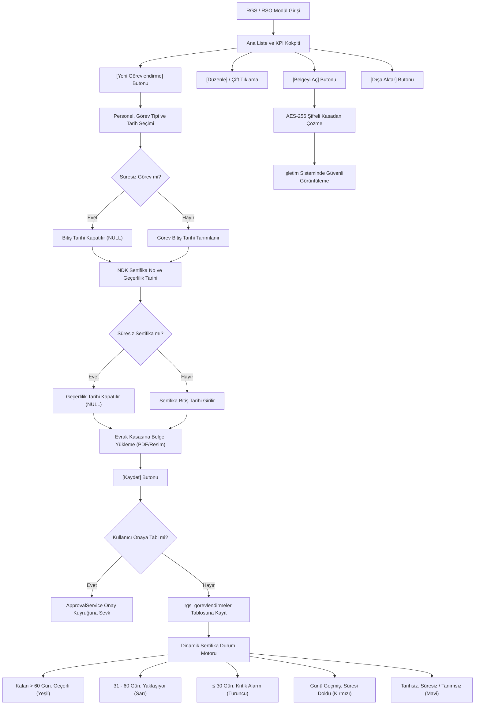

---json
{
  "pageTitle": "16. RGS / RSO Görevlendirme, Yetkilendirme ve Sertifika Takibi — RADPYS v4 Kullanım Kılavuzu",
  "h1": "RGS / RSO Görevlendirme ve Sertifika Takibi",
  "lead": "Nükleer Düzenleme Kurumu (NDK) mevzuatı gereğince sağlık kuruluşlarında iyonlaştırıcı radyasyon kaynaklarıyla çalışan birimlerde bulunması zorunlu olan <strong>Radyasyon Güvenliği Sorumlusu (RGS)</strong>, <strong>RGS Yardımcısı</strong> ve <strong>Radyasyondan Korunma Sorumlusu (RSO)</strong> personellerinin resmi atamalarını, görev sürelerini, NDK sertifika numaralarını, vize/geçerlilik tarihlerini ve KVKK uyumlu şifreli atama evraklarını dijital ortamda yöneten, denetleyen ve erken uyarı alarmları üreten modüldür.",
  "overviewId": "genel-bakis",
  "heroStyle": "gradient",
  "badges": []
}
---

## Vizyonder Hızlı Karar Reçetesi (RGS/RSO Atama Özeti) {#hizli-recete}

:::recipe Vizyonder Hızlı Karar Reçetesi (RGS/RSO Atama Özeti) | 20 SANİYELİK AKIŞ
### 1. Personeli ve Görev Türünü Seçin | cyan
RGS, RGS Yardımcısı veya RSO rolünü seçin. Süreli görevlendirmelerde bitiş tarihi, kurum kadrosu için ise Süresiz Görev seçeneğini işaretleyin.

### 2. NDK Sertifika No ve Vize Takibi | emerald
NDK resmi sertifika numarasını ve 5 yıllık geçerlilik tarihini girin. 60 ve 30 gün kala sistem otomatik sarı/kırmızı erken uyarılar üretir.

### 3. Evrak Kasasına Şifreli Yükleme | blue
Resmi başhekimlik atama yazısını veya NDK sertifika PDF'ini yükleyin. Dosya AES-256 ile şifrelenir; görev silinse dahi arşiv kanıtı korunur.
:::

## 02 Mimari ve İş Akış Şeması {#mimari}

 

 Görevlendirme tanımlama, süre denetimi, NDK sertifika motoru ve evrak kasası işleyiş adımları:
 

 

 

 

## 03 Arayüz Bileşenleri ve 5N1K Kural Çözümlemesi {#bilesenler}

 

 Arayüzdeki her bir butonun, göstergenin ve kutunun mevzuat gerekçesi ve arka plan çalışma kuralı:
 

 

| NE? (Bileşen & Ayar) | NEDEN? (Amaç) | NEREDE? | NASIL ÇALIŞIR? | NE ZAMAN? | KİM? | DURUM |
| --- | --- | --- | --- | --- | --- | --- |
| [Aktif Görevli KPI] | Kuruluşta fiilen görev yapan toplam RGS/RSO sayısını izlemek. | Üst KPI Şeridi | aktif = 1 olan kayıtları toplar | Sürekli canlı | Tüm Kullanıcılar | Eksiksiz |
| [Geçerli Sertifika KPI] | Vize süresi 60 günden fazla veya süresiz olan sertifikaları izlemek. | Üst KPI Şeridi | gecerli + suresiz kayıtları toplar | Sürekli canlı | RGS / İK | Eksiksiz |
| [Süresi Yaklaşan KPI] | Yenileme/vize zamanı gelen sertifikaları önceden fark etmek. | Üst KPI Şeridi | kalan gün ≤ 60 olanları sayar | Vize periyodunda | RGS / Yönetici | Eksiksiz |
| [Süresi Dolmuş KPI] | Mevzuata aykırı olarak sertifikası dolmuş personeli tespit etmek. | Üst KPI Şeridi | geçerlilik tarihi bugünden eski olanlar | Kritik alarmda | RGS / Yönetici | Eksiksiz |
| [Arama Çubuğu] | Personel, TC veya sertifika numarasına göre anlık süzme yapmak. | Filtre Paneli | _apply_client_filter dinamik süzgeci | Liste incelenirken | Tüm Kullanıcılar | Eksiksiz |
| [Görev Tipi Filtresi] | RGS, RGS Yardımcısı veya RSO'ları ayrı ayrı listelemek. | Filtre Paneli | RGS, RGS_YARDIMCISI, RSO sorgusu | Rol incelemesinde | RGS / İK | Eksiksiz |
| [Yeni Görevlendirme] | Yeni bir personel için atama ve sertifika kaydı açmak. | Araç Çubuğu | RgsGorevlendirmeDialogController modalini açar | Atama yapıldığında | RGS / Admin | Eksiksiz |
| [Düzenle] | Süre, sertifika veya evrak bilgilerini güncellemek. | Araç Çubuğu | Personel kilitlenir, mevcut veriler yüklenir | Değişiklik yapıldığında | RGS / Admin | Eksiksiz |
| [Sil] | Hatalı girilen görevlendirme kaydını kaldırmak. | Araç Çubuğu | Onay alır; evrak kasasındaki belge korunur | İptallerde | RGS / Admin | Eksiksiz |
| [Atama Yazısı Üret (PDF)] | Kurum antetli resmi RGS/RSO görevlendirme ve atama yazısı taslağı oluşturmak. | Araç Çubuğu | Antetli resmi PDF taslağı üretir, evrak kasasına bağlar ve İmza Bekliyor rozeti atar | Görevlendirme tanımlandığında | RGS / Admin | Eksiksiz |
| [İmzalı Belge Yükle] | Islak veya e-imzalı resmi atama belgesini sisteme yüklemek. | Araç Çubuğu | İmzalı nüshayı v2 olarak kaydeder; eski taslağı silmeyip sessizce arşive aktarır | İmzalar tamamlandığında | RGS / Admin | Eksiksiz |
| [Belgeyi Aç] | Atama yazısını veya NDK sertifikasını ekranda incelemek. | Araç Çubuğu | Şifreli kasadan hafızada çözerek işletim sistemi görüntüleyicisinde açar | Evrak kontrolünde | Tüm Yetkililer | Eksiksiz |
| [Belge Geçmişi] | Evrakın taslaktan imzalıya kadar tüm kronolojik sürümlerini ve SHA-256 dijital mührünü görmek. | Araç Çubuğu | Belge tarihçesi penceresini açar; arşivdeki eski taslağı veya imzalı evrakı tek tıkla açtırır | Denetim ve teyit anında | RGS / Denetçi / Admin | Eksiksiz |
| [Belge Durumu Rozeti] | Evrakın yasal imza ve arşiv safhasını anlık takip etmek. | Tablo Kolonu | İmzalı (Yeşil), İmza Bekliyor (Sarı), Ek Belge (Mavi), Belge Yok (Gri) rozetleri çizer | Tablo listelendiğinde | Tüm Kullanıcılar | Eksiksiz |
| [Dışa Aktar] | Görevlendirme ve sertifika listesini CSV tablosuna dökmek. | Araç Çubuğu | UTF-8 BOM CSV dosyası oluşturur | Denetimlerde | RGS / İK / Yönetici | Eksiksiz |

## 04 KPI Göstergeleri ve Karar Destek Kokpiti {#kpi-kokpit}

 

 Sayfa açıldığında kurum genelindeki resmi atama ve sertifika durumunu özetleyen anlık sayaçlar:
 

 

 

 

 Aktif Görevli
 
Toplam Aktif

 

 Kurumda fiilen yürürlükte olan toplam RGS, RGS Yardımcısı ve RSO görevlendirmelerinin adedi.
 

 

 

 Geçerli Sertifika
 
Güvenli Vize

 

 Geçerlilik süresine 60 günden fazla süre bulunan veya mevzuata göre süresiz tanımlanmış sertifikalar.
 

 

 

 Süresi Yaklaşan
 
≤ 60 Gün Kaldı

 

 Vize bitişine 60 gün ve daha az kalmış görevliler. NDK vize yenileme başvuru sürecinin başlatılması gerekir.
 

 

 

 Süresi Dolmuş
 
Vizesi Bitmiş

 

 Sertifika geçerliliği sona ermiş personel. Yasal sorumluluğun aksamaması için derhal müdahale edilmelidir.
 

 

 

## 05 Hızlı Arama ve Çok Kriterli Filtreleme {#filtreleme}

 

 Kayıtların anlık ve sunucu taraflı filtrelenmesi:
 

 

 

 <ol class="list-decimal list-inside space-y-2.5 font-medium">
 <li><strong>Anlık Arama (`searchInput`):</strong> Personelin adı, soyadı, TC Kimlik numarası, görevli olduğu departman veya NDK sertifika no yazıldığında tablo satırları anında süzülür. Arama kutusunun sağındaki çarpı butonuyla metin tek tıkla temizlenebilir.</li>
 <li><strong>Görev Tipi Açılır Kutusu (`comboGorevTipi`):</strong> <code class="font-mono text-xs">Tüm Görev Tipleri</code>, <code class="font-mono text-xs">RGS (Radyasyon Güvenliği Sorumlusu)</code>, <code class="font-mono text-xs">RGS Yardımcısı</code> veya <code class="font-mono text-xs">RSO (Radyasyon Korunma Sorumlusu)</code> seçilerek birimdeki belirli sorumlular listelenir.</li>
 <li><strong>Sertifika Durumu Açılır Kutusu (`comboDurum`):</strong> <code class="font-mono text-xs">Geçerli</code>, <code class="font-mono text-xs">Kritik (≤30 Gün)</code>, <code class="font-mono text-xs">Yaklaşıyor (≤60 Gün)</code>, <code class="font-mono text-xs">Süresi Doldu</code> ve <code class="font-mono text-xs">Süresiz / Tanımsız</code> seçenekleri üzerinden vize yenileme kontrolü yapılır.</li>
 <li><strong>Aktiflik Açılır Kutusu (`comboAktif`):</strong> Varsayılan olarak <code class="font-mono text-xs">Sadece Aktifler</code> seçilidir. Arşivlenmiş veya görevi tamamlanmış eski sorumluları görmek için <code class="font-mono text-xs">Pasifler</code> veya <code class="font-mono text-xs">Tümü</code> durumuna geçilebilir.</li>
 </ol>
 

## 06 Yeni RGS / RSO Görevlendirmesi ve NDK Sertifikası Tanımlama {#yeni-gorevlendirme}

 

 Adım adım yeni atama ve sertifika veri giriş prosedürü:
 

 

 

 <ol class="list-decimal list-inside space-y-3 font-medium">
 <li>Üst araç çubuğundaki <strong>[Yeni Görevlendirme]</strong> butonuna tıklayın. Açılan modal pencerede:</li>
 <li><strong>Personel Seçimi (`comboPersonel`):</strong> Kurumda kayıtlı aktif personeller arasından görevlendirilecek kişiyi seçin. Açılır liste personelin ad-soyad, TC Kimlik ve unvan bilgilerini gösterir.</li>
 <li><strong>Görev Tipi (`comboGorevTipi`):</strong> Personelin resmi atama pozisyonunu seçin (*RGS, RGS Yardımcısı* veya *RSO*).</li>
 <li><strong>Görev Başlangıç Tarihi (`dateBaslangic`):</strong> Atamanın yürürlüğe girdiği resmi tarihi takvimden belirleyin.</li>
 <li><strong>Görev Bitiş Tarihi ve Süresiz Görev Kutusu:</strong> Belirli süreli bir atamaysa bitiş tarihini girin. Daimi bir görevlendirmeyse <strong>[x] Süresiz Görev</strong> kutusunu işaretleyin (bitiş alanı kilitlenir ve DB'ye NULL işlenir).</li>
 <li><strong>Sertifika / Belge No (`txtSertifikaNo`):</strong> NDK tarafından tanzim edilen sertifika numarasını girin (Örn: <code class="font-mono text-xs">NDK-RGS-2026-0012</code>).</li>
 <li><strong>Sertifika Geçerlilik Tarihi ve Süresiz Sertifika Kutusu:</strong> NDK vize bitiş tarihini girin. Muafiyetli özel durumlarda <strong>[x] Süresiz Sertifika</strong> işaretlenebilir.</li>
 <li><strong>Evrak Kasasına Belge Yükleme (`btnUploadDoc`):</strong> <strong>[Dosya Seç (PDF / Resim)]</strong> butonuna tıklayarak taranmış atama yazısı veya NDK sertifika belgesini ekleyin. Dosya boyutu ve adı yeşil renkle onaylanır.</li>
 <li><strong>Aktiflik Onayı ve Notlar:</strong> Görev fiilen yürütülüyorsa <strong>[x] Görevlendirme Aktif Olarak Yürütülüyor</strong> kutusunu işaretli bırakın. Resmi yazı sayı ve tarihini <strong>Notlar</strong> kutusuna yazın.</li>
 <li><strong>[Kaydet]</strong> butonuna basarak işlemi tamamlayın.</li>
 </ol>
 

## Ekran Konumları ve Görsel Rehber {#ekran-goruntuleri}

 

 RGS / RSO görevlendirme listesi, vize takip rozetleri ve yeni atama tanımlama penceresi:
 

 

![Yeni RGS RSO Görevlendirme Diyaloğu | RGS / RSO Görevlendirme > [Yeni Görevlendirme] Diyaloğu | Yeni Görevlendirme & Sertifika Formu](assets/img/16_2_rgs_gorevlendirme_dialog.png "<strong>Simülasyon Notu:</strong> Personel seçimi, görev tipi, NDK sertifika numarası, vize geçerlilik tarihi ve şifreli evrak kasasına belge yükleme formu.")

## 07 NDK Sertifika Geçerlilik Süreleri ve 5 Kademeli Erken Uyarı Motoru {#erken-uyari}

 

 Sistemin NDK vize sürelerini denetleyen ve tablolarda otomatik renklendirme uygulayan dinamik motoru:
 

 

 

 

 Geçerli
 
Kalan &gt; 60 Gün

 
Sertifika vizesi güvenli aralıktadır, herhangi bir işlem gerekmez.

 

 

 Yaklaşıyor
 
31 - 60 Gün Kaldı

 
Sertifika vize yenileme dönemi yaklaşmaktadır; eğitim ve evrak hazırlıkları başlatılmalıdır.

 

 

 Kritik
 
≤ 30 Gün Kaldı

 
Vize süresi bitmek üzeredir. NDK vize başvurusu ivedilikle sonuçlandırılmalıdır.

 

 

 Süresi Doldu
 
Tarih Geçmiş

 
Sertifika geçerliliği sona ermiştir. Yasal olarak imza yetkisi askıya alınmalıdır.

 

 

 Süresiz
 
Muaf / Daimi

 
Geçerlilik süresi sınırlaması bulunmayan özel yetkilendirme belgeleri.

 

 

## 08 Şifreli KVKK Evrak Kasası Entegrasyonu {#evrak-kasasi}

 

 Atama yazıları ve NDK sertifikalarının AES-256 şifreli güvenli kasada saklanması:
 

 

 

 

 Yüklenen atama belgeleri ve NDK sertifikaları sunucuda veya yerel diskte açık dosya olarak tutulmaz. RADPYS KVKK Evrak Kasası (<code class="font-mono text-xs">DocumentService</code>); dosyaları <strong>AES-256 Fernet</strong> algoritmasıyla şifreleyerek <code class="font-mono text-xs">personel_belgeler</code> tablosuna kaydeder.
 

 <ul class="list-disc list-inside space-y-2 font-medium">
 <li><strong>Belgeyi Görüntüleme:</strong> Tablodan ilgili görevlendirmeyi seçip <strong>[Belgeyi Aç]</strong> butonuna tıklayın.</li>
 <li><strong>Hafızada Güvenli Çözme:</strong> Sistem veritabanındaki şifreli blobu hafızada çözer, geçici güvenli bir dosyaya aktarır ve varsayılan işletim sistemi görüntüleyicisinde açar.</li>
 <li><strong>Yasal Arşiv Koruma Kilidi:</strong> Bir görevlendirme kaydı silinse dahi, personelin kasadaki şifreli sertifika dosyası yasal denetim izi amacıyla veritabanında saklanmaya devam eder.</li>
 </ul>
 

## 09 Görevlendirme Düzenleme, Silme ve Onay Kuyruğu {#duzenleme-onay}

 

 Veri bütünlüğü kilitleri ve onay sistemi mekanizması:
 

 

 

 

  Personel Değiştirme Kısıtı (Veri Bütünlüğü Kilidi)
 

 Düzenleme modunda <strong>Personel</strong> açılır kutusu güvenlik gerekçesiyle kilitlenir (salt okunur). Atama başka bir personele devredilecekse eski kayıt pasife alınmalı ve yeni personel için sıfırdan görevlendirme açılmalıdır.
 

 

 

  Onay Kuyruğu Entegrasyonu (ApprovalService)
 

 İşlemi yürüten personelin kullanıcı rolünde onay şartı varsa (<code class="font-mono text-xs">onay_gerektirir = 1</code>), yapılan ekleme, düzenleme veya silme işlemi doğrudan veritabanına işlenmez; yöneticinin onay havuzuna gönderilir. Yetkili amir onayladığında yürürlüğe girer.
 

 

 

## 10 Resmi Denetim Listesi CSV / Excel Dışa Aktarımı {#disa-aktar}

 

 NDK denetimleri ve kurum içi raporlama için tablo verisini dışa aktarma:
 

 

 

 

 Üst araç çubuğundaki <strong>[Dışa Aktar]</strong> butonuna tıklandığında; tabloda filtrelenmiş tüm kayıtlar (Personel Adı, TC Kimlik No, Departman, Görev Tipi, Başlangıç, Bitiş, Sertifika No, Geçerlilik Tarihi, Sertifika Durumu ve Belge Durumu) UTF-8 BOM destekli ve noktalı virgül (;) ayracıyla CSV dosyası olarak kaydedilir.
 

 

 * Dosya Microsoft Excel, LibreOffice Calc veya benzeri elektronik tablo programlarında Türkçe karakter bozulması olmadan doğrudan açılabilir.
 

 

## 11 Hibrit Arayüz ve Web Portalı Görünümü {#hibrit-web}

 

 Masaüstü tam yönetim kokpiti ile Web Portalı arasındaki rol ve veri paylaşımı:
 

 

 

 

 <h3 class="font-bold text-slate-900 dark:text-white text-base flex items-center gap-2">
 
 Masaüstü Uygulaması (Yönetim & İK)
 </h3>
 

 Atama tanımlarının yapıldığı, NDK sertifika numaralarının girildiği, evrak kasasına PDF/resim atama olurlarının yüklendiği, geçerlilik sürelerinin takip edildiği, erken uyarı alarmlarının izlendiği ve denetim listelerinin dışa aktarıldığı tam yetkili operasyonel merkezdir.
 

 

 

 <h3 class="font-bold text-slate-900 dark:text-white text-base flex items-center gap-2">
 
 Web Portalı (Özlük & Denetim Kokpiti)
 </h3>
 <ul class="text-xs text-slate-600 dark:text-slate-400 space-y-1.5 list-disc list-inside">
 <li><strong>Personel Profili (<code class="font-mono text-[10px]">profile.routes.ts</code>):</strong> Personel web portala girdiğinde atanmış olduğu RGS / RSO görevlerini ve sertifika geçerlilik durumunu görebilir.</li>
 <li><strong>NDK Denetim Kokpiti (<code class="font-mono text-[10px]">DenetimHazirlikDashboard.tsx</code>):</strong> Radyoloji ve nükleer tıp denetim hazırlık panellerinde kurumun aktif RGS görevlendirme oluru ve eğitim sertifikası uygunluk sorgusu yapılır.</li>
 </ul>
 

 

## 12 Hata ve Uyarı Mesajları Çözümleme Tablosu {#sorun-giderme}

 

 Formda veya işlem esnasında karşılaşılabilecek uyarılar ve pratik çözüm adımları:
 

 

| Hata / Uyarı Mesajı | Tetikleyen Durum | Çözüm Adımı |
| --- | --- | --- |
| "Lütfen bir personel seçiniz." | Formda personel açılır kutusu boş bırakıldığında. | Açılır kutudan görevlendirilecek personeli seçin. |
| "Görev bitiş tarihi, başlangıç tarihinden önce olamaz." | Bitiş tarihi başlangıçtan eski seçildiğinde. | Bitiş tarihini başlangıçtan sonraya ayarlayın veya [x] Süresiz Görev seçin. |
| "Lütfen düzenlemek için bir kayıt seçiniz." | Tablodan satır seçilmeden [Düzenle] tıklandığında. | Düzenlemek istediğiniz satırı farenin sol tuşuyla seçin. |
| "Bu kayda ait eklenmiş bir evrak / sertifika bulunmuyor." | Belgesi olmayan kayıtta [Belgeyi Aç] tıklandığında. | Kaydı [Düzenle] ile açıp [Dosya Seç] ile resmi belgeyi yükleyin. |
| "Belge dosyası bulunamadı veya açılamadı." | Kasada kayıtlı dosya bulunamadığında veya hasarlı olduğunda. | Belgeyi yeniden yükleyin veya sistem yöneticisine danışın. |
| "Dışa aktarılacak kayıt bulunmuyor." | Tablo boşken [Dışa Aktar] tıklandığında. | Filtreleri gevşeterek ekranda kayıt görünmesini sağlayın. |

## RGS/RSO Görevlendirme & Mit Avcısı (Kritik Kurallar) {#mit-avcilari}

 

 

 <svg class="w-4 h-4" fill="none" stroke="currentColor" viewBox="0 0 24 24">
 <path stroke-linecap="round" stroke-linejoin="round" stroke-width="2" d="M6 18L18 6M6 6l12 12" />
 </svg>
 Yaygın Yanılgı (Mit 1)
 

 

 "Bir görevlendirme kaydı tablodan silindiğinde personelin yüklenmiş resmi sertifika belgesi de sistemden silinir."
 

 

 
 <svg class="w-3.5 h-3.5" fill="none" stroke="currentColor" viewBox="0 0 24 24">
 <path stroke-linecap="round" stroke-linejoin="round" stroke-width="2" d="M5 13l4 4L19 7" />
 </svg>
 Doğru Yasal Kural:
 
 

 Sağlık bilgi güvenliği ve NDK denetim izi gereğince görevlendirme silinse dahi personelin şifreli sertifika evrakı (<code class="font-mono text-xs">personel_belgeler</code>) arşivde kanıt olarak saklanmaya devam eder.
 

 

 

 

 

 <svg class="w-4 h-4" fill="none" stroke="currentColor" viewBox="0 0 24 24">
 <path stroke-linecap="round" stroke-linejoin="round" stroke-width="2" d="M12 9v2m0 4h.01m-6.938 4h13.856c1.54 0 2.502-1.667 1.732-3L13.732 4c-.77-1.333-2.694-1.333-3.464 0L3.34 16c-.77 1.333.192 3 1.732 3z" />
 </svg>
 Yaygın Yanılgı (Mit 2)
 

 

 "RGS sertifikasının 5 yıllık vize süresi bittiğinde sistem sessiz kalır; denetim olana kadar fark edilmeyebilir."
 

 

 
 <svg class="w-3.5 h-3.5" fill="none" stroke="currentColor" viewBox="0 0 24 24">
 <path stroke-linecap="round" stroke-linejoin="round" stroke-width="2" d="M5 13l4 4L19 7" />
 </svg>
 Doğru Yasal Kural:
 
 

 Sistem 5 kademeli uyarı motoruna sahiptir; vize bitimine 60 gün ve 30 gün kala sarı, süre dolduğunda kırmızı alarm üretir ve yönetici aksiyon merkezinde bildirim açar.
 

 

 

 

 

 <svg class="w-4 h-4" fill="none" stroke="currentColor" viewBox="0 0 24 24">
 <path stroke-linecap="round" stroke-linejoin="round" stroke-width="2" d="M13 16h-1v-4h-1m1-4h.01M21 12a9 9 0 11-18 0 9 9 0 0118 0z" />
 </svg>
 Yaygın Yanılgı (Mit 3)
 

 

 "Düzenleme ekranında personel kutusu değiştirilerek aynı kayıt üzerinden başka bir hekime görev devri yapılabilir."
 

 

 
 <svg class="w-3.5 h-3.5" fill="none" stroke="currentColor" viewBox="0 0 24 24">
 <path stroke-linecap="round" stroke-linejoin="round" stroke-width="2" d="M5 13l4 4L19 7" />
 </svg>
 Doğru Yasal Kural:
 
 

 Yasal denetim izi güvenliği nedeniyle düzenleme modunda personel seçimi bilerek kilitlenmiştir. Görev devrinde mevcut kayıt pasife alınmalı ve yeni personel için sıfırdan kayıt açılmalıdır.
 

 

 

 

## 13 Sıkça Sorulan Sorular (SSS) {#sss}

:::faq
### Bir personel aynı anda birden fazla aktif görevlendirmeye sahip olabilir mi?
<strong>Evet.</strong> Kurum yapısına göre bir personel farklı birimlerde veya sorumluluklarda (örneğin Nükleer Tıp biriminde RGS, Radyoloji biriminde RGS Yardımcısı) birden fazla aktif görevlendirme kaydına sahip olabilir.

### NDK sertifikaları için süresiz sertifika seçeneği ne zaman kullanılır?
NDK sertifikaları kural olarak 5 yıllık periyodik vizeye tabidir. Ancak kurum içi görevlendirme yazıları (başhekimlik olurları) veya vize muafiyeti bulunan özel yasal yetkilendirmeler için [x] Süresiz Sertifika seçeneği kullanılabilir.

### Bir görevlendirmeyi sildiğimde personelin yüklenmiş sertifika belgesi de silinir mi?
<strong>Hayır.</strong> Görevlendirme kaydı silinse dahi personelin KVKK evrak kasasındaki şifreli sertifika dosyası (<code class="font-mono text-xs">personel_belgeler</code>) geçmiş denetim kanıtı ve yasal arşiv koruma amacıyla silinmeyip saklanmaya devam eder.

### Düzenleme ekranında personel seçimi neden değiştirilemiyor?
Veri bütünlüğü ve denetim izi güvenliği gerekçesiyle düzenleme modunda personel seçimi bilerek kilitlenir. Görevin başka bir personele devri söz konusuysa mevcut kayıt pasife alınmalı ve yeni personel için sıfırdan kayıt açılmalıdır.
:::
