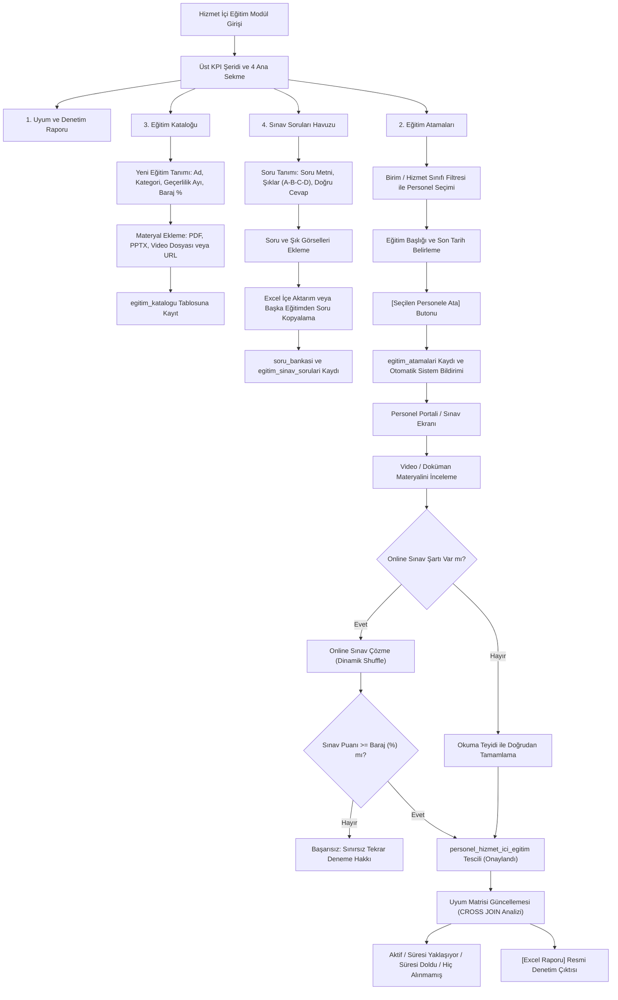

---json
{
  "pageTitle": "17. Hizmet İçi Eğitim, LMS Eğitim Portalı ve Online Sınav — RADPYS v4 Kullanım Kılavuzu",
  "h1": "Hizmet İçi Eğitim ve Online Sınav Yönetimi",
  "lead": "Sağlıkta Kalite Standartları (SKS 6.1) ve Nükleer Düzenleme Kurumu (NDK) mevzuatının zorunlu kıldığı yıllık temel radyasyon güvenliği, radyoizotop kullanımı, hasta ve çalışan korunması ile acil durum eylem eğitimlerinin kurumsal düzeyde planlandığı, personele atandığı, video/doküman içeriklerinin sunulduğu, merkezi soru bankasından hazırlanan online sınavlarla başarı barajının değerlendirildiği ve resmi denetimlere yönelik Uyum Matrisi'nin dinamik olarak üretildiği entegre eğitim ve belgelendirme sistemidir.",
  "overviewId": "genel-bakis",
  "heroStyle": "gradient",
  "badges": []
}
---

## Vizyonder Hızlı Karar Reçetesi (Eğitim & Sınav Özeti) {#hizli-recete}

:::recipe Vizyonder Hızlı Karar Reçetesi (Eğitim & Sınav Özeti) | 20 SANİYELİK AKIŞ
### 1. Eğitim Kataloğu ve Materyalleri | indigo
SKS ve NDK zorunlu yıllık radyasyon eğitimlerini, PDF dokümanlarını ve video bağlantılarını tanımlayın; geçerlilik süresini ve baraj puanını belirleyin.

### 2. Toplu Atama ve Soru Havuzu | emerald
Personele eğitimleri topluca atayın. Excel üzerinden soru bankasını içe aktarın; kopya önleyici dinamik soru-şık karıştırma motorunu çalıştırın.

### 3. Online Sınav & Uyum Matrisi | purple
Personel portal üzerinden sınavı çözer. %70 barajı aşılınca dijital sertifika tescil edilir; SKS Denetim Uyum Matrisi yeşil rozete döner.
:::

## 02 Mimari ve İş Akış Şeması {#mimari}

 

 Eğitim kataloğu hazırlama, soru havuzu oluşturma, toplu atama, online sınav çözme ve Uyum Matrisi entegrasyonu:
 

 

 

 

## 03 Arayüz Bileşenleri ve 5N1K Kural Tablosu {#bilesenler}

 

 Arayüzdeki tüm buton, tablo, form ve sayaçların çalışma kuralları ve durumları:
 

 

| NE? (Bileşen & Ayar) | NEDEN? (Amaç) | NEREDE? (Ekran Konumu) | NASIL? (Çalışma Mantığı) | NE ZAMAN? | KİM? | DURUM |
| --- | --- | --- | --- | --- | --- | --- |
| Genel Uyum Oranı KPI (<code class="text-xs bg-slate-100 dark:bg-slate-800 px-1 py-0.5 rounded text-indigo-600">lblKpiUyumOrani</code>) | Kurumun SKS eğitim uyum yüzdesini anlık görmek. | Üst KPI Şeridi | <code class="text-xs bg-slate-100 dark:bg-slate-800 px-1 py-0.5 rounded">(Aktif + Süresiz) / Toplam * 100</code> ile hesaplar. | Ekran açıldığında ve filtrelemede. | Tüm Yetkililer | Eksiksiz & Aktif |
| Geçerli Eğitimler KPI (<code class="text-xs bg-slate-100 dark:bg-slate-800 px-1 py-0.5 rounded text-indigo-600">lblKpiAktifEgitim</code>) | Süresi devam eden geçerli eğitim sayısını izlemek. | Üst KPI Şeridi | <code class="text-xs bg-slate-100 dark:bg-slate-800 px-1 py-0.5 rounded">durum IN ('Aktif', 'Süresiz Geçerli')</code> sayar. | Sürekli canlı. | Kalite / RGS | Eksiksiz & Aktif |
| 15 Gün Kalanlar KPI (<code class="text-xs bg-slate-100 dark:bg-slate-800 px-1 py-0.5 rounded text-indigo-600">lblKpiYaklasan</code>) | Yakında süresi dolacak personelleri önceden fark etmek. | Üst KPI Şeridi | Geçerlilik bitişine ≤ 15 gün kalan personelleri sayar. | Periyodik kontrolde. | Kalite / RGS | Eksiksiz & Aktif |
| Süresi Dolanlar KPI (<code class="text-xs bg-slate-100 dark:bg-slate-800 px-1 py-0.5 rounded text-indigo-600">lblKpiDolan</code>) | Süresi bittiği halde yenilenmemiş eğitimleri görmek. | Üst KPI Şeridi | Bitiş tarihi geçmiş kayıtları kırmızı alarm ile listeler. | Denetim öncesi. | Kalite / Yönetim | Eksiksiz & Aktif |
| Hiç Alınmamış KPI (<code class="text-xs bg-slate-100 dark:bg-slate-800 px-1 py-0.5 rounded text-indigo-600">lblKpiHicAlinmamis</code>) | Zorunlu eğitimi kurumda hiç almamış personelleri tespit etmek. | Üst KPI Şeridi | Cross-join sonucu eşleşen kaydı olmayanları sayar. | Planlama safhasında. | Eğitim Sorumlusu | Eksiksiz & Aktif |
| Uyum Matrisi Tablosu (<code class="text-xs bg-slate-100 dark:bg-slate-800 px-1 py-0.5 rounded text-indigo-600">tblUyumMatrisi</code>) | Personel-eğitim çapraz tamamlama durumunu matris formatında sergilemek. | 1. Sekme (Uyum ve Denetim Raporu) | Personel, TC, Birim, Eğitim, Tamamlama, Bitiş ve 4 renkli durum hücresi. | Resmi denetim ve incelemede. | Tüm Kullanıcılar | Eksiksiz & Aktif |
| Excel Raporu (<code class="text-xs bg-slate-100 dark:bg-slate-800 px-1 py-0.5 rounded text-indigo-600">btnUyumExcel</code>) | Uyum matrisini resmi denetim çıktısı olarak indirmek. | 1. Sekme Üst Panel | <code class="text-xs bg-slate-100 dark:bg-slate-800 px-1 py-0.5 rounded">openpyxl</code> ile kurumsal lacivert başlıklı .xlsx dosyası oluşturur. | Denetim dosyası hazırlanırken. | Kalite / RGS | Eksiksiz & Aktif |
| Birim & Hizmet Filtresi (<code class="text-xs bg-slate-100 dark:bg-slate-800 px-1 py-0.5 rounded text-indigo-600">comboAtamaBirimFilter</code>) | Toplu eğitim atarken personeli birimine veya mesleğine göre süzmek. | 2. Sekme (Eğitim Atamaları) | Departman ve unvan hizmet sınıflarına göre personelleri listeler. | Atama öncesi. | Eğitim Sorumlusu | Eksiksiz & Aktif |
| Seçilen Personele Ata (<code class="text-xs bg-slate-100 dark:bg-slate-800 px-1 py-0.5 rounded text-indigo-600">btnTopluAta</code>) | İşaretlenen tüm personele tek hamlede eğitim görevi atamak. | 2. Sekme Üst Panel | Seçilen personellere <code class="text-xs bg-slate-100 dark:bg-slate-800 px-1 py-0.5 rounded">egitim_atamalari</code> kaydı açar ve bildirim üretir. | Eğitim planlamasında. | Eğitim Sorumlusu | Eksiksiz & Aktif |
| Eğitim Kataloğu Formu (<code class="text-xs bg-slate-100 dark:bg-slate-800 px-1 py-0.5 rounded text-indigo-600">grpKatalogForm</code>) | Kurumsal eğitimleri, geçerlilik sürelerini ve sınav barajlarını belirlemek. | 3. Sekme (Eğitim Kataloğu) | Ad, kategori, geçerlilik ayı, baraj %, materyal tipi ve dosyasını kaydeder. | Yeni eğitim açılışında. | Yönetici / RGS | Eksiksiz & Aktif |
| Excel'den Soru Yükle (<code class="text-xs bg-slate-100 dark:bg-slate-800 px-1 py-0.5 rounded text-indigo-600">btnSoruExcelImport</code>) | Hazırlanan Excel şablonundaki soruları topluca içe aktarmak. | 4. Sekme (Soru Havuzu) | <code class="text-xs bg-slate-100 dark:bg-slate-800 px-1 py-0.5 rounded">run_with_progress</code> ile Excel'deki soruları okur ve veritabanına bağlar. | Soru bankası hazırlığında. | Sınav Komisyonu | Eksiksiz & Aktif |
| Online Sınav Diyaloğu (<code class="text-xs bg-slate-100 dark:bg-slate-800 px-1 py-0.5 rounded text-indigo-600">HizmetIciSinavDialog</code>) | Personelin eğitimi pekiştirmesi ve puanlandırılması. | Modal Diyalog | Dinamik karıştırma (shuffle) uygular, puanlar; baraj sağlanırsa eğitimi onaylar. | Eğitim sonrasında. | Çalışan Personel | Eksiksiz & Aktif |

## 04 Dinamik KPI Göstergeleri ve Hesaplama Formülleri {#kpi-kokpit}

 

 Ekranın üst bandında yer alan 5 adet canlı performans kartı kurumun eğitim sağlığını anlık olarak yansıtır:
 

 

 

 

 

 Genel Uyum Oranı
 
 

 
%94.5

 

 (Aktif + Süresiz) / Toplam Gereksinim * 100
 

 

 

 

 Geçerli Eğitimler
 
 

 
148

 

 Süresi devam eden veya süresiz tescilli kayıtlar.
 

 

 

 

 15 Gün Kalanlar
 
 

 
12

 

 Kalan süre ≤ 15 gün; bildirim motoru devrede.
 

 

 

 

 Süresi Dolanlar
 
 

 
4

 

 Geçerliliği bitmiş; acil yenileme gerekir.
 

 

 

 

 Hiç Alınmamış
 
 

 
3

 

 Zorunlu olduğu halde sıfır kaydı olan çalışanlar.
 

 

 

## 05 Kurumsal Uyum ve Denetim Matrisi Analizi {#uyum-matrisi}

 

 SKS ve NDK denetimlerinde kurumun en güçlü kanıtıdır. Arka planda aktif çalışanlar ile zorunlu eğitim kataloğu çapraz eşleştirilerek (<code class="text-xs font-mono bg-slate-100 dark:bg-slate-800 px-1 rounded">CROSS JOIN</code>) personelin tüm eğitim geçmişi sorgulanır:
 

 

 

 

 

 Aktif / Süresiz Geçerli
 
Eğitim tamamlanmış, sınavı geçilmiş ve geçerlilik süresi devam ediyor.

 

 

 Süresi Yaklaşıyor (≤15 Gün)
 
Geçerlilik bitişine 15 gün veya daha az kalmış; otomatik uyarı gönderilmiş.

 

 

 Süresi Doldu (Kırmızı Alarm)
 
Eğitimin süresi bitmiş; SKS denetim puanını düşürmemesi için derhal yenilenmelidir.

 

 

 Hiç Alınmamış (Mor Uyarı)
 
Yeni işe başlayan veya zorunlu eğitimi kuruma girdiğinden beri hiç almamış personel.

 

 

 

 

 

 <svg class="w-5 h-5" fill="none" stroke="currentColor" viewBox="0 0 24 24"><path stroke-linecap="round" stroke-linejoin="round" stroke-width="2" d="M12 10v6m0 0l-3-3m3 3l3-3m2 8H7a2 2 0 01-2-2V5a2 2 0 012-2h5.586a1 1 0 01.707.293l5.414 5.414a1 1 0 01.293.707V19a2 2 0 01-2 2z"/></svg>
 

 

 <h4 class="text-sm font-bold text-slate-900 dark:text-white">Resmi Denetim Heyeti İçin Renkli Excel Çıktısı</h4>
 
Üstteki [Excel Raporu] butonuna tıklandığında kurumsal lacivert başlıklı resmi .xlsx matrisi üretilir.

 

 

 openpyxl Motoru
 

 

## 06 Toplu ve Birim Bazlı Eğitim Atama Motoru {#toplu-atama}

 

 Yüzlerce personele tek tek görev atamak yerine birim ve meslek filtresiyle tek tıkla toplu görevlendirme:
 

 

 <ol class="space-y-4 text-sm text-slate-600 dark:text-slate-300 list-decimal list-inside">
 <li class="p-4 rounded-xl bg-slate-50 dark:bg-slate-800/40 border border-slate-200 dark:border-slate-700">
 <strong>Hedef Personel Grubunu Süzme:</strong> Sol üstteki <strong>Birim Filtresi</strong> (<code class="text-xs font-mono">comboAtamaBirimFilter</code>) veya <strong>Hizmet Sınıfı Filtresi</strong> (<code class="text-xs font-mono">comboAtamaHizmetFilter</code>) ile listeyi daraltın.
 </li>
 <li class="p-4 rounded-xl bg-slate-50 dark:bg-slate-800/40 border border-slate-200 dark:border-slate-700">
 <strong>Toplu Seçim:</strong> Tablodaki personelleri tek tek onay kutularıyla seçin veya sol üstteki <strong>[Tümünü Seç]</strong> butonuna tıklayarak süzülen herkesi tek hamlede işaretleyin.
 </li>
 <li class="p-4 rounded-xl bg-slate-50 dark:bg-slate-800/40 border border-slate-200 dark:border-slate-700">
 <strong>Eğitim ve Son Tarih:</strong> Üstteki <strong>Atanacak Eğitim</strong> açılır kutusundan ilgili eğitimi seçin ve <strong>Son Tamamlama Tarihi</strong> (varsayılan: 30 gün sonrası) takvimini belirleyin.
 </li>
 <li class="p-4 rounded-xl bg-slate-50 dark:bg-slate-800/40 border border-slate-200 dark:border-slate-700">
 <strong>[Seçilen Personele Ata]:</strong> Butona basıldığında seçili personellere aynı anda atama yapılır ve sistem personellere otomatik görevlendirme bildirimi yönlendirir.
 </li>
 <li class="p-4 rounded-xl bg-slate-50 dark:bg-slate-800/40 border border-slate-200 dark:border-slate-700">
 <strong>Atama İptali:</strong> Sağdaki mevcut atamalar listesinden bir satır seçip <strong>[Atamayı İptal Et]</strong> butonuyla gerekirse atamayı geri alabilirsiniz.
 </li>
 </ol>

## 07 Eğitim Kataloğu ve Materyal Yönetimi {#katalog-yonetimi}

 

 Kurumun eğitim müfredatının, sürelerinin ve multimedya içeriklerinin tanımlandığı merkezdir:
 

 

 

 

 <h3 class="text-base font-bold text-slate-900 dark:text-white">Temel Parametreler</h3>
 <ul class="space-y-2 text-xs text-slate-600 dark:text-slate-300">
 <li>• <strong>Eğitim Adı:</strong> Eğitimin tam resmi adı (örn: "Radyasyon Alanlarında Çalışma Standartları").</li>
 <li>• <strong>Kategori:</strong> Radyasyon Güvenliği, Hasta Güvenliği, Genel Kalite vb.</li>
 <li>• <strong>Geçerlilik (Ay):</strong> SKS standardı uyarınca varsayılan <code class="px-1 rounded bg-slate-200 dark:bg-slate-700 font-mono">12</code> ay. Süresizler için <code class="px-1 rounded bg-slate-200 dark:bg-slate-700 font-mono">0</code>.</li>
 <li>• <strong>[x] Zorunlu Eğitim:</strong> İşaretlendiğinde kurum geneli Uyum Matrisi'ne doğrudan dahil edilir.</li>
 <li>• <strong>[x] Online Sınav Aktif:</strong> Eğitim sonunda personelin sınav çözmesini zorunlu kılar.</li>
 <li>• <strong>Baraj Puanı:</strong> Sınavı geçmek için gereken başarı yüzdesi (varsayılan: <code class="px-1 rounded bg-slate-200 dark:bg-slate-700 font-mono">%70</code>).</li>
 </ul>
 

 

 <h3 class="text-base font-bold text-slate-900 dark:text-white">Materyal ve Video Entegrasyonu</h3>
 <ul class="space-y-2 text-xs text-slate-600 dark:text-slate-300">
 <li>• <strong>Materyal Türü:</strong> Doküman / Dosya (PDF, DOCX, PPTX), Video Dosyası (MP4, WEBM) veya Harici Video URL.</li>
 <li>• <strong>Dosya Seç:</strong> Bilgisayarınızdaki eğitim sunumunu veya video kaydını bağlamak için <code class="px-1 rounded bg-slate-200 dark:bg-slate-700 font-mono">[Dosya Seç]</code> butonunu kullanın.</li>
 <li>• <strong>Dokümanı Aç:</strong> Yüklenen eğitim materyalini doğrulamak için doğrudan sistemin varsayılan görüntüleyicisinde açar.</li>
 <li>• <strong>Web Portal Stream:</strong> MP4 videoları Web Portal üzerinden mobil cihazlarda ve tarayıcılarda HTTP Range stream ile kesintisiz izlenebilir.</li>
 </ul>
 

 

 

 

 
 SKS 6.1 Kalite Dokümanları ve NDK KLV-014 (T.1 - T.11) Entegrasyonu
 

 

 Sistemde kayıtlı <strong>Kalite Dokümanları</strong> kategorisi altında NDK RSGD-KLV-014 Radyasyondan Korunma Programı kılavuzunda zorunlu tutulan 11 resmi talimat (<strong>TL.RAD.01</strong>'den <strong>TL.RAD.11</strong>'e kadar: Güvenli Cihaz Kullanımı, Çalışan Korunması, Hasta Korunması, Alan Güvenliği, RKE Muayenesi, Ortam Dozu, Dozimetri, Periyodik Muayene, QA/QC, Acil Durum ve Eğitim) tanımlıdır. Bu talimatlar tüm radyasyon personeline yıllık (12 ay geçerlilik) zorunlu doküman eğitimi olarak atanır. Personel portal üzerinden bu talimatları okuyup onayladığında hem Sağlık Bakanlığı SKS v6.1 Denetim Matrisi'ne hem de resmi NDK RKP başvuru dosyasının II. Bölümüne yasal denetim iziyle anlık yansır.
 

 

## 08 Merkezi Soru Havuzu, Şık Görselleri ve Excel İçe Aktarım {#soru-havuzu}

 

 Her eğitim için 4 seçenekli (A, B, C, D) çoktan seçmeli sorular hazırlanır. Hem soru köküne hem de şıklara bağımsız diyagram ve grafik görselleri bağlanabilir:
 

 

 

 

 <h3 class="text-base font-bold text-slate-900 dark:text-white">Görselli Soru Desteği</h3>
 

 Radyolojik anatomik kesitler, dozimetre renk bantları, cihaz kumanda paneli veya uluslararası radyasyon sembolleri sorulara görsel olarak eklenebilir. Soru metni yanındaki <strong>[Soru Resmi Seç]</strong> veya şıkların yanındaki fotoğraf ikonlu butonlar tıklandığında görsel doğrudan sisteme entegre edilir.
 

 

 

 

 <h4 class="text-sm font-bold text-indigo-900 dark:text-indigo-200 mb-1">[Şablon İndir] & [Excel'den Soru Yükle]</h4>
 

 Önceden ayarlanmış <code class="font-mono bg-white dark:bg-slate-800 px-1 rounded">Egitim_Sinav_Sorulari_Sablonu.xlsx</code> şablonunu indirin; onlarca soruyu Excel'de hazırlayıp tek tıkla yükleyin.
 

 

 

 <h4 class="text-sm font-bold text-purple-900 dark:text-purple-200 mb-1">[Başka Eğitimden Soru Kopyala]</h4>
 

 Geçen yılın eğitimindeki veya benzer kategorideki bir eğitimin sınav sorularını tek hamlede yeni eğitime kopyalayarak zamandan tasarruf edin.
 

 

 

 

## 09 Online Sınav Çözme, Dinamik Karıştırma ve Otomatik Tescil {#online-sinav}

 

 Kopya çekilmesini engelleyen dinamik algoritma ve anlık değerlendirme süreci:
 

 

 

 

 <h4 class="text-sm font-bold text-slate-900 dark:text-white mb-2">1. Dinamik Shuffle (Karıştırma)</h4>
 

 Her personel için soruların sırası rastgele karıştırılır. Ayrıca seçeneklerin sırası da dinamik olarak dağıtılır; A şıkkı bir personelde ilk sırada çıkarken diğer personelde C şıkkı konumunda gösterilir.
 

 

 

 <h4 class="text-sm font-bold text-slate-900 dark:text-white mb-2">2. %70 Başarı Barajı</h4>
 

 Sınav bitirildiğinde sistem doğru sayısını hesaplar. Baraj (varsayılan: %70) sağlandığında sınav anında onaylanır. Sağlanamazsa personel sınırsız tekrar sınav hakkına sahiptir.
 

 

 

 <h4 class="text-sm font-bold text-slate-900 dark:text-white mb-2">3. Otomatik Onay & Tescil</h4>
 

 Sınavı geçen personelin eğitimi başka bir komisyon onayı beklemeksizin doğrudan <code class="px-1 rounded bg-emerald-100 text-emerald-800 dark:bg-emerald-950 font-mono">Onaylandı</code> statüsüyle veritabanına tescil edilir ve Uyum Matrisi yeşile döner.
 

 

 

## 10 15 Gün Önceden Otomatik Sistem Bildirim Motoru {#erken-uyari}

 

 Zamanlanmış arka plan servisi (<code class="text-xs font-mono">check_and_create_expiry_notifications</code>) sayesinde hiçbir eğitim süresi unutulmaz:
 

 

 

 

 <svg class="w-5 h-5" fill="none" stroke="currentColor" viewBox="0 0 24 24"><path stroke-linecap="round" stroke-linejoin="round" stroke-width="2" d="M15 17h5l-1.405-1.405A2.032 2.032 0 0118 14.158V11a6.002 6.002 0 00-4-5.659V5a2 2 0 10-4 0v.341C7.67 6.165 6 8.388 6 11v3.159c0 .538-.214 1.055-.595 1.436L4 17h5m6 0v1a3 3 0 11-6 0v-1m6 0H9"/></svg>
 Otomatik Hatırlatma Mekanizması
 

 

 Geçerlilik süresi dolmak üzere olan çalışanlar bitişe 15 gün kala otomatik olarak tespit edilir. Mükerrer bildirim koruması sayesinde her personele günde sadece bir kez aşağıdaki resmi uyarı iletilir:
 

 

 "Sayın [Personel Adı], zorunlu '[Eğitim Adı]' eğitiminizin geçerlilik süresi [Tarih] tarihinde sona erecektir. Lütfen süresi dolmadan eğitiminizi yenileyiniz."
 

 

## 11 Hibrit Arayüz ve Web Portalı Görünümü {#hibrit-web}

 

 Masaüstü yönetim kokpiti ile Web Portalı arasında çift yönlü senkronizasyon:
 

 

 

 

 <h3 class="text-base font-bold text-slate-900 dark:text-white flex items-center gap-2">
 
 Masaüstü Uygulaması (Yetkili & Denetim Merkezi)
 </h3>
 <ul class="space-y-2 text-xs text-slate-600 dark:text-slate-300">
 <li>• Müfredat, kategori ve geçerlilik ayı tanımlama.</li>
 <li>• Birim ve hizmet sınıfına göre toplu personel atamaları.</li>
 <li>• Soru havuzu hazırlama, Excel şablon aktarımı ve soru kopyalama.</li>
 <li>• Kurum geneli Uyum Matrisi izleme ve renkli Excel (.xlsx) çıktısı.</li>
 </ul>
 

 

 <h3 class="text-base font-bold text-slate-900 dark:text-white flex items-center gap-2">
 
 Web Portalı (Personel ve Video Eğitim Portali)
 </h3>
 <ul class="space-y-2 text-xs text-slate-600 dark:text-slate-300">
 <li>• <strong>Personel Eğitim Paneli:</strong> Kendisine atanan eğitimleri ve kalan süreleri görme.</li>
 <li>• <strong>HTTP Range Video Stream:</strong> Büyük boyutlu eğitim videolarını ve PDF'leri tarayıcıda izleme.</li>
 <li>• <strong>Web Sınavı:</strong> Soruları doğrudan tarayıcı üzerinden çözüp anlık baraj sonucunu alma.</li>
 <li>• <strong>Kurumsal Dashboard:</strong> Birim bazlı uyum oranlarını web grafikleriyle izleme.</li>
 </ul>
 

 

## Masaüstü ve Web Portalı Ekran Görüntüleri {#ekran-goruntuleri}

 

 Hizmet içi eğitim uyum matrisi, soru bankası ve online sınav ekranlarının masaüstü ve web portalı görünümleri:
 

 

 denetim matrisi.")

## 12 Hata Mesajları ve Sorun Giderme Rehberi {#sorun-giderme}

 

 Karşılaşabileceğiniz sistem uyarıları ve çözüm adımları:
 

 

| Hata / Uyarı Mesajı | Olası Neden | Çözüm Adımı |
| --- | --- | --- |
| "Lütfen atanacak eğitimi seçiniz." | Toplu atama panelinde eğitim seçilmediğinde. | Açılır kutudan personele atanacak eğitim başlığını seçin. |
| "Lütfen listeden en az bir personel seçiniz." | Seçim tablosunda hiçbir çalışan işaretlenmediğinde. | Tablodan personelleri işaretleyin veya [Tümünü Seç] butonunu kullanın. |
| "Bu eğitime ait henüz aktif sınav sorusu bulunmamaktadır." | Sorusu olmayan eğitim için sınav başlatılmak istendiğinde. | Soru Havuzu sekmesinden eğitime soru ekleyin veya Excel'den aktarın. |
| "X adet soruyu boş bıraktınız. Tamamlamak istiyor musunuz?" | Sınavda boş bırakılan sorular varken gönderilmek istendiğinde. | Boş soruları tamamlamak için 'Hayır'ı seçin veya bu haliyle göndermek için 'Evet'i tıklayın. |
| "Sınav puanınız: %X. Baraj puanı (%Y) sağlanamadı." | Puan katalogdaki baraj puanının altında kaldığında. | Eğitim materyalini tekrar inceleyip sınavı yeniden başlatın (sınırsız hak). |

## Hizmet İçi Eğitim, Sınav & Mit Avcısı (Kritik Kurallar) {#mit-avcilari}

 

 

 <svg class="w-4 h-4" fill="none" stroke="currentColor" viewBox="0 0 24 24">
 <path stroke-linecap="round" stroke-linejoin="round" stroke-width="2" d="M6 18L18 6M6 6l12 12" />
 </svg>
 Yaygın Yanılgı (Mit 1)
 

 

 "Online sınavda %70 baraj puanının altında kalan personel eğitimden elenir ve bir daha sınava giremez."
 

 

 
 <svg class="w-3.5 h-3.5" fill="none" stroke="currentColor" viewBox="0 0 24 24">
 <path stroke-linecap="round" stroke-linejoin="round" stroke-width="2" d="M5 13l4 4L19 7" />
 </svg>
 Doğru Yasal Kural:
 
 

 Amaç öğrenmeyi pekiştirmektir. Personel materyalleri tekrar gözden geçirerek sınırsız sayıda sınava yeniden girebilir; her sınavda soru ve seçenekler dinamik olarak karıştırılır.
 

 

 

 

 

 <svg class="w-4 h-4" fill="none" stroke="currentColor" viewBox="0 0 24 24">
 <path stroke-linecap="round" stroke-linejoin="round" stroke-width="2" d="M12 9v2m0 4h.01m-6.938 4h13.856c1.54 0 2.502-1.667 1.732-3L13.732 4c-.77-1.333-2.694-1.333-3.464 0L3.34 16c-.77 1.333.192 3 1.732 3z" />
 </svg>
 Yaygın Yanılgı (Mit 2)
 

 

 "Kurum Uyum Matrisinde zorunlu eğitimi 'Hiç Almamış' görünen çalışanlar denetim başarı oranını etkilemez."
 

 

 
 <svg class="w-3.5 h-3.5" fill="none" stroke="currentColor" viewBox="0 0 24 24">
 <path stroke-linecap="round" stroke-linejoin="round" stroke-width="2" d="M5 13l4 4L19 7" />
 </svg>
 Doğru Yasal Kural:
 
 

 SKS 6.1 çapraz denetim matrisi gereğince aktif personelin zorunlu eğitimi hiç almamış olması kurumun genel kalite ve uyum puanını doğrudan düşürür.
 

 

 

 

 

 <svg class="w-4 h-4" fill="none" stroke="currentColor" viewBox="0 0 24 24">
 <path stroke-linecap="round" stroke-linejoin="round" stroke-width="2" d="M13 16h-1v-4h-1m1-4h.01M21 12a9 9 0 11-18 0 9 9 0 0118 0z" />
 </svg>
 Yaygın Yanılgı (Mit 3)
 

 

 "Sınavı olmayan eğitimlerde personelin materyali incelediğini kanıtlamak için ıslak imzalı tutanak şarttır."
 

 

 
 <svg class="w-3.5 h-3.5" fill="none" stroke="currentColor" viewBox="0 0 24 24">
 <path stroke-linecap="round" stroke-linejoin="round" stroke-width="2" d="M5 13l4 4L19 7" />
 </svg>
 Doğru Yasal Kural:
 
 

 Sınavsız eğitimlerde personel portaldan dokümanı inceleyip 'Okudum / İnceledim' butonuna bastığında sistem IP ve zaman damgasıyla dijital onay üretir; bu kayıt resmi denetim kanıtıdır.
 

 

 

 

## 13 Sıkça Sorulan Sorular (SSS) {#sss}

:::faq
### Sınavda başarısız olan bir personel için sınav hakkı sınırı var mıdır?
Hayır. Personel başarı baraj puanına (varsayılan: %70) ulaşana kadar eğitim materyalini tekrar gözden geçirerek sınırsız sayıda sınava yeniden girebilir. Her yeni denemede sorular ve şıklar dinamik olarak yeniden karıştırılır.

### Uyum Matrisinde "Hiç Alınmamış" görünen personeller kurum uyum oranını düşürür mü?
Evet. Zorunlu olarak tanımlanan bir eğitimi henüz tamamlamamış olan tüm aktif çalışanlar mor renkli "Hiç Alınmamış" statüsüne düşer ve Genel Uyum Oranını doğrudan aşağı çeker. Bu personellere acil toplu eğitim ataması yapılmalıdır.

### Online sınavı olmayan bir eğitimin tamamlanması nasıl gerçekleşir?
Eğer eğitim kataloğunda [Online Sınav Aktif] seçeneği işaretlenmemişse, personel eğitim dokümanını veya videosunu inceledikten sonra [Okudum / İnceledim] butonuna basar; sistem eğitimi doğrudan tamamlandı ve onaylandı olarak kaydeder.

### 15 gün kala erken uyarı bildirimi bir personele günde kaç kez gider?
Sistem içi mükerrer bildirim koruması bulunur. Aynı gün içerisinde aynı personel ve eğitim için yalnızca tek bir hatırlatma bildirimi üretilir.
:::
