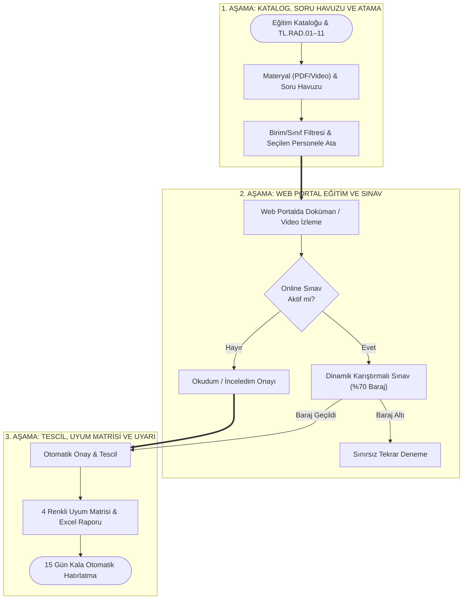

---json
{
  "pageTitle": "17. Hizmet İçi Eğitim, LMS Eğitim Portalı ve Online Sınav — RADPYS v4 Kullanım Kılavuzu",
  "h1": "Hizmet İçi Eğitim ve Online Sınav Yönetimi",
  "lead": "SKS 6.1 ve 19.02.2025 / 32818 sayılı Radyasyondan Korunma Eğitimlerine İlişkin Yönetmelik ile NDK RSGD-KLV-014 talimatları (TL.RAD.01–TL.RAD.11) kapsamındaki yıllık zorunlu eğitim kataloğunu, toplu personel atamalarını, görselli soru havuzunu, dinamik karıştırmalı online sınavı, 15 gün erken uyarısını ve Kurumsal Uyum Matrisini yönetmenizi sağlar.",
  "overviewId": "overview",
  "badges": [
    {
      "text": "SKS 6.1 & 32818 Yön. Uyumlu",
      "tone": "purple"
    }
  ],
  "readingTime": "6 Dakika",
  "legalNote": "<strong>Denetim İlkesi:</strong> Kurumsal Zorunlu Eğitim olarak işaretlenen eğitimleri henüz hiç almamış aktif çalışanlar Uyum Matrisinde mor rozetle (Hiç Alınmamış) gösterilir ve genel uyum oranını doğrudan düşürür; 15 gün kalan eğitimler için günlük tekrar korumalı otomatik hatırlatma gönderilir."
}
---

## Kısa Reçete: Eğitim Kataloğu, Atama, Online Sınav ve Uyum Matrisi {#quick-recipe}

:::recipe Kısa Reçete: Eğitim Kataloğu, Atama, Online Sınav ve Uyum Matrisi | 20 SANİYELİK AKIŞ
### 1. İstenen Sonuç | slate
Yıllık zorunlu radyasyon güvenliği eğitimlerinin ve NDK talimatlarının personele atanması, Web Portalından izlenip online sınavla tescillenmesi ve SKS Uyum Matrisinin hazır tutulması.

### 2. Yapılacak İşlem | cyan
<strong>Eğitim Kataloğu</strong> sekmesinden materyali, geçerlilik süresini ve sınav barajını kaydedin; <strong>Sınav Soruları Havuzu</strong>'ndan soruları ekleyin (veya <strong>[Excel'den Soru Yükle]</strong>); <strong>Eğitim Atamaları</strong>'nda personeli seçip <strong>[Seçilen Personele Ata]</strong> butonuna basın ve <strong>Uyum ve Denetim Raporu</strong>'ndan <strong>[Excel Raporu]</strong> alın.

### 3. Sistem Etkisi | emerald
Online sınavda her çalışana soru ve şık sırası rastgele karıştırılarak gelir; baraj geçildiğinde veya sınavsız doküman okuma onaylandığında eğitim başka onaya gerek kalmadan tescillenir ve Uyum Matrisi yeşile döner.

- [metric] Geçme Barajı | %70 (Sınırsız Tekrar) | purple
- [metric] Geçerlilik &amp; Uyarı | 12 Ay &amp; 15 Gün Alarmı | amber
- [metric] NDK KLV-014 | 11 Resmi Talimat (TL.RAD.01–11) | cyan
- [metric] Hibrit Portal | Video Stream &amp; Web Sınavı | emerald
:::

## 5N1K Kural ve Arayüz Çözümleme Tablosu {#5w1h}

*Uyum matrisi analizi, NDK talimatları, toplu atama, görselli soru havuzu, karıştırmalı sınav ve 15 gün bildirim motoru.*

| NE? (Bileşen / Kontrol) | NEDEN? (Amacı) | NASIL? (Çalışma Mantığı) | NE ZAMAN? (Tetiklenme) | KİM? (Yetkili Rol) |
| --- | --- | --- | --- | --- |
| <strong>Kurumsal Uyum Matrisi &amp; [Excel Raporu]</strong> 4 Durumlu Çapraz Denetim | Hangi çalışanın hangi zorunlu eğitimde eksik veya gecikmiş olduğunu tek ekranda kanıtlamak. | Tüm aktif çalışanları zorunlu eğitimlerle çapraz eşleştirir; Aktif, Süresi Yaklaşıyor (≤15 gün), Süresi Doldu ve Hiç Alınmamış durumlarını renkli raporlar. | Denetim ve rutin takipte. | Kalite / RKS / Yönetim |
| <strong>Eğitim Kataloğu &amp; NDK Talimatları (TL.RAD.01–11)</strong> [Kurumsal Zorunlu Eğitim] &amp; [Online Sınav Aktif] | Yıllık zorunlu radyasyon müfredatını, geçerlilik ayını, materyali ve RKP talimatlarını yönetmek. | PDF/sunum/video materyali, geçerlilik ayı (varsayılan 12, süresiz 0), baraj (%) ve NDK RKP 11 talimat setini tutar. | Katalog oluşturulurken. | Yönetici / RKS |
| <strong>[Seçilen Personele Ata] &amp; [Atamayı İptal Et]</strong> Birim &amp; Hizmet Sınıfı Filtresi | Yüzlerce çalışana tek tek uğraşmadan birim veya meslek grubu bazında eğitim görevi açmak. | Süzülen personellere son tamamlama tarihiyle görev kaydı oluşturur ve bildirim iletir; hatalı görevler iptal edilebilir. | Yıllık eğitim planlamasında. | Eğitim Sorumlusu / RKS |
| <strong>Görselli Soru Havuzu &amp; [Excel'den Soru Yükle]</strong> [Başka Eğitimden Kopyala...] | Çoktan seçmeli soru bankasını radyolojik görsellerle ve toplu aktarımla hızla hazırlamak. | Soru köküne ve A–D şıklarına görsel ekler; şablondan toplu yükleme veya önceki dönem eğitiminden soru kopyalama yapar. | Sınav soruları hazırlanırken. | Sınav Komisyonu / RKS |
| <strong>Dinamik Karıştırmalı Online Sınav &amp; Tescil</strong> [Sınavı Tamamla ve Gönder] | Kopyayı engellemek ve başarı barajını geçen eğitimi bekletmeden onaylamak. | Her denemede soru ve şık sırasını karıştırır; baraj altında sınırsız tekrar hakkı verir; sınavsız eğitim ise okuma onayıyla tescillenir. | Çalışan eğitimi tamamlarken. | Tüm Çalışanlar |
| <strong>15 Gün Erken Uyarı Bildirim Motoru</strong> Mükerrer Bildirim Koruması | Geçerlilik süresi dolmak üzere olan eğitimlerin unutulmasını önlemek. | Sürenin dolmasına 15 gün ve daha az kalan eğitimleri otomatik tarayıp ilgili çalışana günde en fazla bir kez hatırlatma gönderir. | Zamanlanmış kontrolde. | Sistem Otomatik / Çalışan |

## Kritik Sahada Yanlış Bilinen Kurallar (Mit Avcısı) {#myth-buster}

:::myth Baraj Altında Kalan Personelin Hakkı Biter mi ve Hiç Almamış Olanlar Uyum Oranını Etkiler mi?
### Yanlış Algı
<em>"Online sınavda %70 barajını geçemeyen personelin hakkı yanar ve bir daha giremez; ayrıca kuruma yeni başladığı için eğitimi hiç almamış görünen çalışanlar uyum yüzdesini düşürmez."</em>

### Gerçek Sistem Mantığı
<strong>İkisi de yanlıştır.</strong> Eğitimin amacı öğrenmeyi pekiştirmektir; baraj altında kalan personel materyali inceleyerek sınırsız sayıda sınava yeniden girebilir (her denemede sorular ve şıklar yeniden karıştırılır). Öte yandan Uyum Matrisi tüm aktif personelleri zorunlu eğitimlerle çapraz eşleştirdiği için Hiç Alınmamış mor rozetli çalışanlar genel uyum oranını doğrudan aşağı çeker.
:::

## Süreç Akış Şeması {#workflow}

1. **Katalog ve Atama:** Eğitim kataloğu (ve yıllık zorunlu 11 NDK talimatı) materyal ve sorularla hazırlanıp birim veya meslek sınıfı bazlı personele atanır.
2. **Eğitim ve Online Sınav:** Çalışan Web Portalından dokümanı okuyup onaylar veya karıştırmalı online sınavda %70 barajını geçene kadar sınırsız deneme yapabilir.
3. **Tescil ve Uyum Matrisi:** Başarılı tamamlanan eğitim otomatik onaylanır, Uyum Matrisi güncellenir ve süresi 15 gün kalanlara günlük korumalı uyarı iletilir.

## Arayüz Ekran Görünümleri {#screenshots}

## Adım Adım İşlem Rehberi {#step-by-step}

### 1. Eğitim Kataloğu ve Görselli Soru Havuzu Hazırlama

1. **[Hizmet İçi Eğitim ve Online Sınav]** ekranında **Eğitim Kataloğu** sekmesine geçin ve **[Yeni Form]** butonuna tıklayın; eğitim adını, kategoriyi, geçerlilik ayını (yıllık için 12, süresiz için 0), baraj puanını (örneğin %70), **[Kurumsal Zorunlu Eğitim]** ve **[Online Sınav Aktif]** kutularını belirleyip **[Seç...]** ile materyali ekledikten sonra **[Kaydet]**'e basın (**[Aç / Oynat]** ile doğrulayabilirsiniz).
2. NDK RSGD-KLV-014 kapsamındaki 11 zorunlu talimat (<strong>TL.RAD.01</strong>–<strong>TL.RAD.11</strong>) **Kalite Dokümanları** kategorisinde yıllık doküman eğitimi olarak hazır bulunur; personel portaldan okuma onayı verdiğinde SKS ve RKP uyumu güncellenir.
3. **Sınav Soruları Havuzu** sekmesinde soruları ve şıkları tek tek ekleyebileceğiniz gibi (soru ve A–D şıkları için **[Görsel Seç...]** / **[Görsel...]** desteklidir), **[Excel'den Soru Yükle]** ile şablondan toplu yükleyebilir veya **[Başka Eğitimden Kopyala...]** ile önceki eğitimden aktarabilirsiniz.

### 2. Toplu Personel Ataması Yapma ve Uyum Matrisini Raporlama

1. **Eğitim Atamaları** sekmesinde birim ve hizmet sınıfı süzgeçleriyle hedef grubu daraltın, **[Tümünü Seç]** veya onay kutularıyla personeli işaretleyin; atanacak eğitimi ve son tamamlama tarihini belirleyip **[Seçilen Personele Ata]** butonuna basın (gerekirse listeden **[Atamayı İptal Et]** kullanılır).
2. **Uyum ve Denetim Raporu** sekmesinde üstteki 5 KPI göstergesini (Genel Uyum Oranı, Geçerli Eğitimler, 15 Gün Kalanlar, Süresi Dolanlar ve Hiç Alınmamış) izleyip **[Filtrele]** ile süzün; denetimler için **[Excel Raporu]** butonuna tıklayın.

### 3. Web Portalında Video / Doküman İnceleme ve Online Sınav

1. Kendisine görev atanan personel Web Portalındaki eğitim panelinden PDF/sunum dokümanlarını açar veya videoları kesintisiz ileri/geri sararak izler.
2. Sınav şartı yoksa **Okudum / İnceledim** onayıyla, sınav aktifse **[Sınavı Tamamla ve Gönder]** ekranında barajı geçerek eğitimi anında tamamlar ve dijital sertifika/uyum kaydını yeniler.

## Sıkça Sorulan Sorular (SSS) {#faq}

:::faq
### Sınavda barajı aşamayan personel için deneme sayısı kısıtlı mıdır?
Hayır. Personel başarı barajına (varsayılan %70) ulaşana kadar eğitim materyalini tekrar inceleyip sınırsız sayıda yeniden sınava girebilir; her yeni denemede sorular ve A–D şıkları otomatik olarak yeniden karıştırılır.

### Uyum Matrisinde "Hiç Alınmamış" görünen çalışanlar kurum puanını etkiler mi?
Evet. Zorunlu eğitimleri henüz hiç tamamlamamış tüm aktif personel mor renkli <strong>Hiç Alınmamış</strong> durumunda listelenir ve genel uyum yüzdesini doğrudan düşürür; bu gruba öncelikle toplu atama yapılmalıdır.

### Online sınavı kapalı olan doküman/video eğitimleri nasıl tamamlanmış sayılır?
Katalogda <strong>[Online Sınav Aktif]</strong> seçeneği işaretlenmemişse personel eğitim dokümanını veya videosunu inceledikten sonra portaldan okuma onayını verdiğinde eğitim doğrudan tamamlandı olarak tescil edilir.

### 15 gün erken uyarı bildirimi günde kaç kez gönderilir?
Arka plandaki bildirim kontrolünde mükerrer uyarı koruması bulunur; geçerlilik süresine 15 gün ve daha az kalan eğitimler için aynı personele günde yalnızca bir kez hatırlatma gönderilir.
:::
