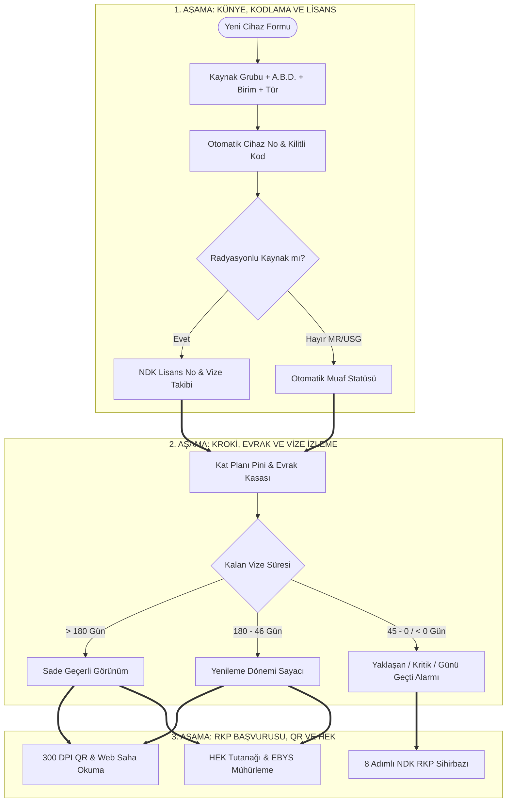

---json
{
  "pageTitle": "18. Tıbbi Cihaz ve NDK Lisans Envanteri — RADPYS v4 Kullanım Kılavuzu",
  "h1": "Tıbbi Cihaz ve NDK Lisans Envanteri",
  "lead": "Hastaneler ve radyoloji merkezlerindeki iyonlaştırıcı radyasyon yayan (X-Ray, Tomografi, Anjiyografi, Skopi, Mamografi), radyasyonsuz medikal (MR, USG) ve ölçüm cihazlarının teknik künyelerini, Nükleer Düzenleme Kurumu (NDK) lisans ve vize takvimini, mimari kat planı sabitlemesini, AES-256 şifreli teknik evrak kasasını, 2 aşamalı HEK tasfiye arşivini ve 8 adımlı NDK KLV-014 Radyasyondan Korunma Programı (RKP) başvuru dosyasını tek merkezden yönetmenizi sağlar.",
  "overviewId": "overview",
  "badges": [
    {
      "text": "NDK KLV-014 & SKS 6.1 Uyumlu",
      "tone": "emerald"
    }
  ],
  "readingTime": "5 Dakika",
  "legalNote": "<strong>Yasal Güvence:</strong> NDK Radyasyon Güvenliği Mevzuatı, Sağlık Bakanlığı Sağlıkta Kalite Standartları (SKS 6.1) ve Taşınır Mal Yönetmeliği uyarınca ruhsatsız veya vizesi dolmuş radyasyon kaynakları erken uyarı takibine alınır; hurdaya ayrılan cihazlar komisyon tutanağı ve EBYS mührü olmadan sistemden silinmez."
}
---

## Kısa Reçete: Yeni Cihaz Kaydı ve NDK Lisansı Bağlama {#quick-recipe}

:::recipe Kısa Reçete: Yeni Cihaz Kaydı ve NDK Lisansı Bağlama | 20 SANİYELİK AKIŞ
### 1. İstenen Sonuç | slate
Tıbbi cihazın resmi NDK lisans bilgileriyle envantere alınması, vize erken uyarı motoruna bağlanması ve saha karekod (QR) etiketinin kullanıma hazır hale getirilmesi.

### 2. Yapılacak İşlem | cyan
Araç çubuğundaki <strong>[Yeni Cihaz]</strong> butonuna tıklayın; 1. sekmede kaynak grubu, Anabilim Dalı, Birim, Cihaz Türü ve Seri No alanlarını doldurun; 2. sekmede NDK Lisans No ve vize bitiş tarihini girip <strong>[Cihazı Kaydet]</strong> butonuna basın.

### 3. Sistem Etkisi | emerald
Modalite sırasına göre Cihaz No ve kilitli Cihaz Kodu otomatik üretilir; vize bitimine 180, 45 ve 30 gün kala kademeli erken uyarı devreye girer ve cihazın karekod pasaportu oluşturulur.

- [metric] Vize Uyarı Eşikleri | 180 / 45 / 30 Gün | cyan
- [metric] Tablo ve Sekme Yapısı | 7 Sütun / 5 Sekme | slate
- [metric] Cihaz Kodu Kuralı | Otomatik ve Kilitli | emerald
- [metric] Platform | Masaüstü + Web / QR | purple
:::

## 5N1K Kural ve Arayüz Çözümleme Tablosu {#5w1h}

*Cihaz kodlama otomasyonu, NDK lisans vize eşikleri, mimari kroki pinleme, Evrak Kasası, tutanaklar, 2 aşamalı HEK arşivi, toplu QR baskı ve RKP sihirbazı kuralları.*

| NE? (Bileşen / Kontrol) | NEDEN? (Amacı) | NASIL? (Çalışma Mantığı) | NE ZAMAN? (Tetiklenme) | KİM? (Yetkili Rol) |
| --- | --- | --- | --- | --- |
| <strong>Kademeli Birim, Cihaz No ve Cihaz Kodu</strong> 1. Sekme: Genel Bilgiler | Modalite başına gerçek cihaz sırasını korumak ve devirlerde kimlik kaymasını önlemek. | Anabilim Dalı seçildiğinde Birim listesi filtrelenir ve sistem boşluk doldurmalı Cihaz No ile salt okunur Cihaz Kodu üretir; düzenlemede yalnızca Birim veya Devir Tutanağı değişince kod yenilenir. | Yeni cihaz tanımlandığında veya birim devri yapıldığında. | Biyomedikal / RKS |
| <strong>NDK Lisans Vize Takibi ve RKS Ataması</strong> 2. Sekme: NDK Lisans ve RKS | İyonlaştırıcı radyasyon yayan cihazların ruhsat yenileme takvimini yasal süre dolmadan yönetmek. | Radyasyonsuz ve Medikal gruplar otomatik Muaf işaretlenirken radyasyonlu cihazlarda vize bitimine 180, 45 ve 30 gün kala uyarı rozeti ve gün sayacı çalışır; lisans belgesi doğrudan kasaya yüklenir. | Cihaz kaydedildiğinde veya vize tarihi yaklaştığında. | RKS / Yönetici |
| <strong>Kat Planına Sabitleme ve <strong>[Pin Kilitli]</strong></strong> 4. Sekme: Kat Planı | Sabit cihazların oda içi mimari konumunu sabitlemek ve Ortam Dozu haritasıyla eşleştirmek. | Mimari plan üzerinde cihaz konumu tıklandığında yüzdesel koordinat ve oda kodu otomatik bağlanır; kilitleme butonu pinin yanlışlıkla sürüklenmesini engeller. | Sabit X-Ray, BT veya Anjiyo kurulumunda. | Biyomedikal / RKS |
| <strong>Şifreli Evrak Kasası ve Birleşik Tutanak Tablosu</strong> 5. Sekme: Kılavuzlar ve Belgeler | Kullanım kılavuzlarını, NDK ruhsat belgelerini ve cihaz tutanaklarını tek listede şifreli korumak. | Yüklenen kılavuzlar, lisans PDF belgeleri ve cihazla ilişkili resmi tutanaklar AES-256 Evrak Kasası üzerinden tek tabloda izlenir ve imzalı tutanak nüshası doğrudan satırdan eklenir. | Teknik belge teslim alındığında veya tutanak imzalandığında. | Yetkili Kullanıcı / RKS |
| <strong><strong>[Tutanak Oluştur]</strong>, <strong>[HEK]</strong> ve 2 Aşamalı Tasfiye Arşivi</strong> Devir / Hasar / Kabul / HEK Süreç Yönetimi | Çoklu cihaz tutanaklarını standart Word/PDF olarak üretmek ve hurdaya ayrılan cihazları EBYS ile mühürlemek. | Araç çubuğundaki <strong>[HEK]</strong> veya <strong>[Tutanak Oluştur]</strong> sihirbazı cihazı imzada bekleyen HEK dosyasına bağlar; Ayniyat kapatmada <strong>[EBYS Gir / Dosyayı Kapat]</strong> ile dosya kalıcı mühürlenir. | Birim devri, hasar tespiti veya hurdaya ayırma kararında. | Komisyon / Ayniyat / RKS |
| <strong><strong>[QR Etiket]</strong> ve 300 DPI Toplu Baskı Paketi</strong> Tekil Kart ve ZIP Matbaa İhracı | Cihaz gövdesine yapıştırılacak saha karekodunu tekil yazdırmak veya topluca matbaa baskısına hazırlamak. | Açılır menüden seçili cihaz için tekil etiket yazdırılır veya seçili/tüm liste için 300 DPI etiket görselleri, matbaa baskı rehberi ve icmal listesi tek ZIP arşivinde üretilir. | Cihaz kabulünde veya toplu etiket yenilemede. | Tekniker / Biyomedikal / RKS |
| <strong>8 Adımlı NDK RKP Sihirbazı ve Merkezi Onay</strong> RSGD-KLV-014 Başvuru Dosyası | Resmi NDK başvuru dosyasını canlı envanter verilerinden hatasız derlemek ve rol bazlı onayları korumak. | Kurum, RKS, personel, cihaz, ölçüm/aktif dozimetre ve RKE matrislerini (KB.1–KB.8) ve 11 talimatı canlı çekip Word/PDF üretir; onay gerektiren rollerin cihaz değişikliklerini Merkezi Onay kuyruğuna sunar. | NDK lisans başvurusunda veya yetki onaylı kayıtta. | RKS / Kurum Amiri |

## Kritik Sahada Yanlış Bilinen Kurallar (Mit Avcısı) {#myth-buster}

:::myth Cihaz Kodu Elle Değiştirilebilir veya HEK'e Ayrılan Cihaz Tamamen Silinebilir mi?
### Yanlış Algı
<em>"Cihaz kodunu kendi kurum numaramıza göre elle yazabilirim; ayrıca hurdaya ayrılan veya yanlış eklenen bir cihazı HEK ekranından silebilir veya dilediğim zaman tek tuşla geri açabilirim."</em>

### Gerçek Sistem Mantığı
<strong>İkisi de sistem güvencesiyle kısıtlıdır.</strong> Cihaz No ve Cihaz Kodu ilişkisel arıza, kalite kontrol ve kroki bağlantılarını korumak için otomatik üretilir; kurum içi demirbaş takibi için formdaki <strong>Demirbaş No</strong> alanı kullanılır ve kod yalnızca birim değiştiğinde güncellenir. Ayrıca hurdaya ayrılan cihazlar geçmiş denetim izini korumak adına asla fiziksel silinmez; komisyon tutanağı ve EBYS sayısıyla mühürlenen HEK tasfiye dosyaları geri döndürülemez.
:::

## Süreç Akış Şeması {#workflow}

1. **Künye ve Lisanslama:** Kaynak grubu, Anabilim Dalı, Birim ve Cihaz Türü seçilince sistem otomatik Cihaz No/Kodu üretir; radyasyonlu cihazlar NDK vize motoruna bağlanırken MR/USG ve genel medikal cihazlar Muaf işaretlenir.
2. **Kroki, Evrak ve Vize İzleme:** Cihaz mimari krokiye pinlenip teknik belgeleri şifreli kasaya eklenir; kalan lisans süresi 180 günün üstündeyken sade görünüm korunur, 180/45/30 gün eşiklerinde kademeli alarm devreye girer.
3. **RKP, Saha QR ve HEK Tasfiyesi:** Aktif cihazlar 300 DPI QR etiketle Web Portal saha süreçlerine bağlanır, canlı envanter verileri NDK RKP Sihirbazına aktarılır; ömrünü tamamlayan cihazlar tutanak ve EBYS sayısıyla mühürlenerek tasfiye arşivine kaldırılır.

## Arayüz Ekran Görünümleri {#screenshots}

## Adım Adım İşlem Rehberi {#step-by-step}

### 1. Yeni Cihaz Tanımlama, Kroki Pinleme ve Evrak Kasası

1. **Tıbbi Cihaz ve Lisans Envanteri** ekranında **[Yeni Cihaz]** butonuna tıklayın; 1. sekmede kaynak grubunu (**Radyasyonlu (XRAY)**, **Radyasyonsuz (RADSIZ/MR/USG)**, **Medikal Cihaz** veya **Ölçüm Cihazı**), **Anabilim Dalı** ve bağlı **Birim** ile **Cihaz Türü** seçimini yapın (Cihaz Kodu ve Cihaz No otomatik oluşur). Seri No ve varsa Demirbaş No bilgilerini girin.
2. 2. sekmede radyasyonlu veya ölçüm cihazları için NDK Lisans No ve bitiş tarihini yazın; resmi lisans PDF belgenizi **[Belge Seç...]** ile doğrudan bağlayın (gerekirse **[Görüntüle]** ile açabilirsiniz) ve **RKS Sorumlusu** ile birim sorumlusunu seçin.
3. 3. sekmede varsa üretici garantisi onay kutusunu ve servis anlaşması tarihlerini işleyin; 4. sekmede mimari kat planını seçip oda içine tıklayarak pini yerleştirin ve **[Pin Kilitli]** butonuyla sabitleyin.
4. 5. sekmede cihazın kullanım kılavuzu ve teknik belgelerini **[Dosya Seç...]** → **[Yükle]** ile AES-256 Evrak Kasasına ekleyip **[Cihazı Kaydet]** butonuna basın (rolünüz onay gerektiriyorsa kayıt Merkezi Onay kuyruğuna iletilir).

### 2. Toplu İçe/Dışa Aktarım, NDK Çizelgesi ve 300 DPI QR Paketi

1. Çoklu cihaz aktarımı için **[Excel İçe Aktar]** butonuna tıklayarak Evrensel İçe Aktarım Sihirbazı üzerinden iki sayfalı şablonla önizlemeli aktarım yapın.
2. Filtrelenmiş listeyi dışa aktarmak için araç çubuğundaki **[Dışa Aktar]** menüsünden Excel, PDF, Word veya **NDK Çizelgesi Oluştur (.xlsx)** seçeneğini çalıştırın.
3. Cihaz gövdesine etiket basmak için araç çubuğundaki **[QR Etiket]** menüsünden tekil cihaz için **[Seçili Cihaz İçin QR Etiket...]** (**[PNG Olarak Kaydet]** / **[Etiketi Yazdır]**) veya çoklu/toplu matbaa basımı için **[Toplu QR Baskı Paketi Oluştur (.zip)...]** seçeneğini kullanın.

### 3. Devir Tutanağı ve 2 Aşamalı HEK Tasfiye Süreci

1. Bir veya birden fazla cihazı tablodan seçerek araç çubuğundan ya da sağ tık menüsünden **[Tutanak Oluştur]** (Devir, Hasar, Kabul, Genel) veya **[HEK]** komutunu çalıştırın; **Tutanak Oluştur** penceresinde sol/sağ listelerdeki **[Ekle]** / **[Çıkar]** butonlarıyla cihazları ve imza heyetini düzenleyip **[Evrak Kasasına Kaydet ve İmzaya Sun]** butonuna basın (Devir tutanağında birim güncelleme kutusu işaretliyse yeni birime göre Cihaz Kodu da otomatik güncellenir).
2. HEK tutanağı oluşturulduğunda dosya **HEK Süreç Yönetimi ve Ayniyat Tasfiye Arşivi** ekranına düşer; Ayniyat evrakı geldiğinde satırı seçip **[EBYS Gir / Dosyayı Kapat]** → **[Resmi Olarak Kapat ve Mühürle]** adımıyla sayıyı/eki işleyin; mühürlenen birleşik dosya **[Mühürlü Dosyayı Aç (PDF)]** ve **[Excel İcmal]** üzerinden denetime sunulur.

### 4. 8 Adımlı NDK KLV-014 RKP Sihirbazı ve Web Portalı Saha Erişimi

1. Sol menüden **NDK RKP Sihirbazı** ekranını açın; **1. Kuruluş (KB.1-2)** adımında kurum ayarlarından verileri yükleyip **2. RKS (KB.3)**, **3. Çalışanlar (KB.4)**, **4. Cihazlar (KB.5)**, **5. Ölçüm (KB.6-7)** (ölçüm cihazları ve aktif dozimetreler) ve **6. RKE Matrisi (KB.8)** tablolarını canlı verilerden doğrulayın.
2. **7. Talimatlar (T.1-11)** adımında talimatları gözden geçirip gerekirse **[Hizmet İçi Eğitim Modülüne Güncelle]** ile LMS modülünü güncelleyin; **8. Belge Üret ve Onay** adımında **[Word (.docx) Resmi Başvuru Dosyası Oluştur ve Aç]**, **[PDF (.pdf) Resmi Dosya Oluştur ve Aç]** veya **[KVKK Evrak Kasasına Arşivle]** ile başvuruyu tamamlayın.
3. **Web Portalı ve Mobil QR Saha Akışı:** Saha personeli telefon veya tablet kamerasıyla cihaz etiketindeki QR kodu tarattığında ilgili cihazın künyesi, NDK lisans ve son kalite kontrol durumu anında açılır ve tek dokunuşla arıza bildirimi başlatılabilir.

## Sıkça Sorulan Sorular (SSS) {#faq}

:::faq
### NDK lisans sürelerinde 180 gün üstü ile altı neden farklı gösteriliyor?
Tabloda gereksiz kalabalığı önlemek için vize bitimine 180 günden fazla süresi kalan cihazlarda yenileme sayacı gizlenir ve yalnızca bitiş tarihi sunulur (üzerine gelindiğinde kalan gün sayısı ipucunda görünür). Kalan süre <strong>180 gün ve altına</strong> indiğinde cihaz Yenileme Dönemine alınır; 45 gün ve 30 gün eşiklerinde alarm rengi sertleşir, süresi dolanlar ise <strong>Günü Geçti</strong> rozetiyle işaretlenir.

### Düzenleme ekranında neden Cihaz No, Kaynak Grubu ve Cihaz Türü kilitleniyor?
Bu üç bilgi cihazın modalite kimliğini ve ilişkisel geçmiş kayıtlarını (arıza, kalite kontrol, kroki pini, RKP tablosu) belirlediği için kayıt sonrasında değiştirilmesine izin verilmez. Yalnızca cihaz başka bir birime devredildiğinde Birim seçimi veya onaylı Devir Tutanağı üzerinden Cihaz Kodu yeni birime uyarlanır.

### Yanlışlıkla HEK sürecine alınan bir cihaz HEK ekranından geri döndürülebilir mi?
Resmi HEK komisyon tutanağıyla dosyaya bağlanmış ve EBYS numarasıyla mühürlenmiş cihazlar mevzuat gereği asla geri açılmaz. Hatalı bir HEK girişi henüz EBYS ile mühürlenmemişse veya tutanak aşamasındaysa durumu yetkili sistem yöneticisi tarafından incelenmelidir.

### NDK RKP Sihirbazındaki 8 adım tüm kurum verilerini otomatik mi çeker?
Evet. RKS görevlendirmeleri, radyasyon çalışanlarının dozimetre/sağlık durumları, tescilli X-Ray cihazları, kalibrasyonlu ölçüm cihazları, aktif dozimetreler ve RKE koruyucu matrisi canlı veritabanından derlenir; yalnızca kuruluş kimlik ve yasal dayanak alanları ilk seferde kontrol edilerek kaydedilir.
:::
