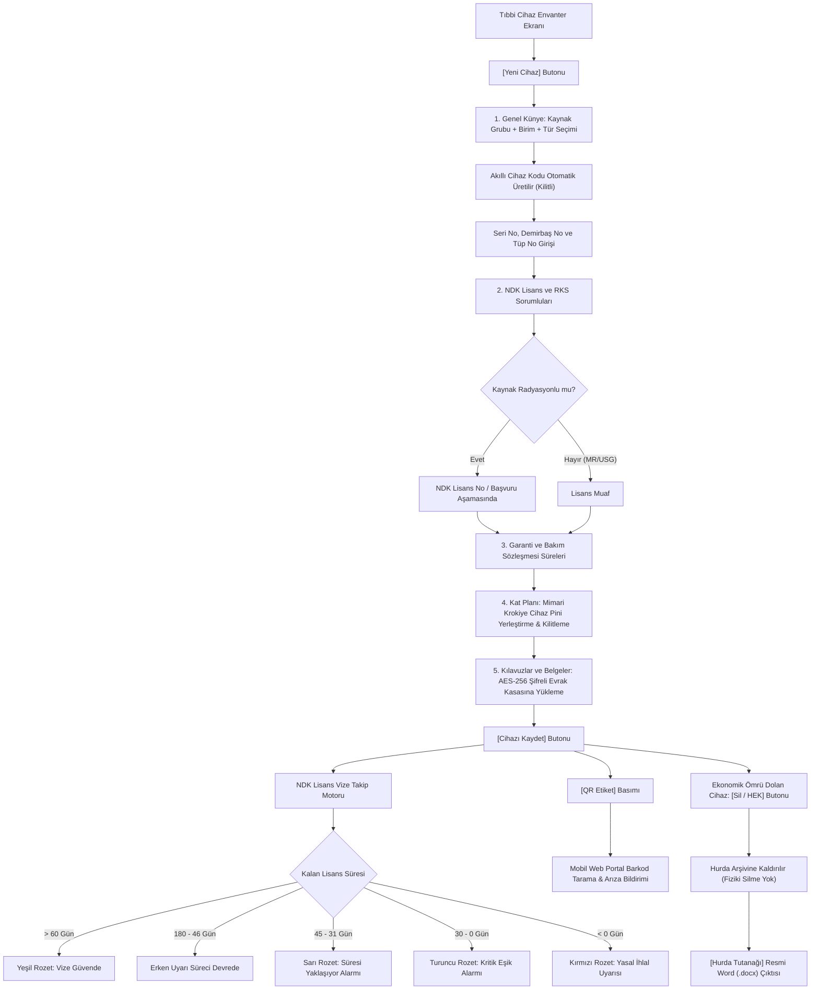

---json
{
  "pageTitle": "18. Tıbbi Cihaz ve NDK Lisans / Uygunluk Envanteri — RADPYS v4 Kullanım Kılavuzu",
  "h1": "Tıbbi Cihaz ve NDK Lisans Envanteri",
  "lead": "Hastaneler ve radyoloji merkezlerindeki iyonlaştırıcı radyasyon yayan (X-Ray, Tomografi, Anjiyografi, Skopi, Mamografi) ve radyasyonsuz medikal (MR, USG) tüm cihazların teknik künyelerinin yönetildiği, Nükleer Düzenleme Kurumu (NDK) lisans ve vize sürelerinin 6 ay - 45 gün - 30 gün kademeli erken uyarı sistemiyle takip edildiği, cihazların mimari kat planları (kroki) üzerine koordinatla sabitlendiği, teknik kılavuzların AES-256 şifreli Evrak Kasasında korunduğu ve hurdaya ayrılan cihazların resmi HEK tutanağıyla arşivlendiği entegre donanım yönetim merkezidir.",
  "overviewId": "overview",
  "badges": [
    {
      "text": "NDK & SKS 6.1 Uyumlu",
      "tone": "emerald"
    }
  ],
  "readingTime": "4 Dakika",
  "legalNote": "<strong>Yasal Güvence:</strong> Sağlık Bakanlığı Sağlıkta Kalite Standartları (SKS 6.1) ve NDK Radyasyon Güvenliği Mevzuatı uyarınca ruhsatsız veya vizesi dolmuş cihazlar karantina uyarısına alınır."
}
---

## Kısa Reçete (20 Saniye Kuralı) {#quick-recipe}

:::recipe Kısa Reçete: Yeni Cihaz Tanımlama ve NDK Lisansı Bağlama | 20 SANİYELİK AKIŞ
### 1. İstenen Sonuç | cyan
Cihazın resmi NDK lisansıyla envantere kaydedilmesi, erken uyarı alarmına bağlanması ve QR künyesinin üretilmesi.

### 2. Yapılacak İşlem | cyan
<strong>[Yeni Cihaz]</strong> butonuna tıklayın. 1. Sekmede Anabilim Dalı ve Birimi seçin (alt birimler otomatik filtrelenir, Cihaz Kodu kilitli olarak otomatik üretilir); Seri No ve Demirbaş No girin. 2. Sekmede NDK Lisans No ve Vize Tarihini yazıp <strong>[Cihazı Kaydet]</strong> butonuna basın.

### 3. Sistem Etkisi & Güvence | cyan
Cihaz Kodu otomatik üretilir ve kilitlenir. Vize bitimine 6 ay kala erken uyarı başlar; 45 gün ve 30 gün eşiklerinde alarm rengi değişir. Hiçbir eski veri ezilmez.

- [metric] Vize Takip Alarmı | 6 Ay / 45G / 30G | cyan
- [metric] Yetkili Rol | Biyomedikal / RGS / RKS | slate
- [metric] Cihaz Kodu Kuralı | Sistem Üretir (Kilitli) | emerald
- [metric] Platform | Masaüstü + Web / QR | purple
:::

## Kritik Sahada Yanlış Bilinen Kurallar (Mit Avcısı) {#myth-buster}

:::myth Kritik Sahada Yanlış Bilinen Kural (Mit Avcısı)
### Yanlış Algı:
<em>"Cihaz kodunu kendi istediğim gibi değiştirebilirim; artık kullanılmayan eski bir cihazı da sistemden kalıcı olarak silebilir veya yok edebilirim."</em>

### Gerçek Sistem Mantığı:
Cihaz Kodu ilişkisel veri bütünlüğünü korumak için <strong>sistem tarafından otomatik üretilir ve kilitlidir</strong>. Kurum içi demirbaş veya ÇKYS takibi için formdaki <strong>Demirbaş No</strong> alanı kullanılır. Ayrıca sistemde cihazlar asla kalıcı silinmez; geçmiş kalite kontrol, arıza ve dozimetri izini korumak için <strong>[Sil / HEK]</strong> butonuyla Hurda Arşivine kaldırılır.
:::

## 5N1K Kural ve Ayar Çözümleme Tablosu {#matrix-5n1k}

 

 

 Tıbbi cihaz envanteri, NDK lisanslama, kat planı sabitleme ve HEK hurda arşivi operasyonel kontrolleri.
 

 

 

 

| NE? (Ekran Kontrolü) | NEDEN? (Amacı) | NASIL? (Çalışma Mantığı) | NE ZAMAN? | KİM? |
| --- | --- | --- | --- | --- |
| Yeni Cihaz Tanımlama  [Yeni Cihaz Butonu] | Hastaneye teslim alınan cihazın teknik künyesini ve lisansını açmak. | 5 sekmeli sihirbaz açılır: Genel Künye, NDK Lisans, Garanti, Kat Planı ve Şifreli Evrak Kasası doldurulur. | Yeni cihaz alımında veya devralındığında. | Biyomedikal / RGS |
| Otomatik Cihaz Kodu & Kademeli Birim Seçimi  [Cihaz Kodu (Kilitli) / A.B.D. & Birim] | Mükerrer cihaz kodlarını ve A.B.D. ile Birim arasındaki hiyerarşik uyumsuzlukları önlemek. | Anabilim Dalı seçildiğinde Birim listesi otomatik filtrelenir. Seçilen parametrelere göre Cihaz Kodu sistem tarafından otomatik üretilir ve kullanıcı müdahalesine karşı kalıcı salt okunur kilitlenir. | Yeni cihaz tanımlanırken veya düzenlenirken. | Biyomedikal / RGS |
| NDK Lisans ve Vize Takibi  [2. Sekme: Lisans Bilgileri] | İyonlaştırıcı radyasyon yayan cihazın yasal ruhsat takvimini kurmak. | Lisans No ve vize geçerlilik tarihi girilir. Sistem 6 ay, 45 gün ve 30 gün erken uyarı alarmları üretir. | Cihaz kaydedilirken veya lisans yenilendiğinde. | RGS / RKS Sorumlusu |
| Kat Planına Sabitleme  [4. Sekme: Kat Planı & Pin Kilitli] | Cihazın oda içindeki mimari koordinatını sabitlemek ve kroki haritasında göstermek. | Birim krokisi açılır, fareyle pini yerleştirilip [Pin Kilitli] butonuyla kilitlenir. | Sabit X-Ray, BT veya Anjiyo kurulumunda. | Biyomedikal / RGS |
| AES-256 Şifreli Evrak Kasası  [5. Sekme: Kılavuzlar ve Belgeler] | Kullanım kılavuzu, servis şeması ve CE belgelerini KVKK uyumlu şifreli saklamak. | Yüklenen PDF/dosyalar AES-256 Fernet ile şifrelenir; istendiğinde şifresi çözülüp görüntülenir. | Teknik evrak teslim alındığında. | Tüm Kullanıcılar |
| Dinamik QR Etiket & Toplu Baskı Paketi (.ZIP)  [Toplu QR Etiket İhracı / Sağ Tık Menüsü] | Cihaz gövdesine yapıştırılacak karekodlu kimlik etiketini tekil basmak veya matbaa üretimi için tüm cihaz etiketlerini toplu paketlemek. | Tekil QR etiketi basılabilir veya üst araç çubuğundaki [Toplu QR Etiket İhracı] ve sağ tık menüsünden seçili/tüm cihazlar için 300 DPI ultra net PNG etiketleri, teknik şartname (00_Baski_ve_Uretim_Rehberi.txt) ve icmal listesi (00_Etiket_Listesi_Icmal.csv) içeren endüstriyel .ZIP paketi olarak ihraç edilir. | Cihaz kabulünde, saha etiketlemesinde veya toplu matbaa siparişlerinde. | Tekniker / Biyomedikal / RGS |
| HEK Hurda Arşivi ve Çıkış Tutanağı  [Sil / HEK &amp; Hurda Tutanağı Butonları] | Ekonomik ömrü biten cihazı arşivleyip resmi komisyon tutanağı üretmek. | Cihaz HEK arşivine kaldırılır; geçmiş denetim izi korunur. Resmi Word (.docx) Hurda Tutanağı tek tıkla üretilir. | Cihaz hurdaya ayrıldığında veya devredildiğinde. | Sistem Yöneticisi |
| Toplu Cihaz İçe Aktar (Excel)  [Excel İçe Aktar Butonu] | Onlarca cihazı tek tek girmek yerine 2 sayfalı kurumsal Excel şablonuyla topluca sisteme aktarmak. | Evrensel İçe Aktarım Sihirbazı devreye girer. Şablondaki veriler doğrulanır; sistemde bulunmayan yeni departman veya türler dinamik sözlükte eşlenir; Dry-Run doğrulamasının ardından asenkron olarak güvenle kaydedilir. | İlk sistem kurulumunda veya toplu cihaz alımlarında. | Biyomedikal / Sistem Yöneticisi |
| Toplu Cihaz Komisyon / HEK Tutanağı  [Tutanak Oluştur Butonu / Sağ Tık Menüsü] | Hizmet dışı kalan, devredilen veya hurdaya ayrılan birden çok cihazı tek bir resmi Word (.docx) komisyon tutanağında toplamak. | Cihaz envanter tablosunda klavyeden Ctrl veya Shift tuşlarıyla birden çok cihaz seçilir. Üst araç çubuğundaki <strong>[Tutanak Oluştur]</strong> butonuna veya sağ tık menüsündeki <em>"Seçili Cihazlar İçin Toplu HEK / Komisyon Tutanağı..."</em> komutuna basılır. Tutanak Sihirbazı açılarak cihazların künye, seri no, marka, model ve servis durumlarını dinamik tablo halinde kurumsal Word (.docx) şablonuna döker. | Toplu cihaz sayımlarında veya komisyon hurda/devir kararlarında. | Biyomedikal / RGS / Sistem Yöneticisi |

 

## Cihaz Yaşam Döngüsü ve İş Akış Şeması (Mermaid) {#workflow}

 Aşağıdaki şema, tıbbi cihazın sisteme ilk kaydından otomatik kodlamaya, NDK vize erken uyarı alarmlarından HEK hurda arşivine kadar tüm yaşam döngüsünü göstermektedir.
 

 

 

## Ekran Konumları ve Görsel Rehber {#screenshots}

![Tıbbi Cihaz Tanımlama ve Kroki Konumlandırma Formu | Tıbbi Cihaz Envanteri > [Yeni Cihaz / Düzenle] & Kroki Konumlandırma | Cihaz Künyesi & Kat Planı Pinleme](assets/img/18_2_cihaz_tanimlama_ve_kroki_formu.png "<strong>Simülasyon Notu:</strong> Akıllı cihaz kodlama (XRAY-ACL-ANJ-01), NDK lisans/vize bilgileri ve kat planı krokisi üzerinde pin sabitleme ekranı.")

## Adım Adım Operasyonel Eylem Akışı {#step-by-step}

 

 <strong class="text-slate-900 dark:text-white text-base block mb-2">Adım 1: Yeni Cihaz Künyesi, Hiyerarşik Birim ve Kilitli Akıllı Kodlama</strong>
 Sol ana menüden <strong>[Tıbbi Cihaz ve Lisans Envanteri]</strong> ekranını açın. Araç çubuğundaki <strong>[Yeni Cihaz]</strong> butonuna tıklayın. 1. Sekmede Kaynak Grubu (X-Ray, Radyasyonsuz, Medikal, Ölçüm), Anabilim Dalı ve bağlı Birim ile Cihaz Türünü seçin. Anabilim Dalı seçildiğinde alt birimler kademeli filtrelenir; sistem sıradaki akıllı Cihaz Kodunu (örn: <code>XRAY-ACL-ANJ-01</code>) otomatik üretir ve yetkisiz müdahaleye karşı salt okunur olarak kilitler. Seri No ve kurum Demirbaş No alanlarını doldurun.
 

 

 <strong class="text-slate-900 dark:text-white text-base block mb-2">Adım 2: NDK Lisans Bilgileri ve Sorumluları Belirleme</strong>
 2. Sekmeye geçin. Radyasyonlu cihazlar için NDK Lisans Numarası ve lisans geçerlilik bitiş tarihini girin. Henüz resmi ruhsat çıkmamışsa durumu <em>"Lisans Başvuru Aşamasında"</em> olarak işaretleyin. Kurumdaki sertifikalı uzmanlar arasından <strong>RKS Sorumlusu</strong> ve klinik <strong>Birim Sorumlusu</strong>'nu seçin.
 

 

 <strong class="text-slate-900 dark:text-white text-base block mb-2">Adım 3: Kat Planına Pini Yerleştirme ve Kilitleme</strong>
 4. Sekmeye (Kat Planı) geçin. Birime ait mimari kroki üzerinde fareyle cihazın bulunduğu odaya tıklayarak veya pini sürükleyerek tam konumunu işaretleyin. Pinin kaymasını önlemek için <strong>[Pin Kilitli]</strong> butonuna basın.
 

 

 <strong class="text-slate-900 dark:text-white text-base block mb-2">Adım 4: Kılavuzları Şifreli Kasaya Yükleme ve Kaydetme</strong>
 5. Sekmede cihazın kullanım kılavuzu veya teknik servis şeması dosyasını <strong>[Dosya Seç]</strong> ile bağlayıp formun altındaki <strong>[Cihazı Kaydet]</strong> butonuna tıklayın. Cihaz anında canlı envantere işlenir ve erken uyarı motoru devreye girer.
 

 

 <strong class="text-slate-900 dark:text-white text-base block mb-2">Adım 5: QR Etiket Basımı ve HEK Hurda Arşivi</strong>
 Tablodan cihazı seçip üstteki <strong>[QR Etiket]</strong> butonuyla etiket yazıcısına çıktı gönderin. Cihazın ekonomik ömrü bittiğinde ise <strong>[Sil / HEK]</strong> butonuyla arşive kaldırın; HEK Arşivi ekranından komisyonun imzalayacağı resmi Word (.docx) Hurda Tutanağını tek tıkla üretin.
 

 

 <strong class="text-slate-900 dark:text-white text-base block mb-2">Adım 6: NDK RSGD-KLV-014 ve KLV-014-EK Radyasyondan Korunma Programı (RKP) Başvuru Sihirbazı</strong>
 Sol ana menüden veya araç çubuğundaki <strong>[NDK RKP Sihirbazı]</strong> butonuna tıklayın. Açılan 8 adımlı resmi sihirbaz üzerinden:
 <ul class="mt-2 space-y-1.5 pl-4 text-xs sm:text-sm list-disc">
 <li><strong>1. Kuruluş Bilgileri (KB.1) & Yasal Dayanaklar (KB.2):</strong> Kurum unvanı, adres, NDK lisans/başvuru numarası ve mevzuat dayanaklarını sistem ayarlarından tek tıkla yükleyin veya düzenleyin.</li>
 <li><strong>2. RKS ve Birim Sorumluları (KB.3):</strong> Kurumda görevli resmi Radyasyondan Korunma Sorumlusu (RKS) ve klinik birim sorumlularının iletişim ve görev bilgilerini listeleyin.</li>
 <li><strong>3. Radyasyon Görevlileri ve Sağlık/Dozimetre Durumu (KB.4):</strong> Canlı personel veritabanından radyasyon görevlileri, çalışma koşulları (Koşul A/B), aktif dozimetre türleri ve periyodik sağlık muayene onaylarını inceleyin.</li>
 <li><strong>4. Tıbbi Radyoloji Cihaz Envanteri (KB.5):</strong> Aktif iyonlaştırıcı radyasyon kaynaklarının cinsi, kullanım şekli, marka/model, seri no, NDK no ve maksimum jeneratör teknik değerlerini (kV/mA) doğrulayın.</li>
 <li><strong>5. Radyasyon Ölçüm Cihazları ve Kalibrasyon Belgeleri (KB.6):</strong> İyon odaları, alan ve kontaminasyon monitörlerinin kalibrasyon geçerlilik sürelerini kontrol edin.</li>
 <li><strong>6. RKE Koruyucu Ekipman Matrisi (KB.7):</strong> DIN 6857-1 standartlarına uygun kurşun önlük, tiroid, gözlük, gonat ve paravanların oda/birim bazlı donanım matrisini canlı verilerle görüntüleyin.</li>
 <li><strong>7. Kalite Dokümanları ve Hizmet İçi Eğitim Talimatları (T.1 - T.11):</strong> SKS 6.1 ve NDK RSGD-KLV-014 uyumlu 11 resmi talimatı (TL.RAD.01 - TL.RAD.11) inceleyin; Hizmet İçi Eğitim Modülü (LMS) ile senkronize edin.</li>
 <li><strong>8. Resmi Başvuru Dosyası Üretimi ve Arşivleme:</strong> <strong>[Resmi Word (.docx) İndir]</strong> ve <strong>[Resmi PDF (.pdf) Üret]</strong> butonlarıyla NDK standartlarında yatay (Landscape) resmi RKP başvuru dosyasını üretin; <strong>[KVKK Evrak Kasasına Arşivle]</strong> butonuyla dosyayı AES-256 ile şifreleyerek güvenli arşive kaydedin. İşi bitirdiğinizde <strong>[Kapat]</strong> butonuyla ana ekrana güvenle dönün.</li>
 </ul>
 

 

## Hibrit Platform Matrisi (Masaüstü vs Web Portal) {#hybrid-platform}

 

 <h3 class="text-base font-bold text-slate-900 dark:text-white flex items-center gap-2">
 
 Masaüstü Uygulaması (Yetkili Yönetim Merkezi)
 </h3>
 <ul class="space-y-2 text-xs text-slate-600 dark:text-slate-300">
 <li>• Yeni cihaz kaydı, teknik künye ve kilitli akıllı kod üretimi.</li>
 <li>• NDK lisanslama, vize süresi ve RKS/Birim sorumlusu atamaları.</li>
 <li>• Mimari kat planı krokisi üzerinde pin sabitleme ve kilitleme.</li>
 <li>• AES-256 şifreli evrak kasasına teknik kılavuz yükleme ve indirme.</li>
 <li>• Excel toplu içe/dışa aktarım ve resmi Word (.docx) HEK Hurda Tutanağı.</li>
 </ul>
 

 

 <h3 class="text-base font-bold text-slate-900 dark:text-white flex items-center gap-2">
 
 Web Portalı & Mobil Barkod (Saha Personeli Görünümü)
 </h3>
 <ul class="space-y-2 text-xs text-slate-600 dark:text-slate-300">
 <li>• Kamera ile cihaz QR barkodunu tarayarak cihaz künyesini sahada açma.</li>
 <li>• Cihazın son Kalite Kontrol (QC) onay ve geçerlilik durumunu teyit etme.</li>
 <li>• Sahadan arıza bildirimi oluşturma ve arıza sayısını izleme.</li>
 <li>• Ortam Dozu Kroki Haritasında sabit cihazların oda yerleşimini izleme.</li>
 </ul>
 

 

## Sıkça Sorulan Sorular ve Saha Çözümleri {#faq}

:::faq
### NDK lisans vize sürelerinde erken uyarı alarmları ne zaman devreye girer?
NDK resmi yenileme bürokrasisinin ortalama 2-3 ay sürmesi nedeniyle erken uyarı süreci lisans bitimine <strong>6 ay (180 gün)</strong> kala başlar. Arayüzde gereksiz bilgi kalabalığını önlemek amacıyla, lisans bitimine 180 günden fazla süre bulunan cihazlarda gün sayacı gizlenerek yalnızca sade <strong>Geçerli</strong> rozeti sunulur; kalan süre 180 gün ve altına indiğinde gün sayacı otomatik olarak görünür hale gelir. Vize süresine <strong>45 gün</strong> kala sistem "Süresi Yaklaşıyor" sarı alarmı verir. Kalan gün <strong>30 gün ve altına</strong> indiğinde ise acil başvuru gerektiren "Kritik Eşik" turuncu alarmı devreye girer. Süresi dolan cihazlar ise kırmızı renkle işaretlenerek yöneticiye raporlanır.

### Cihaz kodunu neden kendimiz serbestçe belirleyemiyoruz?
RADPYS V4, cihazları arıza, kalite kontrol, dozimetre maruziyeti ve kroki sistemlerine bağlarken benzersiz ve standart bir format (<code>XRAY-ACL-ANJ-01</code> gibi) kullanır. Kodun elle düzenlenmesi mükerrer kayıtlara ve ilişkisel veri kopmalarına yol açabileceğinden kilitlenmiştir. Kurum içi demirbaş veya Sağlık Bakanlığı ÇKYS takibi için formdaki <strong>Demirbaş No</strong> alanı kullanılır.

### Yeni bir X-Ray cihazı tanımlarken NDK Lisans Numarası girmek şart mıdır?
<strong>Evet.</strong> Mevzuat gereği iyonlaştırıcı radyasyon yayan cihazların sisteme ruhsatsız kaydedilmesine izin verilmez. Ancak cihaz yeni kurulmuş ve ruhsat süreci devam ediyorsa Lisans Durumu kutusundan <em>"Lisans Başvuru Aşamasında"</em> seçeneği işaretlenerek yasal süreç kayıt altına alınabilir. MR ve USG gibi radyasyonsuz cihazlarda ise lisans şartı aranmaz.

### Yanlışlıkla [Sil / HEK] butonuna basılan bir cihaz nasıl kurtarılır?
Sistem cihazları fiziksel olarak silmediği için hiçbir veri kaybolmaz. Üst menüden <strong>HEK ve Hizmet Dışı Cihaz Arşivi</strong> ekranını açın. Listeden ilgili cihazı seçip <strong>[Tekrar Aktif Statüsüne Al]</strong> butonuna tıklayın. Cihaz anında tüm geçmiş kayıtlarıyla birlikte ana aktif envanter tablosuna geri döner.

### Cihaz Türü veya Cihaz Amacı tanımı sistemden kaldırıldığında mevcut cihazlar bozulur mu?
<strong>Hayır, hiçbir cihaz kaydı bozulmaz.</strong> Sistemde tanımlı bir Cihaz Türü, Amacı veya Kaynak Türü silinmek istendiğinde; eğer o tanıma bağlı tek bir cihaz dahi varsa sistem ilişkisel veri bütünlüğünü korumak adına tanımı fiziksel olarak silmez, güvenle <strong>Pasife</strong> alır. Böylece o kategoriye bağlı geçmiş tüm cihaz kayıtları, lisanslar, kalite kontroller ve servis geçmişi eksiksiz korunur; tanım yalnızca yeni cihaz ekleme sihirbazındaki açılır kutularda görünmez.

### Mobil ve seyyar röntgen cihazlarına kroki pini koymak zorunlu mudur?
<strong>Hayır.</strong> Mobil/seyyar cihazlar acil, ameliyathane veya yoğun bakım gibi farklı birimlerde sürekli yer değiştirdiği için kat planına sabit pin yerleştirilmesi opsiyoneldir. Sabit X-Ray, BT ve Anjiyo cihazlarında ise mimari zırhlama ve ortam dozu ölçüm doğruluğu için kroki pini konulması önerilir.

### Birden fazla tıbbi cihaz için tek bir resmi HEK veya Komisyon Tutanağı nasıl düzenlenir?
Cihaz envanter tablosunda tutanağa dahil edilecek cihazları klavyeden Ctrl veya Shift tuşuna basılı tutarak çoklu seçimle işaretleyin. Ardından araç çubuğundaki <strong>[Tutanak Oluştur]</strong> butonuna veya sağ tık menüsündeki <em>"Seçili Cihazlar İçin Toplu HEK / Komisyon Tutanağı..."</em> seçeneğine tıklayın. Açılan <strong>Tutanak ve Matbu Evrak Sihirbazı</strong> üzerinden dilediğiniz şablonu (Teknik Muayene, Hurda/HEK veya Kurulum Tutanağı) seçerek tüm cihazların künye ve teknik detaylarının tek bir resmi Word (.docx) dosyasında otomatik birleştirilmesini sağlayabilirsiniz.

### Hastanemizdeki tüm tıbbi cihazların QR etiketlerini matbaada veya profesyonel etiket makinesinde topluca nasıl bastırabiliriz?
Cihaz Yönetimi araç çubuğundaki <strong>[Toplu QR Etiket İhracı]</strong> butonuna tıklayın veya tabloda belirli cihazları seçip sağ tıklayarak <em>"Toplu QR Etiket Paketi (.ZIP)"</em> seçeneğini çalıştırın. Sistem arka planda çalışan dışa aktarım motoruyla seçilen cihazlar için <strong>300 DPI (800x1050 px)</strong> matbaa kalitesinde PNG etiketler, profesyonel baskı merkezine doğrudan iletilebilecek malzeme şartnamesi (<strong>00_Baski_ve_Uretim_Rehberi.txt</strong>) ve tüm cihazların seri no/kod fihristini içeren <strong>00_Etiket_Listesi_Icmal.csv</strong> dosyasını tek bir <strong>.ZIP</strong> arşivi halinde kaydeder.

### NDK RSGD-KLV-014 Radyasyondan Korunma Programı (RKP) başvuru dosyası sistemden nasıl hazırlanır ve çıktısı nasıl alınır?
Sol ana menüden <strong>NDK RKP Sihirbazı</strong> ekranını açın. Sistem kurum ayarlarını, aktif RKS sorumlularını, radyasyon görevlisi personelleri (dozimetre ve sağlık muayene durumlarıyla birlikte), tescilli tıbbi cihazları, kalibrasyonlu radyasyon ölçüm donanımlarını ve DIN 6857-1 uyumlu RKE donanım matrisini 8 adımlı başvuru akışında canlı veritabanından otomatik bir araya getirir. 7. Adımda yer alan T.1 - T.11 talimatları SKS 6.1 'Kalite Dokümanları' kategorisi ile çift yönlü senkronizedir. Son adımda <strong>[Resmi Word (.docx) İndir]</strong> veya <strong>[Resmi PDF (.pdf) Üret]</strong> butonlarına basarak NDK resmi başvuru kılavuzuyla birebir uyumlu yatay belgeyi indirebilir; <strong>[KVKK Evrak Kasasına Arşivle]</strong> ile dosyayı şifreli kasaya kaydedebilirsiniz.
:::
