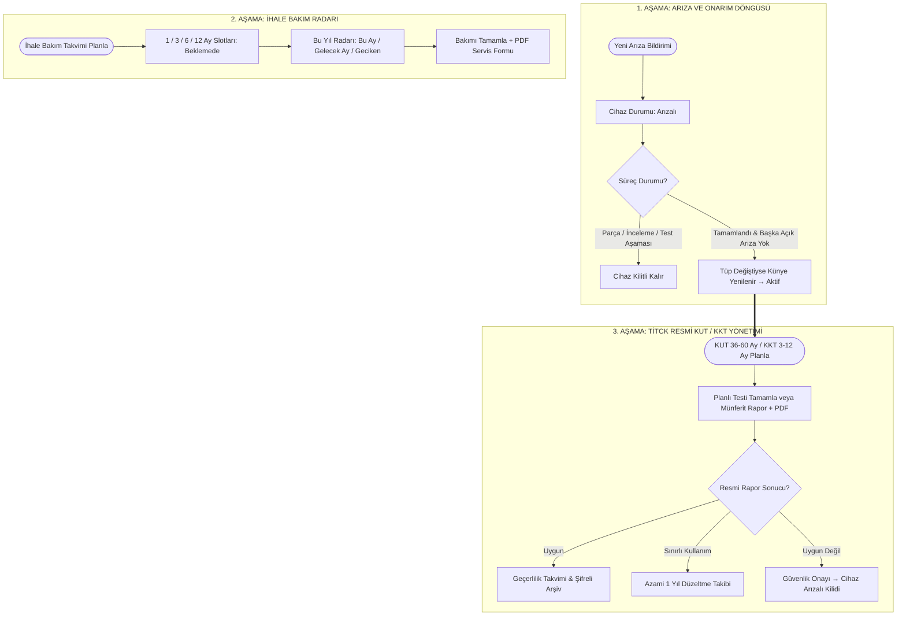

---json
{
  "pageTitle": "19. Cihaz Arıza, Periyodik Bakım ve Kalite Kontrol (KKT / KUT) — RADPYS v4 Kullanım Kılavuzu",
  "h1": "Cihaz Arıza, Periyodik Bakım ve Kalite Kontrol (KKT / KUT)",
  "lead": "Radyoloji ve tıbbi cihazların teknik arıza bildirimleri ile ara servis/test süreçlerini, X-ışını tüp değişimi künye senkronizasyonunu, ihale şartnamelerine bağlı Bu Yıl odaklı Periyodik Bakım Radarını ve TİTCK TCS-KLVZ-06 kılavuzuna uyumlu resmi rapor bazlı Kalite Uygunluk (KUT) / Periyodik Kalite Kontrol (KKT) süreçlerini tek merkezden yönetmenizi sağlar.",
  "overviewId": "overview",
  "badges": [
    {
      "text": "TİTCK TCS-KLVZ-06 & SKS 6.1",
      "tone": "emerald"
    }
  ],
  "readingTime": "6 Dakika",
  "legalNote": "<strong>Yasal Güvence:</strong> TİTCK kılavuzu uyarınca radyoterapi cihazlarında KUT 36 ay (3 yıl), diagnostik ve nükleer tıp cihazlarında KUT 60 ay (5 yıl), periyodik KKT ise 3/6/12 ay periyotla izlenir; Sınırlı Kullanım kararı azami 1 yıl içinde kapatılır, Kullanımı Uygun Değil kararında cihaz otomatik arızalı statüsüne kilitlenir."
}
---

## Kısa Reçete: Arıza Kapatma, İhale Bakım ve Resmi KUT/KKT Planlama {#quick-recipe}

:::recipe Kısa Reçete: İhale Bakım veya KUT/KKT Takvimi Planlama ve Raporla Kapatma | 20 SANİYELİK AKIŞ
### 1. İstenen Sonuç | slate
Cihazın sözleşme veya yasal periyot bitimine kadar olan tüm bakım ve kalite kontrol dönemlerinin takvime işlenmesi, işlem gerçekleştiğinde şifreli PDF formuyla kapatılması.

### 2. Yapılacak İşlem | cyan
İlgili modülden <strong>[İhale Bakım Takvimi Planla]</strong> veya <strong>[İhale Kalibrasyon / KUT Takvimi Planla]</strong> butonuna tıklayıp cihazları, tarihi ve periyodu seçin; dönem geldiğinde satırı seçip <strong>[Bakımı Tamamla]</strong> ya da <strong>[Planlı Testi Tamamla]</strong> üzerinden imzalı PDF raporu ekleyin.

### 3. Sistem Etkisi | emerald
Sözleşme bitimine kadar tüm slotlar Beklemede statüsüyle radara işlenir; kapatılan belgeler AES-256 Evrak Kasasında saklanır ve olumsuz QC kararında cihaz güvenlik kilidine alınır.

- [metric] İhale Bakım Periyotları | 1 / 3 / 6 / 12 Ay | cyan
- [metric] TİTCK KUT Geçerliliği | 36 Ay (RT) / 60 Ay (Rad.) | emerald
- [metric] Sınırlı Kullanım Takibi | Azami 1 Yıl Termin | amber
- [metric] Olumsuz QC Etkisi | Otomatik Arızalı Kilidi | rose
:::

## 5N1K Kural ve Arayüz Çözümleme Tablosu {#5w1h}

*Arıza çözüm ara statüleri, tüp değişimi senkronizasyonu, ihale bakım radarı, TİTCK resmi KUT/KKT rapor modeli ve güvenlik kilidi kuralları.*

| NE? (Bileşen / Kontrol) | NEDEN? (Amacı) | NASIL? (Çalışma Mantığı) | NE ZAMAN? (Tetiklenme) | KİM? (Yetkili Rol) |
| --- | --- | --- | --- | --- |
| <strong><strong>[Yeni Arıza Bildir]</strong> &amp; <strong>[Seçili Arızayı Çöz]</strong></strong> Esnek Durum &amp; QC Kilit Koruması | Arızalı cihazda çekimi durdurmak, her servis aşamasını takip etmek ve uygunsuz QC kilidinin kalkmasını önlemek. | Bildirimde cihaz otomatik Arızalı olur; müdahale geçmişi zaman ve kullanıcı damgasıyla korunur. Tüm arızalar kapansa bile son resmi QC sonucu Kullanımı Uygun Değil ise cihaz Aktif duruma açılmaz; hurda veya devredilmiş cihazlara işlem yapılamaz. | Cihazda arıza oluştuğunda veya servis sürerken. | Tekniker / Biyomedikal / RKS |
| <strong>X-Işını Tüp Değişimi &amp; <strong>[Teknik Rapor]</strong></strong> Zorunlu Seri No ve Künye Tutanağı | Ana radyasyon üreten tüpün değişimini eksiksiz seri numarasıyla cihaz künyesine işlemek. | Çözüm formunda tüp değişimi kutusu işaretlendiğinde yeni tüp seri numarası zorunlu tutulur ve cihaz künyesi güncellenir; <strong>[Teknik Rapor]</strong> ile yazdırılabilir A4 servis tutanağı oluşturulur. | X-ışını tüpü yenilendiğinde veya teknik rapor gerektiğinde. | Biyomedikal / RKS |
| <strong><strong>[İhale Bakım Takvimi Planla]</strong> &amp; Bu Yıl Radarı</strong> Tekil Slot ve 4 KPI Kartı | İhale sözleşmesine bağlı bakım aylarını mükerrer kayıt oluşturmadan önceden sabitlemek. | Seçilen aktif cihazlara sözleşme bitişine dek mükerrer açık slot açmadan 1, 3, 6 veya 12 aylık Beklemede slotları üretir; radar ekranı varsayılan Bu Yıl görünümüyle geciken ve yaklaşan bakımları gösterir. | Bakım ihalesi sonrası veya planlı takip açıldığında. | Klinik Amiri / Biyomedikal |
| <strong><strong>[Bakımı Tamamla]</strong> &amp; <strong>[Servis Formu (PDF)]</strong></strong> Şifreli Bakım Kapatma | Yapılan periyodik bakımı refakatçi ve servis formu PDF belgesiyle belgelemek. | Gerçekleşen tarih, teknisyen, değişen parça ve imzalı servis formu PDF dosyası AES-256 kasaya kaydedilir ve satır Tamamlandı statüsüne geçer. | Servis bakımı tamamlandığında. | Tekniker / RKS |
| <strong><strong>[İhale Kalibrasyon / KUT Takvimi Planla]</strong></strong> TİTCK Modalite Bazlı Periyot Motoru | KKT ve KUT kalibrasyon tarihlerini modalite mevzuatına göre tek atomik takvimde planlamak. | Seçilen kontrol türü ve cihaz modalitesine göre KUT için 36 veya 60 ay, KKT için 3, 6 veya 12 ay önerir; mükerrer açık slotları engelleyerek planlı test takvimini tek işlemde oluşturur. | KKT ihalesi veya yeni KUT dönemi başladığında. | Medikal Fizikçi / RKS |
| <strong><strong>[Planlı Testi Tamamla]</strong> / <strong>[Münferit Resmi Rapor Gir]</strong></strong> KUT, KKT ve Kabul/Onarım Testleri | Günlük kağıt formlar yerine yetkili KUK veya medikal fizikçi imzalı resmi raporları arşivlemek. | Yalnızca aktif cihazlar için rapor no, yapan kuruluş/KUK yetki belge no ve PDF rapor kasaya alınır; Sınırlı Kullanım kararı verilirse eksiklik giderme için azami 1 yıllık takip termini otomatik başlar. | Resmi KUT, KKT veya onarım sonrası test raporu gelince. | Medikal Fizikçi / RKS |
| <strong>Olumsuz QC Güvenlik Karantina Kilidi</strong> Doğrudan Kayıt ve Onay Kuyruğu Kilidi | Kalibrasyon veya radyasyon emniyeti başarısız çıkan cihazın hasta çekiminde kullanılmasını engellemek. | Tanımsız sonuç metinleri reddedilir; resmi test sonucu Kullanımı Uygun Değil seçildiğinde hem doğrudan kayıtta hem merkezi onay kuyruğundan onaylandığında cihaz anında Arızalı statüsüne çekilerek kilitlenir. | QC/KUT sonucu olumsuz işlendiğinde veya onaylandığında. | Medikal Fizikçi / Sistem |

## Kritik Sahada Yanlış Bilinen Kurallar (Mit Avcısı) {#myth-buster}

:::myth Günlük Kontrol Formları QC Ekranına mı Girilir ve X-Işını Tüpü Değişince İşlem Biter mi?
### Yanlış Algı
<em>"Kalite kontrol ekranına günlük kağıt çekim formlarını girmemiz gerekir; ayrıca X-ışını tüpü değiştiğinde arızayı kapatınca sistem dışı başka bir resmi işlem kalmaz."</em>

### Gerçek Sistem Mantığı
<strong>İkisi de doğru değildir.</strong> TİTCK TCS-KLVZ-06 kılavuzu uyarınca RADPYS yalnızca resmi imzalı raporla belgelenen üç yasal kategoriyi (Kalite Uygunluk KUT, Periyodik KKT ve Kabul/Onarım Sonrası Test) takip eder. Ayrıca arıza ekranında X-ışını tüpü değişimi işaretlenip kapatıldığında cihazın aktif tüp seri numarası künyede güncellenir; ancak tüp değişimi NDK lisansı açısından tadil/revizyon gerektirebileceğinden RKS biriminin gecikmeden NDK bildirimi yapması ve Kabul/Onarım Sonrası Test kaydını işlemesi şarttır.
:::

## Süreç Akış Şeması {#workflow}

1. **Arıza ve Onarım Döngüsü:** Arıza açılınca cihaz kullanım dışı sayılır; parça bekleme veya onarım sonrası test aşamalarında kilit korunur ve yalnızca tüm açık arızalar kapatıldığında (varsa yeni X-ışını tüpü işlenerek) cihaz Aktif duruma döner.
2. **İhale Bakım Radarı:** Sözleşme bitimine kadar üretilen tüm bakım tarihleri Bu Yıl varsayılan görünümünde izlenir ve imzalı PDF servis formu şifreli kasaya alınarak kapatılır.
3. **Resmi KUT/KKT ve Emniyet Kilidi:** KUT/KKT takvimi veya münferit resmi rapor sonucu Kullanımı Uygun ise geçerlilik başlatılır, Sınırlı Kullanım ise azami 1 yıllık termin açılır, Kullanımı Uygun Değil ise cihaz güvenlik kilidiyle Arızalı statüsüne çekilir.

## Arayüz Ekran Görünümleri {#screenshots}

## Adım Adım İşlem Rehberi {#step-by-step}

### 1. Cihaz Arızası Bildirme ve Müdahale Sürecini Yönetme

1. **Cihaz Arıza ve Onarım Takibi** ekranında **[Yeni Arıza Bildir]** butonuna tıklayın; arızalı cihazı, aciliyet seviyesini (Düşük, Normal, Yüksek, Acil), bildiren personeli ve hata kodunu/tanımını girip **[Arızayı Kaydet]** butonuna basın (cihaz envanterde otomatik Arızalı olur).
2. Servis müdahalesi başladığında satırı seçip **[Seçili Arızayı Çöz]** butonuna tıklayın. Üst alandaki salt okunur **Önceki Müdahale Geçmişi** kutusunda önceki teknisyen kayıtlarını silme riski olmadan inceleyip alttaki alana yalnızca yeni gelişme notunuzu yazın; ardından durumu esnek biçimde **Açık**, **Servis Bekleniyor**, **Parça Bekleniyor**, **Test Aşamasında** veya **Çözüldü** seçerek **[Süreç Durumunu Kaydet]** butonuna basın (her kayıt tarih, saat ve kullanıcı adı damgasıyla geçmişe eklenir).
3. Tüm onarım tamamlanıp **Çözüldü** aşamasına geçerken servis firmasını, çözen kişiyi ve son teknik notu girin; tüp yenilendiyse **X-Işını Tüp Değişimi Var** kutusunu işaretleyip yeni seri numarasını ekleyin. **[Belge / Form Seç]** ile servis formunu bağlayıp **[Teknik Rapor]** üzerinden A4 tutanağını kontrol edin ve **[Arızayı Çöz ve Kapat]** butonuna basın.

### 2. İhale Şartnamesine Göre Periyodik Bakım Planlama ve Kapatma

1. **Cihaz Periyodik Bakım ve Sözleşme Takibi** ekranında üst kartlardan (Bu Ay Planlanan, Gelecek Ay, Geciken, Tamamlanan) durumu izleyin ve **[İhale Bakım Takvimi Planla]** butonuna tıklayın.
2. Açılan pencerede marka/modalite veya arama süzgeciyle bir ya da birden fazla cihazı işaretleyin (gerekirse **[Tümünü Seç]** / **[Seçimi Temizle]** kullanın); ilk bakım tarihi, sözleşme bitişi ve bakım periyodunu (1, 3, 6 veya 12 ay) girip **[Bakım Takvimini Oluştur]** butonuna basın.
3. Bakım yapıldığında ilgili satıra çift tıklayın veya **[Bakımı Tamamla]** butonuna basın; refakat eden personel, teknisyen ve yapılan işlemleri girip **[PDF Form Seç...]** ile ıslak imzalı formu ekleyin ve **[Bakımı Tamamla ve Kaydet]** butonuna tıklayın (kayıtlı belgeleri **[Servis Formu (PDF)]** veya **[Görüntüle]** ile açabilirsiniz).

### 3. TİTCK Resmi Kalite Kontrol (KUT / KKT) Takibi ve Karantina Kilidi

1. **Cihaz Kalite Kontrol (KKT), Kalite Uygunluk (KUT) ve Kalibrasyon Takibi** ekranında çoklu cihaz planlaması için **[İhale Kalibrasyon / KUT Takvimi Planla]** butonuna tıklayın; modalite seçimine göre sistemin önerdiği yasal periyodu (KUT için Radyoterapi 36 ay, Diagnostik/Nükleer Tıp 60 ay; KKT için 3/6/12 ay) ve sözleşme bitiş tarihini onaylayıp **[Kalibrasyon / QC Takvimini Oluştur]** butonuna basın.
2. Planlanan tarihte testi tamamlamak için satırı seçip **[Planlı Testi Tamamla]**, ihale dışı kurulum/tüp değişimi sonrası tekil rapor için **[Münferit Resmi Rapor Gir]** butonuna tıklayın.
3. Kontrol türünü (**Kalite Uygunluk Testi — KUT**, **Periyodik Kalite Kontrol — KKT** veya **Kabul / Onarım Sonrası Doğrulama Testi**), rapor no, yapan kuruluş ve KUK yetki belge numarasını yazıp **[PDF / Rapor Seç...]** ile imzalı raporu ekleyin.
4. Sonucu (**Kullanımı Uygun**, **Sınırlı Kullanım** veya **Kullanımı Uygun Değil**) seçip kaydedin; **Uygun Değil** sonucunda açılan güvenlik uyarısını onayladığınızda cihaz otomatik Arızalı statüsüne kilitlenir (tüm kayıtları **[İmzalı Rapor (PDF)]** ve **[Dışa Aktar]** üzerinden inceleyip Excel/PDF/Word aktarabilirsiniz).

### 4. Web Portalı ve Mobil QR ile Saha Teknisyen Akışı

1. Saha teknikeri veya sorumlusu Web Portalındaki **Cihaz Eşleştirme ve Seçim Merkezi** çubuğundan birim, modalite, durum veya arama süzgecini kullanarak cihazı seçebilir ya da **[QR Tara]** düğmesiyle cihazın etiketini kameradan okutup satır içi **Cihaz Pasaport Kartını** anında açabilir.
2. Pasaport kartının altındaki dört operasyonel sekmeden (**Arıza Bildir / Müdahale**, **Bakım İşlemleri**, **Kalite Kontrol** ve **Tarihçe**) açık arızalara esnek statü ve zaman damgalı silinemez müdahale notu eklenebilir, planlı/münferit bakım ve KKT/KUT testleri imzalı PDF formuyla sahadan kapatılabilir veya mevcut şifreli belgeler görüntülenebilir.

## Sıkça Sorulan Sorular (SSS) {#faq}

:::faq
### Periyodik bakım ekranı açıldığında neden varsayılan olarak Bu Yıl filtresi gelir?
Önceki veya gelecek yıllara ait yüzlerce ihale slotu arasında günlük takibin kaybolmasını önlemek için ekran doğrudan içinde bulunulan yılın bakım takvimini ve aylık radar sayaçlarını öne çıkarır. Geçmiş yıl kayıtlarını incelemek istediğinizde üst filtre çubuğundan zaman seçimini değiştirmeniz yeterlidir.

### Arıza çözüm penceresinde Test Aşamasında seçilirse cihaz neden hemen Aktif olmaz?
Büyük parça veya X-ışını tüp değişimi sonrasında teknik servis onarımı bitirse bile medikal fizikçinin kabul/doğrulama ve doz kontrol testleri henüz tamamlanmamış olabilir. <strong>Test Aşamasında</strong> ara statüsü cihazın onarımın ilk aşamasını geçtiğini gösterirken testler bitene kadar klinik hasta çekimini güvenle bekletir.

### Sınırlı Kullanım sonucu girildiğinde 1 yıllık termin ne anlama gelir?
TİTCK düzenlemeleri gereğince cihazda çalışmayı tamamen durdurmayan ancak düzeltilmesi gereken kusurlar varsa <strong>Sınırlı Kullanım</strong> kararı verilir. Sistem test tarihinden itibaren azami 1 yıllık düzeltme ve tekrar kontrol termini hesaplar ve rapor tablosunda ayrıca vurgular.

### Bakım veya arıza işlemlerinde maliyet tutarı girilmesi zorunlu mudur?
Hayır. RADPYS V4 arıza ve bakım modülleri finansal fatura muhasebesi yerine teknik servis sürelerini, cihaz duruş güvenliğini, parça/tüp değişim tarihçesini ve ıslak imzalı resmi servis/QC formlarının şifreli izlenebilirliğini yönetmek üzere kurgulanmıştır.
:::
