---json
{
  "pageTitle": "19. Cihaz Arıza, Periyodik Bakım ve Kalite Kontrol (QA/QC) — RADPYS v4 Kullanım Kılavuzu",
  "h1": "Cihaz Arıza, Periyodik Bakım ve Kalite Kontrol (QC)",
  "lead": "Radyoloji departmanındaki tüm tıbbi cihazların teknik arıza ve onarım süreçlerini, ihale şartnamelerine dayalı <strong>Aylık Bakım Radarı</strong> ile planlanan periyodik bakım takvimlerini ve 4 adımlı modern sihirbaz üzerinden yürütülen Kalite Kontrol (QC) / kalibrasyon testlerini yöneten entegre karar destek merkezidir.",
  "overviewId": "overview",
  "badges": [
    {
      "text": "NDK & SKS 6.1 Uyumlu",
      "tone": "emerald"
    }
  ],
  "readingTime": "5 Dakika"
}
---

## Kısa Reçete (20 Saniye Kuralı) {#quick-recipe}

:::recipe Hızlı Reçete: İhale Bakım Takvimi Oluşturma ve Bakım Kapatma | 20 SANİYELİK AKIŞ
### 1. İstenen Sonuç | cyan
Radyoloji cihazının ihale sözleşmesi sonuna kadar olan tüm periyodik bakım aylarının önceden belirlenmesi ve bakım günü geldiğinde ıslak imzalı servis formuyla kapatılması.

### 2. Yapılacak İşlem | cyan
<strong>[Periyodik Bakım Yönetimi]</strong> ekranından <strong>[İhale Bakım Takvimi Planla]</strong> butonuna tıklayın. Cihazı, ilk bakım tarihini, sözleşme bitişini ve periyodu (1, 3, 6 veya 12 Ay) seçip takvimi oluşturun. Bakım yapıldığında <strong>[Bakımı Tamamla]</strong> ile servis formu PDF'ini yükleyin.

### 3. Sistem Etkisi & Güvence | cyan
Sözleşme bitimine kadar tüm randevu slotları otomatik olarak takvime işlenir. Aylık radar kartlarında yaklaşan veya geciken bakımlar anında görülür; servis formları KVKK kasasında şifrelenir.

- [metric] İhale Periyodu | 1, 3, 6, 12 Ay | cyan
- [metric] Yetkili Rol | Klinik Amiri / Fizikçi | slate
- [metric] QC Güvenlik Durumu | Otomatik Karantina | rose
- [metric] Platform | Masaüstü + Web / QR | emerald
:::

## Kritik Sahada Yanlış Bilinen Kurallar (Mit Avcısı) {#myth-buster}

:::myth Kritik Sahada Yanlış Bilinen Kural (Mit Avcısı)
### Yanlış Algı:
<em>"Cihaz bakımları arıza çıktığında veya yetkili servis ansızın hastaneye geldiğinde sisteme işlenir; radyolojinin bunu önceden takip etmesine gerek yoktur."</em>

### Gerçek Sistem Mantığı:
Periyodik bakım ve arıza tamamen ayrı süreçlerdir. Radyoloji cihazlarının bakımı ihale şartnamesine bağlıdır. Sistem, sözleşme bitimine kadar tüm bakım dönemlerini takvime <strong>Beklemede</strong> olarak önceden işler; böylece klinik bakım dönemini önceden bilir ve servisin son dakika *"bugün cihazı kapatıyoruz"* sürprizleri engellenir.
:::

## 5N1K Kural ve Ayar Çözümleme Tablosu {#matrix-5n1k}

 

 

 Arıza ve onarım, periyodik bakım radarı ve kalite kontrol sihirbazının operasyonel kuralları.
 

 

 

 

| NE? (Ekran Kontrolü) | NEDEN? (Amacı) | NASIL? (Çalışma Mantığı) | NE ZAMAN? | KİM? |
| --- | --- | --- | --- | --- |
| Yeni Arıza Bildirimi  [Yeni Arıza Bildir Butonu] | Cihazın bozulduğunu sisteme işleyip hasta çekimlerini durdurmak. | Cihaz seçilir, aciliyet ve arıza tanımı girilir. Cihaz genel listede otomatik olarak 'Arızalı' statüsüne geçer. | Cihazda fiziksel veya yazılımsal arıza çıktığında. | Tekniker / Hekim |
| Arızayı Çözümleme ve Kapatma  [Seçili Arızayı Çöz Butonu] | Teknik servis müdahalesini belgeleyip cihazı tekrar hizmete açmak veya test aşamasına almak. | Çözüm açıklaması, dış servis firması ve kurum içi çözen personel bilgisi birlikte kaydedilir; devam eden arızalarda önceki müdahale tarihi korunur. Cihaz doğrudan 'Aktif' statüsüne döndürülebileceği gibi, klinik doğrulama süresince 'Test Aşamasında' ara durumunda tutularak hasta güvenliği garantiye alınabilir. | Yetkili servis arızayı giderip test sürecini başlattığında veya bitirdiğinde. | Biyomedikal / RGS |
| X-Işını Tüp Değişimi Onayı  [X-Işını Tüp Değişimi Var Kutusu] | Cihazın ana radyasyon jeneratörünü güncellemek ve NDK lisansına esas künyeyi yenilemek. | Yeni tüp seri no ve tüp modeli girilir. Sistem cihaz künyesindeki aktif tüpü otomatik günceller. | Tüp arızasında veya ömrü bittiğinde yenisi takıldığında. | Biyomedikal / RGS |
| Aylık Bakım Radarı Sayaçları  [Bu Ay / Gelecek Ay / Geciken Kartları] | Radyolojinin bakım aylarını önceden bilmesini sağlayıp son dakika servis sürprizlerini engellemek. | Bu ay planlananlar, gelecek ayın yoğunluğu ve geciken bakımlar renkli rozetlerle canlı olarak hesaplanır. | Periyodik Bakım sayfası her açıldığında. | Radyoloji Sorumlusu |
| İhale Bakım Takvimi Planlama  [İhale Bakım Takvimi Planla Butonu] | İhale şartnamesine göre sözleşme sonuna kadar bakım randevu slotlarını tek tıkla üretmek. | Cihaz, ilk bakım tarihi, sözleşme bitişi ve periyot (1, 3, 6, 12 ay) seçilir; sistem tüm randevuları 'Beklemede' olarak takvime işler. | Yıllık bakım ihalesi/sözleşmesi tamamlandığında. | Klinik Amiri / Biyomedikal |
| Bakımı Tamamla & Servis Formu  [Bakımı Tamamla Butonu] | Yapılan periyodik bakımı imzalı servis raporuyla kapatmak ve KVKK kasasında saklamak. | Gerçekleşen tarih, refakat eden personel, teknisyen ve taranmış servis formu (PDF) seçilir. Belge şifrelenir ve durum 'Tamamlandı' olur. | Yetkili servis bakımı bitirip servis formunu imzalattığında. | Tekniker / RKS |
| 4 Adımlı QC Sihirbazı  [Yeni QC Kaydı / Adımlı Stepper] | Kalite kontrol ve kalibrasyon ölçümlerini karmaşadan uzak, 4 adımlı akışla hatasız girmek. | 1. Cihaz/Protokol 2. Ekipman/Ekip 3. Canlı Ölçümler 4. Değerlendirme & Onay adımlarıyla ilerlenir. | Periyodik kalite kontrol veya kalibrasyon yapıldığında. | Medikal Fizik Uzmanı |
| Canlı Ölçüm Tablosu Tek Tık Girişi  [Canlı Ölçümler Tablo Hücresi] | Ölçüm değerlerini çift tıklama veya F2 engeli olmadan akıcı girmek. | Hücreye tek tıkla dokunulduğunda doğrudan sayısal değer girilebilir; tabular font ile sütunlar hizalanır. | Ölçüm tablosu doldurulurken. | Medikal Fizik Uzmanı |
| QC Başarısızlık Karantina Kilidi  [Güvenlik Uyarısı Onayı] | Standart dışı radyasyon yayan veya kalibrasyonu bozuk cihazın kullanımını engellemek. | Sonuç 'Uygun Değil' kaydedildiğinde güvenlik uyarısı açılır; onaylandığında cihaz otomatik 'Arızalı' statüsüne kilitlenir. | QC sonucu olumsuz kaydedildiğinde. | Medikal Fizikçi / Sistem |

 

## Arıza, Bakım ve Kalite Kontrol Yaşam Döngüsü {#workflow}

 Aşağıdaki şema; arıza bildirimi ve parça değişimini, ihale şartnamesine dayalı periyodik bakım döngüsünü ve 4 adımlı QC ölçüm sürecini özetlemektedir.

```mermaid
flowchart TB
 subgraph S1["1. Arıza ve Onarım Döngüsü"]
 A["Arıza Tespit Edilir"] --> B["[Yeni Arıza Bildir]"]
 B --> C["Cihaz Durumu: 'Arızalı'"]
 C --> D["Teknik Servis Müdahalesi"]
 D --> E{"Tüp Değişimi Var mı?"}
 E -- "Evet" --> F["Yeni Tüp Seri No Künyeye İşlenir"]
 E -- "Hayır" --> G["Standart Parça Değişimi"]
 F --> H["Cihaz Durumu: 'Aktif'"]
 G --> H
 end

 subgraph S2["2. İhale Bakım Takvimi & Aylık Radar"]
 I["Yıllık İhale Şartnamesi"] --> J["[İhale Bakım Takvimi Planla]"]
 J --> K["Periyot Seçilir: 1, 3, 6 veya 12 Ay"]
 K --> L["Sözleşme Sonuna Kadar Slotlar Üretilir: 'Beklemede'"]
 L --> M["Aylık Bakım Radarı: Bu Ay / Gelecek Ay / Geciken"]
 M --> N["Firma Gelir: Bakım Gerçekleşir"]
 N --> O["[Bakımı Tamamla] + İmzalı Servis Formu (PDF)"]
 O --> P["KVKK Kasasına Şifreli Arşivlenir & 'Tamamlandı'"]
 end

 subgraph S3["3. 4 Adımlı QC Sihirbazı & Emniyet Kilidi"]
 Q["Periyodik QC Zamanı"] --> R["[Yeni QC Kaydı] Sihirbazı"]
 R --> S["Adım 1-2: Cihaz, Protokol & Ekipman"]
 S --> T["Adım 3: Canlı Ölçümler (Tek Tıkla Giriş)"]
 T --> U["Adım 4: Değerlendirme & Onay"]
 U --> V{"Test Sonucu Uygun mu?"}
 V -- "Uygun" --> W["Geçerlilik Takvimi Başlar (12 Ay)"]
 V -- "Uygun Değil" --> X["Güvenlik Kilidi: Cihazı 'Arızalı'ya Al ve Kilitle"]
 end
```
 

 

 

 

 

 1. Arıza & Künye Güvencesi
 

 Arıza anında hasta alımı durdurulur; X-ışını tüpü değiştiğinde seri numarası anında künyeye senkronize edilir.
 

 

 

 2. Proaktif Bakım Radarı
 

 Radyoloji kliniği bakım aylarını önceden bilir; firmanın son dakika *"bugün cihazı kapatıyoruz"* sürprizleri önlenir.
 

 

 

 3. Negatif QC Emniyet Kilidi
 

 Doz veya sızıntı ölçümünde olumsuz sonuç tespit edildiğinde cihaz anında kullanıma kapatılarak karantinaya alınır.
 

 

 

## Ekran Konumları ve Görsel Rehber {#screenshots}

![Cihaz Arıza Bildirim ve Çözüm Formu | Cihaz Arıza ve Onarım Takibi > [Yeni Arıza Bildir / Arızayı Çöz] | Arıza Kayıt & Çözüm Diyaloğu](assets/img/19_2_cihaz_ariza_bakim_ve_kalite_kontrol_qc.png "<strong>Simülasyon Notu:</strong> Arıza aciliyet seviyesi, klinik duruş süresi ve onarım sonrası test/doğrulama statüsü yönetimi.")

![Periyodik Bakım Planlama ve Tamamlama Formu | Periyodik Bakım Yönetimi > [İhale Bakım Takvimi Planla / Bakımı Tamamla] | Bakım Planlama & Servis Formu Kasası](assets/img/19_4_cihaz_ariza_bakim_ve_kalite_kontrol_qc.png "<strong>Simülasyon Notu:</strong> Sözleşme bitiş tarihine kadar otomatik bakım slotu üretimi ve ıslak imzalı servis formu (PDF) arşivleme.")
 test sonuçları ana listesi.")
![4 Adımlı Cihaz Kalite Kontrol Sihirbazı | Cihaz QC Kokpiti > [Yeni QC Kaydı] 4 Adımlı Sihirbaz | 4 Adımlı RDS QC Ölçüm Sihirbazı](assets/img/19_6_cihaz_ariza_bakim_ve_kalite_kontrol_qc.png "<strong>Simülasyon Notu:</strong> Canlı ölçüm girişi, otomatik sapma/tolerans kontrolü ve tolerans aşımında otomatik karantina kilidi.")

## Adım Adım Operasyonel Eylem Akışı {#step-by-step}

 

 <strong class="text-slate-900 dark:text-white text-base block mb-2">Bölüm 1: Cihaz Arızası Bildirme ve Onarımı Kapatma</strong>
 <strong>[Cihaz Yönetimi]</strong> menüsünden <strong>[Cihaz Arıza ve Onarım Takibi]</strong> ekranını açın. Sol üstteki <strong>[Yeni Arıza Bildir]</strong> butonuna tıklayın. Açılan formda arızalanan tıbbi cihazı seçin, aciliyet derecesini ve arıza tanımını girip <strong>[Kaydet]</strong> butonuna basın. Cihaz anında listede kırmızı 'Arızalı' olarak işaretlenir. Yetkili servis arızayı giderdiğinde ilgili satırı seçip <strong>[Seçili Arızayı Çöz]</strong> butonuyla yapılan müdahaleyi kaydedin. Parça değişimi veya onarım sonrası klinik doğrulama/fantom testleri yürütülürken cihazı <em>'Test Aşamasında'</em> ara statüsünde tutarak hasta çekimini güvenle bekletebilir, testler başarıyla bittiğinde tek tıkla arızayı tamamen kapatıp cihazı 'Aktif' kılabilirsiniz. Eğer X-ışını tüpü değişmişse onay kutusunu işaretleyip yeni tüp seri numarasını işleyin.
 

 

 <strong class="text-slate-900 dark:text-white text-base block mb-2">Bölüm 2: İhale Şartnamesine Göre Bakım Takvimi Oluşturma ve Kapatma</strong>
 <strong>[Cihaz Yönetimi]</strong> menüsünden <strong>[Periyodik Bakım Yönetimi]</strong> ekranına geçin. Üstteki <strong>[İhale Bakım Takvimi Planla]</strong> butonuna tıklayın. Cihazı, ilk bakım tarihini, sözleşme bitiş tarihini ve ihale şartnamesinde yer alan bakım periyodunu (1, 3, 6 veya 12 Ay) seçin. Sistem sözleşme sonuna kadar tüm bakım tarihlerini otomatik hesaplar ve takvime 'Beklemede' olarak işler. Bakım günü gelip servis işlemi tamamlandığında satırı seçip <strong>[Bakımı Tamamla]</strong> butonuna basın; refakat eden personeli, servis teknisyenini seçip taranmış ıslak imzalı <strong>Servis Formu (PDF)</strong> belgesini ekleyin.
 

 

 <strong class="text-slate-900 dark:text-white text-base block mb-2">Bölüm 3: 4 Adımlı QC Sihirbazı ile Canlı Ölçüm ve Kalibrasyon Kaydı</strong>
 <strong>[Cihaz Yönetimi]</strong> menüsünden <strong>[Cihaz QC Kokpiti]</strong> ekranını açın ve <strong>[Yeni QC Kaydı]</strong> butonuna tıklayın. Karşınıza 4 adımlı modern sihirbaz gelir:
 <ul class="list-disc pl-5 mt-2 space-y-1 text-xs">
 <li><strong>1. Cihaz & Protokol:</strong> Cihazı ve uygulanacak test protokolünü (Üretici, Türkak, NDK, DIN) belirleyin.</li>
 <li><strong>2. Ekipman & Ekip:</strong> Testte kullanılan kalibratör/fantom ekipmanlarını ve ölçümü yürüten medikal fizikçiyi seçin.</li>
 <li><strong>3. Canlı Ölçümler:</strong> Doz doğruluğu, tekrarlanabilirlik ve sızıntı tablosundaki hücrelere tek tıkla dokunarak ölçülen değerleri girin.</li>
 <li><strong>4. Değerlendirme & Onay:</strong> Sistem tolerans analizini anında yapar; genel sonucu (Uygun / Şartlı / Uygun Değil) onaylayın. Sonuç uygunsuz ise sistem cihazı otomatik olarak arızalıya alıp kilitler.</li>
 </ul>
 

 

## Hibrit Platform Matrisi (Masaüstü vs Web Portal) {#hybrid-platform}

 

 <h3 class="text-base font-bold text-slate-900 dark:text-white flex items-center gap-2">
 
 Masaüstü Uygulaması (Yetkili Yönetim Merkezi)
 </h3>
 <ul class="space-y-2 text-xs text-slate-600 dark:text-slate-300">
 <li>• Yeni arıza bildirimleri ve X-ışını tüp değişim onayı ile künye senkronizasyonu.</li>
 <li>• Aylık Bakım Radarı (Bu Ay, Gelecek Ay, Gecikenler, Tamamlananlar) canlı izleme.</li>
 <li>• İhale şartnamesine göre 1/3/6/12 aylık periyotlarla sözleşme takvimi üretme.</li>
 <li>• 4 adımlı QC sihirbazı üzerinden canlı ölçüm girişi ve negatif QC karantina kilidi.</li>
 <li>• AES-256 Fernet şifreli evrak kasasına PDF servis formu ve QC raporu bağlama.</li>
 </ul>
 

 

 <h3 class="text-base font-bold text-slate-900 dark:text-white flex items-center gap-2">
 
 Web Portalı & Mobil Barkod (Saha Teknisyen Görünümü)
 </h3>
 <ul class="space-y-2 text-xs text-slate-600 dark:text-slate-300">
 <li>• Cihaz üzerindeki QR etiketi tarayarak arıza bildirim formunu sahada anında açma.</li>
 <li>• Cihazın son QC test durumunu ve geçerlilik süresini yeşil/sarı/kırmızı rozetle doğrulama.</li>
 <li>• Açık arıza listesi takibi ve mobil teknisyen servis müdahale kapatma formu.</li>
 <li>• Saha denetimlerinde cihaza ait son test tutanağını mobilde görüntüleme.</li>
 </ul>
 

 

## Hata Mesajları ve Sorun Giderme Rehberi {#troubleshooting}

| Hata / Uyarı Mesajı | Olası Neden | Çözüm Adımı |
| --- | --- | --- |
| "İlk bakım tarihi sözleşme bitiş tarihinden sonra olamaz!" | Bakım planlama penceresinde ilk bakım tarihi bitiş tarihinden ileri seçildiğinde. | İlk bakım tarihini sözleşme başlangıç/ihale tarihine uygun şekilde geriye çekiniz. |
| "Lütfen arıza tanımını giriniz." | Arıza açıklama kutusu doldurulmadan kaydet butonuna basıldığında. | Cihazda görülen arıza belirtisini en az birkaç kelimeyle özetleyiniz. |
| "Tüp değişimi seçildi ancak yeni tüp seri numarası girilmedi." | Tüp değişimi kutusu işaretlenip seri no alanı boş bırakıldığında. | Servis tutanağındaki yeni X-ışını tüpünün seri numarasını yazınız. |
| "Bu kayda ait şifreli servis formu kasada bulunamadı." | Bakım kapatılırken PDF servis formu yüklenmediğinde veya dosya seçilmediğinde. | Bakım kaydını açıp imzalı servis formunu [Servis Formu Seç] ile tekrar yükleyiniz. |

 

## Sıkça Sorulan Sorular ve Saha Çözümleri {#faq}

:::faq
### Periyodik bakım modülünün radyoloji kliniği için temel faydası nedir?
RADPYS'de periyodik bakım modülü, karmaşık bir atölye veya parça stok sistemi değildir. Amaç, radyoloji kliniğinin kendi cihazlarının bakım dönemlerini önceden bilmesi; unutulan bakımları ve servis firması veya biyomedikal ekibinin son dakika *"bugün bakım var, cihazı 4 saat kapatıyoruz"* sürprizlerini tamamen önlemektir. Bu sayede hasta randevuları bakım dönemlerine göre önceden ayarlanır.

### İhale şartnamesine göre bakım periyotları nasıl çalışır?
Hastanelerde cihaz bakımları 1, 3, 6 veya 12 aylık periyotlarla ihale edilir. Planlama sihirbazında cihaz, ilk bakım tarihi ve sözleşme bitiş tarihi seçildiğinde, sistem sözleşme bitimine kadar olan tüm bakım randevu tarihlerini otomatik hesaplar ve takvime tek seferde "Beklemede" olarak kaydeder.

### QC ölçüm tablosunda hücreye sayısal değer nasıl girilir?
Yeni sihirbaz yapısında ölçüm tablosu veri girişine tamamen açıktır. İlgili ölçüm hücresine (Doz, Gerilim, Sızıntı vb.) tek bir tıklama yapıldığında hücre doğrudan düzenleme moduna geçer ve klavyeden ölçüm değeri kesintisiz yazılabilir. Çift tıklama veya F2 zorunluluğu kaldırılmıştır.

### X-Işını tüpü değiştiğinde NDK lisansı için ne yapılmalıdır?
X-ışını tüpü radyasyon kaynağının ana jeneratörüdür. Sistemde tüp değişimi kaydedildiğinde cihaz künyesindeki güncel tüp seri numarası otomatik yenilenir. NDK Radyasyon Güvenliği Mevzuatı uyarınca tüp değişimi lisans tadili/revizyonu gerektirebileceğinden işlem tamamlandığında RKS birimi derhal NDK sistemine resmi bildirimde bulunmalıdır.
:::
