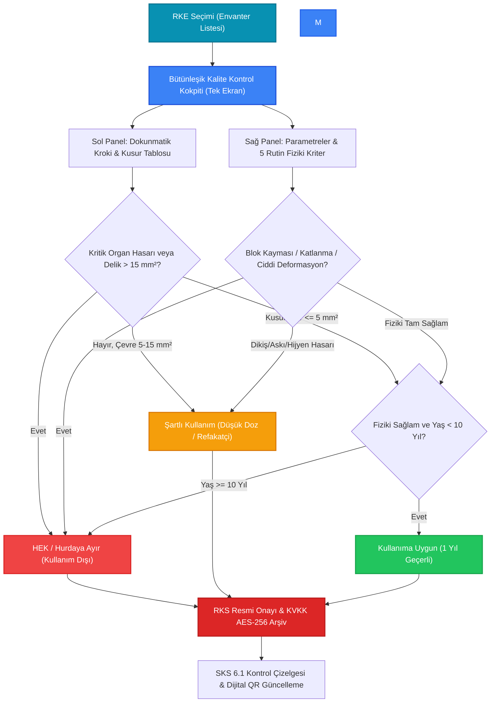

---json
{
  "pageTitle": "20. Radyasyon Koruyucu Ekipman (RKE) ve DIN 6857 Muayenesi — RADPYS v4 Kullanım Kılavuzu",
  "h1": "20. Radyasyon Koruyucu Ekipman (RKE) & DIN 6857 Kalite Kontrol Yönetimi",
  "lead": "Radyoloji, nükleer tıp, kardiyoloji ve skopi ameliyathanelerinde kullanılan kurşun önlük, palto, etek-yelek, tiroid ve gonad koruyucularının yaşam döngüsünü, akıllı kodlamasını, fiziksel kontrollerini, skopi altındaki interaktif delik/çatlak krokisini, matematiksel karar motorunu ve Sağlık Bakanlığı SKS 6.1 resmi denetim çizelgelerini yönetin.",
  "overviewId": "overview",
  "badges": [],
  "readingTime": "6 Dakika"
}
---

## Kısa Reçete (20 Saniye Kuralı) {#hizli-recete}

:::recipe Hızlı Reçete (20 Saniye Kuralı) | 20 SANİYELİK AKIŞ
Tablodan ekipmanı seçin <strong class="text-cyan-700 dark:text-cyan-300">[Muayene Yap]</strong> butonuna basın Bütünleşik Kokpitte sol taraftaki dokunmatik krokiye tıklayarak kusurları pinleyin, sağ taraftaki 5 rutin fiziki kriteri onaylayın veya ekipman kusursuzsa doğrudan <strong class="text-emerald-700 dark:text-emerald-300">[1-Tıkla Kusursuz / Uygun Onayla]</strong> butonuna basın.
:::

## 5N1K Kural ve Ayar Çözümleme Tablosu {#5n1k-tablosu}

 Aşağıdaki tablo, koruyucu donanım yönetiminde kullanılan tüm operasyonel fonksiyonları, kısıtları, formülleri
 ve yetki sınırlarını teknik kod karmaşası olmaksızın açıklar:
 

| NE? (Ayar & Ekran Bileşeni) | NEDEN? (Gerekçe & Amaç) | NASIL? (Çalışma Mantığı & Formül) | NE ZAMAN? (Tetiklenme Anı) | KİM? (Yetkili Rol) |
| --- | --- | --- | --- | --- |
| [Yeni Ekipman]  Ana Toolbar Butonu | Yeni satın alınan koruyucu önlük veya donanımı envantere işlemek. | Tip, klinik departman, ön/arka kurşun eşdeğeri, beden ve marka seçilir. Sistem benzersiz kod üretir. | Klinik tesliminde veya ilk kabulde. | Medikal Fizikçi, RKS |
| Akıllı Kod Önerisi  Otomatik Format | Departman ve tip bazında mükerrersiz standart künye oluşturmak. | <code class="font-mono text-xs bg-slate-100 dark:bg-slate-800 px-1 py-0.5 rounded">RKE-[KISA_KOD]-[DEPT]-[SIRA]</code> şablonu (Örn: <code class="font-mono text-xs text-cyan-600">RKE-Ö-RAD-001</code>). | Tip veya departman kutusu değiştirildiğinde. | Sistem (Otomatik) |
| [Muayene ve QC]  Kalite Kontrol Kokpiti | DIN 6857-1 standardına göre yıllık delik, çatlak ve fiziksel kontrol yapmak. | Çift modlu ekran açılır; 5 fiziksel kriter kontrol edilir veya dokunmatik SVG krokide delikler işaretlenir. | Yıllık periyotta veya şüphe durumunda. | Medikal Fizik Uzmanı |
| İnteraktif Kusur Krokisi  Dokunmatik SVG Tuvali | Skopi görüntüsündeki radyasyon sızıntı noktalarını milimetrik haritalamak. | Ön/Arka silüet üzerine tıklanarak delik/çatlak pini konur; çap (mm) ve alan (mm²) otomatik hesaplanır. | Skopi altında tarama yapılırken. | Medikal Fizikçi |
| DIN 6857-1 Karar Motoru  Otomatik Yasal Eşikler | Hata payını sıfırlamak ve dünya standartlarında yasal karar üretmek. | • Kritik Organ: &gt; 0 mm² → <strong>HEK / Hurda</strong>.  • Non-Kritik: ≤ 5 mm² → <strong>Uygun</strong>, 5–15 mm² → <strong>Şartlı</strong>, &gt; 15 mm² → <strong>HEK</strong>. | Tuvale her kusur pini eklendiğinde/silindiğinde. | Sistem (Otomatik) |
| 10+ Yıl Kullanım Ömrü Uyarısı  Ömür & Malzeme Yorulması | Eski kurşun katmanların görünmeyen yorulmasına karşı erken uyarı üretmek. | Donanım yaşı ≥ 10 yıl ise sistem karar rozetinde <em>"10+ Yıl Ömür Aşımı -> HEK Önerisi"</em> uyarısı üretir. | Muayene formu açıldığında ve kaydedilirken. | Sistem (Kurumsal İnisiyatif) |
| [1-Tıkla Kusursuz / Uygun Onayla]  Hızlı Muayene Butonu | Toplu tarama günlerinde hatasız ekipmanları saniyeler içinde onaylamak. | Tüm fiziki kriterleri tam sağlam yapar, kusurları sıfırlar, kararı "Kullanıma Uygun" yapıp doğrudan kaydeder. | Görsel ve radyolojik kusur bulunmadığında. | Medikal Fizikçi, Yetkili Tekniker |
| [Toplu Muayene]  Toplu Kalite Kontrol | Klinikteki onlarca donanımı tek ekranda seçip toplu muayeneden geçirmek. | [Gecikenleri Seç] ile işaretleme yapılır, skopi cihazı ve varsayılan karar seçilip tek işlemle kaydedilir. | Yıllık departman taramalarında. | Medikal Fizik Uzmanı, RKS |
| [Zimmet Transfer]  Birim & Personel Devri | Önlüğün zimmetli olduğu personeli veya bağlı olduğu odayı/kliniği değiştirmek. | Hedef birim, teslim eden/alan personel ve gerekçe girilir; zimmet hareket kaydı tescil edilir. | Personel değişimi veya oda transferinde. | Birim Sorumlusu, RKS |
| Hurda Devir Güvenlik Kilidi  Emniyet Kilidi | Hurdaya ayrılmış, resmi EBYS tutanağıyla mühürlenmiş veya kayıp önlüklerin değiştirilmesini ve personele dağıtılmasını önlemek. | Ekipman durumu HEK veya Kayıp ise transfer formu açıldığında uyarı verilir ve kaydet butonu kilitlenir. | Geçersiz ekipmana zimmet yapılmak istendiğinde. | Sistem (Otomatik Kilit) |
| [QR Etiket] & Toplu Baskı Paketi (.ZIP)  [Toplu QR Etiket İhracı] / Sağ Tık Menüsü | Önlüğe dikilecek suya dayanıklı dijital kimlik etiketini tekil basmak veya matbaa üretimi için tüm önlük etiketlerini topluca paketlemek. | Tekil QR etiketi basılabilir veya üst araç çubuğundaki [Toplu QR Etiket İhracı] ve sağ tık menüsünden seçili/tüm ekipmanlar için 300 DPI ultra net PNG etiketleri, medikal PVC/PET teknik şartnamesi (00_Baski_ve_Uretim_Rehberi.txt) ve icmal fihristi (00_Etiket_Listesi_Icmal.csv) içeren endüstriyel .ZIP paketi olarak ihraç edilir. | Yeni kabulde, etiket yıprandığında veya toplu matbaa siparişlerinde. | Medikal Fizikçi, Radyoloji Teknikeri, RKS |
| [SKS Çizelgesi]  Resmi Excel Raporu | Sağlık Bakanlığı SKS 6.1 denetimlerine anında hazır resmi çizelge üretmek. | Envanterdeki tüm donanımları, askılık konumlarını, kurşun kalınlıklarını ve son muayene tarihlerini Excel'e döker. | SKS denetimlerinde veya yıl sonu raporunda. | RKS, Kalite Direktörü |
| RKE Tanımlama Silme Kalkanı  [Sil] Butonu (RKE Tanımları) | Kullanımda olan bir ekipman türü/kategorisi silindiğinde kayıtlı önlüklerin yetim kalarak SKS denetim izinin kopmasını engellemek. | Seçilen RKE tanımına bağlı en az 1 ekipman kaydı varsa sistem fiziksel silme yapmaz; kaydı güvenle <strong>[Pasif]</strong> statüye alır ve yeni ekipman kayıt listelerinden gizler. Hiçbir donanımla eşleşmemiş tanımlar ise doğrudan kalıcı silinir. | RKE Tanımları ekranında satır seçilip silme istendiğinde. | Sistem Yöneticisi / RKS |
| Toplu RKE &amp; Muayene İçe Aktar  [Excel İçe Aktar Butonu] | Yüzlerce kurşun önlük, tiroid koruyucu veya yıllık muayene sonucunu tek tek girmek yerine 2 sayfalı şablonla tek seferde sisteme yüklemek. | Evrensel İçe Aktarım Sihirbazı açılır. RKE envanteri veya geçmiş muayene listesi seçilir; sistemde tanımlı olmayan yeni ekipman türleri veya birimler dinamik sözlükte eşlenir; Dry-Run doğrulamasının ardından asenkron olarak kaydedilir. | İlk SKS envanteri oluşturulurken veya toplu yıllık kalite kontrol sonuçları girilirken. | Medikal Fizikçi, RKS |
| Toplu HEK Tutanağı Oluşturma  [HEK Tutanağı Butonu / Sağ Tık Menüsü] | DIN 6857-1 yıllık kontrolünde veya ömür aşımında hurdaya ayrılan birden fazla koruyucu donanımı (örn. 20 adet kurşun önlüğü) tek bir resmi komisyon tutanağında birleştirmek. | RKE envanter tablosunda klavyeden Ctrl veya Shift tuşlarıyla birden çok satır seçilir. Üst araç çubuğundaki <strong>[HEK Tutanağı]</strong> butonuna veya sağ tık menüsündeki <em>"Seçili Ekipmanlar İçin Toplu HEK Tutanağı Oluştur..."</em> komutuna tıklanır. Tutanak Sihirbazı açılarak seçili tüm donanımları dinamik tabloya işler ve kilitli resmi PDF Hurda Komisyon Tutanağı üretir. | Yıllık kalite taraması sonucunda hurdaya sevk edilecek ekipman listesi kesinleştiğinde. | Medikal Fizikçi, RKS, Birim Amiri |

## Klinik Radyasyon Güvenliği & Mit Avcısı (Kritik Kurallar) {#mit-avcilari}

 

 

 <svg class="w-4 h-4" fill="none" stroke="currentColor" viewBox="0 0 24 24">
 <path stroke-linecap="round" stroke-linejoin="round" stroke-width="2" d="M6 18L18 6M6 6l12 12" />
 </svg>
 Yaygın Yanılgı (Mit 1)
 

 

 "Önlükte delik yok, dikişleri biraz açılmış ve kurşun katman hafif katlanmış; idare eder, ameliyatta
 giyilebilir."
 

 

 
 <svg class="w-3.5 h-3.5" fill="none" stroke="currentColor" viewBox="0 0 24 24">
 <path stroke-linecap="round" stroke-linejoin="round" stroke-width="2" d="M5 13l4 4L19 7" />
 </svg>
 Doğru Yasal Kural:
 
 

 Kurşun katmandaki blok kayması veya katlanmalar doğrudan korumasız radyasyon sızıntı koridorları açar.
 DIN 6857-1 standardı uyarınca kurşun blok katlanması veya blok kayması tespit edilen tüm koruyucular
 derhal <strong>HEK / Hurdaya</strong> ayrılmalıdır.
 

 

 

 

 

 <svg class="w-4 h-4" fill="none" stroke="currentColor" viewBox="0 0 24 24">
 <path stroke-linecap="round" stroke-linejoin="round" stroke-width="2"
 d="M12 9v2m0 4h.01m-6.938 4h13.856c1.54 0 2.502-1.667 1.732-3L13.732 4c-.77-1.333-2.694-1.333-3.464 0L3.34 16c-.77 1.333.192 3 1.732 3z" />
 </svg>
 Yaygın Yanılgı (Mit 2)
 

 

 "10 yılı dolduran önlükler skopide kusursuz ve deliksiz çıksa bile sistem tarafından zorla çöpe atılır."
 

 

 
 <svg class="w-3.5 h-3.5" fill="none" stroke="currentColor" viewBox="0 0 24 24">
 <path stroke-linecap="round" stroke-linejoin="round" stroke-width="2" d="M5 13l4 4L19 7" />
 </svg>
 Doğru Klinik Kural:
 
 

 RADPYS'teki 10+ yıl uyarısı uluslararası malzeme yorulması ilkelerine dayalı bir <strong>Öneri & Dikkat
 Uyarısıdır</strong>. Skopi testinde deliksiz ve homojen olduğu kanıtlanan önlükler, kurum hekiminin ve
 medikal fizikçinin onayıyla hassas takip altında kullanılabilir.
 

 

 

 

 

 <svg class="w-4 h-4" fill="none" stroke="currentColor" viewBox="0 0 24 24">
 <path stroke-linecap="round" stroke-linejoin="round" stroke-width="2"
 d="M13 16h-1v-4h-1m1-4h.01M21 12a9 9 0 11-18 0 9 9 0 0118 0z" />
 </svg>
 Yaygın Yanılgı (Mit 3)
 

 

 "'Şartlı Kullanım' kararı alan önlüğü anjiyoda veya skopi eşliğindeki ortopedi cerrahisinde giyebiliriz."
 

 

 
 <svg class="w-3.5 h-3.5" fill="none" stroke="currentColor" viewBox="0 0 24 24">
 <path stroke-linecap="round" stroke-linejoin="round" stroke-width="2" d="M5 13l4 4L19 7" />
 </svg>
 Doğru Güvenlik Protokolü:
 
 

 Şartlı donanımlar (5-15 mm² delik veya toka hasarı olanlar) primer ışınlama konisi altında asla
 kullanılamaz. Bu önlükler yalnızca <strong>hasta yakını veya düşük saçılmalı refakatçi</strong>
 işlemlerinde kullanılmak üzere ayrı sarı askılıkta tutulmalıdır.
 

 

 

 

## Tek Ekranda Bütünleşik Muayene ve Karar İş Akış Şeması {#surec-akisi}

 

## DIN 6857-1 / IEC 61331 Karar Motoru & Eşik Değerleri {#karar-motoru}

 

 RADPYS V4, skopi veya röntgen şutlaması altında yapılan kalite kontrol muayenelerinde medikal fizikçinin
 sübjektif değerlendirmesini ortadan kaldıran <strong>matematiksel bir karar motoru</strong> barındırır.
 Dokunmatik SVG tuvali üzerinde işaretlenen her deliğin çapı (<em>d</em>) girildiğinde sistem daire alan formülüyle
 hasar büyüklüğünü hesaplar:
 

 

 Hasar Alanı Formülü: <strong>Alan (mm²) = π · (çap / 2)²</strong>
 Otomatik Hassas Hesaplama
 

 

 

 

 Kullanıma Uygun
 1
 Yıl Geçerli
 

 <ul class="text-xs space-y-1.5 text-slate-700 dark:text-slate-300">
 <li>• Toplam hasar alanı ≤ 5.0 mm².</li>
 <li>• Kritik organ bölgesinde delik/çatlak <strong>YOK</strong>.</li>
 <li>• Kurşun blok katlanması veya kayması <strong>YOK</strong>.</li>
 <li>• Tüm klinik ve ameliyathanelerde serbest kullanım.</li>
 </ul>
 

 

 

 Şartlı Kullanım
 Kısıtlı
 Alan
 

 <ul class="text-xs space-y-1.5 text-slate-700 dark:text-slate-300">
 <li>• Toplam hasar alanı 5.0 – 15.0 mm² aralığında.</li>
 <li>• Veya dikiş/toka açılması mevcut.</li>
 <li>• Primer ışınlama alanında (Anjiyo, C-Kollu Skopi) <strong>YASAK</strong>.</li>
 <li>• Yalnızca hasta refakati ve düşük dozlu alanlarda.</li>
 </ul>
 

 

 

 HEK / Hurdaya Ayır
 Kullanım
 Dışı
 

 <ul class="text-xs space-y-1.5 text-slate-700 dark:text-slate-300">
 <li>• Kritik organ bölgesinde &gt; 0 mm² delik (Sıfır Tolerans).</li>
 <li>• Non-kritik alanda toplam hasar &gt; 15.0 mm².</li>
 <li>• Kurşun blok katlanması veya blok kayması.</li>
 <li>• Önlük derhal klinikten çekilir ve imhaya sevk edilir.</li>
 </ul>
 

 

 

## Toplu Muayene Kokpiti & Zimmet Güvenlik Kilidi {#toplu-muayene-ve-zimmet}

 

 <h3 class="font-bold text-slate-900 dark:text-white flex items-center gap-2 mb-3">
 1
 Toplu Kalite Kontrol Kokpiti ([Toplu Muayene])
 </h3>
 

 Hastanede 100'den fazla kurşun önlük bulunan merkezlerde her ekipman için ayrı form açıp kaydetmek saatler
 sürebilir. <strong class="text-cyan-700 dark:text-cyan-300">[Toplu Muayene]</strong> butonu ile:
 

 <ul class="space-y-2 text-xs">
 <li class="flex items-start gap-2">
 <svg class="w-4 h-4 text-cyan-600 shrink-0 mt-0.5" fill="none" stroke="currentColor"
 viewBox="0 0 24 24">
 <path stroke-linecap="round" stroke-linejoin="round" stroke-width="2" d="M5 13l4 4L19 7" />
 </svg>
 <strong>Gecikenleri Seç:</strong> Muayene tarihi yaklaşan veya günü geçen önlükleri tek tıkla
 otomatik işaretler.
 </li>
 <li class="flex items-start gap-2">
 <svg class="w-4 h-4 text-cyan-600 shrink-0 mt-0.5" fill="none" stroke="currentColor"
 viewBox="0 0 24 24">
 <path stroke-linecap="round" stroke-linejoin="round" stroke-width="2" d="M5 13l4 4L19 7" />
 </svg>
 <strong>Tek Tıkla Toplu İşlem:</strong> Skopi cihazı, kontrol tarihi ve "Kullanıma Uygun" kararı
 seçilerek onlarca ekipmanın muayenesi tek tuşla sisteme işlenir.
 </li>
 </ul>
 

 

 <h3 class="font-bold text-slate-900 dark:text-white flex items-center gap-2 mb-3">
 2
 Hurda Devir Güvenlik Kilidi ([Zimmet Transfer])
 </h3>
 

 Koruyucu donanımlar personelin şahsına zimmetlenebildiği gibi birim ortak askılıklarına da atanabilir.
 Ancak hurda donanımların yanlışlıkla kullanıma sokulmasını engelleyen katı bir emniyet kilidi mevcuttur:
 

 

 <strong>Emniyet Kilidi Aktif:</strong> Durumu <code class="font-mono">HEK_Hurda</code>, <code
 class="font-mono">Kayip</code> veya <code class="font-mono">Kullanim_Disi</code> olan bir ekipman
 seçilip transfer yapılmak istendiğinde sistem transferi engeller ve kaydetme butonunu kilitler.
 

 

 

## Karekod (QR) Pasaport Etiketi & Mobil Saha Muayenesi {#qr-pasaport}

 

 

 <h3 class="font-bold text-base text-slate-900 dark:text-white">Her Önlüğe Benzersiz Dijital Pasaport</h3>
 

 <strong class="text-cyan-700 dark:text-cyan-300">[QR Etiket]</strong> butonuna tıklandığında önlüğün
 teknik künyesini (Önlük No, Cinsi, Kurşun Eşdeğeri mm Pb, Beden, Konum, Son Muayene Sonucu) içeren
 kurumsal bir etiket üretilir.
 

 <ul class="space-y-2 text-xs">
 <li>• <strong>Yazdır:</strong> Doğrudan klinik etiket yazıcısına gönderilir (Suya ve dezenfektana
 dayanıklı kumaş etiketler tavsiye edilir).</li>
 <li>• <strong>PNG Olarak Kaydet:</strong> Yüksek çözünürlüklü dijital görsel olarak arşivlenir.</li>
 <li>• <strong>Mobil Saha Muayenesi:</strong> Sahada çalışan medikal fizikçi cep telefonu veya tablet
 kamerasıyla önlükteki QR kodu tarattığında web portal açılır; cihaz başından ayrılmadan dokunmatik
 kroki üzerinde delikleri işaretleyip canlı kamera fotoğrafı ekleyerek testi onaylayabilir.</li>
 </ul>
 

 

 

 <svg class="w-20 h-20 text-slate-800" fill="currentColor" viewBox="0 0 24 24">
 <path
 d="M2 2h8v8H2V2zm2 2v4h4V4H4zm10-2h8v8h-8V2zm2 2v4h4V4h-4zM2 14h8v8H2v-8zm2 2v4h4v-4H4zm14-2h2v2h-2v-2zm-4 0h2v2h-2v-2zm2 2h2v2h-2v-2zm2 2h2v2h-2v-2zm-4 0h2v2h-2v-2zm2 2h2v2h-2v-2z" />
 </svg>
 

 RKE-Ö-RAD-001
 Palto Önlük (0.50 mm Pb)
 Geçerli Muayene
 

 

 

## Arayüz Rehberi & Ekran Görünümleri {#ekran-goruntuleri}

## Sıkça Sorulan Sorular (SSS) {#sss}

:::faq
### 1. Muayenesi yaklaşan veya geçen önlükleri ana ekranda nasıl hızlıca filtreleyebilirim?
Filtre çubuğundaki <strong class="text-slate-800 dark:text-slate-200">[Tüm Kontrol & Ömür Durumları]</strong> açılır kutusundan <em>"Kontrolü Gecikenler"</em> seçildiğinde süresi dolmuş kırmızı alarmlı kayıtlar; <em>"Kontrolü Yaklaşanlar (30 Gün)"</em> seçildiğinde ise son 30 günü kalan donanımlar listelenir. Ayrıca tablonun en üstündeki <em>"Kontrolü Geciken"</em> KPI kartına tıklayarak da anında erişebilirsiniz.

### 2. Tiroid veya gonad koruyucuda milimetrik dahi olsa delik çıkarsa ne yapılmalıdır?
DIN 6857-1 standardı uyarınca tiroid ve gonad bölgeleri doğrudan kritik organları koruduğu için <strong>tolerans sıfırdır (0.0 mm²)</strong>. 1 mm dahi delik tespit edilse ekipman kesinlikle şartlı kullanılamaz; doğrudan <strong>HEK / Hurdaya Ayrılmalı</strong> kararı verilerek derhal hizmetten çekilmelidir.

### 3. Hurdaya ayrılan bir önlük listede kalmaya devam eder mi, kazara tekrar kullanılabilir mi?
Hurdaya ayrılan önlükler geçmiş denetim izlerinin korunması amacıyla sistemde silinmez; ancak durumu kırmızı <em>"HEK (Hurda)"</em> olarak işaretlenir. Aktif envanter listesinde ve SKS çizelgesinde kullanım dışı görünür. Ayrıca bu önlüklerin başka personele devredilmesini engelleyen <strong>Hurda Devir Güvenlik Kilidi</strong> devreye girer.

### 4. Muayeneye eklenen hasar fotoğrafları ve skopi röntgenleri nereye kaydedilir?
Yüklenen görsel ve PDF servis belgeleri masaüstündeki açık klasörlerde korunmasız tutulmaz. Form kaydedildiği anda <strong>KVKK uyumlu Evrak Kasasında Fernet AES-256 algoritmasıyla şifrelenerek</strong> PostgreSQL veritabanı blob alanında saklanır. Yalnızca yetkili kullanıcılar detay ekranından deşifre ederek görüntüleyebilir.

### 5. Bir RKE donanım tanımını (tür/kategori) sildiğimde mevcut önlük ve ekipmanlar kaybolur mu?
<strong>Asla kaybolmaz.</strong> RADPYS'nin <em>"Veri Bütünlüğü Odaklı Hibrit Silme"</em> mimarisi gereğince; silinmek istenen tanıma (örneğin "Kurşun Önlük Çift Taraflı") bağlı en az bir ekipman veya geçmiş muayene kaydı varsa sistem fiziksel silme yapmaz, kaydı güvenle <strong>Pasife</strong> çeker. Böylece geçmiş SKS çizelgeleri, zimmetler ve muayene kusur kayıtları bozulmaz; tanım yalnızca yeni ekipman ekleme listesinden gizlenir. Yalnızca hiçbir ekipmanla ilişkilendirilmemiş tanımlar kalıcı olarak silinir.

### 6. Yıllık muayenede hurdaya ayrılan 15-20 adet kurşun önlüğü tek bir resmi tutanakta nasıl birleştirebilirim?
RADPYS V4.0.3.0 ile gelen çoklu seçim desteği sayesinde, RKE envanter tablosunda hurdaya sevk edilecek ekipmanları klavyeden Ctrl veya Shift tuşuna basarak topluca seçebilirsiniz. Ardından üst araç çubuğundaki <strong>[HEK Tutanağı]</strong> butonuna veya sağ tık menüsündeki <em>"Seçili Ekipmanlar İçin Toplu HEK Tutanağı Oluştur..."</em> seçeneğine tıklayın. Sistem doğrudan <strong>Tutanak ve Matbu Evrak Sihirbazı</strong>'nı açar; seçilen 20 ekipmanın künye, seri no, marka ve kusur bilgilerini tek bir tablo halinde resmi Word (.docx) HEK komisyon şablonuna otomatik olarak işler.

### 7. Hastanedeki yüzlerce kurşun önlük ve koruyucu ekipmanın QR etiketlerini dış matbaada veya profesyonel etiket makinesinde topluca nasıl bastırabilirim?
RKE Envanter tablosu üst araç çubuğundaki <strong>[Toplu QR Etiket İhracı]</strong> butonuna tıklayın veya dilediğiniz ekipmanları seçip sağ tıklayarak <em>"Toplu QR Etiket Paketi (.ZIP)"</em> komutunu çalıştırın. Sistem arka plan iş parçacığıyla seçilen ekipmanlar için <strong>300 DPI (800x1050 px)</strong> yüksek çözünürlüklü PNG etiketler, matbaa ve etiket üreticisine doğrudan iletilebilecek PVC/PET medikal malzeme teknik şartnamesi (<strong>00_Baski_ve_Uretim_Rehberi.txt</strong>) ve tüm ekipmanların künye/kurşun eşdeğeri dökümünü içeren <strong>00_Etiket_Listesi_Icmal.csv</strong> dosyasını tek bir <strong>.ZIP</strong> arşivi halinde kaydeder.
:::
