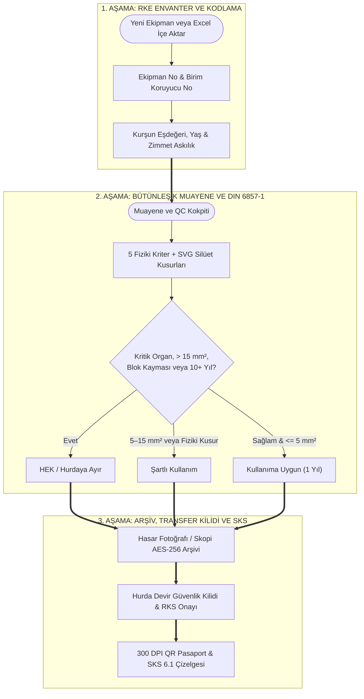

---json
{
  "pageTitle": "20. Radyasyon Koruyucu Ekipman (RKE) ve DIN 6857-1 Muayenesi — RADPYS v4 Kullanım Kılavuzu",
  "h1": "Radyasyon Koruyucu Ekipman (RKE) ve DIN 6857-1 Muayenesi",
  "lead": "Radyoloji, nükleer tıp, kardiyoloji ve ameliyathanelerde kullanılan kurşun önlük, yelek-etek, tiroid ve gonad koruyucuları ile koruyucu gözlük ve paravanların akıllı kodlamasını, bütünleşik görsel ve skopi SVG silüet muayenesini, DIN 6857-1 / IEC 61331-3 karar motorunu, 10+ yıl ömür takibini, toplu muayeneyi, hurda devir kilidini ve SKS 6.1 resmi denetim çizelgelerini yönetmenizi sağlar.",
  "overviewId": "overview",
  "badges": [
    {
      "text": "DIN 6857-1 & SKS 6.1",
      "tone": "emerald"
    }
  ],
  "readingTime": "6 Dakika",
  "legalNote": "<strong>Yasal Güvence:</strong> DIN 6857-1, IEC 61331-3 ve Sağlık Bakanlığı SKS 6.1 uyarınca tiroid/gonad koruyucular ile önlük kritik organ bölgelerinde delik toleransı sıfırdır (0,0 mm²); non-kritik bölgelerde toplam hasar 15,0 mm² sınırını aştığında veya kurşun blok kayması tespit edildiğinde ekipman HEK/Hurda kararına çekilir."
}
---

## Kısa Reçete: RKE Kalite Kontrol ve Kusur Haritalama {#quick-recipe}

:::recipe Kısa Reçete: RKE Kalite Kontrol ve Kusur Haritalama | 20 SANİYELİK AKIŞ
### 1. İstenen Sonuç | slate
Koruyucu önlük veya donanımın yıllık fiziki ve skopi kontrolünün yapılarak DIN 6857-1 kararının tescil edilmesi ve ekipman statüsünün güncellenmesi.

### 2. Yapılacak İşlem | cyan
RKE listesinde satırı seçip <strong>[Muayene ve QC]</strong> butonuna tıklayın; kusursuz ekipmanda doğrudan <strong>[1-Tıkla Kusursuz / Uygun Onayla]</strong> kullanın ya da ön/arka silüet krokisine tıklayıp kusur çapını girerek <strong>[Muayeneyi Kaydet ve Onayla]</strong> butonuna basın.

### 3. Sistem Etkisi | emerald
Dairesel hasar alanı (π · (d/2)²) ve kritik bölge otomatik hesaplanır; HEK, Şartlı Kullanım veya Uygun kararı kronolojik en güncel muayeneye göre envantere işlenir ve hasar fotoğrafları şifreli kasaya alınır.

- [metric] Kritik Organ Toleransı | 0,0 mm² (Sıfır Tolerans) | rose
- [metric] Non-Kritik Eşik | ≤ 5 Uygun / 5–15 Şartlı / &gt; 15 HEK | amber
- [metric] Ömür Takip Eşiği | 5 Yıl Dikkat / 10+ Yıl HEK Önerisi | cyan
- [metric] Platform | Masaüstü + Mobil Web QR | emerald
:::

## 5N1K Kural ve Arayüz Çözümleme Tablosu {#5w1h}

*Çift katmanlı kodlama, skopi SVG kusur krokisi, DIN 6857-1 karar eşikleri, toplu muayene, hurda devir güvenlik kilidi, 300 DPI QR paketi ve RKS onay akışı.*

| NE? (Bileşen / Kontrol) | NEDEN? (Amacı) | NASIL? (Çalışma Mantığı) | NE ZAMAN? (Tetiklenme) | KİM? (Yetkili Rol) |
| --- | --- | --- | --- | --- |
| <strong>Akıllı Ekipman No ve Koruyucu No Üretimi</strong> Yeni Ekipman ve Düzenleme Kartı | Ekipmanın kalıcı tür kimliği ile bulunduğu birim/askılık bilgisini birbirinden ayırmak. | Tür seçildiğinde merkezi Ekipman No otomatik önerilirken Anabilim Dalı/Birim seçimiyle birime özgü Koruyucu No üretilir ve düzenlemede transfer izi korunur. | Yeni koruyucu kabulünde veya birim değişiminde. | Medikal Fizikçi / RKS |
| <strong>Bütünleşik Kokpit ve Ön/Arka SVG Kusur Krokisi</strong> Görsel + Skopi (DIN 6857-1) Modu | Skopi röntgeni ve 5 fiziki kriteri tek pencerede milimetrik koordinatla belgelemek. | Silüet üzerinde tıklanan koordinattan tiroid, gonad veya göğüs kritik bölgesi otomatik algılanır, girilen çaptan alan hesaplanır ve bulgu listesi senkronize edilir. | Yıllık skopi taramasında veya şüpheli kontrolde. | Medikal Fizik Uzmanı |
| <strong>DIN 6857-1 Karar Motoru ve 10+ Yıl Ömür Kuralı</strong> Otomatik Eşik ve Risk Değerlendirmesi | Sübjektif yorumu ortadan kaldırıp uluslararası standartlara göre yasal karar üretmek. | Kritik bölgede delik/çatlak, kurşun blok kayması veya non-kritikte 15,0 mm² üstü hasarda HEK; 5–15 mm² hasar, yüzeysel dikiş/toka kusuru veya düşük Pb kalınlığında Şartlı; 10 yıl yaş üzerinde ise HEK önerisi üretilir. | Her kusur pini veya fiziki bulgu işaretlendiğinde. | Sistem Motoru / RKS |
| <strong><strong>[1-Tıkla Kusursuz / Uygun Onayla]</strong> ve <strong>[Toplu Muayene]</strong></strong> Hızlı Onay ve Gecikenleri Seçme | Yüzlerce koruyucu önlüğün yıllık periyodik skopi taramasını hatasız hızlandırmak. | Tekil kokpitte 5 kriteri tam sağlam kabul edip kaydederken <strong>[Toplu Muayene]</strong> penceresinde geciken/10+ yaşlı ekipmanları seçip (isteğe bağlı otomatik HEK ile) tek işlemde kapatır. | Yıllık toplu klinik RKE taramalarında. | Medikal Fizikçi / RKS |
| <strong><strong>[Zimmet Transfer]</strong> ve Hurda Devir Güvenlik Kilidi</strong> Birim / Askılık ve Personel Devri | Hurdaya ayrılmış veya kayıp önlüğün yanlışlıkla başka bir birime verilmesini engellemek. | Ekipman durumu HEK/Hurda, Kayıp veya Kullanım Dışı ise transfer formunda uyarı gösterilir ve <strong>[Transferi Onayla]</strong> butonu kilitlenir. | Personel veya oda/askılık devri yapılırken. | Birim Sorumlusu / RKS |
| <strong><strong>[QR Etiket]</strong> Tekil Pasaport ve 300 DPI Baskı Paketi</strong> Etiket Yazdırma ve ZIP Matbaa Paketi | Önlüğe dikilecek suya dayanıklı dijital pasaport kartını tekil veya toplu basıma hazırlamak. | Tekli satır seçiliyken etiket önizleme/yazdırma penceresi açılır; çoklu seçimde veya seçimsiz tıklamada 300 DPI etiketler, baskı şartnamesi metin dosyası ve icmal tablosu tek ZIP paketine konur. | İlk kabulde veya toplu etiket baskısında. | Medikal Fizikçi / Tekniker / RKS |
| <strong>Muayene Geçmişi, RKS Onayı ve Toplu <strong>[HEK Tutanağı]</strong></strong> Denetim İzi ve Komisyon Çıktısı | Geçmiş muayene girişlerinin güncel statüyü bozmasını önlemek ve toplu hurda tutanağı üretmek. | Envanter statüsü daima en ileri tarihli muayeneye göre eşitlenir; Muayene Geçmişi ekranında revizyon ve RKS onayı yapılır, çoklu seçimde <strong>[HEK Tutanağı]</strong> sihirbazı tüm kalemleri tek tutanakta birleştirir. | Geçmiş tarihli kayıt, revizyon veya yıllık hurda kararında. | Medikal Fizikçi / RKS / Komisyon |

## Kritik Sahada Yanlış Bilinen Kurallar (Mit Avcısı) {#myth-buster}

:::myth Şartlı Önlükler Ameliyathanede Kullanılabilir mi veya Geçmiş Muayene Güncel Statüyü Bozar mı?
### Yanlış Algı
<em>"5–15 mm² arası hasar alıp Şartlı Kullanım verilen önlüğü anjiyo ve ortopedi skopisinde de giyebiliriz; ayrıca sisteme eski tarihli bir muayene girersek cihazın bugünkü HEK statüsü bozulur."</em>

### Gerçek Sistem Mantığı
<strong>İkisi de yanlıştır.</strong> <strong>Şartlı Kullanım</strong> alan önlükler (5–15 mm² çevre hasarı veya dikiş/askı kusuru olanlar) primer ışınlama konisi ve girişimsel işlemlerde kesinlikle kullanılmaz; yalnızca düşük saçılmalı alanlarda ve hasta yakını refakatinde değerlendirilir. Ayrıca sistem kronolojik eşitleme kuralıyla envanter durumunu daima takvimdeki en yeni tarihli muayeneye göre hesaplar; sonradan girilen eski tarihli bir tarama bugünkü HEK kararını asla bozmaz.
:::

## Süreç Akış Şeması {#workflow}

1. **Envanter ve Kodlama:** Ekipman kaydında tür ve birim bazlı çift katmanlı kod üretilir, ön/arka kurşun kalınlığı ve giriş tarihine göre ekipman yaşı izlenir.
2. **Bütünleşik Muayene ve Karar Motoru:** 5 fiziki kriter ile Ön/Arka SVG kroki kusurları birlikte değerlendirilir; kritik organ hasarı, blok kayması veya 15 mm² aşımı HEK kararı üretirken 5–15 mm² çevre kusuru Şartlı Kullanım, sağlam kayıtlar Kullanıma Uygun sonucu alır.
3. **Arşiv, Kilit ve SKS Çıktısı:** Fotoğraf ve röntgenler Evrak Kasasında şifrelenir, HEK ekipmanların zimmet devri kilitlenir, Muayene Geçmişinden RKS onayı verilerek 300 DPI QR ve SKS 6.1 çizelgesi üretilir.

## Arayüz Ekran Görünümleri {#screenshots}

## Adım Adım İşlem Rehberi {#step-by-step}

### 1. Yeni Ekipman Kaydı, Akıllı Kodlama ve Zimmet Transferi

1. **RKE Envanter** ekranında **[Yeni Ekipman]** butonuna tıklayın; tip, Anabilim Dalı ve Alt Birim seçildiğinde sistem merkezi **Ekipman No** ile birim bazlı **Koruyucu No** bilgisini otomatik önerir (çoklu aktarım için **[Excel İçe Aktar]** kullanabilirsiniz).
2. Kuruma giriş tarihi, marka, beden, askılık konumu ile ön/arka kurşun eşdeğerini (mm Pb) doldurup **[Kaydet]** butonuna basın.
3. Önlüğü başka bir personele veya birime devretmek için satırı seçip **[Zimmet Transfer]** butonuna tıklayın, hedef birim ve teslim bilgilerini girip **[Transferi Onayla]** butonuna basın (HEK, Kayıp veya Kullanım Dışı kayıtlarda transfer güvenlik kilidi devreye girer).

### 2. Bütünleşik Tekil Muayene, SVG Kroki Pinleme ve 1-Tıkla Onay

1. Envanterde ekipmanı seçip **[Muayene ve QC]** butonuna tıklayın; üstten **[Görsel / Fiziki Muayene]** veya **[Skopi / X-Işını (DIN 6857-1)]** modları arasında geçiş yapın.
2. Ekipman tümüyle sağlamsa doğrudan alt soldaki **[1-Tıkla Kusursuz / Uygun Onayla]** butonunu kullanın; aksi halde 5 rutin fiziki kriteri ve klinik bulguları işaretleyin.
3. Skopi altında kusur tespit ettiğinizde **[Ön Yüz]** veya **[Arka Yüz]** görünümünü seçip tuvalde hasarlı noktaya tıklayın; açılan pencerede kusur türü ile çap (mm) değerini girin (kritik organ bölgesi otomatik algılanır ve alan mm² cinsinden hesaplanır).
4. Varsa **Fotoğraflar ve Belgeler** sekmesinden **[Fotoğraf / Röntgen Ekle]** ile görselleri şifreli kasaya ekleyin; canlı karar rozetini doğrulayıp **[Muayeneyi Kaydet ve Onayla]** butonuna tıklayın.

### 3. Toplu Muayene, Muayene Geçmişi ve RKS Onayı

1. Çok sayıda ekipmanın yıllık kontrolünü tamamlamak için **[Toplu Muayene]** butonuna tıklayın; **[Gecikenleri ve 10+ Yaşlıları Seç]** ile tarihi geçenleri otomatik işaretleyin, skopi cihazı ve kararı seçip (isterseniz **10+ Yıl Aşanları Otomatik HEK (Hurda) Yap** seçeneğini açarak) **[Seçili Ekipmanları Kaydet]** butonuna basın.
2. Geçmiş taramaları incelemek için **Muayene ve Kontrol Geçmişi** ekranını açın; **[Detay ve Rapor]** ile A4 raporu ve ön/arka krokiyi görüntüleyin, **[Düzenle / Revize Et]** veya **[Belge / Fotoğraf Ekle]** ile ekleme yapın, sağ tık menüsünden **RKS Olarak Onayla** komutuyla kaydı onaylayın.

### 4. QR Pasaport, SKS Çizelgesi, Toplu HEK ve Web Mobil Muayene

1. Tekil veya çoklu QR basımı için araç çubuğundan **[QR Etiket]** butonuna tıklayın: tek satır seçiliyken pasaport önizlemesinden **[PNG Olarak Kaydet]** veya **[Yazıcıya Gönder]**, çoklu seçimde ya da seçimsiz basımda 300 DPI PNG etiketleri ve baskı şartnamesini içeren ZIP paketini indirin.
2. Denetim çizelgeleri için **[Dışa Aktar]** menüsünden SKS 6.1 RKE çizelgesini Excel/PDF/Word formatında alın; hurdaya ayrılacak birden çok önlüğü Ctrl veya Shift ile seçip **[HEK Tutanağı]** butonundan toplu komisyon tutanağı üretin (tekil hurdaya çekmek için **[HEK'e Ayır]** kullanılır).
3. **Web Portalı ve Mobil QR Saha Akışı:** Saha kullanıcısı mobil kamerayla önlükteki QR etiketi okuttuğunda dijital pasaport kartı açılır; parmakla yakınlaştırılabilen dokunmatik ön/arka SVG silüeti üzerinde kusur işaretlenebilir, canlı kamera fotoğrafı eklenebilir, askılık hızlı sayımı ve toplu muayene sorumlu birim yetkisi dahilinde sahadan tamamlanabilir.

## Sıkça Sorulan Sorular (SSS) {#faq}

:::faq
### 10+ yılını dolduran bir kurşun önlük skopide tamamen sağlam çıkarsa ne olur?
Sistem 5–10 yıl arası ekipmanları yaşlı/dikkat takibine alır; <strong>10 yıl ve üzerine</strong> çıktığında ise malzeme yorulması riskine karşı otomatik HEK önerisi üretir. Tekil kokpitte nihai klinik karar medikal fizikçinin ve kurum yetkililerinin değerlendirmesiyle onaylanır; toplu muayene ekranında ise 10+ yaşlıları otomatik HEK yapma seçeneği kullanıcı kontrolüne bırakılmıştır.

### Bir RKE ekipman tanımı (türü) silindiğinde eski muayene ve envanter kayıtları silinir mi?
Hayır. Silinmek istenen RKE türüne bağlı en az bir ekipman veya muayene geçmişi varsa sistem veri bütünlüğünü korumak adına kaydı fiziksel silmez, <strong>Pasife</strong> alarak yalnızca yeni ekipman açılır listelerinden gizler; hiç kullanılmamış tanımlar kalıcı silinir.

### Skopi çekiminden gelen hasar fotoğrafları ve PDF belgeleri nerede saklanır?
Yüklenen tüm röntgen, skopi görseli ve hasar fotoğrafları yerel disk klasörlerinde açık dosya olarak bırakılmaz; veritabanı içinde AES-256 Fernet ile şifrelenerek Evrak Kasasında saklanır ve yalnızca yetkili kullanıcılar tarafından geçici olarak deşifre edilip görüntülenir.

### Önlükte hem dikiş açılması hem küçük bir non-kritik delik varsa hangi karar geçerli olur?
Bütünleşik karar motoru her zaman en katı güvenlik kuralını uygular. İncelenen 5 fiziki kriterdeki hata ile SVG kroki üzerindeki hasar birlikte değerlendirilir; herhangi bir katmanda HEK kriteri oluşursa (örneğin kurşun blok kayması veya kritik bölge deliği) toplam karar doğrudan <strong>HEK / Hurdaya Ayır</strong> olur.
:::
