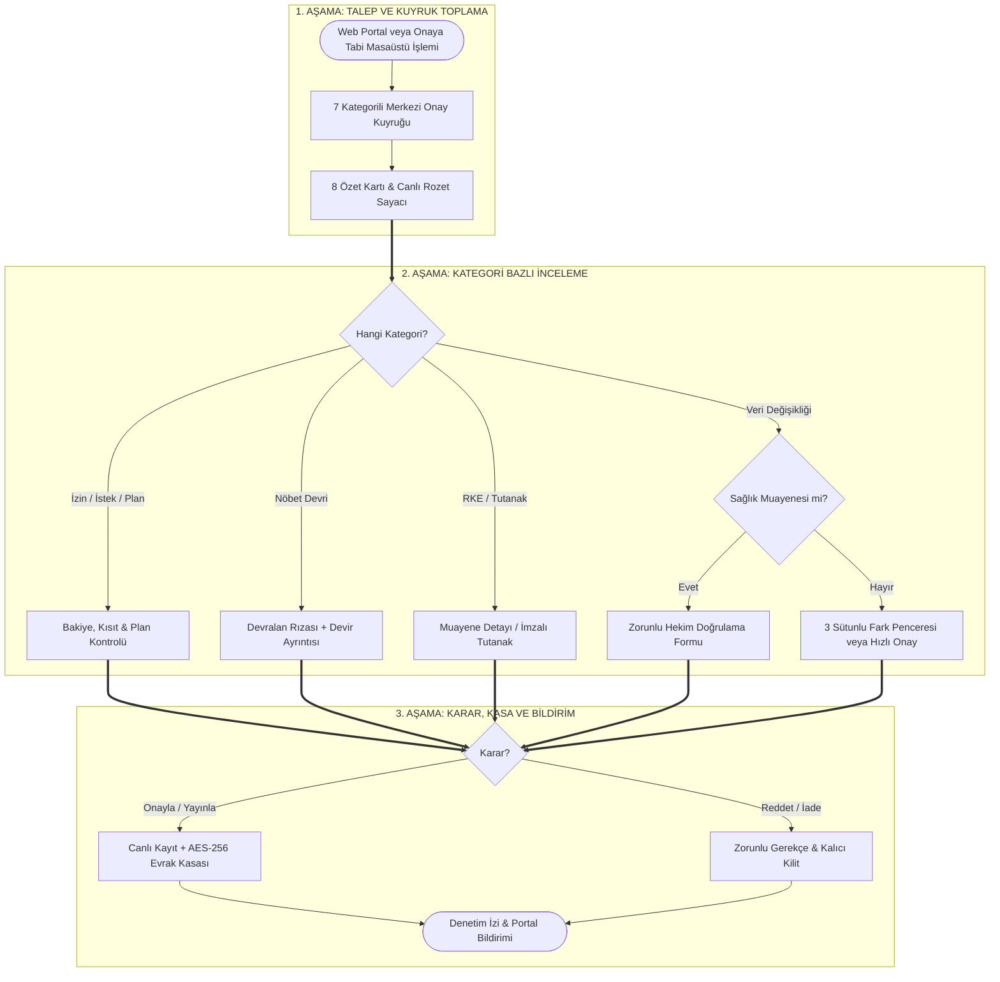

---json
{
  "pageTitle": "21. Merkezi Onay Bekleyen Görevler Paneli — RADPYS v4 Kullanım Kılavuzu",
  "h1": "Merkezi Onay Bekleyen Görevler Paneli",
  "lead": "Tüm klinik ve idari birimlerden gelen personel izinlerini, karşılıklı nöbet devirlerini, aylık nöbet istek ve mazeretlerini, birim onaylı nöbet planlarını, RKE muayene onaylarını, 4-göz veri değişiklik taleplerini ve imza bekleyen resmi tutanakları 7 kategorili tek merkezden denetleyip karara bağlamanızı sağlar.",
  "overviewId": "overview",
  "badges": [
    {
      "text": "7 Kategori & 4-Göz Denetimi",
      "tone": "indigo"
    }
  ],
  "readingTime": "5 Dakika",
  "legalNote": "<strong>Yasal Güvence:</strong> Tüm onay ve zorunlu ret kararları aktör rolüyle birlikte değiştirilemez denetim izine işlenir; sağlık muayenelerinde hekim incelemesi yapılmadan hızlı onay verilmesi güvenlik gereği engellenmiştir."
}
---

## Kısa Reçete: Bekleyen Talepleri İnceleme ve Karara Bağlama {#quick-recipe}

:::recipe Kısa Reçete: Bekleyen Talepleri İnceleme ve Karara Bağlama | 20 SANİYELİK AKIŞ
### 1. İstenen Sonuç | slate
İzin, nöbet devri/isteği, nöbet planı, RKE muayenesi, veri değişikliği ve imza bekleyen tutanakların yetkili yönetici veya RKS tarafından tek merkezden sonuçlandırılması.

### 2. Yapılacak İşlem | cyan
Üstteki tıklanabilir özet kartlarından ya da soldaki 7 kategori sekmesinden bekleyen grubu açın; gerekirse <strong>[İncele ve Karar Ver]</strong> ile ayrıntıları gözden geçirip <strong>[Onayla]</strong> / <strong>[Yayınla]</strong> veya zorunlu ret gerekçesiyle <strong>[Reddet]</strong> butonuna basın.

### 3. Sistem Etkisi | emerald
İzin bakiyeleri anında düşer, devirlerde nöbet çizelgesi güncellenir, veri değişikliklerinde eski-yeni fark onaylanıp ek belgeler AES-256 Evrak Kasasına taşınır ve karar çalışan bildirimine yansır.

- [metric] Onay Kategorisi | 7 Sekme / 8 Özet Kartı | indigo
- [metric] Kuyruk Çekim Sınırı | Kategori Başına 500 Kayıt | slate
- [metric] Sağlık Güvenlik Kilidi | Hızlı Onay Engelli | rose
- [metric] Platform | Masaüstü Karar + Web Bildirim | cyan
:::

## 5N1K Kural ve Arayüz Çözümleme Tablosu {#5w1h}

*7 kategorili onay kuyruğu, 3 aşamalı nöbet devri, 4-göz veri fark karşılaştırması, hekim doğrulama kilidi, RKE RKS onayı ve resmi tutanak kapatma kuralları.*

| NE? (Bileşen / Kontrol) | NEDEN? (Amacı) | NASIL? (Çalışma Mantığı) | NE ZAMAN? (Tetiklenme) | KİM? (Yetkili Rol) |
| --- | --- | --- | --- | --- |
| <strong>8 Özet Kartı ve 7 Kategori Rozeti</strong> Tıklanabilir Sayaç ve Hızlı Arama | Yüzlerce onay arasında kaybolmadan bekleyen kategorilere tek tıkla geçmek. | Her kategoride bekleyen kayıt sayısı kart ve sekme rozetinde gösterilir (0 olunca gizlenir); Toplam Bekleyen kartı bekleyen talebi bulunan ilk sekmeyi açar. | Panel açıldığında veya talep geldiğinde. | Birim Amiri / RKS / İdare |
| <strong>İzinler, Nöbet İstekleri ve İdari Plan Yayını</strong> <strong>[Onayla]</strong>, <strong>[Yayınla]</strong>, <strong>[Taslağa Geri Gönder]</strong> | İzin bakiyelerini düşmek, nöbet kısıtlarını bağlamak ve birim planını yayımlamak. | İzin onayında kalan bakiye anında güncellenir; nöbet istekleri çizelge motoruna kısıt olarak aktarılır; planlarda <strong>[Yayınla]</strong> çizelgeyi portala açarken <strong>[Taslağa Geri Gönder]</strong> planı birime iade eder. | İzin/istek geldiğinde veya aylık plan sunulduğunda. | Birim Amiri / Başhekimlik / İdare |
| <strong>3 Aşamalı Nöbet Devri Onay Zinciri</strong> Devralan Rızası + <strong>[İncele ve Karar Ver]</strong> | Personeller arası nöbet takasının karşılıklı onay olmadan çizelgeyi değiştirmesini önlemek. | Devralan çalışan Web Portalından kabul verene dek talep devralan onayı aşamasında bekler; amir inceleyip onayladığında çizelgedeki nöbetçi değişimi gerçekleşir. | Nöbet takası devralan tarafından onaylandığında. | Nöbetçi Personel / Birim Amiri |
| <strong>RKE Muayeneleri RKS Onay Sekmesi</strong> <strong>[İncele ve Muayene Detayı]</strong> &amp; <strong>[RKS Olarak Onayla]</strong> | Sahada veya toplu olarak yapılan DIN 6857-1 kurşun ekipman kontrollerini RKS imzasıyla kesinleştirmek. | Muayene raporu ve kusur krokisi incelenerek <strong>[RKS Olarak Onayla]</strong> ile tescil edilir ya da <strong>[Reddet / İade Et]</strong> ile gerekçeli şekilde düzeltmeye gönderilir. | RKS onayı bekleyen RKE muayenesi varken. | RKS Sorumlusu |
| <strong>4-Göz Veri Değişiklikleri ve Birim Kapsamı</strong> Personel, Sağlık, Eğitim, RGS, Olay/DÖF, Cihaz | Onay zorunluluğu tanımlı rollerin işlemlerini öz-onay yasağı ve birim sınırıyla denetlemek. | Yöneticiler yalnızca yetkili oldukları birimlerin taleplerini görür ve kendi açtıkları talebi onaylayamaz; <strong>[İncele ve Karar Ver]</strong> fark penceresindeki onay notu denetim izine kaydedilir ve ek belgeler şifreli kasaya taşınır. | Onaya tabi rol kayıt değişikliği yaptığında. | Modül Sorumlusu / Yönetici |
| <strong>Sağlık Muayenesi Hızlı Onay Engeli</strong> Zorunlu Hekim İnceleme Formu | İşe giriş veya periyodik muayene bulgularının incelenmeden tek tıkla onaylanmasını önlemek. | Sağlık muayenesi ekleme taleplerinde hızlı onay çalıştırılmaz ve sistem doğrudan Göz, Dahiliye, Dermatoloji bulgularını içeren hekim doğrulama formunu açar. | Sağlık muayenesi onaylanmak istendiğinde. | İşyeri Hekimi / RKS |
| <strong>Resmi Tutanaklar ve Zorunlu Ret Kuralı</strong> <strong>[Taslak Görüntüle]</strong> &amp; <strong>[İmzalı Belge Yükle / Onayla]</strong> | Heyet tutanaklarının ıslak imzalı nüshalarını tamamlamak ve ret işlemlerinde iz bırakmak. | Taslak tutanak incelenip EBYS imzalı PDF yüklendiğinde tutanak kasası güncellenir; tüm 7 sekmede ret işleminde metin gerekçesi zorunludur ve ret sonrası talep arşivlenerek kilitlenir. | Tutanak imzalandığında veya talep reddedildiğinde. | Birim Amiri / RKS / İdare |

## Kritik Sahada Yanlış Bilinen Kurallar (Mit Avcısı) {#myth-buster}

:::myth Sağlık Muayeneleri Hızlı Onayla Geçilebilir mi veya Reddedilen Talep Geri Açılabilir mi?
### Yanlış Algı
<em>"Veri Değişiklikleri sekmesinde Hızlı Onayla diyerek sağlık muayenesi dahil her talebi tek tıkla onaylayabilirim; yanlışlıkla reddettiğim bir talebi de sonradan listeden bulup yeniden onaylarım."</em>

### Gerçek Sistem Mantığı
<strong>İkisi de engellenmiştir.</strong> Sağlık muayenesi kayıtlarında hızlı onay güvenlik kilidiyle bloklanır ve uzman hekim/RKS bulgularının görüntülendiği inceleme formu zorunlu açılır. Ayrıca tüm sekmelerde reddedilen talepler zorunlu ret gerekçesiyle kalıcı sonlandırılır ve kuyruktan düşer; düzeltme sonrası çalışanın yeni talep açması gerekir.
:::

## Süreç Akış Şeması {#workflow}

1. **Talep ve Kuyruk Toplama:** Web Portalından ve onaya tabi masaüstü rollerinden (Personel, Sağlık, Eğitim, RGS, Olay/DÖF, Ortam Dozu, Cihaz dahil) gelen talepler 7 kategori sekmesinde toplanır.
2. **Kategori Bazlı İnceleme:** Nöbet devrinde devralan rızası, sağlık muayenesinde hekim formu, veri değişikliklerinde eski-yeni 3 sütunlu fark penceresi, RKE ve tutanakta belge/kroki detayları kontrol edilir.
3. **Karar ve Bildirim:** Onaylanan kayıtlar canlı tablolara işlenir ve varsa belgeler AES-256 Evrak Kasasına aktarılır; ret işlemlerinde zorunlu gerekçe alınarak sonuç portal bildirimine gönderilir.

## Arayüz Ekran Görünümleri {#screenshots}

## Adım Adım İşlem Rehberi {#step-by-step}

### 1. Kuyruk Gezinme, Hızlı Arama ve İzin / Nöbet Onayları

1. Ana menüden **Onay Bekleyen Görevler** ekranını açın; üstteki **Toplam Bekleyen** veya ilgili kategori özet kartına tıklayarak doğrudan bekleyen sekmeye geçin (sağ üst arama kutusundan personel veya ekipman adı süzebilirsiniz).
2. **İzin Talepleri** veya **Nöbet İstekleri** sekmesinde satırı seçip **[Onayla]** ile bakiyeyi/kısıtı uygulayın ya da **[Reddet]** ile zorunlu gerekçe yazın.
3. **Nöbet Devirleri** sekmesinde yalnızca devralan personel portal üzerinden onay verdikten sonra amir onayı aktifleşir; **[İncele ve Karar Ver]** ile eski/yeni vardiyaları doğrulayıp onaylayın.
4. **Nöbet Planları** sekmesinde birim sorumlusunun gönderdiği aylık taslağı **[Yayınla]** ile tüm personele açın veya eksiklik varsa **[Taslağa Geri Gönder]** ile birime iade edin.

### 2. RKE Muayeneleri ve 4-Göz Veri Değişikliği (Fark) İncelemesi

1. **RKE Muayeneleri** sekmesinde satırı seçip **[İncele ve Muayene Detayı]** ile DIN 6857-1 kusur krokisini kontrol edin; ardından **[RKS Olarak Onayla]** veya gerekçeli **[Reddet / İade Et]** butonuna basın.
2. **Veri Değişiklikleri** sekmesinde Personel, Sağlık, Kısıt, Eğitim, RGS, Olay/DÖF, Ortam Dozu veya Cihaz modüllerinden düşen talebi seçip **[İncele ve Karar Ver]** butonuna tıklayın.
3. Açılan karşılaştırma tablosunda eski değerleri (kırmızı) ve yeni talep edilen değerleri (yeşil) kontrol edip **[Talebi Onayla]** veya **[Talebi Reddet]** butonuna basın (sağlık muayenesi eklemelerinde sistem doğrudan hekim inceleme formunu açar; rutinde değişiklik yoksa diğer kayıtlar için **[Hızlı Onayla]** kullanılabilir).

### 3. Resmi Tutanaklar ve Web Portalı Bildirim Döngüsü

1. **Resmi Tutanaklar** sekmesinde imza bekleyen tutanak satırını seçerek **[Taslak Görüntüle]** ile orijinal metni inceleyin; ıslak imzalı belge ve EBYS numarası geldiğinde **[İmzalı Belge Yükle / Onayla]** ile tutanağı tamamlayın (geniş liste için **[Tüm Tutanaklar...]** butonunu kullanabilirsiniz).
2. **Web Portalı Çift Yönlü Süreç:** Personel ve saha görevlileri başvurularını (izin, devir rızası, mazeret, profil talebi) tarayıcıdan başlatır; yöneticinin burada verdiği onay veya zorunlu ret gerekçesi çalışanın Web Portal bildirim çekmecesine iletilir.

## Sıkça Sorulan Sorular (SSS) {#faq}

:::faq
### Personelin başlattığı nöbet takası neden onay panelinde görünmüyor?
Karşılıklı nöbet devri önce devralacak personelin kendi Web Portalı üzerinden rıza onayını gerektirir. Devralan çalışan kabul onayı verene dek talep yönetici onayına aktarılmaz.

### Cihaz envanteri veya kalite kontrol değişiklikleri de buraya düşer mi?
Evet. Kullanıcının rol ayarında işlem onayı zorunlu kılınmışsa cihaz ekleme, güncelleme, HEK arşivleme, arıza, bakım ve QC kayıtları da 4-göz denetimi kapsamında <strong>Veri Değişiklikleri</strong> sekmesine düşer.

### İzin onaylandığında personelin aynı günde nöbeti varsa çakışma nasıl çözülür?
İzin onaylandığında sistem çizelgedeki nöbet çakışmasını otomatik denetler; birim sorumlusu Yönetici Aksiyon Sihirbazı veya İkame havuzu üzerinden ilgili nöbete yedek personel atayabilir.

### Kuyrukta çok fazla bekleyen talep varsa sistem yavaşlar mı?
Performansı korumak adına her kategori sekmesi bekleyen en güncel 500 kaydı optimize edilmiş sorgularla listeler. Süreçlerin aksamaması için amirlerin bekleyen talepleri düzenli olarak sonuçlandırması önerilir.
:::
