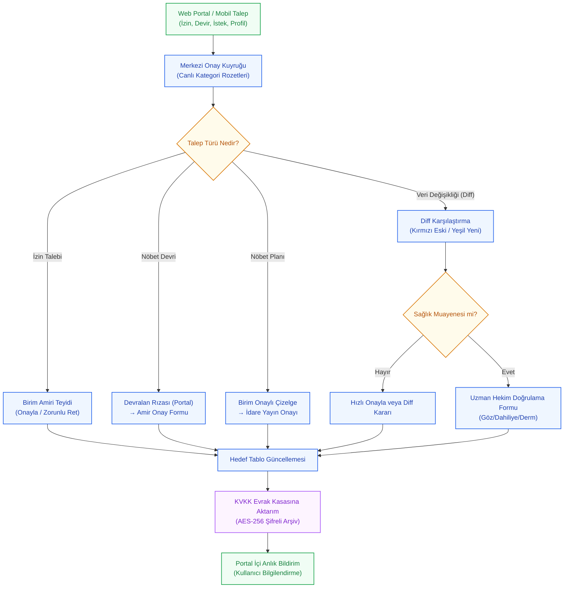

---json
{
  "pageTitle": "21. Merkezi Onay Bekleyen Görevler Paneli — RADPYS v4 Kullanım Kılavuzu",
  "h1": "21. Merkezi Onay Bekleyen Görevler Paneli",
  "lead": "Tüm klinik ve idari birimlerden gelen personel izinlerini, nöbet takas/devirlerini, aylık nöbet tercihlerini, resmi nöbet çizelgesi yayınlarını ve 4-göz veri değişiklik taleplerini tek merkezden denetleyip karara bağlayın.",
  "overviewId": "overview",
  "badges": [],
  "readingTime": "5 Dakika"
}
---

## Vizyonder Hızlı Karar Reçetesi & Önemli Metrikler {#hizli-recete}

:::recipe Vizyonder Hızlı Karar Reçetesi & Önemli Metrikler | 20 SANİYELİK AKIŞ
### İstenen Sonuç: | cyan
Klinik birimlerden ve personelden gelen izin, nöbet devir, istek, taslak plan ve veri değişikliklerini tek merkezden güvenle denetleyip karara bağlamak.

### Yapılacak İşlem: | emerald
Sol paneldeki 5 sekmeden ilgili kategoriyi seçin; satırları veya Diff penceresini inceleyip <strong>[Onayla]</strong> veya zorunlu gerekçe girerek <strong>[Reddet]</strong> butonuna basın.

### Sistem Etkisi: | blue
İzin bakiyeleri anında düşer, nöbet devirlerinde çizelge otomatik güncellenir, veri değişikliklerinde yeni kayıtlar işlenir ve fiziksel evraklar AES-256 ile şifreli KVKK kasasına aktarılır.
:::

## 5N1K Kural ve Ayar Çözümleme Tablosu {#5n1k-tablosu}

 RADPYS-M21-RULE-MATRIX
 

| NE (İşlem / Alan) | NEDEN (Gerekçe) | NEREDE (Arayüz Yolu) | NASIL (Yöntem) | NE ZAMAN (Zamanlama) | KİM (Rol / Yetki) | DURUM (Sistem Tepkisi) |
| --- | --- | --- | --- | --- | --- | --- |
| İzin Onayı / Reddi | Yıllık, şua ve mazeret iznini resmiyete bağlamak | Onay Paneli → İzin Talepleri | Onayla Butonu / Reddet Butonu (Zorunlu Gerekçe) | İzin başlangıcından önce | Birim Amiri / Yönetici | Bakiye anında düşer, portalda bildirim kutusuna düşer |
| Nöbet Devir İnceleme & Onay | Personeller arası nöbet takasını resmi çizelgeye yansıtmak | Onay Paneli → Nöbet Devirleri | İncele / Detay Butonu → Karar Formu | Devralan personelin portal rızasından sonra | Birim / Hizmet Sorumlusu | Çizelgedeki personel adı otomatik güncellenir |
| Nöbet İstek & Mazeret | Personelin aylık tercih ve muafiyetlerini kısıt olarak bağlamak | Onay Paneli → Nöbet İstekleri | Onayla / Reddet Butonu | Solver motoru çalıştırılmadan önce | Başteknisyen / Yönetici | Otomatik çizelge motoruna bağlayıcı kural olarak girer |
| Nöbet Planı Yayınlama | Birim onaylı aylık taslak çizelgeyi resmi yürürlüğe sokmak | Onay Paneli → Nöbet Planları | Yayınla Butonu / Taslağa Geri Gönder Butonu | Ay bitmeden ve nöbet başlamadan önce | İdare / Başhekimlik / Admin | Plan "Yayında" olur, portalda tüm personele açılır |
| Veri Değişiklik Kıyaslama (Diff) | 4-göz ilkesiyle hatalı veya yetkisiz veri girişlerini engellemek | Onay Paneli → Veri Değişiklikleri | İncele ve Karar Ver Butonu (Diff Penceresi) | Kritik profil/evrak/kart kaydedildiğinde | Modül Sorumlusu / Yönetici | Eski-yeni farkı onaylanır, evrak KVKK kasasına aktarılır |
| Sağlık Muayene Teyidi | İşe giriş ve periyodik muayene bulgularını hekimce doğrulamak | Onay Paneli → Veri Değişiklikleri | İncele Butonu → Hekim Doğrulama Formu | Sağlık muayenesi talep kuyruğuna düştüğünde | RKS / İşyeri Hekimi | Hızlı onay engellenir; Dahiliye/Göz/Derm bulguları zorunludur |
| Gelişmiş Çok Kriterli Filtreleme | Kuyruktaki yüzlerce onay talebini tür, öncelik ve tarihe göre süzmek | Onay Paneli Üst Filtre Çubuğu | Talep Türü, Öncelik (Normal/Acil) ve Tarih Aralığı seçimi | Talepler incelenirken | Tüm Onay Yetkilileri | Tablo anlık süzülür, acil talepler turuncu rozetle vurgulanır |
| Split-Layout Detay Paneli | Talebin tüm ayrıntılarını, diff farklarını ve personel bilgilerini tek ekranda izlemek | Onay Paneli Sağ Bölmesi | Tablodan satır seçildiğinde otomatik yüklenir | Kayıt tıklandığında | Tüm Onay Yetkilileri | Pencere değiştirmeden hızlı önizleme ve doğrudan onay/red imkanı sunar |
| Resmi Tutanak Takibi & İmzalı Yükleme | Tüm sistemden gelen heyet tutanaklarının ıslak imzalı kopyalarını ve EBYS numaralarını denetlemek | Onay Paneli → Resmi Tutanaklar | Taslak İncele → İmzalı Nüsha ve EBYS No Yükle → Onayla / İptal Et | Heyet imzaları veya EBYS üst yazısı çıktığında | Birim Amiri / RKS / İdare | Tutanak 'Tamamlandı' olur, KVKK kasasına şifrelenir ve onay rozeti güncellenir |

## Mit Avcısı: Merkezi Onaylarda Yanlış Bilinen Doğrular {#mit-avcilari}

 ONAY-MYTH-BUSTER
 

 

 

 

 <svg class="w-4 h-4 shrink-0" fill="none" stroke="currentColor" viewBox="0 0 24 24"><path stroke-linecap="round" stroke-linejoin="round" stroke-width="2" d="M6 18L18 6M6 6l12 12"/></svg>
 YANLIŞ (Mit):
 

 

 "Veri Değişiklikleri tablosunda 'Hızlı Onayla' butonuna basarak tüm talepleri, hekim muayeneleri dahil tek tıkla onaylayabilirim."
 

 

 <svg class="w-4 h-4 shrink-0" fill="none" stroke="currentColor" viewBox="0 0 24 24"><path stroke-linecap="round" stroke-linejoin="round" stroke-width="2" d="M5 13l4 4L19 7"/></svg>
 DOĞRU (Mevzuat Standardı):
 

 

 Sağlık muayenesi kayıtlarında sistem "Hızlı Onayla"yı güvenlik gereği bloklar ve zorunlu olarak uzman hekim inceleme formunu açar. Dahiliye, göz ve dermatoloji bulguları doğrulanmadan sağlık onayı verilemez.
 

 

 

 

 <svg class="w-4 h-4 shrink-0" fill="none" stroke="currentColor" viewBox="0 0 24 24"><path stroke-linecap="round" stroke-linejoin="round" stroke-width="2" d="M6 18L18 6M6 6l12 12"/></svg>
 YANLIŞ (Mit):
 

 

 "İzin veya nöbet devrini reddederken gerekçe yazmak isteğe bağlıdır; boş bırakıp geçebilirim."
 

 

 <svg class="w-4 h-4 shrink-0" fill="none" stroke="currentColor" viewBox="0 0 24 24"><path stroke-linecap="round" stroke-linejoin="round" stroke-width="2" d="M5 13l4 4L19 7"/></svg>
 DOĞRU (Mevzuat Standardı):
 

 

 Sistem tüm ret eylemlerinde zorunlu olarak metin girişi ister. Ret gerekçesi girilmeden ret işlemi tamamlanamaz ve bu gerekçe personelin web portalındaki bildirim paneline anında iletilir.
 

 

 

 

 <svg class="w-4 h-4 shrink-0" fill="none" stroke="currentColor" viewBox="0 0 24 24"><path stroke-linecap="round" stroke-linejoin="round" stroke-width="2" d="M6 18L18 6M6 6l12 12"/></svg>
 YANLIŞ (Mit):
 

 

 "Reddedilen bir talebi onay paneli üzerinden tekrar bulup onaylayabilirim."
 

 

 <svg class="w-4 h-4 shrink-0" fill="none" stroke="currentColor" viewBox="0 0 24 24"><path stroke-linecap="round" stroke-linejoin="round" stroke-width="2" d="M5 13l4 4L19 7"/></svg>
 DOĞRU (Mevzuat Standardı):
 

 

 Güvenlik ve denetim izi bütünlüğü gereğince bir talep reddedildiğinde işlem kalıcı olarak sonuçlanır ve arşivlenir. Gerekçe düzeltilerek personelin yeni bir başvuru yapması gerekir.
 

 

 

 

 <svg class="w-4 h-4 shrink-0" fill="none" stroke="currentColor" viewBox="0 0 24 24"><path stroke-linecap="round" stroke-linejoin="round" stroke-width="2" d="M6 18L18 6M6 6l12 12"/></svg>
 YANLIŞ (Mit):
 

 

 "Bir personelin başlattığı nöbet takası doğrudan amirin onay kuyruğuna düşer."
 

 

 <svg class="w-4 h-4 shrink-0" fill="none" stroke="currentColor" viewBox="0 0 24 24"><path stroke-linecap="round" stroke-linejoin="round" stroke-width="2" d="M5 13l4 4L19 7"/></svg>
 DOĞRU (Mevzuat Standardı):
 

 

 Nöbet takası karşılıklı rıza gerektirir. Devralacak personel kendi Web Portalı üzerinden "Kabul Ediyorum" onayını vermeden talep yöneticinin onay kuyruğuna düşmez.
 

 

 

## Merkezi Onay Mekanizması Süreç Akışı {#surec-akisi}

 ONAY-WORKFLOW-DIAGRAM
 

 

 

## Merkezi Onay Paneli: 6 Kategori Sekmesi & Rozet Yönetimi {#onay-paneli}

 ONAY-PANEL-SECTIONS
 

 

 

 

 <h3 class="text-base font-bold text-slate-900 dark:text-white flex items-center gap-2 mb-2">
 
 1. İzin Talepleri Sekmesi
 </h3>
 

 Personelin başvurduğu yıllık, şua, sağlık ve mazeret izinleri listelenir. Tabloda personelin adı, birimi, izin türü, tarih aralığı, gün süresi ve talep tarihi görüntülenir.
 

 <ul class="mt-3 text-xs space-y-1 text-slate-500 dark:text-slate-400">
 <li>• <strong>Onayla Butonu:</strong> Onay teyidiyle izin onaylanır; personelin kalan yıllık veya şua izni bakiyesinden gün sayısı otomatik düşülür.</li>
 <li>• <strong>Reddet Butonu:</strong> Açılan pencereden zorunlu ret gerekçesi alınır; başvuru iptal edilir ve gerekçe portala iletilir.</li>
 </ul>
 

 

 <h3 class="text-base font-bold text-slate-900 dark:text-white flex items-center gap-2 mb-2">
 
 2. Nöbet Devirleri Sekmesi
 </h3>
 

 Nöbet değişim ve becayiş başvuruları 3 aşamalı denetimden geçer. Devralan personelin web portalından onay vermediği talepler tabloda "Devralan Onayı Bekliyor (Portal)" olarak listelenir.
 

 <ul class="mt-3 text-xs space-y-1 text-slate-500 dark:text-slate-400">
 <li>• <strong>İncele / Detay Butonu:</strong> Ayrıntılı devir diyaloğunu açarak devreden, devralan, nöbet tarihi, vardiya saatleri ve devir gerekçesini gösterir.</li>
 <li>• <strong>Onaylama:</strong> Birim veya hizmet amiri onayladığında aktif nöbet çizelgesinde personellerin yer değişimi anında gerçekleşir.</li>
 </ul>
 

 

 <h3 class="text-base font-bold text-slate-900 dark:text-white flex items-center gap-2 mb-2">
 
 3. Nöbet İstekleri Sekmesi
 </h3>
 

 Personelin ay başlamadan önceki nöbet yazılmasın (mazeret), nöbet yazılsın, lisansüstü ders/eğitim günleri ve muafiyet tercihleri 1 ila 5 arası öncelik puanıyla listelenir. Onaylanan talepler Nöbet Hazırlık (Solver) motoruna doğrudan kısıt olarak beslenir.
 

 

 

 

 

 <h3 class="text-base font-bold text-slate-900 dark:text-white flex items-center gap-2 mb-2">
 
 4. Nöbet Planları Sekmesi (İdari Yayın)
 </h3>
 

 Birim amiri tarafından hazırlanıp "Birim Onaylı" statüsüne getirilmiş aylık nöbet planları yer alır.
 

 <ul class="mt-3 text-xs space-y-1 text-slate-500 dark:text-slate-400">
 <li>• <strong>Yayınla Butonu:</strong> Planı "Yayında" statüsüne çevirir; Web Portalda tüm klinik personeline görünür hale gelir.</li>
 <li>• <strong>Taslağa Geri Gönder:</strong> İdare eksiklik veya kural ihlali gördüğünde zorunlu revizyon gerekçesi girerek planı tekrar "Taslak" moduna döndürür.</li>
 </ul>
 

 

 <h3 class="text-base font-bold text-slate-900 dark:text-white flex items-center gap-2 mb-2">
 
 5. Veri Değişiklikleri Sekmesi (4-Göz Mekanizması)
 </h3>
 

 Rol ayarlarında değişiklik onayı zorunlu kılınan kullanıcıların personel profili, yeni eklenen belgeler, eğitim/sertifikalar, önceki hizmet dökümleri, sağlık muayeneleri ve çalışma kısıtları başvuruları bu sekmede toplanır.
 

 <ul class="mt-3 text-xs space-y-1 text-slate-500 dark:text-slate-400">
 <li>• <strong>İncele ve Karar Ver:</strong> Değişiklik İnceleme (Diff) penceresini açar.</li>
 <li>• <strong>Hızlı Onayla:</strong> Rutin veri girişlerini doğrudan veritabanına uygular (Sağlık muayeneleri hariç).</li>
 <li>• <strong>Reddet:</strong> Zorunlu ret gerekçesi alınarak değişiklik iptal edilir.</li>
 </ul>
 

 

 <h3 class="text-base font-bold text-slate-900 dark:text-white flex items-center gap-2 mb-2">
 
 6. Resmi Tutanaklar Sekmesi (Islak İmza & EBYS Takibi)
 </h3>
 

 Cihaz, RKE, Nöbet ve Kalite gibi tüm modüllerden üretilen ve heyet imzası bekleyen resmi tutanaklar (TUT-YYYY-XXXX) bu sekmede listelenir.
 

 <ul class="mt-3 text-xs space-y-1 text-slate-500 dark:text-slate-400">
 <li>• <strong>Taslak Gör:</strong> Tutanak oluşturulurken şifreli kasaya kaydedilen orijinal taslağı anında açar.</li>
 <li>• <strong>İmzalı Yükle:</strong> Heyetçe ıslak imzalanmış taranmış PDF nüshasını ve EBYS evrak numarasını yükleyerek tutanağı 'Tamamlandı' durumuna getirir.</li>
 <li>• <strong>Tutanak Modülüne Git:</strong> Bağımsız Resmi Tutanaklar yönetim kokpitine doğrudan geçiş sağlar.</li>
 </ul>
 

 

 Otomatik Canlı Rozet (Badge) Mantığı:
 Her sekmenin sağında bekleyen onay sayısını gösteren sayısal rozetler yer alır. İlgili kategorideki tüm talepler onaylandığında veya reddedildiğinde sayaç sıfırlanır ve rozet kullanıcıyı gereksiz meşgul etmemek adına otomatik gizlenir.
 

 

 

## Değişiklik İnceleme (Diff Dialog): 4-Göz Kıyaslama Standardı {#diff-dialog}

 DIFF-VISUAL-STANDARD
 

 

 Kullanıcıların veya personelin yaptığı kayıt güncellemelerinde veri güvenliğini sağlamak için sistem otomatik olarak eski veriyi ve yeni talep edilen veriyi çözümler. İnceleme penceresinde teknik alan kodları gizlenerek alanlar Türkçe etiketlerle 3 sütunlu bir tabloda sunulur:
 

 

 

 

 Sütun 1: Alan Adı (Türkçe)
 Örn: Telefon, E-Posta, İkamet Adresi, Kadro Tipi, Mezuniyet Tarihi, Çalışma Kısıtı
 

 

 Sütun 2: Eski Değer (Kırmızı Vurgulu)
 Veritabanında kayıtlı mevcut değer. Değişen satırlarda açık kırmızı arka planla gösterilir.
 

 

 Sütun 3: Yeni Değer (Yeşil Vurgulu)
 Personel veya amir tarafından talep edilen yeni değer. Kalın yazı tipi ve yeşil renkle vurgulanır.
 

 

 

 KVKK Şifreli Dosya Kasasına Otomatik Aktarım:
 Eğer değişiklik talebi personel belgesi, diploma, sertifika veya sağlık raporu gibi fiziksel bir dosya yüklemesi içeriyorsa, yönetici "Talebi Onayla" butonuna bastığı anda sistem dosyayı geçici yükleme dizininden alır, AES-256 Fernet algoritmasıyla şifreleyerek güvenli evrak kasasına aktarır. Veritabanı işlemi başarıyla tamamlandıktan sonra diskteki geçici dosya güvenli bir şekilde silinir.
 

 

## Arayüz Rehberi & Ekran Görünümleri {#ekran-goruntuleri}

 UI-SCREENSHOTS
 

 

 

## Sıkça Sorulan Sorular (SSS) {#sss}

:::faq
### 1. Bir personelin nöbet devir talebi onay panelinde neden görünmüyor?
Nöbet takası karşılıklı rıza gerektirir. Devralacak personelin kendi Web Portalı üzerinden "Devir Almayı Kabul Ediyorum" onayını vermesi zorunludur. Devralan personel onay vermediği sürece talep yöneticinin onay kuyruğuna düşmez.

### 2. İzin onaylandığında nöbet çizelgesinde personelin nöbeti varsa ne olur?
İzin onaylandığı anda sistem nöbet çizelgesindeki çakışmayı tespit eder; amir isterse Yönetici Aksiyon Sihirbazı üzerinden izne denk gelen nöbet için anında ikame personel atayabilir veya ilgili nöbeti düşürebilir.

### 3. Reddedilen bir izin veya nöbet talebini geri alıp tekrar onaylayabilir miyim?
Hayır. Güvenlik ve denetim izi (Audit Log) bütünlüğü gereğince bir talep "Reddedildi" statüsüne geçtiğinde arşivlenir ve kilitlenir. Personelin web portalı üzerinden gerekçeyi düzelterek yeni bir talep oluşturması gerekir.

### 4. Sağlık muayenelerinde Hızlı Onay butonu neden çalışmıyor?
6331 sayılı İSG Kanunu ve NDK Radyasyon Güvenliği Mevzuatı uyarınca, sağlık muayene bulguları (göz, dahiliye, hemogram, dermatoloji) bir uzman hekim veya RKS tarafından incelenmeden onaylanamaz. Bu sebeple Hızlı Onay güvenlik amacıyla kilitlenmiştir.

### 5. Onay kuyruğunda çok fazla bekleyen talep birikirse sistem performansı etkilenir mi?
Onay paneli her kategori için en son 500 beklemedeki talebi optimize edilmiş sorgularla çeker. Ancak personelin operasyonel mağduriyet yaşamaması adına geçmiş tarihe ait taleplerin amirler tarafından zamanında sonuçlandırılması kurumsal bir zorunluluktur.
:::
