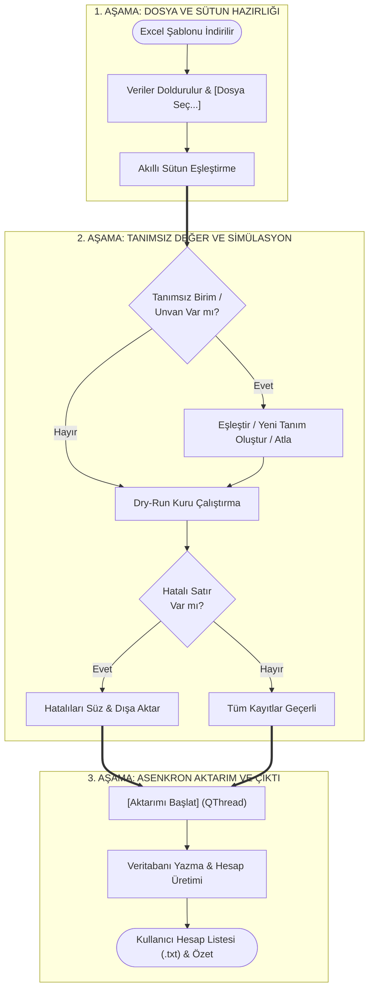

---json
{
  "pageTitle": "22. Merkezi Toplu İçe Aktarım Motoru (Bulk Import) — RADPYS v4 Kullanım Kılavuzu",
  "h1": "Merkezi Toplu İçe Aktarım Motoru (Bulk Import)",
  "lead": "Personel, izin hakları, cihaz, koruyucu ekipman (RKE), nöbet çizelgesi ve sistem tanımlamalarını 2 sayfalı kurumsal Excel şablonlarıyla sisteme yükleme; akıllı sütun eşleme, tanımsız değer çözücü, sıfır veri kaybı sağlayan Dry-Run simülasyonu ve asenkron aktarım rehberi.",
  "overviewId": "overview",
  "badges": [
    {
      "text": "5 Adımlı Akıllı Sihirbaz",
      "tone": "emerald"
    },
    {
      "text": "Dry-Run Simülasyonu",
      "tone": "cyan"
    },
    {
      "text": "Asenkron QThread",
      "tone": "purple"
    }
  ],
  "readingTime": "5 Dakika",
  "legalNote": "<strong>Veri Bütünlüğü ve Güvenlik Güvencesi:</strong> İçe aktarım motoru veritabanına doğrudan ham SQL yazmaz; aktarım öncesinde kuru simülasyon (dry-run) ile mükerrerlik ve alan doğrulaması yapar, kilitli resmi Şua dönemleri ile mühürlü kayıtları ezilmeye karşı korur."
}
---

## Kısa Reçete: 5 Adımlı Toplu Veri İçe Aktarımı {#quick-recipe}

:::recipe Kısa Reçete: 5 Adımlı Toplu Veri İçe Aktarımı | 20 SANİYELİK AKIŞ
### 1. İstenen Sonuç | slate
Yüzlerce personel, cihaz, RKE veya izin kaydını Excel dosyasından tek seferde, veri tabanını kilitlemeden ve hatalı satırları önceden ayıklayarak sisteme aktarmak.

### 2. Yapılacak İşlem | cyan
Sol Menüden <strong>[Sistem Yönetimi] &gt; [Toplu İçe Aktarım]</strong> (veya ilgili modüldeki <strong>[Toplu Import]</strong>) butonuna tıklayın; <strong>[Şablonlar Klasörü]</strong> içindeki resmi Excel şablonunu doldurup <strong>[Dosya Seç...]</strong> ile yükleyin. Tanımsız değerleri eşleştirip <strong>[Önizleme ve Doğrulama]</strong> adımında <strong>[Aktarımı Başlat]</strong> butonuna basın.

### 3. Sistem Etkisi | emerald
Kayıtlar asenkron arka plan iş parçacığıyla veritabanına işlenir; arayüz donmaz, yeni personeller için otomatik oluşturulan rastgele şifreler tek tıkla metin belgesi olarak indirilir ve hatalı satırlar varsa gerekçesiyle raporlanır.

- [metric] İşlem Adımı | 5 Aşamalı Güvenli Sihirbaz | emerald
- [metric] Doğrulama | Kuru Çalıştırma (Dry-Run) | cyan
- [metric] Motor Mimarisi | Asenkron Arka Plan (QThread) | purple
- [metric] Güvenlik Çıktısı | Maskeli Hesap Listesi (.txt) | amber
:::

## 5N1K Kural ve Arayüz Çözümleme Tablosu {#5w1h}

*İçe aktarım motorunun arayüz kontrolleri, çalışma ilkeleri ve güvenlik sınırları:*

| NE? (Bileşen / Kontrol) | NEDEN? (Amacı) | NASIL? (Çalışma Mantığı) | NE ZAMAN? (Tetiklenme) | KİM? (Yetkili Rol) |
| --- | --- | --- | --- | --- |
| <strong>[Şablonlar Klasörü] &amp; [Dosya Seç...]</strong> Şablon ve Dosya Seçim Adımı | Sistemin beklediği sütun yapısına uygun 2 sayfalı kurumsal Excel dosyasını temin etmek ve yüklemek. | Modüle özel şablonu (Veri Listesi + Geçerli Değerler Kılavuzu) Windows Gezgini'nde açar; yüklenen dosyanın formatını ve satır sayısını doğrular. | İçe aktarım sihirbazı başlatıldığında. | Modül Sorumlusu / Sistem Yöneticisi |
| <strong>Akıllı Sütun Eşleştirme Motoru</strong> 2. Adım: Sütun Haritalama | Excel'deki farklı sütun başlıklarını sistemdeki zorunlu ve isteğe bağlı veri alanlarıyla hatasız eşleştirmek. | Sol (1/3) ve sağ (2/3) bölünmüş panelde başlık benzerliklerini otomatik tanır; her satır sonunda 3 durumlu simgeyle (eşleşen, çakışan/uyarılı, atlanan) görsel geri bildirim verir ve zorunlu alanlar tamamlanmadan ilerletmez. | Dosya başarıyla yüklendiğinde. | Modül Sorumlusu / Sistem Yöneticisi |
| <strong>Tanımsız Değer Çözücü</strong> 3. Adım: Lookup Değer Eşleştirme | Excel dosyasındaki farklı birim, unvan veya kategori yazımlarını sistemdeki standart kayıtlarla hizalamak. | Dosyada geçen tanımsız her değer için üç seçenek sunar: sistemdeki mevcut tanıma bağlama (<strong>[Hepsini Eşle]</strong>), veritabanına yeni tanım olarak ekleme (<strong>[Hepsini Yeni Yap]</strong>) veya satırı atlama. | Dosyada kayıtlı olmayan bir değer tespit edildiğinde. | Sistem Yöneticisi |
| <strong>Dry-Run Simülasyonu ve Canlı Filtre Rozetleri</strong> 4. Adım: Önizleme ve Doğrulama | Veritabanına tek bir satır yazmadan önce tüm dosyanın doğrulama durumunu ve mükerrer kayıtları görmek. | Satırları bellek üzerinde sanal olarak dener; canlı kayıt sayacı rozetleri ve aktif filtre vurgusuyla (<strong>[Tümü]</strong>, <strong>[Geçerli]</strong>, <strong>[Mükerrer]</strong>, <strong>[Hatalı]</strong>) sorunlu satırları süzüp dışa aktarma imkanı sağlar. | Eşleştirmeler tamamlanıp önizlemeye geçildiğinde. | Modül Sorumlusu / Sistem Yöneticisi |
| <strong>Asenkron Aktarım &amp; [Hesap Bilgilerini İndir]</strong> 5. Adım: Tamamlama ve Döküm | Büyük dosyalarda masaüstü uygulamasını dondurmadan aktarımı tamamlamak ve oluşturulan kimlikleri güvenle teslim etmek. | İşlemi ana ekrandan bağımsız arka plan iş parçacığında animasyonlu ilerleme göstergesi ve sonuç simgeleriyle yürütür; personel aktarımlarında üretilen tek kullanımlık geçici şifreleri maskeli TXT dosyası olarak indirir. | <strong>[Aktarımı Başlat]</strong> butonuna basıldığında. | Sistem Yöneticisi |
| <strong>Modüle Özel İş Kuralı ve Otomatik Kod Kalkanları</strong> Personel, RKE, İzin ve Sistem Tanımları | Aktarım sırasında mevzuat sınıfı, ekipman numaralandırma ve geçmiş hak ediş hatalarını önlemek. | Personelde yalnızca hizmet sınıfı <strong>Radyasyon Görevlisi</strong> olanları radyasyon görevlisi olarak işaretler; RKE aktarımında ekipman tipi ön ekine göre otomatik kod üretir; İzin Hakediş ile İzin Geçmişi verilerini kilitli Şua dönemlerini koruyarak ayırır ve 6 farklı sistem tanımı kategorisini toplu işler. | Önizleme ve aktarım çalıştırıldığında. | Modül Sorumlusu / Sistem Yöneticisi |

## Kritik Sahada Yanlış Bilinen Kurallar (Mit Avcısı) {#myth-buster}

:::myth Excel Dosyasında Hatalı Satırlar Varsa Tüm Aktarım İptal Olur mu?

### Yanlış Algı

<em>"Toplu aktarım dosyasında 10 tane satırda eksik bilgi varsa bütün dosya reddedilir, düzeltip baştan yüklemek zorunda kalırız."</em>

### Gerçek Sistem Mantığı

**HAYIR.** İçe aktarım motoru esnek doğrulama mimarisine sahiptir. Önizleme adımında hatalı satırlar açıkça işaretlenir; dilerseniz yalnızca geçerli satırları tek tıkla aktarabilir, hatalı satırları ise <strong>[Hata Raporunu Aç]</strong> butonu ile ayrı bir Excel listesi halinde dışa aktararak sadece ilgili satırları düzelttikten sonra ekleyebilirsiniz.
:::

## Süreç Akış Şeması {#workflow}

1. **Dosya ve Sütun Hazırlığı:** İlgili modülün 2 sayfalı şablonu doldurulur; yükleme sonrasında sistem alanları ile Excel sütunları otomatik veya manuel eşleştirilir.
2. **Tanımsız Değer ve Simülasyon:** Sistemde kayıtlı olmayan birim veya unvanlar çözülür; veritabanına yazmadan önce kuru simülasyon (dry-run) çalıştırılarak mükerrer veya hatalı satırlar filtrelenir.
3. **Asenkron Aktarım ve Çıktı:** Onaylanan kayıtlar arka plan iş parçacığıyla veritabanına atomik olarak işlenir; yeni personel hesapları için tek kullanımlık geçici şifre dökümü üretilir.

## Arayüz Ekran Görünümleri {#screenshots}

## Adım Adım İşlem Rehberi {#step-by-step}

### 1. Şablon Hazırlama ve Dosya Yükleme

1. Sol menüden **[Sistem Yönetimi] &gt; [Toplu İçe Aktarım]** ekranına girin veya ilgili modül listesindeki (Personel, Cihaz, RKE vb.) **[Toplu Import]** butonuna tıklayın.
2. Açılan sihirbazın ilk adımında **[Şablonlar Klasörü]** butonuna basın; sistemin `data/import_sablon/` dizinindeki resmi 2 sayfalı Excel şablonunu açın (*1. Sayfa: Veri Listesi*, *2. Sayfa: Geçerli Değerler Kılavuzu*).
3. Verilerinizi şablona kopyalayıp kaydettikten sonra sihirbazdaki **[Dosya Seç...]** butonuna tıklayarak Excel dosyanızı sisteme yükleyin ve **[İleri]** butonuna basın.

### 2. Sütun Eşleştirme ve Alan Doğrulama

1. İkinci adımdaki 1/3–2/3 bölünmüş ekranda sistem, Excel'deki sütun başlıkları ile veritabanındaki hedef alanları otomatik olarak eşleştirmeye çalışır ve seçilen sütunun örnek değerlerini sağ panelde gösterir.
2. Her satırın sonundaki 3 durumlu simgeden eşleşme sağlığını anında görebilirsiniz: yeşil onay (sorunsuz eşleşme), sarı uyarı (şüpheli, biçim uyumsuzluğu veya mükerrer eşleşme) ve kırmızı uyarı (eşleşmemiş/atlanacak alan). Otomatik algılanamayan veya uyarı veren sütunları açılır kutulardan manuel seçip düzenleyin.
3. Kırmızı yıldızlı zorunlu alanların (örneğin Personel için TC Kimlik, Ad, Soyad; Cihaz için Seri No, Marka vb.) tamamı eşleştiğinde **[İleri]** butonu aktifleşecektir.

### 3. Tanımsız Değerleri Çözümleme Motoru

1. Yüklenen dosyada sistemde henüz tanımlanmamış birim, unvan, cihaz türü veya koruyucu ekipman tipi varsa sihirbaz otomatik olarak **3. Tanımsız Değerleri Eşleştir** adımını açar.
2. Her tanımsız değer için sağdaki işlem seçeneklerinden birini belirleyin:
   - **Mevcutla Eşle:** Benzer bir kaydı seçip bağlayın (örneğin Excel'deki "Radyoloji Uzm." değerini sistemdeki "Uzm. Tabip" ile eşleştirin).
   - **Yeni Oluştur (Hepsini Yeni Yap):** Bu değeri sistem tanımlarına otomatik yeni kayıt olarak ekleyin.
   - **Satırı Atla:** İlgili değeri içeren satırın aktarılmasını engelleyin.
3. Kararları verdikten sonra **[Eşleştirmeleri Uygula ve İlerle]** butonuna tıklayın.

### 4. Dry-Run Simülasyonu ile Önizleme ve Hata Filtreleme

1. Dördüncü adımda sistem, veritabanına hiçbir veri yazmadan tam bir kuru çalıştırma (dry-run) simülasyonu yürütür.
2. Ekrandaki büyük sayaç rozetlerini kontrol edin: **Toplam Satır**, **Geçerli Kayıt**, **Mükerrer Kayıt** ve **Hatalı Kayıt**.
3. Üstteki canlı sayaçlı ve aktif vurgulu filtre butonlarını kullanarak:
   - **[Hatalı]** butonuna basarak MERNİS algoritmasına uymayan TC kimlikleri, formatı bozuk tarihleri veya eksik zorunlu alanları inceleyin; **[Mükerrer]** filtresiyle mevcut kayıtlarla çakışan satırları süzün.
   - Varsa hatalı satırları **[Hata Raporunu Aç]** ile dışa aktarın.
4. Sonuçlar uygunsa **[Aktarımı Başlat]** butonuna tıklayarak onay verin.

### 5. Asenkron Aktarım, Şifre Dökümü ve Tamamlama

1. Aktarım arka planda asenkron olarak başlar; animasyonlu radyasyon ilerleme göstergesi durumu canlı gösterir ve uygulama donmaz.
2. İşlem tamamlandığında sonuç durum simgesiyle birlikte özet bilgi kartı görüntülenir.
3. Personel aktarımı yapıldıysa, yeni kullanıcılar için üretilen tek kullanımlık geçici şifreleri **[Kullanıcı Hesap Bilgilerini İndir (.txt)]** butonuna basarak güvenle kaydedin.
4. **[Tamamla]** butonuna basarak sihirbazı kapatın ve güncellenen modül listesine dönün.

## Sıkça Sorulan Sorular (SSS) {#faq}

:::faq

### Excel'de var olan bir personel veya cihaz dosyada tekrar gelirse sistem ne yapar?

İçe aktarım motoru önizleme adımında benzersiz alanları (TC Kimlik No, Cihaz Seri No, RKE Barkod No vb.) kontrol ederek bu kayıtları **Mükerrer** olarak işaretler. Birleştirme (merge) stratejisi seçildiyse var olan kaydın yalnızca boş alanları güncellenir; kilitli Şua yılları veya resmi onaylı kayıtlar kesinlikle ezilmez.

### Tanımsız bir birim veya unvan çıktığında dosya yüklemesini iptal etmek zorunda mıyım?

Hayır. Sihirbazın 3. adımı olan Tanımsız Değer Çözücü sayesinde, sistemde olmayan değerleri ya mevcut bir tanımla eşleştirebilir ya da tek tıkla veritabanına yeni tanım olarak ekleyebilirsiniz.

### Aktarım sırasında elektrik kesilirse veya uygulama kapanırsa veriler yarım kalır mı?

Hayır. İçe aktarım motoru atomik veritabanı işlem kalkanı (*transaction*) ile çalışır. Bir veri bloğunda kritik hata oluşursa o ana kadarki adımlar güvenle geri alınır (*rollback*), böylece veritabanında bozuk veya başıboş yarım kayıt oluşması engellenir.

### Oluşturulan personel kullanıcı hesaplarının geçici şifrelerini daha sonra tekrar görebilir miyiz?

Hayır. KVKK ve parola güvenliği ilkeleri gereğince, tek kullanımlık geçici şifreler yalnızca aktarım bittiği anda 5. adımda **[Kullanıcı Hesap Bilgilerini İndir (.txt)]** butonu üzerinden bir defaya mahsus indirilebilir. Sonrasında şifreler veritabanında tek yönlü karma (hash) olarak saklanır; unutulması durumunda Sistem Yöneticisi Kullanıcı Yönetimi ekranından yeni şifre tanımlamalıdır.

### Hangi modüller için toplu içe aktarım şablonu bulunmaktadır?

RADPYS v4 Evrensel İçe Aktarım Motoru; Personel Özlük, İzin Hakları ve Devirleri, Tıbbi Cihaz Envanteri, Koruyucu Ekipman (RKE), Nöbet Çizelgesi ve Sistem Tanımlamaları (Departman, Unvan, Oda vb.) olmak üzere tüm ana kurumsal modülleri desteklemektedir.
:::
