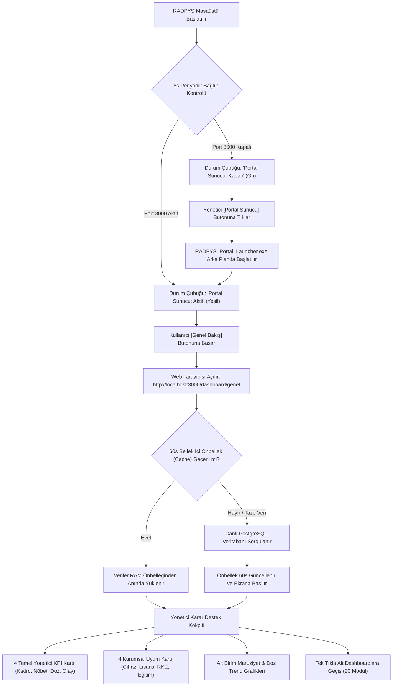

---json
{
  "pageTitle": "22. Web Portalı, Mobil Nöbet Takibi ve Yönetici Dashboardları — RADPYS v4 Kullanım Kılavuzu",
  "h1": "Web Portalı ve Yönetici Gösterge Panelleri (Dashboards)",
  "lead": "Tüm radyoloji ve radyasyon güvenliği operasyonunu (dozimetre kritik aşımları, aktif nöbetler, açık arızalar, DIN 6857-1 KKD muayeneleri, SKS denetim hazırlığı ve yasal kurumsal uyumu) tek merkezde toplayan, masaüstü durum çubuğundan 8 saniyede bir sağlık denetimi yapılan ve 60 saniyelik bellek içi önbellekle (In-Memory Cache) çalışan kurumsal karar destek merkezidir.",
  "overviewId": "overview",
  "badges": [],
  "readingTime": "5 Dakika",
  "legalNote": "<strong>Yasal Güvence:</strong> Canlı PostgreSQL veritabanı üzerinden beslenen panel, denetim müfettişlerine anlık tarafsız metrik sunar; sahte veya sentetik kayıt barındırmaz."
}
---

## Kısa Reçete (20 Saniye Kuralı) {#quick-recipe}

 

 

 <svg class="w-5 h-5 text-cyan-600" fill="none" stroke="currentColor" viewBox="0 0 24 24">
 <path stroke-linecap="round" stroke-linejoin="round" stroke-width="2" d="M13 10V3L4 14h7v7l9-11h-7z" />
 </svg>
 Hızlı Reçete: Masaüstünden Web Gösterge Paneline Erişim
 

 20 SANİYELİK AKIŞ
 

 

 

 1. İstenen Sonuç
 

 Tüm hastane radyoloji birimlerinin anlık nöbet doluluğunu, dozimetre kritik aşım alarmlarını, bekleyen DÖF ve arıza durumlarını tek ekranda incelemek.
 

 

 

 2. Yapılacak İşlem
 

 Masaüstü ana ekranında sol üstteki <strong>[Genel Bakış]</strong> butonuna tıklayın (veya <strong>[Ctrl+K]</strong> ile arayın). Sunucu kapalıysa durum çubuğundaki <strong>[Portal Sunucu: Kapalı]</strong> butonuna basarak tek tıkla çalıştırın.
 

 

 

 3. Sistem Etkisi & Güvence
 

 Sistem varsayılan tarayıcınızda <strong>http://localhost:3000/dashboard/genel</strong> sayfasını açar. 60 saniyelik bellek içi önbellek sayesinde veritabanı kilitlenmez, ağır sorgular saniyeler içinde yüklenir.
 

 

 

 

 

 Önbellek (Cache)
 60 Saniye TTL
 

 

 Yetkili Rol
 Yönetici / RGU / Sorumlu
 

 

 Canlılık Denetimi
 8 Saniye Döngü
 

 

 Platform Desteği
  Masaüstü + Web / Tablet
 

 

 

## Kritik Sahada Yanlış Bilinen Kurallar (Mit Avcısı) {#myth-buster}

:::myth Kritik Sahada Yanlış Bilinen Kural (Mit Avcısı)
### Yanlış Algı:
<em>"Web Portal sadece teknikerlerin nöbet çizelgesini gördüğü pasif bir ekrandır; idari karar, dozimetre analizi veya resmi denetim hazırlığı buradan yürütülemez."</em>

### Gerçek Sistem Mantığı:
Web Portal, sistemdeki <strong>20 farklı gösterge panelini</strong> tek merkezde toplayan tam yetkili karar destek platformudur. Sağlık Bakanlığı SKS 6.1 denetim hazırlığı, 20 mSv yıllık doz projeksiyonu, arıza duruş süreleri ve DIN 6857-1 koruyucu ekipman muayeneleri bu ekranlardan anlık izlenir, Excel ve PDF olarak dışa aktarılır.
:::

## 5N1K Kural ve Ayar Çözümleme Tablosu {#matrix-5n1k}

 

 

 Masaüstü entegrasyonu, web gösterge panelleri ve operasyonel alarm eşiklerinin kuralları.
 

 

 

 

| NE? (Ekran Kontrolü) | NEDEN? (Amacı) | NASIL? (Çalışma Mantığı) | NE ZAMAN? (Tetiklenme Anı) | KİM? (Yetkili Rol) |
| --- | --- | --- | --- | --- |
| Genel Bakış Butonu  [Sol Kenar Çubuğu En Üst Buton] | Yöneticinin tüm hastane radyoloji birimlerini tek ekranda görmesini sağlamak. | Sunucu aktifse varsayılan tarayıcıda Genel Bakış'ı açar; kapalıysa başlatıcıyı arka planda tetikler. | Kullanıcı butona bastığında veya Ctrl+K ile seçtiğinde. | Tüm Yöneticiler |
| Portal Sunucu Durum Butonu  [Durum Çubuğu / Status Bar Butonu] | Web Portal sunucusunun Port 3000'de canlı olup olmadığını izlemek ve gerekirse başlatmak. | 8 saniyede bir otomatik denetlenir. 200 dönerse yeşil 'Aktif', aksi halde gri 'Kapalı' olur. Tıklandığında başlatıcıyı tetikler. | Açılışta ve her 8 saniyede bir periyodik. | Sistem Yöneticisi (Admin) |
| 60 Saniye Önbellek & Zorla Yenile  [Bellek İçi Cache ve Yenile Butonu] | Ağır istatistik ve analitik sorgularının PostgreSQL veritabanını kilitlemesini önlemek. | 60 saniye boyunca sorgu sonuçları RAM'den sunulur. Filtre değiştiğinde veya zorla yenilendiğinde veritabanından taze veri çekilir. | Web paneli sayfaları arasında gezinirken. | Otomatik Sistem |
| Dozimetre Uyarı & Kritik Aşım Alarmı  [≥2 mSv ve ≥5 mSv Doz Rozetleri] | Yıllık 20 mSv mevzuat sınırına yaklaşan personeli erkenden tespit edip yasal korumaya almak. | Aylık derin doz ≥2.0 mSv ise sarı uyarı, ≥5.0 mSv ise kırmızı alarm ve resmi NDK bildirimi zorunluluğu tetiklenir. Ayrıca hakkında inceleme aksiyonu açılan personele Web Portal görev paneline 'Bölüm 2: Çalışan Beyanı' formunu doldurması için anlık görev bildirimi atanır. | Dozimetre okuma raporları içe aktarıldığında. | RGU / Medikal Fizikçi |
| P2P Nöbet Devir Havuz Süresi (36s)  [Nöbet Devir & Takas Analitiği] | Devre bırakılan nöbetlerin sahipsiz kalmasını ve son dakika açıklarını engellemek. | Havuza bırakılan nöbet 36 saat boyunca başka bir tekniker tarafından devralınmazsa istek iptal edilir ve nöbet sahibinde kalır. | Nöbet devir talebi açıldığı andan itibaren 36 saat. | Nöbetçi Personel |
| Cihaz QC ve Lisans 30 Gün Uyarısı  [Cihaz & QC Yönetimi Göstergesi] | NDK lisansı veya periyodik kalite kontrol süresi bitmeden önce yenileme payı bırakmak. | Geçerliliğine ≤30 gün kalan cihazlar sarı renkli alarm listesine alınır; süresi dolanlar kırmızı 'Hizmet Dışı' statüsüne geçer. | Her gün otomatik takvim kontrolünde. | Biyomedikal / RGU |
| Excel ve PDF Dışa Aktarımı  [Dışa Aktar / Export Butonları] | Denetimlerde ve idari toplantılarda resmi onaylı metrik çıktısı sunmak. | Tablodaki filtrelenmiş verileri sütun hizalı Excel (.xlsx) veya kurumsal antetli PDF belgesi olarak indirir. | Kullanıcı [Excel İndir] veya [PDF İndir] butonuna bastığında. | Tüm Kullanıcılar |
| Web Portalı Aç Butonu  [Portal Başlatıcı / Tray Menüsü] | Servis başlatıcı penceresinden tek tıkla canlı web portalını ve gösterge panellerini tarayıcıda açmak. | İşletim sisteminin varsayılan güncel tarayıcısını önceliklendirerek Port 3000 portal ana sayfasını açar; Sandbox veya kısıtlı ortamlarda Edge yedeğini kullanır. | Kullanıcı başlatıcıdaki [Web Portalı Aç] butonuna veya sistem tepsisindeki menü öğesine tıkladığında. | Tüm Kullanıcılar |
| Şifreli Lisans (.lic) ve Gömülü Cloudflare Tüneli  [Portal Başlatıcı &gt; Tünel Durum Rozeti] | Modem portu açmadan ve ek program kurmadan kuruma özel alt alan adıyla (Örn: kurumadi.radpys.com) güvenli dış erişim sağlamak. | Kuruma özel tünel ve Turnstile anahtarları .lic lisans dosyası içinde Cihaz Kimliğine (Machine ID) bağlı AES-256 şifreli gelir. Hiçbir personel veya dozimetre verisi dış sunucularda saklanmaz (%100 Yerel KVKK Güvencesi); tünel yalnızca kurum içi yerel bilgisayarınızla tarayıcı arasında uçtan uca şifreli geçiş köprüsü kurar. | Lisans etkinleştirildiğinde ve Portal Başlatıcı üzerinden servisler başlatıldığında. | Sistem Yöneticisi (Admin) |
| Cloudflare Turnstile &amp; 2FA E-Posta Doğrulaması  [Web Giriş Ekranı &amp; 6 Haneli OTP Kodu] | Web Portalını otomatik bot saldırılarına ve yetkisiz parola denemelerine karşı tam korumaya almak. | Yerel ağda hızlı giriş korunurken dış ağda Turnstile robot doğrulaması ve 6 haneli tek kullanımlık e-posta doğrulama kodu (2FA OTP) zorunlu tutulur. Doğrulama e-postası iletilemezse dış ağ oturumu açılmaz (Güvenli Kapanma); 5 hatalı denemede hesap 15 dakika otomatik kilitlenir. | Web Portalına her kullanıcı girişinde. | Tüm Web Kullanıcıları |
| Merkezileştirilmiş Profilim &amp; Kişisel Beyan Sekmeleri  [Profilim &amp; Saha Operasyon Ekranları] | Personelin tüm özlük, nöbet, izin/Şua, dozimetre, sağlık (EK-1), gebelik/muafiyet, eğitim ve RKE zimmet işlemlerini sol menü kalabalığı olmadan tek merkezden yürütmesini sağlamak. | Periyodik Sağlık (EK-1) anamnez/semptom beyanı, RD.F43 Doz Araştırma Beyanı ve Gebelik/Sağlık Muafiyeti başvurusu doğrudan <strong>[Profilim]</strong> sekmeleri içinden yönetilir. Saha görevlileri Cihaz Arıza/QC, RKE Barkod/Kroki Muayenesi ve Ortam Dozu Kroki Ölçümü işlemlerini atomik veri güvencesiyle doğrudan mobil tarayıcıdan yürütür. | Personel portala giriş yaptığında veya saha denetimi sırasında. | Tüm Web Kullanıcıları / RKS |
| Dozimetre Aksiyon Takip Kokpiti &amp; RD.F43 Tam Uyum  [Dozimetre Gösterge Paneli &gt; Aksiyon &amp; İnceleme Planları] | Doz aşımı ve anomali vakalarını masaüstü ana programla birebir aynı 8 sütunlu kokpit tablosunda izlemek ve RKS aksiyonlarını sonuçlandırmak. | İnceleme bekleyen erken uyarı/anomali adayları ile açık ve kapatılan aksiyonlar tek tabloda listelenir. Seçili kayıt üzerinden <strong>[Doz Araştırma Formu (RD.F43)]</strong>, <strong>[Birim Notu Ekle]</strong>, <strong>[Takip Ölçümü Planla]</strong> ve <strong>[Aksiyonu Kapat]</strong> işlemleri yürütülür. | Doz aşımı/anomali tespit edildiğinde veya RKS incelemesinde. | RKS / Medikal Fizikçi / Yönetici |
| Atomik Nöbet Devir/Takas, İkame Havuzu &amp; Denetim Kokpitleri  [Nöbet Devir Merkezi, İkame Havuzu &amp; SKS/NDK Denetim Panosu] | Nöbet takası, acil mazeret ikame atamaları ve yönetici onaylarında çizelge bütünlüğünü korumak; SKS/NDK denetim hazırlığını gerçek zamanlı izlemek. | Karşılıklı takas, yönetici devir onayı ve ikame havuzu teklif kabulleri atomik işlem kilidiyle yürütülür; aynı anda çakışan taleplerde mükerrer atama engellenir. Kayıt olmayan dönemlerde sahte/örnek veri üretilmez, dürüst boş durum gösterilir. | Nöbet devir/havuz işlemi onaylandığında veya yönetici kokpitleri açıldığında. | Birim Sorumlusu / RKS / Yönetici |

 

## Web Portal ve Dashboard Mimari Akış Şeması (Mermaid) {#workflow}

 Aşağıdaki şema, masaüstü uygulamasının portal sunucusunu denetlemesinden tarayıcıda canlı gösterge panellerinin yüklenmesine kadar olan mimari entegrasyonu göstermektedir.
 

 

 

## Ekran Konumları ve Görsel Rehber {#screenshots}

![Masaüstü Uygulamasından Web Portalına Tek Tıkla Erişim | Masaüstü Ana Ekranı > Sol Kenar Çubuğu [Genel Bakış] & Durum Çubuğu [Portal Sunucu] | Masaüstü Köprü Entegrasyonu](assets/img/dashboard_masaustu_portal_erisim.png "<strong>Simülasyon Notu:</strong> Masaüstü sol menüdeki Genel Bakış butonu ve sağ alt durum çubuğundaki canlı Portal Sunucu sağlık göstergesi.")
![RADPYS Web Portal Başlatıcı ve Durum Paneli | Masaüstü Durum Çubuğu > [Portal Sunucu: Aktif] > Portal Başlatıcı Paneli | Portal Launcher & Sunucu Kontrolü](assets/img/02_portal_launcher_paneli_on.png "<strong>Simülasyon Notu:</strong> Arka plan API (Port 5000) ve Web Arayüzü (Port 3000) servislerinin tek tıkla başlatılması ve yerel ağ (LAN) adres bilgisi.")
![RADPYS Web Portal Genel Bakış Executive Dashboard | Web Tarayıcısı > http://localhost:3000/dashboard/genel [Yönetici Özeti] | Executive Overview & 20 Analitik Dashboard](assets/img/web_portal_genel_dashboard.png "<strong>Simülasyon Notu:</strong> 8 temel yönetici KPI kartı, 4 kurumsal uyum göstergesi, alt birim doz trendleri ve 20 modüle tek tıkla geçiş kokpiti.")

## Adım Adım Eylem Akışı {#step-by-step}

 

 <strong class="text-slate-900 dark:text-white text-base block mb-2">Adım 1: Masaüstünden Portal Durumunu Doğrulama</strong>
 Masaüstü uygulamasının sağ alt köşesindeki durum çubuğuna bakın. Eğer yeşil renkli <strong>[Portal Sunucu: Aktif]</strong> yazıyorsa sunucu hazırdır. Eğer gri renkli <strong>[Portal Sunucu: Kapalı]</strong> yazıyorsa butona bir kez tıklayarak arka planda Portal Başlatıcı'yı çalıştırın; 3-4 saniye içinde aktifleşecektir.
 

 

 <strong class="text-slate-900 dark:text-white text-base block mb-2">Adım 2: Genel Bakış Ekranını Açma ve KPI İnceleme</strong>
 Sol kenar çubuğunun en üstündeki <strong>[Genel Bakış]</strong> butonuna tıklayın. Varsayılan tarayıcınızda açılan ekranda 4 temel yönetici kartını (Kadro, Nöbet, Dozimetre, Olay) ve 4 kurumsal uyum kartını (Cihaz, NDK Lisansları, RKE, Eğitim) kontrol edin. Sayıların üzerine dokunarak ilgili alt modüle doğrudan geçiş yapabilirsiniz.
 

 

 <strong class="text-slate-900 dark:text-white text-base block mb-2">Adım 3: İlgili Gösterge Panellerine Geçiş</strong>
 Sol menüdeki akordeon gruplarından incelemek istediğiniz alana tıklayın:
 <ul class="list-disc pl-5 mt-2 space-y-1">
 <li><strong>Nöbet Yönetimi:</strong> Kurumsal nöbet matrisi, poliklinik vardiyaları, kısıt ihlalleri ve adalet katsayıları.</li>
 <li><strong>Dozimetre Takibi:</strong> 2 mSv ve 5 mSv aşım alarmları, DÖF aksiyonları ve RDF-43 araştırma formları.</li>
 <li><strong>Denetim Panosu:</strong> Sağlık Bakanlığı SKS ve NDK denetim hazırlık eksiklik kontrol listesi.</li>
 <li><strong>Cihaz & RKE:</strong> Lisans vize süreleri, bakım gecikmeleri ve DIN 6857-1 kurşun ekipman muayeneleri.</li>
 </ul>
 

 

 <strong class="text-slate-900 dark:text-white text-base block mb-2">Adım 4: Filtreleme, Zorla Yenileme ve Resmi Rapor Alma</strong>
 Üstteki filtre çubuğundan Departman veya Yıl/Ay seçimi yapın. Yeni bir kayıt girildiğinde 60 saniyelik önbelleği beklemeden anlık veri çekmek için sağ üstteki <strong>[Yenile]</strong> butonuna basın. İncelediğiniz tabloyu denetime sunmak için <strong>[Excel İndir]</strong> veya <strong>[PDF İndir]</strong> butonuna tıklayın.
 

 

## Hibrit Platform Karşılaştırması (Masaüstü & Web) {#hybrid-platform}

 

 <h3 class="text-base font-bold text-slate-900 dark:text-white flex items-center gap-2">
 
 Masaüstü Uygulaması (PySide6)
 </h3>
 <ul class="text-xs sm:text-sm space-y-2 text-slate-600 dark:text-slate-300">
 <li class="flex items-start gap-2">
 •
 <strong>Sunucu Yönetimi:</strong> Durum çubuğunda Node.js Port 3000 sağlık kontrolü ve arka plan launcher tetikleme.
 </li>
 <li class="flex items-start gap-2">
 •
 <strong>Hızlı Köprü:</strong> Tek tıkla varsayılan tarayıcıda yönetici kokpitini açma yetkisi.
 </li>
 <li class="flex items-start gap-2">
 •
 <strong>Gelişmiş Solver & Rapor:</strong> Nöbet dağıtım motorunu çalıştırma, Excel toplu içe aktarım ve şifreli evrak kasası yönetimi.
 </li>
 </ul>
 

 

 <h3 class="text-base font-bold text-slate-900 dark:text-white flex items-center gap-2">
 
 Web Portalı & PWA (React 18 + Vite)
 </h3>
 <ul class="text-xs sm:text-sm space-y-2 text-slate-600 dark:text-slate-300">
 <li class="flex items-start gap-2">
 •
 <strong>20 Analitik Dashboard:</strong> Dozimetre, nöbet devir, SKS denetim, RKE ve ortam dozu göstergeleri.
 </li>
 <li class="flex items-start gap-2">
 •
 <strong>Mobil / Tablet Uyumu:</strong> Kurum içindeki telefon ve tabletlerden duyarlı (responsive) anlık veri takibi.
 </li>
 <li class="flex items-start gap-2">
 •
 <strong>Yüksek Performans:</strong> 60 saniyelik bellek içi önbellek ile anında grafik yükleme ve rapor dökümü.
 </li>
 </ul>
 

 

## Hata Mesajları ve Sorun Giderme Rehberi {#troubleshooting}

| Hata / Durum Bildirimi | Olası Neden | Çözüm Adımı |
| --- | --- | --- |
| "Portal Sunucu: Kapalı" | Node.js Express sunucusu Port 3000 üzerinde henüz başlatılmamış. | Masaüstü durum çubuğundaki butona bir kez tıklayarak başlatıcıyı devreye alın (3-4 saniye bekleyin). |
| "Portal Başlatıcı (RADPYS_Portal_Launcher.exe) bulunamadı." | Başlatıcı yürütülebilir dosyası silinmiş veya kurulum dizini dışına taşınmış. | RADPYS kurulum klasöründeki user_launcher dizinini kontrol ediniz veya sistem yöneticisine başvurunuz. |
| "Yeni girdiğim nöbet/kaza kaydı gösterge panelinde görünmüyor." | 60 saniyelik bellek içi önbellek henüz süresini doldurmamış. | Dashboard'un sağ üstündeki [Yenile] butonuna basarak önbelleği zorla temizleyip taze veri çekiniz. |
| "Tarayıcıda sayfa yüklenmiyor (Bağlantı Reddedildi)" | PostgreSQL veritabanı veya web sunucusu güvenlik duvarı tarafından engellenmiş. | Yerel güvenlik yazılımında 3000 portuna yerel ağ (localhost) izinlerini veriniz. |

 

## Sıkça Sorulan Sorular (SSS) {#faq}

:::faq
### Web Portal sunucusunu başlatma yetkisi kimdedir?
Kurumsal güvenlik kuralı gereğince durum çubuğundaki başlatıcı tetikleme yetkisi yalnızca <strong>Sistem Yöneticisi (Admin)</strong> rolüne aittir. Normal kullanıcılar ve teknikerler açık olan portali tarayıcıdan izleyebilir ancak arka plan sunucu sürecini başlatamaz veya durduramaz.

### 60 saniyelik önbellek süresi verilerin gecikmesine yol açar mı?
Hayır. 60 saniyelik TTL (Time-to-Live), yüzlerce personelin aynı anda gösterge panellerini açtığı kurumsal hastane ağlarında veritabanı kilitlenmelerini önleyen endüstriyel bir standarttır. Kritik bir veri girişi yapıldığında paneldeki <strong>[Yenile]</strong> butonuna basılarak önbellek anında geçersiz kılınabilir ve canlı veri çekilebilir.

### Web Gösterge Panellerine cep telefonu veya tabletten erişilebilir mi?
Evet. RADPYS Web Portalı modern duyarlı (responsive) React mimarisinde geliştirilmiştir. Hastane yerel Wi-Fi ağına bağlı tabletler ve akıllı telefonlar üzerinden yetkili kullanıcı girişi yapılarak tüm paneller ve grafikler tam ekran olarak incelenebilir.

### İnternet bağlantısı kesildiğinde Web Portal çalışmaya devam eder mi?
<strong>Evet, kesintisiz çalışır.</strong> RADPYS sistemi dış bulut servislerine bağımlı değildir; kurumun yerel sunucusunda veya ana bilgisayarında çalışan yerel PostgreSQL ve Node.js mimarisiyle kuruludur. Dış internet bağlantısı kesilse dahi hastane intranet ağı üzerinden gösterge panellerine erişim eksiksiz devam eder.

### Portal Başlatıcı üzerindeki [Web Portalı Aç] butonu hangi tarayıcıyı kullanır?
Kullanıcının işletim sisteminde varsayılan olarak belirlediği güncel web tarayıcısı (Google Chrome, Mozilla Firefox, Brave vb.) otomatik olarak açılır. Yalnızca kısıtlı kurumsal konteyner veya izole güvenlik ortamlarında (Windows Sandbox gibi) protokol uyumluluğunu korumak amacıyla Microsoft Edge yedeği devreye girer.
:::
