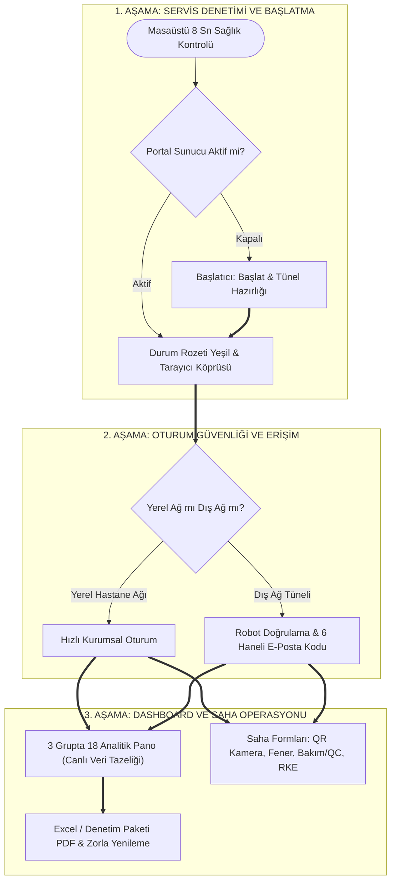

---json
{
  "pageTitle": "22. Web Portalı ve Yönetici Gösterge Panelleri — RADPYS v4 Kullanım Kılavuzu",
  "h1": "Web Portalı ve Yönetici Gösterge Panelleri",
  "lead": "Kurum içi personel ve saha işlemlerini (izin, nöbet devri, EK-1 sağlık/RD.F43 beyanı, cihaz arıza-bakım-QC, RKE QR muayenesi ve ortam dozu ölçümü) mobil uyumlu tarayıcı ve PWA arayüzüne taşırken; 3 ana gruptaki 18 aktif yönetici gösterge panelini bellek içi önbellek, canlı veri tazeliği göstergesi, 8 saniyelik canlı sağlık denetimi ve isteğe bağlı şifreli dış erişim tüneliyle sunar.",
  "overviewId": "overview",
  "badges": [
    {
      "text": "18 Aktif Dashboard & Mobil PWA",
      "tone": "cyan"
    }
  ],
  "readingTime": "5 Dakika",
  "legalNote": "<strong>Yasal ve KVKK Güvencesi:</strong> Tüm gösterge panelleri doğrudan kurumun canlı yerel veritabanından beslenir ve sıfır veri durumunda asla sahte veya sentetik kayıt üretmez; dış erişim açılsa dahi personel ve doz verileri bulut sunucularında depolanmaz."
}
---

## Kısa Reçete: Portal Servisini Kontrol Etme ve Yönetici Paneline Erişim {#quick-recipe}

:::recipe Kısa Reçete: Portal Servisini Kontrol Etme ve Yönetici Paneline Erişim | 20 SANİYELİK AKIŞ
### 1. İstenen Sonuç | slate
Masaüstü uygulamasından veya Portal Servis Yöneticisinden Web Portalını doğrulayıp 18 analitik gösterge paneli ile saha QR işlemlerine anında bağlanmak.

### 2. Yapılacak İşlem | cyan
Masaüstü durum çubuğunda <strong>[Portal Sunucu: Aktif]</strong> göstergesini kontrol edin (kapalıysa tıklayarak başlatıcıdan <strong>[Başlat]</strong> deyin), ardından sol üstteki <strong>[Genel Bakış]</strong> butonuna basın.

### 3. Sistem Etkisi | emerald
Varsayılan tarayıcınızda Yönetici Özet Paneli açılır; 60 saniyelik bellek içi önbellek eşzamanlı sorgularda veritabanı yükünü dengeler, sağ üstte son veri çekim saati görülür ve istenen anda <strong>[Yenile]</strong> ile canlı veri çekilir.

- [metric] Yönetici Panelleri | 3 Grupta 18 Aktif Pano | cyan
- [metric] Sağlık Kontrol Döngüsü | Her 8 Saniyede Bir | emerald
- [metric] Dashboard Önbelleği | 60 Sn (Tatil Cetveli 300 Sn) | amber
- [metric] Platform | Tarayıcı + Mobil PWA | purple
:::

## 5N1K Kural ve Arayüz Çözümleme Tablosu {#5w1h}

*Masaüstü köprü ve başlatıcı denetimi, önbellek ve veri tazeliği, 18 yönetici paneli, dış erişim güvenliği, saha QR ve PWA kuralları.*

| NE? (Bileşen / Kontrol) | NEDEN? (Amacı) | NASIL? (Çalışma Mantığı) | NE ZAMAN? (Tetiklenme) | KİM? (Yetkili Rol) |
| --- | --- | --- | --- | --- |
| <strong><strong>[Genel Bakış]</strong> &amp; <strong>[Portal Sunucu: Aktif / Kapalı]</strong></strong> Masaüstü Köprüsü ve 8 Sn Kontrol | Sunucunun canlı olduğunu anlık görmek ve tek tıkla yönetici özetini açmak. | Masaüstü her 8 saniyede bir portal durumunu sorgular; kapalıysa durum butonundan veya Servis Yöneticisindeki <strong>[Başlat]</strong> ve <strong>[Web Portalı Aç]</strong> butonlarından tarayıcı açılır. | Program açıkken ve kullanıcı tıkladığında. | Sistem Yöneticisi / Yönetici |
| <strong>Önbellek, Veri Tazeliği, <strong>[Yenile]</strong> ve Excel/PDF İhracı</strong> Eşzamanlı Performans ve Denetim Paketi | Yüzlerce kişi aynı anda panele girerken veritabanı yükünü korumak ve verinin güncelliğini şeffaf göstermek. | İstatistik yanıtları 60 saniye (yıllık resmi tatil cetvelinde 300 saniye paylaşımlı) bellekte tutulur; sağ üstte son çekim zamanını gösteren <strong>Veri Tazeliği Göstergesi</strong> ve 1.000 kaydı aşan listelerde dönem daraltma bilgilendirmesi yer alır. <strong>[Yenile]</strong> önbelleği sıfırlar; <strong>[Excel]</strong>, <strong>[Yazdır / PDF]</strong> ve Denetim Panosu'ndaki <strong>[Denetim Paketi (PDF)]</strong> resmi çıktı verir. | Dashboard yüklenirken veya çıktı alınırken. | Yönetici / RKS / Yetkili |
| <strong>3 Grupta 18 Aktif Yönetici Gösterge Paneli</strong> Denetim, Nöbet &amp; İzin, Sağlık &amp; Güvenlik | Kurumsal uyum, nöbet adaleti ve kısıt/istek analizi, birleşik izin/Şua/farazi planlama, doz aşımı, bakım ve eğitim durumlarını tek yerden izlemek. | Genel ve Analiz (4), Nöbet ve İzin Yönetimi (5) ile Sağlık ve Güvenlik (9) gruplarında canlı KPI, yıllık ısı haritası ve dürüst boş durum sunulur; <strong>İzin &amp; Hak Ediş Yönetimi</strong> altında yıllık izin, Şua bakiye karnesi ve farazi projeksiyon tek ekranda toplanır, <strong>Nöbet Kısıt &amp; İstek Analitiği</strong> tercih/kısıt ihlallerini denetler ve <strong>Çalışma Kısıtları</strong> hizmet sınıfı ile radyasyon kapsamını ayırır. | Yetkili yönetici yan menüden panel seçtiğinde. | Yönetici / RKS / Birim Sorumlusu |
| <strong>Şifreli Dış Erişim Tüneli, Robot Koruması ve 2FA OTP</strong> Kurumsal İnternet Erişim Güvenliği | Modem portu açmadan güvenli dış erişim sağlamak ve yetkisiz girişleri önlemek. | Yerel ve dış ağ ayrımı gerçek bağlantı adresinden doğrulanır; dış ağda şifreli tünel, robot doğrulaması, ilk girişte tek kullanımlık parola yenileme bileti ve 6 haneli e-posta kodu zorunlu çalışır, 5 hatalı girişte hesap 15 dakika kilitlenir ve masaüstünden kapatılan oturumlar portalda da düşürülür. | Kullanıcı dış ağdan veya web ekranından girerken. | Admin / Tüm Web Kullanıcıları |
| <strong>İmzalı Belge Bileti, Kasa Bütünlüğü ve Çoklu Birim Yetki Kalkanı</strong> <strong>[İndir]</strong>, <strong>[Raporu İndir]</strong> &amp; Saha Güvenliği | Tarayıcı adres çubuğunda oturum sızmasını, birimler arası yetkisiz erişimi ve bozuk evrak açılmasını önlemek. | Belge, eğitim medyası ve kat planı açılışlarında 60 saniyelik tekil güvenlik bileti üretilir ve evrakın dijital parmak izi doğrulanır; çoklu birim sorumluları yalnızca atandıkları klinikleri yönetir, şifahi nöbet devirlerinde tek kullanımlık kod aranır ve HBYS numarası yalnızca onaylı izinlere işlenebilir. | Belge/kat planı açılırken veya saha kaydı girilirken. | Yetkili Kullanıcı / Birim Sorumlusu |
| <strong>Merkezi Profilim ve 3 Gruplu Saha Formları</strong> Standart Saha Merkezi &amp; Onay Kuyruğu | Çalışan ve saha teknisyenlerinin mobil/tarayıcıdan eksiksiz ve tek biçimli işlem yapmasını sağlamak. | EK-1 sağlık beyanı, RD.F43 doz beyanı ve izin/nöbet devirleri <strong>[Profilim]</strong> ve form sekmelerinden yürür; Cihaz, RKE ve Ortam Dozu saha ekranları ise ortak <strong>Eşleştirme ve Seçim Merkezi</strong>, satır içi <strong>Pasaport Kartı</strong> ve görevli birim yetkisi + Merkezi Onay Kuyruğu güvencesiyle çalışır. | Personel beyanı veya saha müdahalesi yapılırken. | Tüm Personel / Saha Görevlisi |
| <strong>PWA Kurulumu, QR Kamera, Fener ve Taslak Koruma</strong> Mobil / Karanlık Oda Ergonomisi | Telefon ve tabletlerde tam ekran uygulama deneyimi ve karanlık odalarda kesintisiz QR okuma sunmak. | Üst çubuktaki <strong>[Uygulamayı Yükle]</strong> ile tam ekran uygulama kurulur; kamera QR okuyucusu karanlık çekim odaları için fener, ekranı uyanık tutma, titreşimli onay ve uzun form taslağı koruması sağlar. | Tarayıcıdan saha veya QR işlemi yapılırken. | Saha Personeli / Teknisyen |

## Kritik Sahada Yanlış Bilinen Kurallar (Mit Avcısı) {#myth-buster}

:::myth Web Portal Sadece Nöbet Görüntüleme Ekranı mıdır ve Dış Erişim Verileri Buluta mı Taşır?
### Yanlış Algı
<em>"Web Portal yalnızca personelin nöbet listesine baktığı salt okunur bir sayfadır; ayrıca kurum dışından erişim açıldığında personel ve dozimetre kayıtlarımız dış bulut sunucularına yüklenir."</em>

### Gerçek Sistem Mantığı
<strong>İkisi de doğru değildir.</strong> Web Portalında yöneticiler için SKS Denetim Panosu dahil <strong>18 aktif karar destek paneli</strong> ve personeller/teknisyenler için tam kapsamlı saha formları bulunur (izin, nöbet devri/havuzu, RD.F43/EK-1 beyan, cihaz bakım/QC, RKE kroki muayenesi ve ortam dozu). Ayrıca dış erişim açıldığında hiçbir veri buluta kopyalanmaz; yalnızca kurumun yerel sunucusuyla yetkili kullanıcının tarayıcısı arasında uçtan uca şifreli tünel köprüsü kurulur.
:::

## Süreç Akış Şeması {#workflow}

1. **Servis Denetimi:** Masaüstü uygulaması 8 saniyede bir portal durumunu kontrol eder; kapalıysa Servis Yöneticisi üzerinden yerel sunucu ve varsa şifreli tünel ayağa kaldırılır.
2. **Güvenli Oturum:** Kurum içi ağda hızlı oturum açılırken dış erişimde robot doğrulaması ve 6 haneli tek kullanımlık e-posta doğrulaması uygulanır.
3. **Analitik ve Saha İşlemleri:** Yetkisine göre yöneticiler 18 gösterge panelinde (60 sn önbellekli ve veri tazeliği göstergeli) anlık Excel/PDF analizine ulaşır; personel ve teknisyenler karanlık oda fenerli QR okuyucu ve mobil formlarla sahadan kayıt girer.

## Arayüz Ekran Görünümleri {#screenshots}

## Adım Adım İşlem Rehberi {#step-by-step}

### 1. Portal Servisini Başlatma ve Durum Kontrolü

1. Masaüstü programının sağ alt köşesindeki **[Portal Sunucu: Aktif]** göstergesini kontrol edin; gösterge **Kapalı** görünüyorsa butona tıklayarak **RADPYS V4 Portal ve Servis Yöneticisi** penceresini öne getirin.
2. Yönetici penceresinde **[Başlat]** butonuna basarak veritabanı motoru ile portal servisinin (gerekirse dış erişim tünelinin) aktifleşmesini bekleyin ve pencereyi küçültmek için **[Tepsiye Küçült]** seçeneğini kullanın.
3. Doğrudan tarayıcıyı açmak için başlatıcıdaki **[Web Portalı Aç]** butonuna veya masaüstü sol menüsündeki **[Genel Bakış]** düğmesine tıklayın.

### 2. 18 Yönetici Gösterge Panelinde Analiz ve Raporlama

1. Sol menüdeki **GENEL & ANALİZ** (4 pano), **NÖBET & İZİN YÖNETİMİ** (5 pano) ve **SAĞLIK & GÜVENLİK** (9 pano) gruplarından ilgili panoyu seçin (veya üst çubuktan `Ctrl+K` hızlı arama ile Şua, Farazi İzin ya da Kısıt alt görünümlerine doğrudan atlayın).
   - **Üst Yönetim ve Denetim Kolaylıkları:** **Genel Bakış** ekranında 4 hücreli yönetici özet şeridi, 3 modlu birim grafiği ile **Acil / Geciken** ve **Yaklaşan (30 Gün)** uyarı sekmelerini inceleyebilir; **Denetim Panosu** ekranında birim bazlı kanıt özetlerini, acil aksiyonları, **Mevzuat & Denetim Rehberi** sekmesini ve tek tıkla **[Denetim Paketi (PDF)]** toplu kanıt çıktısını kullanabilirsiniz.
   - **Birim Yük ve Personel Matrisi:** **Birim Yük / Oran Paneli** ekranında cari yıl seçimiyle 1+3 düzenindeki **Yatay Barometre**, **Karşılaştırma Grafiği** ve **Ana Departman Gruplu** görünümlerini inceleyebilir (sekreterlik ve arşiv gibi destek birimleri tek **İdari & Destek Birimleri (Sekreterlik / Arşiv)** satırında özetlenir); **Personel & Birimler** ekranında ise iki ondalıklı doz gösterimini, **Ünvan & Branş Dağılımı** özetini ve tıklandığında ilgili birim listesini açan **Klinik Birim Matrisi** yapısını kullanabilirsiniz.
   - **Nöbet & İzin Yönetimi Panoları (Faz 4):** **Nöbet Yönetimi** ekranında kurumsal matris, birim çizelgesi, dini ve resmi bayram ayrımlı Adalet Sayacı, 12 aylık Borç/Alacak Matrisi ve Birim × Kural Çapraz İhlal Matrisi sunulur; **Nöbet Devir & Takas Analitiği** karşılıklı takasların her iki vardiya ayağını, 3 aşamalı onay ve yanıt sürelerini, aşırı devir uyarılarını ve saha Değişim/Onay Merkezine doğrudan geçişi izler; **Nöbet Kısıt & İstek Analitiği** eğitim/ders günü kısıtları, nöbet yaz/yazma mazeretleri ve fazla mesai tercihlerinin çizelgeye gerçekleşme ve ihlal durumunu 7 günlük birim yoğunluğu ile yaş/kıdem muafiyetleri eşliğinde analiz eder; **Aylık Mesai & Tatil Cetveli** artık yıl duyarlı yıllık mesai hesabını, 2027–2030 Diyanet dini bayram/Arife yarım günlerini ve çakışan tatil tekilleştirmesini gösterir; **İzin & Hak Ediş Yönetimi** ise Birim İzin Matrisi, İzin Hareketleri, yıl sonu yanma riskini izleyen **Yıllık & Şua Bakiye Karnesi** ve KVKK maskelemeli **Farazi İzin Projeksiyonu** sekmelerini tek çatı altında birleştirir.
   - **Sağlık & Güvenlik Panoları (Faz 2 & Faz 3):** **Dozimetre Takibi** (yıllık **ALARA Doz Bütçesi** ve özel izlem radarı dahil), **Olay Bildirimi & DÖF** (yanıt süresi ve kök neden dağılım analizi dahil), **NDK Araştırma Formları** (Çalışan Beyanı / RKS süreç kapıları, 15 günlük yasal süre geri sayımı ve panelden ilgili RD.F43 formuna tek tıkla geçiş), **Sağlık Muayene**, **Çalışma Kısıtları** (hizmet sınıfı ile radyasyon kapsamı ayrımı, radyasyonlu birim alan kısıtı uyarısı, tek-ekran önlem özeti, ileri tarihli planlanan fazlar ve kadro muafiyeti ayrımı), **Cihaz & QC Yönetimi** (zimmet sekmesiyle birleşik), **RKE & KKD Muayene**, **Ortam Dozu Trendi** (ölçüm cihazı lisans/kalibrasyon takibi dahil) ve **Zorunlu Eğitim Uyum** panellerinde yıllık ısı haritaları, Personel × Eğitim matrisi ve güvenli sertifika önizleme imkanı sunulur.
2. Üstteki dönem ve birim filtrelerini uygulayın; sağ üstteki **Veri Tazeliği Göstergesi** verinin en son ne zaman çekildiğini gösterir, son 60 saniye içinde yeni bir veri girişi yaptıysanız önbelleği beklemeden taze veri çekmek için **[Yenile]** butonuna tıklayın.
3. Denetim veya toplantı sunumu için sağ üstteki **[Excel]**, **[Yazdır / PDF]** ya da Denetim Panosu'ndaki **[Denetim Paketi (PDF)]** butonlarından tabloyu ve özet metrikleri dışa aktarın.

### 3. Mobil Saha İşlemleri, PWA Kurulumu ve Karanlık Oda QR Kullanımı

1. Telefon, tablet veya bilgisayarda tarayıcı üst çubuğundaki **[Uygulamayı Yükle]** butonuna basarak Web Portalını tam ekran uygulama (PWA) olarak kurun (iOS cihazlarda ekrandaki Paylaş ve Ana Ekrana Ekle yönergesi açılır).
2. Sol menüdeki **Kişisel İşlemlerim**, **Nöbet İşlemlerim** ve **Saha & Güvenlik Bildirimleri** altından izin talebi, nöbet takası/havuzu, **Profilim** içi EK-1 sağlık / RD.F43 doz beyanları ile Cihaz, RKE ve Ortam Dozu saha merkezlerini açın. Cihaz, RKE ve Ortam Dozu ekranlarında yalnızca görevli olduğunuz birimler üzerinden seçim veya QR taraması yaparak pasaport kartı ve alt sekmelerden (esnek arıza tarihçesi, kroki pinleme, askılık sayımı ve nokta bazlı ölçüm geçmişi) kayıtlarınızı onaya gönderin.
3. Çekim odasında QR kod taratırken tarayıcı kamerasındaki fener düğmesiyle alanı aydınlatın; uzun formlarda sayfa kapansa dahi tarayıcı taslağının korunduğundan emin olarak işleminizi güvenle tamamlayın.

## Sıkça Sorulan Sorular (SSS) {#faq}

:::faq
### Portal sunucusunu herkes başlatabilir veya durdurabilir mi?
Hayır. Kurumsal güvenlik politikası gereğince arka plan portal servisini başlatma, durdurma ve tünel ayarlarını yönetme yetkisi yalnızca Sistem Yöneticisi (Admin) rolüne aittir; diğer yetkili kullanıcılar açık portalda kendi modüllerini kullanır.

### 60 saniyelik önbellek yüzünden yeni girdiğim kayıt görünmezse ne yapmalıyım?
Yönetici panellerinin sağ üstünde yer alan <strong>[Yenile]</strong> butonuna basmanız yeterlidir. Bu işlem 60 saniyelik bellek süresini beklemeden doğrudan güncel veritabanı sorgusunu çalıştırır.

### İnternet kesildiğinde Web Portal ve mobil QR okuyucu çalışmaya devam eder mi?
Evet. Hastane yerel ağı (intranet) üzerindeki tüm gösterge panelleri, personel formları ve QR saha işlemleri kurum sunucusu üzerinde çalıştığı için dış internet kesintisinden etkilenmez.

### Web Portalındaki bazı ekranlar dar telefon penceresinde neden alta kayıyor?
Dar mobil veya uygulama pencerelerinde hiçbir sekmenin ekran dışında kesilip gizlenmemesi için sekmeler otomatik olarak alt satıra dizilir ve tüm onay pencereleri dokunmatik ekrana uyumlu açılır.
:::
