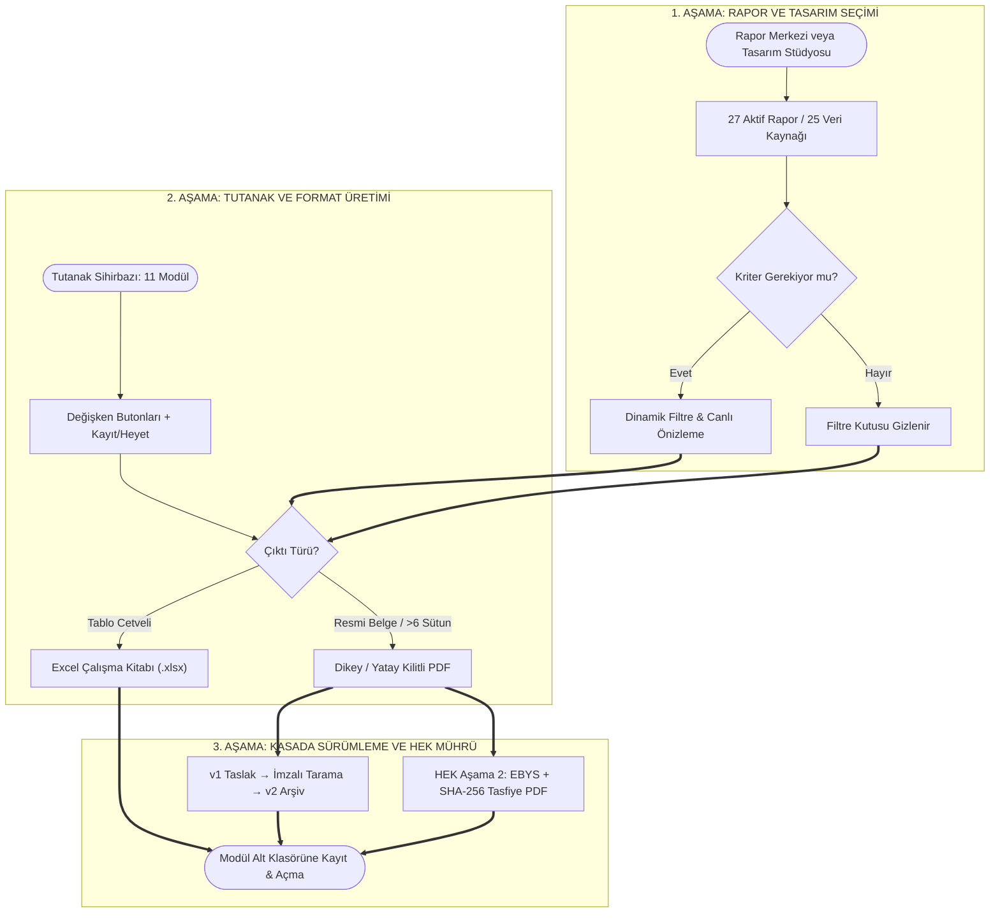

---json
{
  "pageTitle": "23. Raporlama ve Tutanak Yönetim Merkezi — RADPYS v4 Kullanım Kılavuzu",
  "h1": "Raporlama ve Tutanak Yönetim Merkezi",
  "lead": "SKS 6.1 ve NDK denetimleri için 27 aktif resmi mevzuat raporunu ve 25 hazır veri kaynağını tek merkezde toplar; dinamik dikey/yatay A4 PDF ve Excel (.xlsx) çıktıları üretir, Şablon Tasarım Stüdyosu ve kurumsal çift logo ayarlarını yönetir, 11 modül kapsamlı Evrensel Tutanak Sihirbazı ile kilitli PDF tutanaklar oluşturup Resmi Tutanaklar Kasası (v1 taslak → v2 imzalı) ile 2 aşamalı SHA-256 mühürlü HEK tasfiyesini güvence altına alır.",
  "overviewId": "overview",
  "badges": [
    {
      "text": "Kilitli PDF & EBYS Mühürlü Arşiv",
      "tone": "rose"
    }
  ],
  "readingTime": "6 Dakika",
  "legalNote": "<strong>Yasal Güvence:</strong> Tutanak Sihirbazı tahrifatı önlemek için yalnızca değiştirilemez kilitli PDF çıktı verir; kurum adı veya logo tanımlanmamışsa sahte kurum adı yazılmaz, dürüst kurumsal varsayılan olarak RADPYS anteti kullanılır."
}
---

## Kısa Reçete: Resmi Rapor Çıktısı veya Çoklu Tutanak Üretme {#quick-recipe}

:::recipe Kısa Reçete: Resmi Rapor Çıktısı veya Çoklu Tutanak Üretme | 20 SANİYELİK AKIŞ
### 1. İstenen Sonuç | slate
Seçili dönem/birim kriterlerine göre denetime hazır A4 PDF veya Excel (.xlsx) raporu almak ya da birden çok cihaz/RKE için tek resmi PDF heyet tutanağı üretmek.

### 2. Yapılacak İşlem | cyan
Rapor Merkezinde listeden şablonu seçip varsa filtreleri belirleyerek <strong>[PDF İndir]</strong> veya <strong>[Excel (.xlsx)]</strong> butonuna basın; çoklu varlık tutanağı için <strong>[Tutanak Sihirbazı]</strong> üzerinden <strong>[Sistemden Kayıt Ekle...]</strong> ve <strong>[Tutanak Oluştur / Yazdır]</strong> adımlarını uygulayın.

### 3. Sistem Etkisi | emerald
6 sütundan geniş tablolarda PDF otomatik Yatay A4 döner; HEK başlığı taşıyan tutanaklarda önce ön inceleme dosyası açılır, EBYS kapatması yapılınca SHA-256 dijital mührüyle kalıcı arşivlenir.

- [metric] Rapor & Veri Kataloğu | 27 Aktif Rapor / 25 Kaynak | indigo
- [metric] Çıktı Standardı | Excel + Kilitli PDF (RKP: Word) | rose
- [metric] Geniş Tablo Uyumu | > 6 Sütunda Yatay A4 | cyan
- [metric] Belge Yaşam Döngüsü | v1 Taslak → v2 İmzalı & SHA-256 | emerald
:::

## 5N1K Kural ve Arayüz Çözümleme Tablosu {#5w1h}

*Katalog kapsamı, format disiplini, otomatik sayfa yönlendirme, Tasarım Stüdyosu, Evrensel Tutanak Sihirbazı, 2 aşamalı HEK ve Resmi Tutanaklar Kasası kuralları.*

| NE? (Bileşen / Kontrol) | NEDEN? (Amacı) | NASIL? (Çalışma Mantığı) | NE ZAMAN? (Tetiklenme) | KİM? (Yetkili Rol) |
| --- | --- | --- | --- | --- |
| <strong>Rapor Kataloğu, Birim Kapsamı ve KVKK Maskelemesi</strong> Tümü / Raporlar / Tutanaklar Süzgeci | 27 aktif mevzuat raporunu yalnızca yetkili birim kapsamı ve KVKK gizliliği içinde sunmak. | Canlı önizleme dahil tüm raporlar modül yetkisini ve kullanıcının sorumlu birim kapsamını doğrular; özel nitelikli KVKK alanları yetkisiz rollerde otomatik maskelenir ve tüm açılır filtre kaynakları canlı doldurulur. | Rapor seçildiğinde veya önizleme/çıktı alındığında. | Yetkili Kullanıcı / RKS |
| <strong>Format Disiplini ve Dinamik Sayfa Yönlendirme</strong> <strong>[PDF İndir]</strong>, <strong>[Excel (.xlsx)]</strong> &amp; RKP Word | Doğru işe tek format uygulamak, formül enjeksiyonunu önlemek ve geniş tabloları sığdırmak. | Standart raporlarda güvenli hücre korumalı Excel ve kilitli PDF (7+ sütunda Yatay A4) üretilir; NDK KLV-014 RKP gibi resmi başvuru şablonlarında ise <strong>[Word (.docx)]</strong> dışa aktarım butonu otomatik açılır. | Dışa aktarma butonuna basıldığında. | Yetkili Kullanıcı / Yönetici |
| <strong>Rapor Tasarım Stüdyosu ve Çift Antet/Logo</strong> <strong>[Yeni Tasarla]</strong> &amp; <strong>[Özelleştir]</strong> | 25 hazır veri kaynağından şablon geçmişini bozmadan kuruma özel şablon üretmek. | 5 sekmeli stüdyoda sütun sırası, metin gövdesi, filtre tipleri ve imza blokları yetki doğrulaması sonrasında kaydedilir; geçmiş şablon sürümleri korunur ve yalnızca izinli kurum logoları antete yerleştirilir. | Yeni kurumsal rapor veya antet gerektiğinde. | Sistem Yöneticisi (Admin) |
| <strong>11 Modüllü Evrensel Tutanak Sihirbazı</strong> <strong>[Sistemden Kayıt Ekle...]</strong> &amp; Akıllı Heyet | Tekil veya 20+ aktif cihaz/RKE kaydını mühürlü hurdaları karıştırmadan tek tutanakta birleştirmek. | Varlık seçiminde mühürlü HEK kayıtları hariç tutulur; üretilen PDF, Evrak Kasası kaydı ve tutanak numarası tek atomik işlemde tamamlanarak sıralı tablolarda satır kayması önlenir. | Devir, hasar, nöbet veya HEK kararı yazılırken. | Komisyon Başkanı / Birim Yetkilisi |
| <strong>2 Aşamalı HEK Tasfiye ve SHA-256 Mühürleme</strong> Ön İnceleme Dosyası → EBYS Kapatma | Heyet ıslak imzası ve Taşınır EBYS üst yazısı olmadan kayıttan düşmeyi önlemek. | İlk PDF alımında ekipmanlar ön inceleme dosyasına alınır; ikinci aşamada EBYS sayısı ve ek belgeyle tüm lisans/bakım/QC/muayene geçmişi ve PDF ekleri SHA-256 mühürlü tek tasfiye PDF dosyasında birleştirilir. | HEK tutanağı kesildiğinde ve EBYS gelince. | Komisyon / Taşınır Yetkilisi |
| <strong>Resmi Tutanaklar Kasası (v1 Taslak → v2 İmzalı)</strong> <strong>[İmzalı Nüshayı Yükle]</strong> &amp; Mühür Kilidi | Tüm modüllerin tutanaklarını çakışmasız numaralamak ve mühürlenen belgelerin değiştirilmesini önlemek. | İmzalı tarama yüklendiğinde v1 taslak korunarak v2 imzalı nüsha resmi belge olur; imzalanıp tamamlanmış veya iptal edilmiş tutanakların sonradan değiştirilmesi ya da iptali kilitlenir ve açılan geçici belgeler özgün uzantısıyla temizlenir. | Islak imzalı tutanak taranıp sisteme girilince. | Birim Amiri / RKS / İdare |
| <strong>Modül Bazlı Klasörleme ve Standart Dosya Adı</strong> <strong>[Klasörü Aç]</strong> &amp; Otomatik Adlandırma | Üretilen PDF ve Excel dosyalarının tek klasöre yığılıp kaybolmasını engellemek. | Çıktılar ilgili modül alt klasörüne Türkçe karakter arındırmalı tarih-saat damgasıyla kaydedilir ve işlem sonunda varsayılan görüntüleyicide otomatik açılır. | Rapor veya tutanak çıktısı kaydedildiğinde. | Sistem Otomasyonu / Kullanıcı |

## Kritik Sahada Yanlış Bilinen Kurallar (Mit Avcısı) {#myth-buster}

:::myth Tutanaklar Word Olarak Değiştirilebilir mi ve HEK Tutanağı Ekipmanı Anında Siler mi?
### Yanlış Algı
<em>"Tutanak Sihirbazında resmi komisyon tutanağını Word formatında indirip sonradan metnini düzeltebilirim; ayrıca HEK tutanağı oluşturduğum an cihaz veya önlük hemen envanterden silinir."</em>

### Gerçek Sistem Mantığı
<strong>İkisi de doğru değildir.</strong> Hukuki bağlayıcılığı olan heyet kararlarında tahrifatı önlemek için Rapor Merkezinde ve Tutanak Sihirbazında Word çıktısı tamamen kaldırılmış olup tek resmi çıktı kilitli PDF belgesidir (Word çıktısı yalnızca kurum içi düzenleme gerektiren NDK RKP kılavuz taslağında bulunur). Ayrıca HEK tutanağı üretildiğinde ilk aşamada varlık silinmez, yalnızca imza koruma kilidine alınır; Taşınır EBYS evrakıyla kapatılıp SHA-256 mührü basılmadan kalıcı tasfiye tamamlanmaz.
:::

## Süreç Akış Şeması {#workflow}

1. **Seçim ve Tasarım:** Yetkili kullanıcı 27 aktif sistem raporu veya Admin tarafından Tasarım Stüdyosunda türetilen özel şablonlardan birini seçer; kriter yoksa form alanı gizlenir.
2. **Format ve Tutanak Üretimi:** Tablo verileri Excel, resmi formlar ve 11 modül kapsamlı tutanaklar kilitli PDF olarak (7 ve üstü sütunda otomatik Yatay A4) oluşturulur.
3. **Kasa ve HEK Mühürleme:** Tutanaklar önce taslak (v1) sürümüyle kasaya girip ıslak imzalı nüshayla v2 olur; HEK dosyaları ise EBYS üst yazısıyla SHA-256 mühürlü nihai tasfiye PDF olarak kilitlenir.

## Arayüz Ekran Görünümleri {#screenshots}

## Adım Adım İşlem Rehberi {#step-by-step}

### 1. Mevzuat Raporu Üretme ve Klasöre Erişme

1. Sol menüden **Rapor ve Tutanak Merkezi** ekranını açın; üstteki **Tümü**, **Raporlar**, **Tutanaklar** seçicileri ve kategori/arama kutusuyla istediğiniz raporu bulun.
2. Sağ üstteki kriter alanından dönem, departman veya durum filtresini belirleyin; alttaki önizleme tablosundan sütun yapısını kontrol edin.
3. **[PDF İndir]** veya **[Excel (.xlsx)]** butonuna tıklayarak antetli çıktıyı modüle özel çıktı klasörüne üretin ve gerekirse **[Klasörü Aç]** ile doğrudan klasöre gidin.

### 2. Tasarım Stüdyosu ve Kurumsal Antet/Logo Yapılandırması

1. Sistem Yöneticisi olarak mevcut bir raporu uyarlamak için **[Özelleştir]** (tutanak seçiliyse **[Tutanağı Düzenle]**) veya sıfırdan oluşturmak için **[Yeni Tasarla]** butonuna tıklayın.
2. 5 sekmeli stüdyoda sütun görünürlüğünü (**[Yukarı Taşı]** / **[Aşağı Taşı]**), filtre sorularını, özel antet ayarını ve imza bloklarını (**[Personel Listesinden Ekle]**) belirleyip **[Raporu Kaydet]** butonuna basın.
3. Kurum geneli üst başlık ve çift logo tanımlamak için sağ alttaki **Şablon ve Marka Ayarlarını Yapılandır** bağlantısından başlık ve logo alanlarını güncelleyip kaydedin.

### 3. Evrensel Tutanak Sihirbazı ve Resmi Tutanaklar Kasası (v1 → v2)

1. Doğrudan **[Tutanak Sihirbazı]** butonundan ya da Cihaz/RKE tablolarında çoklu satır seçerek tutanak penceresini açın; ilgili modülü seçip imleci metin kutusuna getirerek alttaki hazır bilgi etiketi butonlarıyla tarih/kurum/kayıt bilgilerini ekleyin.
2. Çoklu döküm gerekiyorsa **[Sistemden Kayıt Ekle...]** veya **[Manuel Satır Ekle]** ile listeyi doldurun (tablosuz resmi yazı için Salt Metin düzenini seçin), **[Üye Ekle]** ile komisyon heyetini belirleyip **[Tutanak Oluştur / Yazdır]** butonuna basın (HEK tutanağı ise otomatik tasfiye süreci başlar).
3. İmzaya çıkan tutanağı yönetmek için **Resmi Tutanaklar Kasası** ekranını açın; **[Taslak Belgeyi Aç]** ile metni görün, heyet ıslak imzaladığında **[İmzalı Nüshayı Yükle]** (veya HEK için EBYS kapatma) ile taramayı ekleyerek kaydı mühürleyin (tüm masaüstü raporlama süreci kurumsal güven gereği Masaüstü Uygulamasında yürütülür; Web Portalda anlık özet tablo Excel/PDF dökümleri sunulur).

## Sıkça Sorulan Sorular (SSS) {#faq}

:::faq
### Kurum ayarlarında yalnızca tek logo veya hiç logo tanımlı değilse raporlar hata verir mi?
Hayır. Kurumda tek logo varsa sistem yalnızca mevcut logoyu yerleştirir; hiç başlık veya logo tanımlanmamışsa sahte kurum adı uydurmadan temiz <strong>RADPYS</strong> antetiyle raporu sorunsuz üretir.

### 20 adet RKE veya cihaz için her birine ayrı ayrı HEK tutanağı mı basmam gerekir?
Hayır. Envanter listesinde Ctrl veya Shift tuşlarıyla çoklu seçim yapıp <strong>[HEK Tutanağı]</strong> ya da <strong>[Tutanak Oluştur]</strong> dediğinizde tüm kayıtlar tek resmi tutanağın döküm tablosunda ve tek komisyon imzasında toplanır.

### Tutanak şablonu seçtiğimde alttaki butonlardan neden sadece Özelleştir veya Tutanağı Düzenle değişiyor?
Rapor Merkezinde seçili öğe bir tutanak şablonuysa sistem kolaylık amacıyla düzenleme butonunu otomatik olarak <strong>[Tutanağı Düzenle]</strong> moduna geçirir ve tıklamada doğrudan Tutanak Sihirbazını o şablonla açar.

### İmzalı belge yüklediğimde ilk oluşturduğum taslak PDF silinir mi?
Hayır. Sessiz sürümleme ve denetim izi kuralı gereğince eski taslak belge Evrak Kasasında arşiv statüsüne alınarak korunur; yeni yüklediğiniz ıslak imzalı nüsha v2 resmi sürüm olarak kayda bağlanır.
:::
