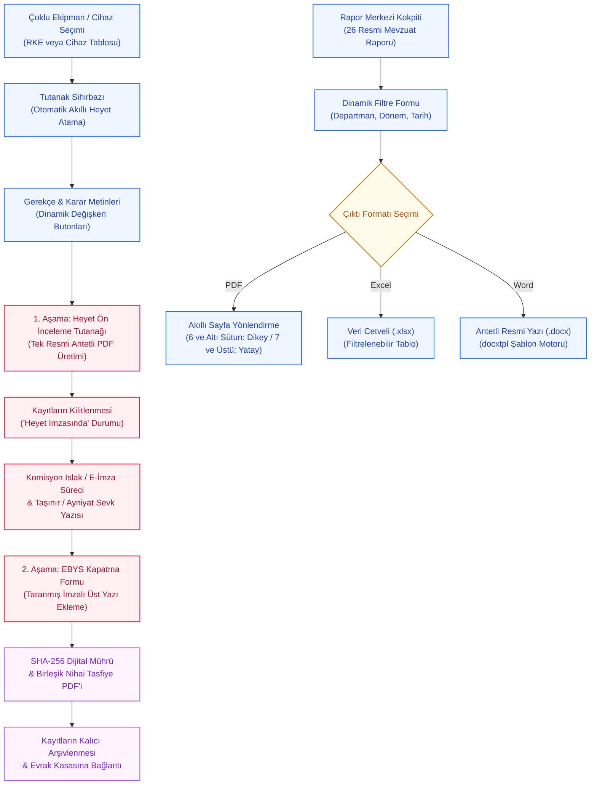

---json
{
  "pageTitle": "23. Merkezi Rapor ve Matbu Tutanak Çıktı Merkezi — RADPYS v4 Kullanım Kılavuzu",
  "h1": "23. Raporlama ve Tutanak Yönetim Merkezi",
  "lead": "Çoklu koruyucu ekipman ve cihazlar için tek resmi tutanakta heyet kararı oluşturun; iki aşamalı yasal tasfiye döngüsüyle EBYS kapatması yapıp SHA-256 ile mühürleyin. Kurumsal 26 resmi mevzuat raporunu \"Doğru İşe Tek Format\" standardıyla (tablolar için Excel, resmi tutanaklar için kilitli PDF, yönetmelik taslakları için Word) tek tıkla üretin.",
  "overviewId": "overview",
  "badges": [],
  "readingTime": "6 Dakika"
}
---

## Vizyonder Hızlı Karar Reçetesi & Önemli Metrikler {#hizli-recete}

:::recipe Vizyonder Hızlı Karar Reçetesi & Önemli Metrikler | 20 SANİYELİK AKIŞ
### İstenen Sonuç: | cyan
Birden fazla ekipman veya cihaz için tek resmi tutanak almak, iki aşamalı mühürleme ile yasal HEK tasfiye sürecini tamamlamak ve kurumsal 26 resmi sistem raporunu antetli üretmek.

### Yapılacak İşlem: | emerald
Envanter tablosunda kayıtları seçip <strong>[HEK Tutanağı]</strong> butonuna basın; gerekçeleri düzenleyip <strong>[Tutanak Oluştur / Yazdır]</strong> ile tek resmi PDF üretin; imzalar sonrası EBYS kapatma formundan üst yazıyı ekleyin.

### Sistem Etkisi: | blue
İlk aşamada ekipmanlar silinmez, "Heyet İmzasında" durumuna alınır; EBYS kapatması yapıldığında SHA-256 dijital mührüyle nihai birleşik tasfiye PDF'i üretilir ve kayıtlar kalıcı kilitlenir.
:::

## 5N1K Kural ve Ayar Çözümleme Tablosu {#5n1k-tablosu}

 RAPOR-TUTANAK-RULE-MATRIX
 

| NE (İşlem / Alan) | NEDEN (Gerekçe) | NEREDE (Arayüz Yolu) | NASIL (Yöntem) | NE ZAMAN (Zamanlama) | KİM (Rol / Yetki) | DURUM (Sistem Tepkisi) |
| --- | --- | --- | --- | --- | --- | --- |
| Resmi Rapor Üretimi | SKS 6.1 ve NDK denetimleri veya kurum içi analizler için resmi belge almak | Rapor Merkezi → Raporlar Sekmesi | Rapor Seç → Filtrele → "Rapor Oluştur ve Aç" | Periyodik denetim veya yönetim taleplerinde | Raporlar Okuma Yetkilisi | Resmi PDF veya analitik Excel formatında diskte üretilir ve sistemde açılır |
| Şablon ve Marka Ayarı | Kurum başlıklarını ve resmi çift logoyu antetli belgelere giydirmek | Rapor Merkezi → Şablon Ayarları | Logo Seç → Başlık Gir → Antetli Şablonu Güncelle | Kurum logosu veya başlığı değiştiğinde | Sistem Yöneticisi / Admin | Tüm kurumsal antetli raporlara otomatik yansır |
| Tutanak ve Heyet Kararı Oluşturma | Çoklu kayıt (örn: 20 RKE veya cihaz) için tek bir resmi evrakta gerekçe, döküm tablosu, karar ve imza heyeti oluşturmak | Sol Menü → [Tutanak Sihirbazı] VEYA Modül Araç Çubuğu → [HEK Tutanağı] / [Tutanak Oluştur] | Kayıtları Seç → Sihirbazı Aç → Giriş/Sonuç Metinlerini Düzenle → [Tutanak Oluştur / Yazdır] (Resmi PDF) | HEK, devir, imha veya komisyon kararı alınacağı an | Komisyon Başkanı / Birim Yetkilisi | Tek resmi kilitli PDF üretilir; keyfi değişiklikleri önlemek için Word çıktısı tamamen kaldırılmıştır |
| İki Aşamalı HEK & Kalıcı Mühürleme | Heyet ıslak imzası ve resmi Ayniyat EBYS yazısı olmadan kayıtların erken kayıttan düşmesini engellemek | Cihaz / RKE Yönetimi → [HEK Tutanağı] ve HEK Yönetimi → [EBYS ile Kapat] | 1. Aşamada Heyet Ön İnceleme Tutanağı üretilir; 2. Aşamada imzalı taranmış üst yazı eklenip SHA-256 ile mühürlenir | Ekipman heyete sevk edildiğinde ve Ayniyat devri bittiğinde | Muayene Heyeti / Birim Amiri / Taşınır Yetkilisi | Ekipmanlar önce 'Heyet İmzasında' kalır; kapatılınca birleşik mühürlü PDF oluşur ve kalıcı kilitlenir |
| Şablon Tasarım ve Klonlama Stüdyosu | Kurumun kendine özgü rapor, çizelge veya tutanak formatlarını sıfırdan tasarlamak veya mevcutları uyarlamak | Rapor Merkezi → [Yeni Tasarla] VEYA [Özelleştir] | Veri Kaynağı Seç → Kolonları ve Başlıkları Belirle → Sayfa Yönü / Format Ata → Kaydet | Yeni bir resmi form veya denetim şablonu gerektiğinde | Sistem Yöneticisi / Admin | Şablon kataloğuna anında eklenir; ilgili modül dışa aktar menülerinde canlı görünür |
| Tıklanabilir Değişken Butonları | Tutanak metinlerine tarih, kurum adı, departman veya kayıt sayısını tek tıkla hatasız eklemek | Tutanak Sihirbazı / Şablon Tasarım → Metin Kutuları Altındaki [+ {{ ... }}] Butonları | Metin kutusunda imleci yerleştir → İlgili değişken butonuna tıkla | Tutanak gerekçesi veya karar metni yazılırken | Tüm Kullanıcılar | İmlecin bulunduğu yere etiket eklenir; tutanak çıktısında gerçek değerlerle çözümlenir |
| Akıllı Kriter Çerçevesi Yönetimi | Parametresi veya filtre kriteri bulunmayan raporlarda ekranda içi boş bir kutu kalmasını önlemek | Rapor Merkezi Kokpiti → [Rapor Kriterleri ve Filtreleri] Kutusu | Sistem tarafından otomatik yönetilir (Kriter varsa açılır, yoksa gizlenir) | Listeden bir rapor veya tutanak seçildiği an | Sistem Otomasyonu | Gereksiz boş kutu ekrandan kaybolur; tablo ve butonlar ferah bir şekilde yukarı kayar |
| Çoklu Sütun Sayfa Yönlendirme Adaptasyonu | Çok sütunlu geniş tablolarda metinlerin sıkışmasını veya sayfa kenarından taşmasını önlemek | PDF Çıktı Motoru (Otomatik Sistem Kuralı) | Sütun sayısı ≤ 6 ise Dikey A4, > 6 ise otomatik Yatay A4 olarak dökülür | Herhangi bir tablonun veya raporun PDF dökümü alındığında | Sistem Otomasyonu | Geniş tablolarda yatay yönlendirme sayesinde tüm sütunlar kusursuz okunur |
| NDK RKP Başvuru Dosyası | NDK RSGD-KLV-014 ve KLV-014-EK mevzuatına uygun resmi başvuru dosyasını üretmek | Kalite / Cihaz Modülü → NDK RKP Sihirbazı | 8 Adımlı Sihirbaz → Verileri Doğrula → "Resmi Word / PDF İndir" | İlk lisans başvurusu, lisans vize yenileme veya denetim süreçlerinde | RKS / Kurum Amiri | Resmi yatay mizanpajlı Word ve PDF üretilir; KVKK Evrak Kasasına tek tıkla şifrelenir |

## Mit Avcısı: Rapor ve Tutanaklarda Yanlış Bilinen Doğrular {#mit-avcilari}

 RAPOR-MYTH-BUSTER
 

 

 

 

 <svg class="w-4 h-4 shrink-0" fill="none" stroke="currentColor" viewBox="0 0 24 24"><path stroke-linecap="round" stroke-linejoin="round" stroke-width="2" d="M6 18L18 6M6 6l12 12"/></svg>
 YANLIŞ (Mit):
 

 

 "Tutanak Sihirbazı'nda oluşturduğum resmi tutanağı Word (.docx) olarak indirip üzerinde istediğim değişiklikleri yapabilirim."
 

 

 <svg class="w-4 h-4 shrink-0" fill="none" stroke="currentColor" viewBox="0 0 24 24"><path stroke-linecap="round" stroke-linejoin="round" stroke-width="2" d="M5 13l4 4L19 7"/></svg>
 DOĞRU (Mevzuat Standardı):
 

 

 Tutanaklar hukuki bağlayıcılığı olan heyet kararlarıdır. Keyfi tahrifat ve yetkisiz değişiklikleri önlemek amacıyla Word indirme seçeneği sistemden tamamen silinmiş olup tek resmi standart kilitli PDF çıktısıdır.
 

 

 

 

 <svg class="w-4 h-4 shrink-0" fill="none" stroke="currentColor" viewBox="0 0 24 24"><path stroke-linecap="round" stroke-linejoin="round" stroke-width="2" d="M6 18L18 6M6 6l12 12"/></svg>
 YANLIŞ (Mit):
 

 

 "HEK tutanağı aldığım an ekipmanlar doğrudan envanterden silinir ve hurdaya ayrılmış olur."
 

 

 <svg class="w-4 h-4 shrink-0" fill="none" stroke="currentColor" viewBox="0 0 24 24"><path stroke-linecap="round" stroke-linejoin="round" stroke-width="2" d="M5 13l4 4L19 7"/></svg>
 DOĞRU (Mevzuat Standardı):
 

 

 İki Aşamalı Yasal Tasfiye Kuralı gereğince ilk aşamada ekipmanlar silinmez, "Heyet İmzasında" durumuna alınır. Heyetin ıslak imzalı tutanağı ve Taşınır/EBYS resmi yazısı taranıp yüklenmeden hiçbir ekipman kayıttan düşülmez.
 

 

 

 

 <svg class="w-4 h-4 shrink-0" fill="none" stroke="currentColor" viewBox="0 0 24 24"><path stroke-linecap="round" stroke-linejoin="round" stroke-width="2" d="M6 18L18 6M6 6l12 12"/></svg>
 YANLIŞ (Mit):
 

 

 "Kurum ayarlarında çift logo tanımlı değilse Word ve PDF raporları hata verip kilitlenir."
 

 

 <svg class="w-4 h-4 shrink-0" fill="none" stroke="currentColor" viewBox="0 0 24 24"><path stroke-linecap="round" stroke-linejoin="round" stroke-width="2" d="M5 13l4 4L19 7"/></svg>
 DOĞRU (Mevzuat Standardı):
 

 

 Rapor motoru kurumda tek logo yüklüyse sadece mevcut logoyu basar; hiç logo tanımlanmamışsa şablon logoları atlayarak dürüst kurumsal varsayılan olan RADPYS antetini kullanır ve hatasız döküm üretir.
 

 

 

 

 <svg class="w-4 h-4 shrink-0" fill="none" stroke="currentColor" viewBox="0 0 24 24"><path stroke-linecap="round" stroke-linejoin="round" stroke-width="2" d="M6 18L18 6M6 6l12 12"/></svg>
 YANLIŞ (Mit):
 

 

 "Resmi antetli Word ve PDF raporlarını Web Portal üzerinden de oluşturabilirim."
 

 

 <svg class="w-4 h-4 shrink-0" fill="none" stroke="currentColor" viewBox="0 0 24 24"><path stroke-linecap="round" stroke-linejoin="round" stroke-width="2" d="M5 13l4 4L19 7"/></svg>
 DOĞRU (Mevzuat Standardı):
 

 

 Antetli matbu Word (.docx), PDF ve Excel rapor merkezi yalnızca Masaüstü İstemcisi üzerinde çalışır. Web portalda ise personelin bireysel başvuru ekranları ve etkileşimli canlı analiz panoları yer alır.
 

 

 

## Raporlama ve Tutanak Yaşam Döngüsü Süreç Akışı {#surec-akisi}

 RAPOR-TUTANAK-WORKFLOW
 

 

 

## Kurumsal Rapor Merkezi: Resmi Mevzuat Kataloğu & Üretim Motoru {#rapor-merkezi}

 REPORT-CATALOG-SSOT
 

 

 Rapor Merkezi, sistem genelindeki tüm klinik, dozimetre, nöbet, personel ve kalite verilerini Sağlık Bakanlığı SKS 6.1 ve NDK standartlarında resmi antetli dökümlere dönüştürür.
 

 

 

 Dozimetre & Sağlık Takip Raporları
 <ul class="space-y-1.5 text-slate-600 dark:text-slate-300">
 <li>• <strong>SKS SRG11.02 Kümülatif Doz Raporu:</strong> Yıllık doz sınırları, %80 eşik yaklaşım uyarıları ve denetim dökümü.</li>
 <li>• <strong>SKS SRG11.04 Gebe Personel Doz Raporu:</strong> Hamilelik süresince kümülatif doz ve çalışma alanı uyum cetveli.</li>
 <li>• <strong>DOZ-06 Resmi NDK Doz Aşımı Formu:</strong> İnceleme düzeyini aşan vakalarda NDK'ya sunulan resmi araştırma raporu.</li>
 <li>• <strong>Periyodik Sağlık Muayenesi Uyum Raporu:</strong> 6331 sayılı İSG Kanunu'na göre geciken ve yaklaşan muayeneler.</li>
 </ul>
 

 

 Nöbet, İzin & SGK Fiili Hizmet Raporları
 <ul class="space-y-1.5 text-slate-600 dark:text-slate-300">
 <li>• <strong>Fiili Hizmet ve Şua Hakediş Raporu (FHZ):</strong> SGK yıpranma payı ve radyasyonlu alanda net çalışma cetveli.</li>
 <li>• <strong>Nöbet Fazla Mesai Bildirim Cetveli:</strong> Mutemetlik birimine iletilen resmi normal ve bayram fazla mesai icmali.</li>
 <li>• <strong>Personel İzin Bakiye Cetveli:</strong> Yıllık izin, şua izni ve mazeret izinlerinin güncel devir ve hakediş özeti.</li>
 <li>• <strong>Nöbet Hakediş ve Çalışma Raporu:</strong> Gece/hafta sonu çarpanları ile nöbet saatleri icmali.</li>
 </ul>
 

 

 Cihaz, RKE & Kalite Güvence Raporları
 <ul class="space-y-1.5 text-slate-600 dark:text-slate-300">
 <li>• <strong>Cihaz Lisans & Kalibrasyon Raporu:</strong> NDK lisans bitiş süreleri ve periyodik kalite kontrol (QC) durumları.</li>
 <li>• <strong>SKS SRG12.01 RKE Muayene Çizelgesi:</strong> Kurşun önlük, tiroid ve gözlüklerin DIN 6857 skopi muayene sonuçları.</li>
 <li>• <strong>SKS Ortam Dozu İzleme Raporu:</strong> Denetimli/gözetimli alan radyasyon arka plan ölçümleri ve sınır aşımları.</li>
 <li>• <strong>SKS SRG13.02 Olay Bildirim Trend Analizi:</strong> İstenmeyen güvenlik olayları, kazalar ve DÖF takibi.</li>
 </ul>
 

 

 Özlük, Eğitim & Lokasyon Dağılım Raporları
 <ul class="space-y-1.5 text-slate-600 dark:text-slate-300">
 <li>• <strong>Personel Listesi & Künye Raporu:</strong> Departman, unvan ve hizmet sınıfına göre filtrelenmiş aktif personel dökümü.</li>
 <li>• <strong>Eğitim & Sınav Tamamlama Raporu:</strong> Zorunlu radyasyon güvenliği eğitim ve online sınav başarı tablosu.</li>
 <li>• <strong>Personel Kimlik ve Acil İletişim Rehberi:</strong> Kurum içi iletişim ve acil durum irtibat listesi.</li>
 <li>• <strong>Fiziksel Konum Dağılım Raporu:</strong> Bina, kat ve oda bazında kurulu cihaz ve personel yerleşimi.</li>
 </ul>
 

 

## Çıktı Formatları ve "Doğru İşe Tek Format" Standardı {#sablon-ve-marka}

 DOCXTPL-BRANDING
 

 

 Sistem genelindeki çoklu ve mükerrer dışa aktarma karmaşasını önlemek amacıyla RADPYS V4.0.5.0 sürümüyle <strong>"Doğru İşe Tek Format"</strong> standardı hayata geçirilmiştir. Kullanıcının gereksiz dosya biçimi seçimiyle vakit kaybetmesi engellenmiş, her iş türü için en uygun ve resmi standart format belirlenmiştir:
 

 

 

 

 <svg class="w-4 h-4" fill="none" stroke="currentColor" viewBox="0 0 24 24"><path stroke-linecap="round" stroke-linejoin="round" stroke-width="2" d="M9 17v-2m3 2v-4m3 4v-6m2 10H7a2 2 0 01-2-2V5a2 2 0 012-2h5.586a1 1 0 01.707.293l5.414 5.414a1 1 0 01.293.707V19a2 2 0 01-2 2z"/></svg>
 1. Operasyonel Tablolar: Excel (.xlsx)
 

 

 Cihaz Envanteri, RKE Donanım Listesi, Dozimetre Takip Dökümleri, İzin Bakiyeleri, Nöbet Çizelgeleri, FHZ Cetvelleri ve Olay Listeleri doğrudan filtrelenebilir kurumsal Excel formatında dökülür.
 

 

 

 

 <svg class="w-4 h-4" fill="none" stroke="currentColor" viewBox="0 0 24 24"><path stroke-linecap="round" stroke-linejoin="round" stroke-width="2" d="M7 21h10a2 2 0 002-2V9.414a1 1 0 00-.293-.707l-5.414-5.414A1 1 0 0012.586 3H7a2 2 0 00-2 2v14a2 2 0 002 2z"/></svg>
 2. Kanuni Tutanaklar: Kilitli PDF (.pdf)
 

 

 RD.F43 Doz Araştırma Formu, EK-1 Sağlık Muayene Belgesi, SKS Olay Bildirim Tutanağı, DIN 6857 RKE Muayene Tutanağı ve HEK Heyet Kararları değiştirilemez, antetli ve mühürlü PDF formatında üretilir.
 

 

 

 

 <svg class="w-4 h-4" fill="none" stroke="currentColor" viewBox="0 0 24 24"><path stroke-linecap="round" stroke-linejoin="round" stroke-width="2" d="M9 12h6m-6 4h6m2 5H7a2 2 0 01-2-2V5a2 2 0 012-2h5.586a1 1 0 01.707.293l5.414 5.414a1 1 0 01.293.707V19a2 2 0 01-2 2z"/></svg>
 3. Mevzuat Kılavuz Taslağı: Word (.docx)
 

 

 Yalnızca NDK KLV-014 Radyasyondan Korunma Programı (RKP) gibi kurumların kendi özel maddelerini ve klinik prosedürlerini serbestçe eklemesi gereken mevzuat kılavuz taslakları Word formatında sunulmaktadır.
 

 

 

 

 <h3 class="font-bold text-slate-900 dark:text-white">Şablon Tasarım ve Marka Ayarları:</h3>
 

 Rapor Merkezi'nin Şablon Ayarları sekmesi ve Şablon Tasarım pencereleri üzerinden kurum kimliği kolayca yönetilir:
 

 

 

 <strong>{{BASLIK_1}} / {{BASLIK_2}}:</strong> Kurum üst ve alt antet metinleri (Örn: T.C. Sağlık Bakanlığı / İl Sağlık Müdürlüğü).
 

 

 <strong>{{LOGO_1}} / {{LOGO_2}}:</strong> Resmi kurum amblemi ve hastane logosu resim dosyaları.
 

 

 

 * <strong>Sıfır Sentetik Kurum Standardı:</strong> Sistem ayarlarında henüz bir kurum adı tanımlanmamışsa şablonlarda veya PDF dökümlerinde asla sahte kamu/özel kurum adı yazılmaz; dürüst kurumsal varsayılan olarak <strong>RADPYS</strong> anteti otomatik çözümlenir.
 

 

## Evrensel Tutanak ve Komisyon Karar Sihirbazı & Şablon Tasarım Stüdyosu {#tutanak-ve-tasarim-studyosu}

 V4.2-TUTANAK-STUDIO
 

 

 RADPYS v4.2 ile birlikte sistemde yalnızca klasik satır-sütun tabloları değil; <strong>resmi metin içerikli tutanaklar (Nöbet Tutanağı, Cihaz Hasar/Arıza, Devir-Teslim, Zimmet, HEK/Hurda, Komisyon Kararı vb.)</strong> oluşturabilme altyapısı devreye alınmıştır. Örneğin 20 adet radyasyon koruyucu ekipman veya tıbbi cihaz için tek tek 20 sayfa evrak basıp kağıt ve zaman israfı yapmak yerine; <strong>Giriş Paragrafı (Toplanma Gerekçesi) + Döküm Tablosu (20 Kayıt) + Sonuç / Karar Paragrafı + Komisyon İmza Heyeti</strong> yapısı tek bir resmi belgede <strong>kilitli ve değiştirilemez tek resmi PDF standardında</strong> üretilir. Resmi heyet kararlarında sonradan tahrifat veya yetkisiz metin değişikliğini önlemek amacıyla Word çıktısı tamamen kaldırılmıştır.
 

 

 

 <h3 class="text-base font-bold text-slate-900 dark:text-white flex items-center gap-2">
 
 İkili Belge Düzeni: Salt Metin veya Sandviç Tablo
 </h3>
 <ul class="text-xs sm:text-sm text-slate-600 dark:text-slate-300 space-y-2">
 <li>• <strong>Salt Metin Tutanağı (Tablosuz / Hızlı):</strong> Nöbete gelmeme, idari uyarı veya genel komisyon kararları gibi döküm tablosu gerektirmeyen durumlarda kullanılır. Tablo alanı tamamen gizlenir; PDF çıktısında içi boş tablo veya gereksiz kutular kesinlikle basılmaz. Sadece Başlık + Gerekçe + Karar + Heyet İmzaları tertemiz dökülür.</li>
 <li>• <strong>Metin + Liste + Karar (Sandviç Düzen):</strong> HEK, toplu devir-teslim veya çoklu donanım muayenelerinde kullanılır. Giriş paragrafı, seçilen varlıkların döküm tablosu ve sonuç/karar metni kusursuz bir hiyerarşiyle birleşir.</li>
 <li>• <strong>Sistemden Kayıt Ekle:</strong> [Kayıt Ekle] menüsüyle sistem veritabanından doğrudan <em>Personel</em> veya <em>Cihaz / RKE Varlığı</em> seçilerek tabloya aktarılabilir.</li>
 <li>• <strong>Manuel Satır Ekle / Sil:</strong> Tabloya dilediğiniz sayıda serbest metinli manuel satır ekleyebilir, çift tıklayarak hücreleri anında düzenleyebilirsiniz.</li>
 <li>• <strong>Özel Şablon Olarak Kaydet:</strong> Hazırladığınız metin ve heyet yapısını [Şablon Olarak Kaydet] butonuyla kurum kataloğuna ekleyebilir, ileride tek tıkla yeniden kullanabilirsiniz.</li>
 </ul>
 

 

 <h3 class="text-base font-bold text-slate-900 dark:text-white flex items-center gap-2">
 
 İlgili Modül / Kapsam ve Dinamik Değişken Motoru
 </h3>
 

 Kullanıcıya zorla sabit metin kalıpları dayatılmaz. Kullanıcı yalnızca tutanağın ait olduğu <strong>İlgili Modül / Kapsam</strong>ı (Nöbet, Cihaz, RKE, Dozimetre, Sağlık vb.) seçer. Sistem seçilen modüle özel mantıklı değişken butonlarını anında metin kutularının altına dizer. Tıklanan değişken imlecin durduğu yere anında eklenir ve dökümde gerçek verilerle doldurulur:
 

 

 

 Nöbet Seçildiğinde:
 + &#123;&#123; nobet_tarihi &#125;&#125; / + &#123;&#123; vardiya &#125;&#125; / + &#123;&#123; saat &#125;&#125; / + &#123;&#123; personel_adi &#125;&#125; / + &#123;&#123; departman &#125;&#125;
 

 

 Cihaz Seçildiğinde:
 + &#123;&#123; cihaz_kodu &#125;&#125; / + &#123;&#123; cihaz_adi &#125;&#125; / + &#123;&#123; marka &#125;&#125; / + &#123;&#123; model &#125;&#125; / + &#123;&#123; seri_no &#125;&#125; / + &#123;&#123; servis_firmasi &#125;&#125;
 

 

 RKE Seçildiğinde:
 + &#123;&#123; ekipman_kodu &#125;&#125; / + &#123;&#123; tur_adi &#125;&#125; / + &#123;&#123; kursun_esdegeri &#125;&#125; / + &#123;&#123; muayene_tarihi &#125;&#125; / + &#123;&#123; adet &#125;&#125;
 

 

 Dozimetre Seçildiğinde:
 + &#123;&#123; personel_adi &#125;&#125; / + &#123;&#123; tc_kimlik &#125;&#125; / + &#123;&#123; dozimetre_no &#125;&#125; / + &#123;&#123; donem &#125;&#125; / + &#123;&#123; olcum_degeri &#125;&#125;
 

 

 

 

 

 

 <svg class="w-4 h-4 text-cyan-600 shrink-0" fill="none" stroke="currentColor" viewBox="0 0 24 24"><path stroke-linecap="round" stroke-linejoin="round" stroke-width="2" d="M3 7v10a2 2 0 002 2h14a2 2 0 002-2V9a2 2 0 00-2-2h-6l-2-2H5a2 2 0 00-2 2z"/></svg>
 Modül Bazlı Dinamik Çıktı Klasörleme ve Standart Dosya Adlandırma Motoru:
 

 

 Sistemdeki tüm Excel, Word ve PDF dökümleri Masaüstünde tek bir klasöre yığılmaz. Bunun yerine <strong>RADPYS Raporları / [İlgili Modül] /</strong> (Örn: <em>RADPYS Raporları/Dozimetre/</em>, <em>RADPYS Raporları/Tutanaklar ve Kalite/</em>) hiyerarşisinde güvenle gruplanır. Üretilen tüm dosyalar <code>[Modul]_[Islem_Adi]_[Kisi/Cihaz]_[YYYYMMDD_HHMMSS].[uzanti]</code> kurumsal standardına bağlanmıştır. Dosya adlarındaki Türkçe karakterler otomatik olarak güvenli ASCII formatına dönüştürülür.
 

 

 

 

 <svg class="w-4 h-4 text-rose-600 shrink-0" fill="none" stroke="currentColor" viewBox="0 0 24 24"><path stroke-linecap="round" stroke-linejoin="round" stroke-width="2" d="M12 15v2m-6 4h12a2 2 0 002-2v-6a2 2 0 00-2-2H6a2 2 0 00-2 2v6a2 2 0 002 2zm10-10V7a4 4 0 00-8 0v4h8z"/></svg>
 Yasal Güvenlik Standardı: İki Aşamalı HEK & Tasfiye Yaşam Döngüsü:
 

 

 

 1. Aşama: Heyet Ön İnceleme Tutanağı (Tutanak Sihirbazı)
 

 Tutanak Sihirbazı'nda ekipmanlar seçilip PDF alındığında işlem sıradan bir döküm olarak kalmaz; arka planda otomatik olarak <strong class="text-rose-600">HEK-YYYY-XXXX</strong> süreç dosyası açılır. Üretilen PDF'te sarı HEYET İMZASINDA & ÖN İNCELEME DOSYASI rozeti yer alır ve ekipmanlar koruma amaçlı kilitlenir. Bu aşamada henüz hiçbir ekipman kayıttan düşülmez.
 

 

 

 2. Aşama: EBYS Kapatma & SHA-256 Dijital Mühür
 

 Heyet üyeleri tutanağı ıslak imzaladıktan ve Taşınır/Ayniyat biriminden resmi EBYS üst yazısı alındıktan sonra, HEK yönetiminden <strong>[EBYS ile Kapat]</strong> butonuna tıklanır. İmzalı evrak taranıp sisteme yüklenir; sistem tüm muayene geçmişini, hasar krokilerini ve taranmış ekleri tek bir birleşik PDF'te dondurarak <strong>SHA-256 dijital mührüyle</strong> süreci kalıcı olarak tamamlar.
 

 

 

 

 

 

 <svg class="w-4 h-4 text-cyan-600 shrink-0" fill="none" stroke="currentColor" viewBox="0 0 24 24"><path stroke-linecap="round" stroke-linejoin="round" stroke-width="2" d="M13 16h-1v-4h-1m1-4h.01M21 12a9 9 0 11-18 0 9 9 0 0118 0z"/></svg>
 Tutanak Sihirbazına Hızlı Erişim Yolları & Akıllı Kriter Yönetimi:
 

 

 

 <strong class="block text-slate-900 dark:text-white mb-0.5">1. Sol Menü (Sidebar)</strong>
 Sistem & Yönetim menüsü altında [Tutanak Sihirbazı] veya [Resmi Tutanaklar] butonuna tıklayarak doğrudan genel sihirbazı başlatabilirsiniz.
 

 

 <strong class="block text-slate-900 dark:text-white mb-0.5">2. RKE Yönetimi Araç Çubuğu</strong>
 Tabloda birden fazla kurşun önlüğü seçip üstteki [HEK Tutanağı] butonuna bastığınızda seçili kayıtlar otomatik aktarılır.
 

 

 <strong class="block text-slate-900 dark:text-white mb-0.5">3. Cihaz Yönetimi Araç Çubuğu</strong>
 Envanter tablosunda cihazları seçip [Tutanak Oluştur] butonuna bastığınızda künye bilgileriyle resmi tutanak açılır.
 

 

 

 <strong>Akıllı Filtre Gizleme:</strong> Rapor Merkezi'nde seçilen raporun filtre/kriter parametresi bulunmuyorsa veya tutanak şablonu seçildiyse [Rapor Kriterleri ve Filtreleri] kutusu otomatik olarak gizlenir; gereksiz boşluklar ortadan kalkarak canlı önizleme doğrudan öne çıkar.
 

 

## Arayüz Rehberi & Ekran Görünümleri {#ekran-goruntuleri}

 UI-SCREENSHOTS
 

 

![Evrensel Tutanak ve Komisyon Karar Sihirbazı Ekran Görünümü | Koruyucu Ekipman (RKE) / Cihazlar > [HEK Tutanağı] | Tek Resmi PDF Standardı | rose](assets/img/21_tutanak_sihirbazi.png "<strong>Yasal Bilgilendirme:</strong> Bu görseldeki isimler, TCKN'ler ve kayıtlar tamamen test amaçlı sentetik veridir. Gerçek kişi ve kayıtlarla benzerlikler tesadüfidir.")

 

## Sıkça Sorulan Sorular (SSS) {#sss}

:::faq
### 1. 20 adet koruyucu ekipmanı tek bir resmi HEK tutanağında nasıl toplayabilirim?
RKE Yönetimi ekranında klavyeden Ctrl veya Shift tuşuna basılı tutarak tablodaki 20 ekipmanı seçin ve üst araç çubuğundaki [HEK Tutanağı] butonuna tıklayın. Açılan sihirbazda 20 ekipman doğrudan döküm tablosuna yerleştirilir; giriş ve karar gerekçelerini düzenleyip tek tıkla resmi, antetli ve imza çizgili tek PDF belgesi alabilirsiniz.

### 2. Tutanak Sihirbazı'nda neden Word (.docx) indirme seçeneği bulunmuyor?
Tutanaklar; komisyon üyelerinin ıslak/e-imzasıyla resmiyet kazanan hukuki vesikalardır. Word gibi üzerinde sonradan tahrifat veya yetkisiz değişiklik yapılabilen formatlar denetim güvenliğini ihlal eder. Bu sebeple Tutanak Sihirbazı'nda tek yasal çıktı standardı olarak değiştirilemez kilitli PDF dökümü uygulanmaktadır.

### 3. HEK tutanağı oluşturulan bir cihaz veya RKE neden doğrudan envanterden silinmez?
İki Aşamalı Yasal Tasfiye Kuralı gereğince: Tutanak ilk alındığında (1. Aşama) ekipmanlar "Heyet İmzasında" durumuna alınarak kilitlenir. Heyetin ıslak imzalı tutanağı ve Taşınır/EBYS resmi yazısı sisteme taranıp yüklenmeden (2. Aşama) hiçbir ekipman kayıttan düşülmez. EBYS kapatması yapıldığında ise SHA-256 dijital mührüyle tüm süreç kalıcı olarak dondurulur.

### 4. Tutanak metinlerindeki değişken etiketleri (+ &#123;&#123; tarih &#125;&#125;, + &#123;&#123; kurum_adi &#125;&#125;) nasıl çalışır?
Metin kutusunda imlecinizi eklemek istediğiniz yere getirin ve alttaki ilgili değişkene tıklayın. Sistem imlecin tam bulunduğu yere etiketi ekler. Belge üretilirken bu etiketler sistemdeki güncel kurum adı, o günün tarihi veya seçili toplam ekipman sayısı ile otomatik olarak doldurulur.

### 5. Heyet üyeleri nasıl belirlenir ve komisyona yeni üye nasıl eklenir?
Sistem unvan önceliğine göre aktif hekim, medikal fizikçi ve sorumlu teknisyeni otomatik olarak Komisyon Başkanı, RKS ve Raportör olarak atar. Farklı bir personel eklemek için [Üye Ekle] butonuna basarak personel seçimi yapabilir; komisyondan çıkarmak istediğiniz satırı seçip [Üye Sil] ile silebilirsiniz.

### 6. Üretilen rapor ve tutanak dosyaları bilgisayarda nerede saklanır?
Üretilen tüm resmi dökümler çalışma dizinindeki güvenli rapor klasörüne benzersiz bir dosya adı ile kaydedilir ve işlem bittiğinde sistemin varsayılan PDF, Word veya Excel görüntüleyicisi ile otomatik açılır. Ayrıca HEK dosyaları sistem evrak kasasında kalıcı olarak arşivlenir.

### 7. Çok sütunlu tablolarda PDF çıktısı dikey mi yoksa yatay mı dökülür?
Sistem otomatik sayfa adaptasyonuna sahiptir: Tablodaki sütun sayısı 6 ve daha az ise Dikey A4 (Portrait); 6'dan fazla sütun varsa sütunların sıkışmasını ve taşmasını önlemek amacıyla otomatik olarak Yatay A4 (Landscape) formatında çıktı üretilir.

### 8. Rapor kriterleri ve filtreleri kutusu neden bazı raporlarda görünmüyor?
Seçilen rapor veya tutanak herhangi bir filtreleme parametresi (örneğin sadece genel kurum dökümü) gerektirmiyorsa, arayüzde gereksiz boş kutu oluşmasını önlemek amacıyla [Rapor Kriterleri ve Filtreleri] çerçevesi otomatik gizlenir ve butonlar ferah bir biçimde öne çıkarılır.
:::
